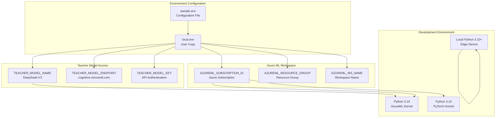
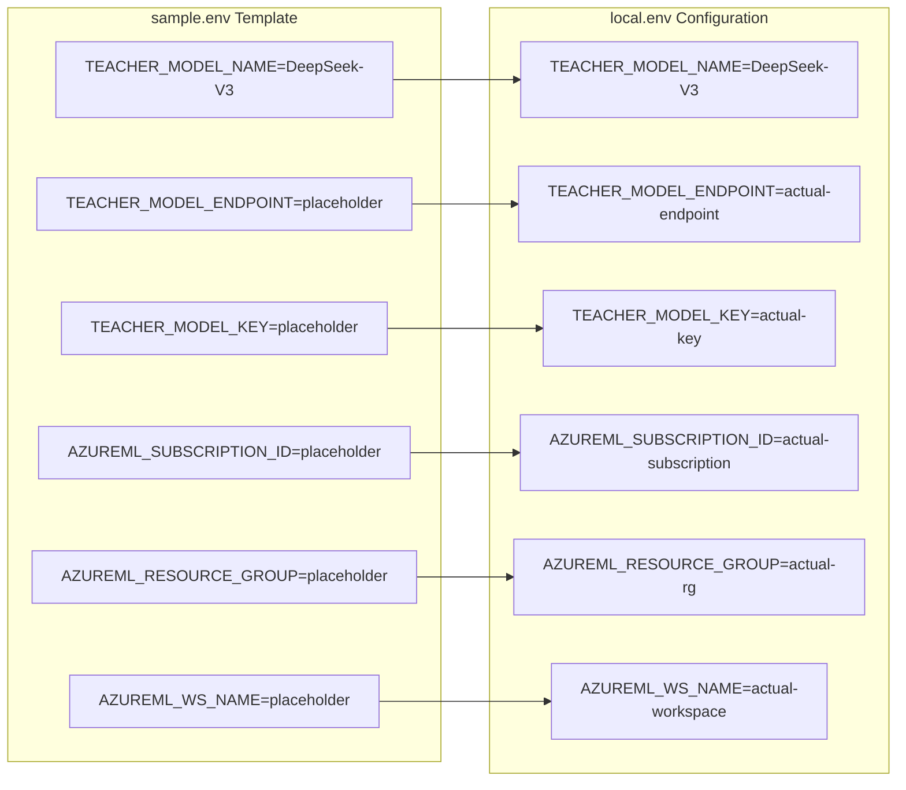
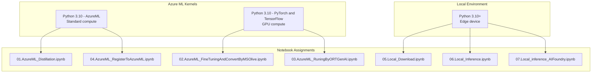
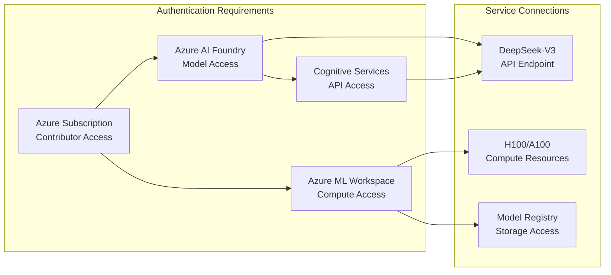
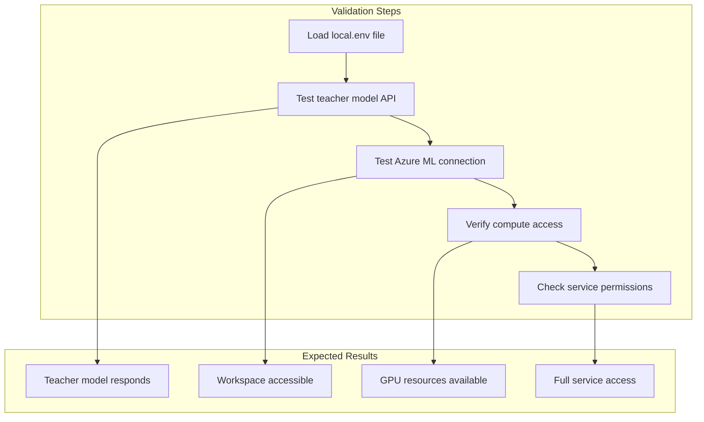

<!-- source: DeepWiki mcp.deepwiki.com · repo microsoft/Build25-LAB329 · extra page Environment Configuration · fetched 2026-10-26 -->

# Environment Configuration

Relevant source files

The following files were used as context for generating this wiki page:

- [.gitignore](.gitignore)
- [Lab329/Notebook/sample.env](Lab329/Notebook/sample.env)
- [Lab329/README.md](Lab329/README.md)
- [azure.yaml](azure.yaml)
- [infra/main.parameters.json](infra/main.parameters.json)

This document provides detailed instructions for configuring the required environment variables, authentication credentials, and development environment needed to execute the Model Distillation Workshop notebooks. The configuration establishes connections to Azure AI services, Azure Machine Learning workspace, and sets up the proper Python environments for each stage of the workflow.

For Azure infrastructure provisioning instructions, see [Azure Infrastructure Setup](#1.1.1). For the complete workshop workflow overview, see [Workshop Workflow](#1.2).

## Configuration Overview

The workshop requires configuration of two primary connection types: teacher model access through Azure AI Foundry and Azure Machine Learning workspace connectivity. These configurations enable the 7-step distillation pipeline to access cloud resources and manage model artifacts.

Sources: [Lab329/Notebook/sample.env:1-12](), [Lab329/README.md:87-98]()

## Environment File Setup

### Creating the Configuration File

The workshop uses environment variables stored in a configuration file to manage sensitive credentials and workspace identifiers. Create your configuration by copying the sample template:

| Configuration Step | Action | File Location |
|-------------------|--------|---------------|
| 1. Locate template | Find sample configuration | `Lab329/Notebook/sample.env` |
| 2. Create user copy | Copy to working directory | `Lab329/Notebook/local.env` |
| 3. Configure values | Replace placeholder values | Update all variables |
| 4. Secure file | Exclude from version control | Add to `.gitignore` |

The configuration file structure follows this format:

Sources: [Lab329/Notebook/sample.env:1-12](), [Lab329/README.md:87-98]()

### Teacher Model Configuration

Configure access to the DeepSeek-V3 teacher model deployed through Azure AI Foundry:

| Variable | Purpose | Source Location |
|----------|---------|-----------------|
| `TEACHER_MODEL_NAME` | Model identifier | Fixed as "DeepSeek-V3" |
| `TEACHER_MODEL_ENDPOINT` | API endpoint URL | Azure AI Foundry model overview |
| `TEACHER_MODEL_KEY` | Authentication key | Azure AI Foundry model overview |

The teacher model endpoint follows the pattern defined in the sample configuration: `https://westus3.api.cognitive.microsoft.com/models`.

Sources: [Lab329/Notebook/sample.env:1-4](), [azure.yaml:7-14]()

### Azure ML Workspace Configuration

Configure connectivity to your Azure Machine Learning workspace for model training and registration:

| Variable | Purpose | CLI Command |
|----------|---------|-------------|
| `AZUREML_SUBSCRIPTION_ID` | Azure subscription identifier | `az account show --query id --output tsv` |
| `AZUREML_RESOURCE_GROUP` | Resource group name | `az group list --query "[].name" --output tsv` |
| `AZUREML_WS_NAME` | ML workspace name | `az ml workspace list --query "[].name" --output tsv` |

Alternative configuration methods include downloading the `config.json` file from the Azure Portal resource group or using the Azure ML Studio interface.

Sources: [Lab329/Notebook/sample.env:5-12](), [infra/main.parameters.json:4-14]()

## Development Environment Setup

### Jupyter Kernel Configuration

The workshop notebooks require specific Python environments based on their computational requirements:

Sources: [Lab329/README.md:82-86]()

### Execution Environment Requirements

| Environment Type | Requirements | Purpose |
|-----------------|-------------|---------|
| Azure ML Standard | Python 3.10 AzureML kernel | Data generation and model registration |
| Azure ML GPU | Python 3.10 PyTorch kernel, A100 GPU | Model fine-tuning and optimization |
| Local Edge Device | Python 3.10+, sufficient resources | Model download and local inference |

The workshop requires access to H100 or A100 GPU resources for the fine-tuning steps, as specified in the computational requirements.

Sources: [Lab329/README.md:101-102]()

## Authentication and Permissions

### Azure Service Authentication

The workshop requires appropriate Azure permissions for the following services:

Sources: [Lab329/README.md:100](), [azure.yaml:4-15]()

### Credential Validation

Verify your configuration by testing the connection to each service:

| Service | Validation Method | Expected Response |
|---------|-------------------|-------------------|
| Teacher Model | API endpoint test | HTTP 200 with model metadata |
| Azure ML Workspace | Workspace list command | Workspace details |
| Subscription Access | Resource group list | Available resource groups |

Sources: [Lab329/Notebook/sample.env:6-9]()

## Configuration Validation

### Environment File Verification

Before executing the workshop notebooks, validate your configuration file contains all required variables with actual values (not placeholders):

| Variable Type | Validation Check | Correct Format |
|--------------|------------------|----------------|
| Model Name | Exact match | `DeepSeek-V3` |
| Endpoint URL | Valid HTTPS URL | `https://westus3.api.cognitive.microsoft.com/models` |
| API Key | Non-placeholder string | Alphanumeric key value |
| Subscription ID | Valid GUID format | 36-character UUID |
| Resource Group | Existing resource group | Matches Azure resource group name |
| Workspace Name | Existing ML workspace | Matches Azure ML workspace name |

### Connection Testing

Test each configured connection before proceeding with the workshop:

Sources: [Lab329/README.md:87-102]()

The environment configuration establishes the foundation for the complete model distillation workflow, enabling seamless execution of the 7-step process from data generation through edge deployment.

---

