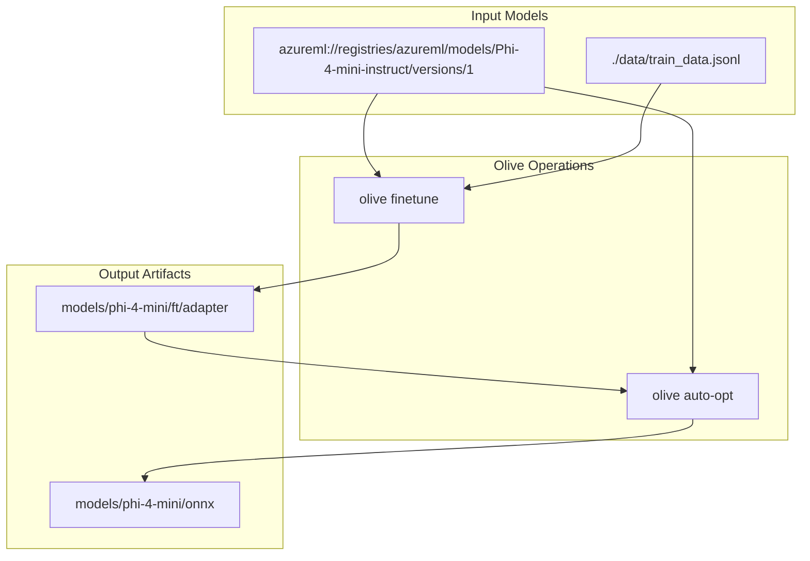
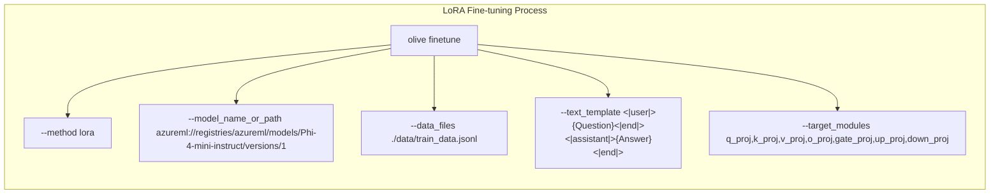
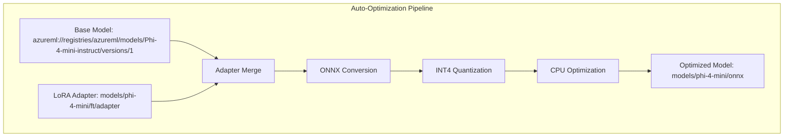
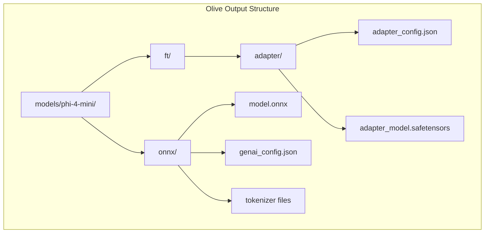

<!-- source: DeepWiki mcp.deepwiki.com · repo microsoft/Build25-LAB329 · extra page Microsoft Olive Framework · fetched 2026-10-26 -->

# Microsoft Olive Framework

Relevant source files

The following files were used as context for generating this wiki page:

- [Lab329/Notebook/02.AzureML_FineTuningAndConvertByMSOlive.ipynb](Lab329/Notebook/02.AzureML_FineTuningAndConvertByMSOlive.ipynb)

## Purpose and Scope

This document covers Microsoft Olive, an open-source model optimization toolkit used for fine-tuning, converting, and optimizing machine learning models in the Build25-LAB329 workshop. Olive serves as the primary engine for transforming the Phi-4-mini student model through LoRA fine-tuning and ONNX conversion with quantization.

For information about ONNX Runtime GenAI inference capabilities, see [ONNX Runtime GenAI](#1.3.2). For the complete fine-tuning workflow, see [Step 2: Fine-tuning and Optimization](#1.2.2).

## Overview

Microsoft Olive is a model optimization framework that provides automated workflows for fine-tuning, converting, and optimizing machine learning models for deployment. In the workshop, Olive performs two critical functions: applying LoRA fine-tuning to the Phi-4-mini model using teacher-generated data, and converting the resulting model to optimized ONNX format with int4 quantization.

Sources: [Lab329/Notebook/02.AzureML_FineTuningAndConvertByMSOlive.ipynb:374-385](), [Lab329/Notebook/02.AzureML_FineTuningAndConvertByMSOlive.ipynb:472-481]()

## Installation and Dependencies

Olive requires specific package versions and dependencies to function correctly in the workshop environment. The installation process includes PyTorch, ONNX Runtime GenAI, and various supporting libraries.

| Package | Version | Purpose |
|---------|---------|---------|
| `olive-ai[auto-opt]` | Latest | Core optimization framework |
| `torch` | CUDA 12.4 compatible | Deep learning backend |
| `onnxruntime-genai` | 0.7.1 | Generative AI inference |
| `onnxruntime` | 1.21.1 | ONNX model execution |
| `transformers` | 4.49.0 | Transformer model support |
| `peft` | Latest | Parameter-efficient fine-tuning |
| `bitsandbytes` | Latest | Quantization support |

The installation sequence ensures package compatibility and resolves potential conflicts between different runtime versions.

Sources: [Lab329/Notebook/02.AzureML_FineTuningAndConvertByMSOlive.ipynb:112-133](), [Lab329/Notebook/02.AzureML_FineTuningAndConvertByMSOlive.ipynb:166-189]()

## LoRA Fine-tuning with Olive

### Fine-tuning Command Structure

The `olive finetune` command applies Low-Rank Adaptation (LoRA) to the Phi-4-mini model using teacher-generated training data. LoRA adds small trainable matrices to specific model layers instead of updating all weights, making fine-tuning parameter-efficient.

Sources: [Lab329/Notebook/02.AzureML_FineTuningAndConvertByMSOlive.ipynb:374-385]()

### Target Modules and Architecture

The LoRA fine-tuning targets specific transformer layers within the Phi-4-mini architecture:

| Module Type | Purpose | LoRA Application |
|-------------|---------|-------------------|
| `q_proj` | Query projection | Low-rank adaptation |
| `k_proj` | Key projection | Low-rank adaptation |
| `v_proj` | Value projection | Low-rank adaptation |
| `o_proj` | Output projection | Low-rank adaptation |
| `gate_proj` | Gating mechanism | Low-rank adaptation |
| `up_proj` | Up-projection in FFN | Low-rank adaptation |
| `down_proj` | Down-projection in FFN | Low-rank adaptation |

These modules represent the attention and feed-forward network components where LoRA adapters capture task-specific knowledge without modifying the base model weights.

Sources: [Lab329/Notebook/02.AzureML_FineTuningAndConvertByMSOlive.ipynb:383]()

### Training Configuration

The fine-tuning process uses specific hyperparameters optimized for the workshop environment:

- **Max Steps**: 100 (reduced for workshop timing)
- **Data Format**: JSON with structured question-answer pairs
- **Text Template**: `<|user|>{Question}<|end|><|assistant|>{Answer}<|end|>`
- **Output Path**: `models/phi-4-mini/ft`
- **Trust Remote Code**: Enabled for model repository access

Sources: [Lab329/Notebook/02.AzureML_FineTuningAndConvertByMSOlive.ipynb:380-382]()

## Model Optimization and Quantization

### Auto-Optimization Workflow

The `olive auto-opt` command performs automated model optimization, combining LoRA adapter merging, ONNX conversion, and int4 quantization in a single operation.

Sources: [Lab329/Notebook/02.AzureML_FineTuningAndConvertByMSOlive.ipynb:472-481]()

### Optimization Parameters

The auto-optimization process uses specific configuration parameters:

| Parameter | Value | Impact |
|-----------|-------|---------|
| `--device` | cpu | Target CPU execution |
| `--provider` | CPUExecutionProvider | ONNX Runtime provider |
| `--precision` | int4 | 75% size reduction |
| `--use_model_builder` | Enabled | Optimized conversion |
| `--adapter_path` | models/phi-4-mini/ft/adapter | LoRA integration |
| `--output_path` | models/phi-4-mini/onnx | Final model location |

The int4 quantization reduces model size by approximately 75% compared to FP16 while maintaining inference accuracy suitable for edge deployment scenarios.

Sources: [Lab329/Notebook/02.AzureML_FineTuningAndConvertByMSOlive.ipynb:474-480]()

## File Structure and Outputs

### Directory Organization

Olive generates a structured output hierarchy for fine-tuned and optimized models:

Sources: [Lab329/Notebook/02.AzureML_FineTuningAndConvertByMSOlive.ipynb:382](), [Lab329/Notebook/02.AzureML_FineTuningAndConvertByMSOlive.ipynb:479]()

### Artifact Types

The optimization process produces several artifact types:

- **LoRA Adapter**: Parameter-efficient fine-tuning weights stored in `adapter/` directory
- **ONNX Model**: Optimized model file `model.onnx` for inference
- **GenAI Config**: Configuration file `genai_config.json` for ONNX Runtime GenAI
- **Tokenizer Files**: Vocabulary and tokenization configuration
- **Metadata**: Model configuration and optimization statistics

These artifacts enable deployment across different runtime environments while maintaining compatibility with ONNX Runtime GenAI for inference.

Sources: [Lab329/Notebook/02.AzureML_FineTuningAndConvertByMSOlive.ipynb:452-458]()

## Integration with Workshop Workflow

Olive integrates with the broader model distillation pipeline at two critical stages: consuming teacher-generated training data and producing optimized models for inference testing. The framework bridges the gap between raw transformer models and deployment-ready artifacts optimized for resource-constrained environments.

The integration points include:
- Input from Step 1 training data generation
- Output to Step 3 ONNX Runtime testing
- Model registration preparation for Step 4
- Foundation for local deployment in Steps 5-7

Sources: [Lab329/Notebook/02.AzureML_FineTuningAndConvertByMSOlive.ipynb:8-21]()

---

