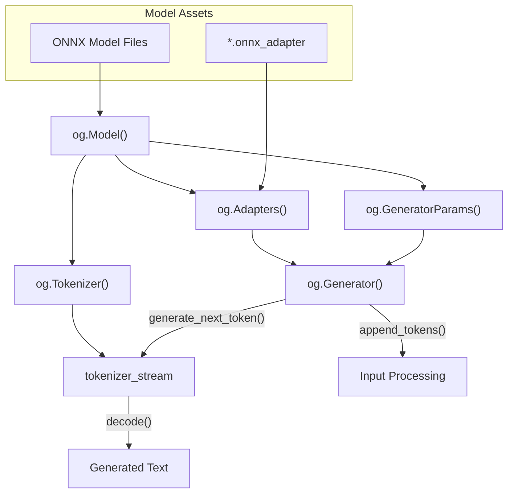
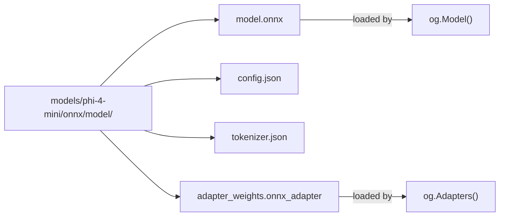
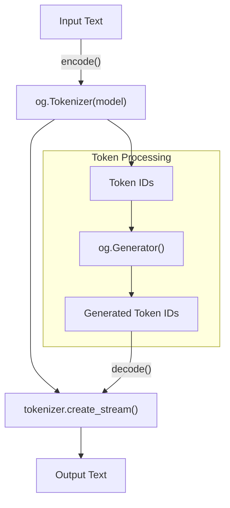
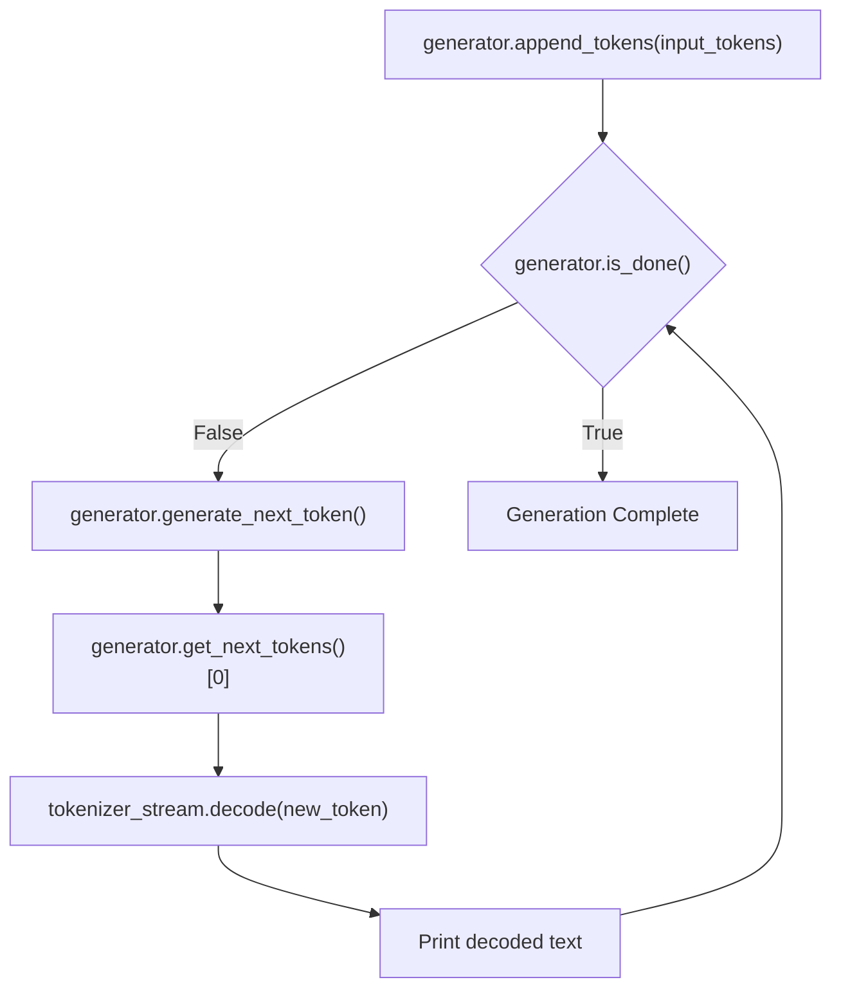
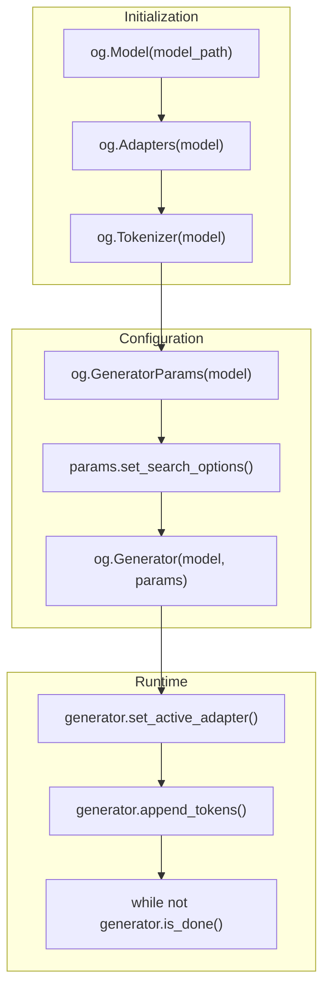

<!-- source: DeepWiki mcp.deepwiki.com · repo microsoft/Build25-LAB329 · extra page ONNX Runtime GenAI · fetched 2026-10-26 -->

# ONNX Runtime GenAI

<details>
<summary>Relevant source files</summary>

The following files were used as context for generating this wiki page:

- [Lab329/Notebook/03.AzureML_RuningByORTGenAI.ipynb](Lab329/Notebook/03.AzureML_RuningByORTGenAI.ipynb)
- [Lab329/Notebook/06.Local_Inference.ipynb](Lab329/Notebook/06.Local_Inference.ipynb)

</details>


This document covers ONNX Runtime GenAI (`onnxruntime_genai`), the specialized inference engine used for running optimized language models in the model distillation workshop. ONNX Runtime GenAI provides efficient inference capabilities for transformer-based models with support for LoRA adapters, quantization, and streaming generation.

For information about model optimization and ONNX conversion, see [Microsoft Olive Framework](#1.3.1). For deployment scenarios, see [Deployment Scenarios](#1.4).

## Core Architecture

ONNX Runtime GenAI provides a layered architecture for generative AI inference, with distinct components for model management, tokenization, and text generation.

### Component Overview



Sources: [Lab329/Notebook/03.AzureML_RuningByORTGenAI.ipynb:94-106](), [Lab329/Notebook/03.AzureML_RuningByORTGenAI.ipynb:175-189]()

### Runtime Dependencies

| Component | Package | Version | Purpose |
|-----------|---------|---------|---------|
| ONNX Runtime GenAI | `onnxruntime_genai` | 1.21.1+ | Core inference engine |
| ONNX Runtime | `onnxruntime` | 1.21.1 | Base runtime dependency |
| NumPy | `numpy` | Latest | Numerical operations |

Sources: [Lab329/Notebook/03.AzureML_RuningByORTGenAI.ipynb:64-75](), [Lab329/Notebook/06.Local_Inference.ipynb:76-94]()

## Model Loading and Management

### Model Initialization

The `og.Model()` class handles loading ONNX-optimized language models from a directory containing model files.

```python
model = og.Model(model_folder)
```

The model folder must contain:
- ONNX model weights
- Model configuration files  
- Tokenizer vocabulary files

Sources: [Lab329/Notebook/03.AzureML_RuningByORTGenAI.ipynb:146-157](), [Lab329/Notebook/03.AzureML_RuningByORTGenAI.ipynb:175-189]()

### Model File Structure



Sources: [Lab329/Notebook/03.AzureML_RuningByORTGenAI.ipynb:146-157](), [Lab329/Notebook/06.Local_Inference.ipynb:124-137]()

## Adapter Management

### LoRA Adapter Loading

The `og.Adapters()` class manages LoRA (Low-Rank Adaptation) adapters for fine-tuned model capabilities:

```python
adapters = og.Adapters(model)
adapters.load('./models/phi-4-mini/onnx/model/adapter_weights.onnx_adapter', "qa_choice")
```

### Adapter Activation

Adapters must be explicitly activated on the generator to apply fine-tuned weights:

```python
generator.set_active_adapter(adapters, "qa_choice")
```

Sources: [Lab329/Notebook/03.AzureML_RuningByORTGenAI.ipynb:207-221](), [Lab329/Notebook/03.AzureML_RuningByORTGenAI.ipynb:449-461]()

## Tokenization System

### Tokenizer Components



### Tokenization Workflow

1. **Encoding**: Convert input text to token IDs using `tokenizer.encode(prompt)`
2. **Streaming Setup**: Create stream decoder with `tokenizer.create_stream()`
3. **Decoding**: Convert generated tokens back to text with `tokenizer_stream.decode(token)`

Sources: [Lab329/Notebook/03.AzureML_RuningByORTGenAI.ipynb:236-250](), [Lab329/Notebook/03.AzureML_RuningByORTGenAI.ipynb:380-399]()

## Text Generation Engine

### Generator Configuration

The generation process requires configuring parameters and creating a generator instance:

```python
search_options = {
    'max_length': 120,
    'past_present_share_buffer': False
}

params = og.GeneratorParams(model)
params.set_search_options(**search_options)
generator = og.Generator(model, params)
```

### Generation Parameters

| Parameter | Type | Default | Description |
|-----------|------|---------|-------------|
| `max_length` | int | 102-200 | Maximum tokens to generate |
| `past_present_share_buffer` | bool | False | Memory buffer sharing |
| `repeat_penalty` | float | 1.1 | Repetition penalty factor |
| `temperature` | float | 0.7 | Sampling temperature |

Sources: [Lab329/Notebook/03.AzureML_RuningByORTGenAI.ipynb:268-282](), [Lab329/Notebook/06.Local_Inference.ipynb:232-243]()

### Streaming Generation Loop



The streaming generation pattern allows real-time text output:

```python
generator.append_tokens(input_tokens)

while not generator.is_done():
    generator.generate_next_token()
    new_token = generator.get_next_tokens()[0]
    print(tokenizer_stream.decode(new_token), end='', flush=True)
```

Sources: [Lab329/Notebook/03.AzureML_RuningByORTGenAI.ipynb:474-487](), [Lab329/Notebook/03.AzureML_RuningByORTGenAI.ipynb:511-527]()

## Chat Template System

### Template Formatting

ONNX Runtime GenAI uses structured chat templates to format conversations:

```python
chat_template = "<|system|>You are a helpful assistant. Your output should only be one of the five choices: 'A', 'B', 'C', 'D', or 'E'.<|end|><|user|>{input}<|end|><|assistant|>"
prompt = chat_template.format(input=input)
```

### Template Components

| Token | Purpose | Position |
|-------|---------|----------|
| `<|system|>` | System instructions | Beginning |
| `<|end|>` | Message separator | After each message |
| `<|user|>` | User message marker | Before user input |
| `<|assistant|>` | Assistant response marker | Before generation |

Sources: [Lab329/Notebook/03.AzureML_RuningByORTGenAI.ipynb:335-347](), [Lab329/Notebook/06.Local_Inference.ipynb:277-279]()

## Integration Patterns

### Complete Inference Pipeline



### Error Handling Patterns

Common error handling approaches in the codebase include:

1. **Model Loading Validation**: Check model path existence before loading
2. **Adapter Fallback**: Search for alternative adapter files if primary not found
3. **Generation Timeout**: Implement token generation limits to prevent infinite loops

Sources: [Lab329/Notebook/06.Local_Inference.ipynb:166-193](), [Lab329/Notebook/06.Local_Inference.ipynb:281-337]()

## Performance Considerations

### Memory Management

- Set `past_present_share_buffer: False` for stability with higher memory usage
- Configure appropriate `max_length` limits to control memory allocation
- Use streaming generation to minimize memory peaks

### Optimization Features

- **Int4 Quantization**: Supported through ONNX model optimization
- **Adapter Swapping**: Multiple adapters can be loaded and activated dynamically
- **Token Streaming**: Real-time generation reduces perceived latency

Sources: [Lab329/Notebook/03.AzureML_RuningByORTGenAI.ipynb:268-282](), [Lab329/Notebook/06.Local_Inference.ipynb:232-243]()

---

