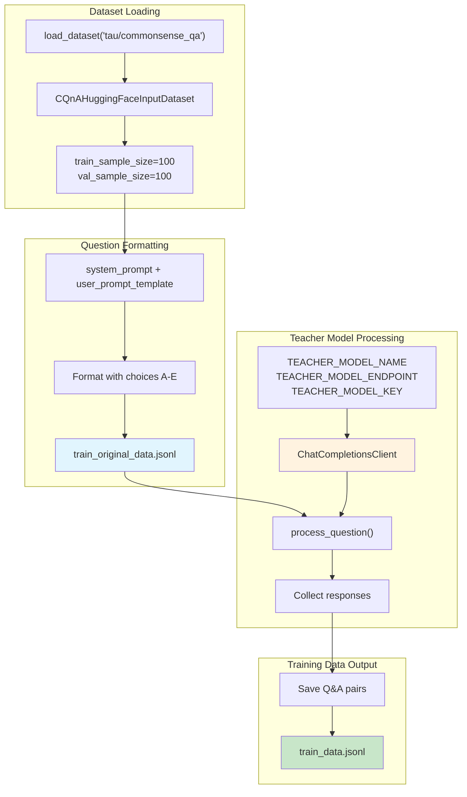
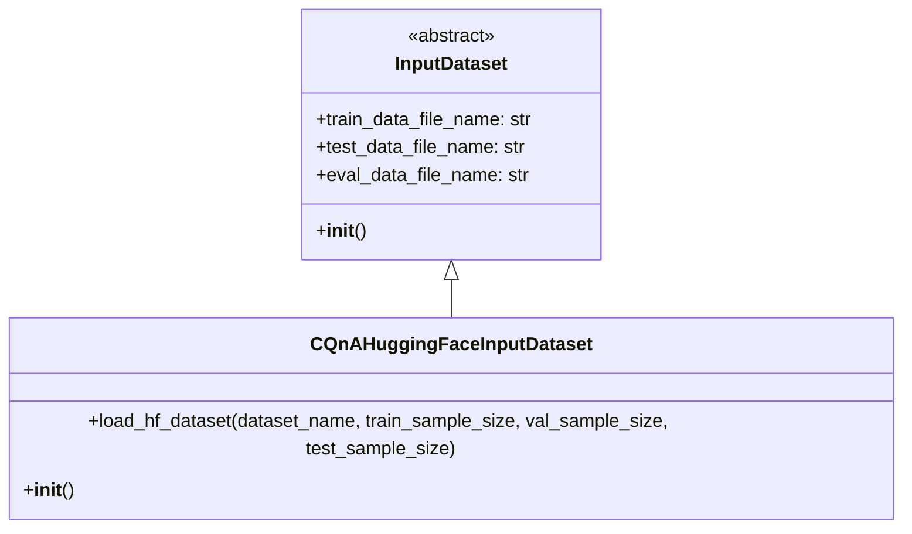
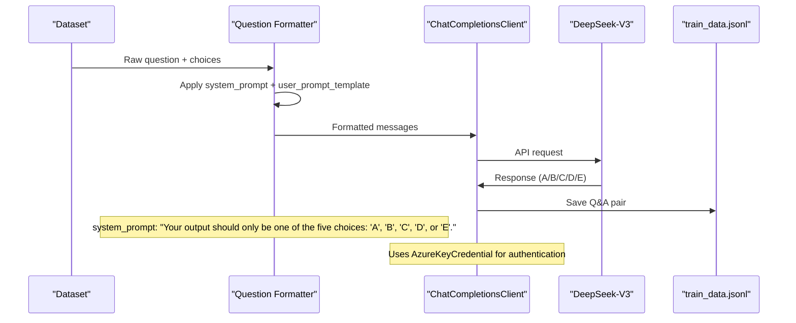
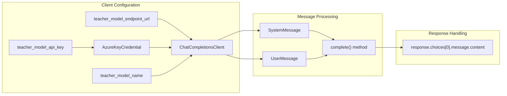
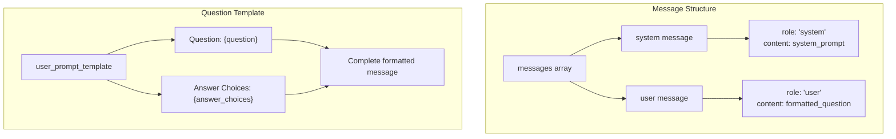
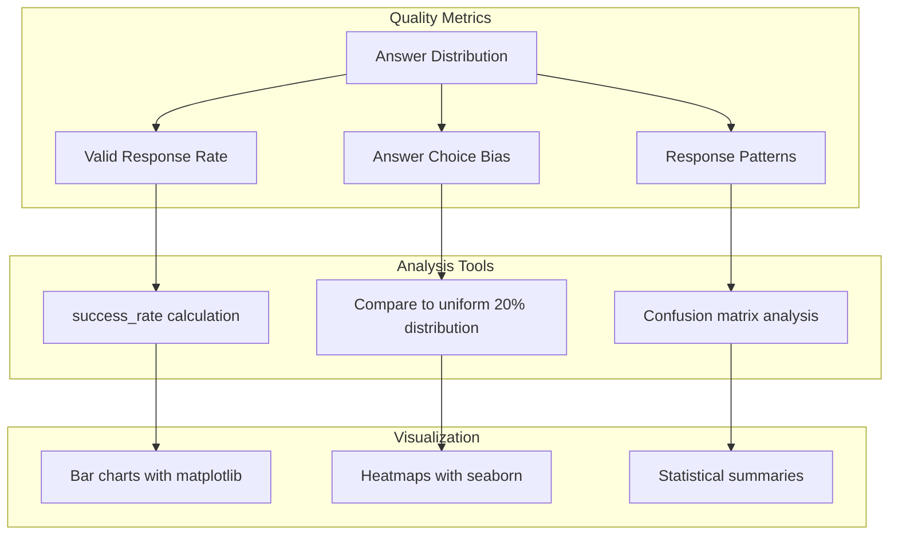

<!-- source: DeepWiki mcp.deepwiki.com · repo microsoft/Build25-LAB329 · extra page Step 1: Data Generation with Teacher Model · fetched 2026-10-26 -->

# Step 1: Data Generation with Teacher Model

<details>
<summary>Relevant source files</summary>

The following files were used as context for generating this wiki page:

- [Lab329/Notebook/01.AzureML_Distillation.ipynb](Lab329/Notebook/01.AzureML_Distillation.ipynb)
- [lab_manual/Skillable_lab_manual1.md](lab_manual/Skillable_lab_manual1.md)

</details>


This document covers the first step in the model distillation pipeline: generating high-quality training data using a large teacher model. This step transforms raw CommonsenseQA questions into formatted training examples by collecting responses from DeepSeek-V3, creating the foundation for training a smaller student model.

For information about the complete model distillation workflow, see [Workshop Workflow](#1.2). For details about subsequent fine-tuning steps, see [Step 2: Fine-tuning and Optimization](#1.2.2).

## Purpose and Scope

The data generation step serves as the knowledge extraction phase in model distillation. It loads multiple-choice questions from the CommonsenseQA dataset, formats them appropriately for the teacher model, sends them to DeepSeek-V3 via Azure AI services, and collects the responses to create training data for the student model. The output is a structured JSONL file containing question-answer pairs that capture the teacher model's reasoning patterns.

## Data Generation Workflow

The following diagram illustrates the complete data generation pipeline:



**Data Generation Pipeline Overview**

Sources: [Lab329/Notebook/01.AzureML_Distillation.ipynb:1-1458]()

## Core Components

### Dataset Handler Classes

The data loading infrastructure uses an abstract base class pattern to handle different dataset sources:



**Dataset Handler Class Structure**

| Class | Purpose | Key Methods |
|-------|---------|-------------|
| `InputDataset` | Abstract base for dataset handlers | `__init__()` |
| `CQnAHuggingFaceInputDataset` | Loads CommonsenseQA from Hugging Face | `load_hf_dataset()` |

Sources: [Lab329/Notebook/01.AzureML_Distillation.ipynb:145-153](), [Lab329/Notebook/01.AzureML_Distillation.ipynb:188-223]()

### Question Processing Pipeline

The question processing involves formatting raw questions into the teacher model's expected input format and collecting responses:



**Question Processing Sequence**

Sources: [Lab329/Notebook/01.AzureML_Distillation.ipynb:403-404](), [Lab329/Notebook/01.AzureML_Distillation.ipynb:660-686](), [Lab329/Notebook/01.AzureML_Distillation.ipynb:715-718]()

## Configuration and Environment

### Required Environment Variables

The system requires three environment variables for teacher model access:

| Variable | Purpose | Source |
|----------|---------|--------|
| `TEACHER_MODEL_NAME` | Model identifier for DeepSeek-V3 | Environment or local.env |
| `TEACHER_MODEL_ENDPOINT` | Azure AI Foundry endpoint URL | Environment or local.env |
| `TEACHER_MODEL_KEY` | Authentication key for API access | Environment or local.env |

These variables are loaded using the `load_azd_env()` and `load_dotenv()` functions to support both Azure Developer CLI environments and local configuration files.

Sources: [Lab329/Notebook/01.AzureML_Distillation.ipynb:541-543](), [Lab329/Notebook/01.AzureML_Distillation.ipynb:504-508]()

### Azure AI Client Setup

The Azure AI client initialization creates the connection to the teacher model:



**Azure AI Client Architecture**

Sources: [Lab329/Notebook/01.AzureML_Distillation.ipynb:715-718](), [Lab329/Notebook/01.AzureML_Distillation.ipynb:618-621]()

## Data Flow and File Operations

### Input Data Processing

The system processes CommonsenseQA data through several transformation stages:

| Stage | Input | Output | File Path |
|-------|-------|--------|-----------|
| Dataset Loading | HuggingFace dataset | Python objects | - |
| Question Formatting | Raw questions | Formatted prompts | `./data/train_original_data.jsonl` |
| Teacher Processing | Formatted prompts | Model responses | - |
| Training Data Creation | Q&A pairs | Training dataset | `./data/train_data.jsonl` |

The `process_question()` function handles individual question processing with error handling:

```python
def process_question(question_data):
    # Convert JSON messages to Azure AI message objects
    # Send to teacher model via ChatCompletionsClient
    # Return structured response with question, answer, and metadata
```

Sources: [Lab329/Notebook/01.AzureML_Distillation.ipynb:330](), [Lab329/Notebook/01.AzureML_Distillation.ipynb:864](), [Lab329/Notebook/01.AzureML_Distillation.ipynb:660-686]()

### Question Format Structure

The system formats questions using a specific template structure:



**Question Message Format Structure**

Sources: [Lab329/Notebook/01.AzureML_Distillation.ipynb:403-404](), [Lab329/Notebook/01.AzureML_Distillation.ipynb:423-443]()

## Data Analysis and Quality Control

### Response Distribution Analysis

The system includes analysis capabilities to assess the quality of generated training data:



**Data Quality Analysis Pipeline**

The analysis includes several validation checks:

- **Success Rate**: Percentage of responses that are valid single letters (A-E)
- **Distribution Bias**: Comparison against expected uniform distribution
- **Response Patterns**: Analysis by question type and length

Sources: [Lab329/Notebook/01.AzureML_Distillation.ipynb:944-1005](), [Lab329/Notebook/01.AzureML_Distillation.ipynb:1042-1081]()

## Output Format

### Training Data Structure

The final training data is saved in JSONL format with a simplified structure:

```json
{
  "Question": "Answer the following multiple-choice question...",
  "Answer": "A"
}
```

Each line in `train_data.jsonl` represents one training example that will be used in the subsequent fine-tuning step. The file typically contains 100 question-answer pairs based on the default `train_sample_size` parameter.

Sources: [Lab329/Notebook/01.AzureML_Distillation.ipynb:876-879](), [Lab329/Notebook/01.AzureML_Distillation.ipynb:257-258]()

## Dependencies and Requirements

### Required Python Packages

| Package | Purpose | Installation |
|---------|---------|--------------|
| `dotenv-azd` | Environment variable loading | `pip install dotenv-azd` |
| `datasets` | HuggingFace dataset access | `pip install datasets tqdm -U` |
| `azure-ai-inference` | Azure AI service client | `pip install azure-ai-inference` |
| `matplotlib`, `seaborn` | Data visualization | `pip install matplotlib seaborn scikit-learn` |

### Azure Services

The step requires access to:
- Azure AI Foundry project with DeepSeek-V3 model deployment
- Valid API key and endpoint configuration
- Sufficient compute quota for model inference

Sources: [Lab329/Notebook/01.AzureML_Distillation.ipynb:56](), [Lab329/Notebook/01.AzureML_Distillation.ipynb:85](), [Lab329/Notebook/01.AzureML_Distillation.ipynb:580]()

## Next Steps

Upon completion of this step, the generated `train_data.jsonl` file serves as input for the next phase of the model distillation pipeline. The file contains high-quality question-answer pairs that capture the teacher model's reasoning patterns, ready for use in fine-tuning the student model.

For the next step in the workflow, see [Step 2: Fine-tuning and Optimization](#1.2.2).

---

