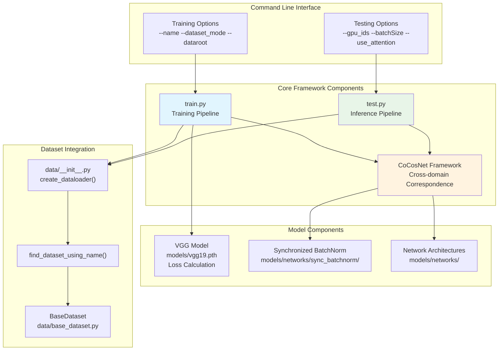
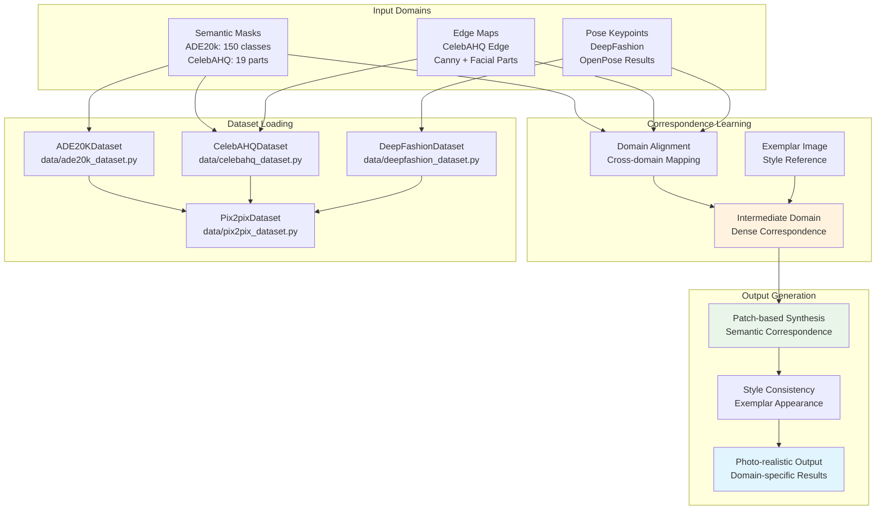

<!-- source: DeepWiki mcp.deepwiki.com · repo microsoft/CoCosNet · page 1 CoCosNet Overview · fetched 2026-10-26 -->

# CoCosNet Overview

Relevant source files

The following files were used as context for generating this wiki page:

- [.gitignore](.gitignore)
- [README.md](README.md)

## Purpose and Scope

This document provides an overview of the CoCosNet framework, a PyTorch implementation for cross-domain correspondence learning and exemplar-based image translation. CoCosNet enables synthesis of photo-realistic images from inputs in distinct domains (semantic segmentation masks, edge maps, pose keypoints) while maintaining style consistency with a provided exemplar image.

For detailed information about specific dataset implementations, see [Dataset Implementations](#3.2). For training and inference instructions, see [Getting Started](#2). For data format specifications, see [Data Formats and Organization](#4).

Sources: [README.md:1-11]()

## Framework Overview

CoCosNet is a general framework that jointly learns cross-domain correspondence and image translation in a weakly supervised manner. The core innovation lies in aligning images from distinct domains to an intermediate domain where dense correspondence is established, then synthesizing images based on semantically corresponding patches in the exemplar.

The framework supports multiple translation tasks:
- **Mask-to-image**: Semantic segmentation masks to realistic images (ADE20k, CelebAHQ)
- **Edge-to-face**: Edge maps to face images (CelebAHQ)  
- **Pose-to-image**: Human pose keypoints to person images (DeepFashion)

Sources: [README.md:10-11]()

## Core Training and Inference Architecture

Sources: [README.md:40-116]()

## Cross-Domain Correspondence Learning Pipeline

Sources: [README.md:10-11](), [data/base_dataset.py](), [data/pix2pix_dataset.py]()

## Supported Domains and Datasets

The framework supports four primary translation domains, each with specialized dataset implementations:

| Domain | Input Type | Output Type | Dataset Class | Key Features |
|--------|------------|-------------|---------------|--------------|
| **ADE20k** | Semantic masks (150 classes) | Scene images | `ADE20KDataset` | Scene parsing, object segmentation |
| **CelebAHQ (Mask)** | Facial part masks (19 parts) | Face images | `CelebAHQDataset` | Face generation, part-based control |
| **CelebAHQ (Edge)** | Edge maps | Face images | `CelebAHQEdgeDataset` | Edge-to-face translation |
| **DeepFashion** | Pose keypoints | Person images | `DeepFashionDataset` | Human pose transfer |

Each dataset implements domain-specific preprocessing, reference file management, and data augmentation strategies optimized for their respective translation tasks.

Sources: [README.md:42-116]()

## Key Technical Components

### Dynamic Dataset Loading
The framework uses a factory pattern for dynamic dataset instantiation through `find_dataset_using_name()` in [data/__init__.py](). This enables runtime selection of dataset implementations based on command-line arguments.

### Cross-Domain Training Options
Key training parameters include:
- `--use_attention`: Enables attention mechanisms for correspondence learning
- `--maskmix`: Applies mask mixing augmentation
- `--PONO` / `--PONO_C`: Positional normalization techniques
- `--warp_bilinear`: Bilinear warping for geometric consistency

### Model Architecture Features
- **Synchronized BatchNorm**: Cross-GPU normalization via `sync_batchnorm/`
- **VGG Perceptual Loss**: Pre-trained VGG19 model for feature matching
- **Patch-based Synthesis**: Dense correspondence-guided generation
- **Exemplar Style Transfer**: Appearance consistency with reference images

Sources: [README.md:40-116](), [models/networks/]()

## System Dependencies

The framework integrates several external components:

- **PyTorch**: Core deep learning framework
- **Synchronized-BatchNorm-PyTorch**: Multi-GPU batch normalization from [vacancy/Synchronized-BatchNorm-PyTorch](https://github.com/vacancy/Synchronized-BatchNorm-PyTorch)
- **VGG19**: Pre-trained perceptual loss model
- **OpenPose**: Human pose estimation for DeepFashion dataset

Installation requires cloning the synchronized batch normalization repository into `models/networks/` and downloading pre-trained models for both training and inference.

Sources: [README.md:28-38](), [README.md:75]()

---

