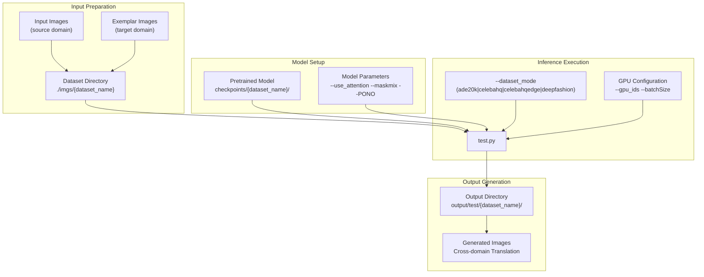
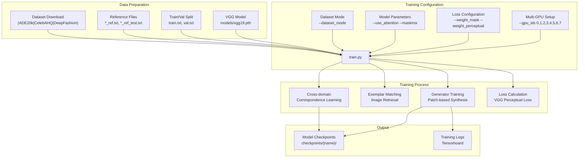
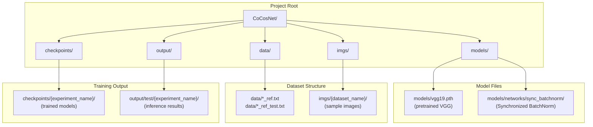

<!-- source: DeepWiki mcp.deepwiki.com · repo microsoft/CoCosNet · page 2 Getting Started · fetched 2026-10-26 -->

# Getting Started

<details>
<summary>Relevant source files</summary>

The following files were used as context for generating this wiki page:

- [README.md](README.md)

</details>


This document provides practical instructions for setting up, training, and running inference with CoCosNet models. It covers command-line usage, model downloads, dataset preparation, and the essential workflows for both inference and training across all supported datasets.

For detailed information about the dataset management system and how different datasets are integrated, see [Dataset Management System](#3). For understanding the overall framework architecture and cross-domain correspondence learning concepts, see [CoCosNet Overview](#1).

## Prerequisites and Installation

### System Requirements

CoCosNet requires PyTorch and several dependencies for cross-domain image translation. The framework supports multiple GPU training and inference.

### Installation Steps

1. **Clone Synchronized BatchNorm dependency**:
   ```bash
   cd models/networks/
   git clone https://github.com/vacancy/Synchronized-BatchNorm-PyTorch
   cp -rf Synchronized-BatchNorm-PyTorch/sync_batchnorm .
   cd ../../
   ```

2. **Install Python dependencies**:
   ```bash
   pip install -r requirements.txt
   ```

3. **Download pretrained VGG model** (required for training):
   Download from Google Drive and place in `models/` directory. This model is used by the loss calculation components.

**Sources:** [README.md:27-38]()

## Quick Start with Pretrained Models

The fastest way to get started is using pretrained models for inference. CoCosNet provides pretrained models for four different translation tasks.

### Inference Workflow



### Supported Translation Tasks

| Task | Dataset Mode | Input Domain | Output Domain | Model Download |
|------|--------------|--------------|---------------|----------------|
| Scene Translation | `ade20k` | Semantic masks | Scene images | [Google Drive](https://drive.google.com/drive/folders/1BEBBENbEr9tutZsyGGc3REUuuOYqf6M3) |
| Face Generation | `celebahq` | Face masks | Face images | [Google Drive](https://drive.google.com/drive/folders/16xgIrGzGBKJWbAUROM71wiA1cf7zrQk5) |
| Edge-to-Face | `celebahqedge` | Edge maps | Face images | [Google Drive](https://drive.google.com/drive/folders/1SCUrAPsEb6HOx8EtI89ED4wsOR8mrPDF) |
| Pose-to-Image | `deepfashion` | Pose keypoints | Fashion images | [Google Drive](https://drive.google.com/drive/folders/1vyzTdhQqY9ljsAx4u4xPvytX3wR75GYB) |

### Example Inference Commands

**ADE20k (mask-to-image)**:
```bash
python test.py --name ade20k --dataset_mode ade20k --dataroot ./imgs/ade20k \
    --gpu_ids 0 --nThreads 0 --batchSize 6 --use_attention --maskmix \
    --warp_mask_losstype direct --PONO --PONO_C
```

**CelebAHQ (mask-to-face)**:
```bash
python test.py --name celebahq --dataset_mode celebahq --dataroot ./imgs/celebahq \
    --gpu_ids 0 --nThreads 0 --batchSize 4 --use_attention --maskmix \
    --warp_mask_losstype direct --PONO --PONO_C --warp_bilinear --adaptor_kernel 4
```

**DeepFashion (pose-to-image)**:
```bash
python test.py --name deepfashion --dataset_mode deepfashion --dataroot ./imgs/DeepFashion \
    --gpu_ids 0 --nThreads 0 --batchSize 4 --use_attention --PONO --PONO_C \
    --warp_bilinear --no_flip --warp_patch --video_like --adaptor_kernel 4
```

**Sources:** [README.md:40-71]()

## Training Your Own Models

Training CoCosNet requires dataset preparation, reference file setup, and proper command-line configuration. The training process uses the correspondence learning framework with exemplar-based supervision.

### Training Pipeline



### Dataset-Specific Training Setup

**ADE20k Training**:
1. Download ADE20k dataset and organize annotations
2. Download `ade20k_ref.txt` and `ade20k_ref_test.txt` reference files
3. Run training command:
```bash
python train.py --name ade20k --dataset_mode ade20k --dataroot dataset_path \
    --niter 100 --niter_decay 100 --use_attention --maskmix \
    --warp_mask_losstype direct --weight_mask 100.0 --PONO --PONO_C \
    --batchSize 32 --vgg_normal_correct --gpu_ids 0,1,2,3,4,5,6,7
```

**CelebAHQ Training**:
1. Download CelebAHQ dataset and mask annotations
2. Download reference files: `celebahq_ref.txt`, `celebahq_ref_test.txt`
3. Download train/val split files: `train.txt`, `val.txt`
4. Run training command:
```bash
python train.py --name celebahq --dataset_mode celebahq --dataroot dataset_path \
    --niter 30 --niter_decay 30 --which_perceptual 4_2 --weight_perceptual 0.001 \
    --use_attention --maskmix --warp_mask_losstype direct --weight_mask 100.0 \
    --PONO --PONO_C --vgg_normal_correct --fm_ratio 1.0 --warp_bilinear \
    --warp_cycle_w 0.1 --batchSize 32 --gpu_ids 0,1,2,3,4,5,6,7
```

**Sources:** [README.md:73-116]()

## Command Line Interface Reference

### Core Parameters

The `train.py` and `test.py` scripts share a common parameter interface for dataset selection and model configuration.

```mermaid
graph LR
    subgraph "Script Entry Points"
        TRAIN_PY["train.py"]
        TEST_PY["test.py"]
    end
    
    subgraph "Dataset Selection"
        DATASET_MODE["--dataset_mode<br/>(ade20k|celebahq|celebahqedge|deepfashion)"]
        DATAROOT["--dataroot<br/>Dataset path"]
        NAME["--name<br/>Experiment name"]
    end
    
    subgraph "Model Configuration"
        ATTENTION["--use_attention<br/>Attention mechanism"]
        MASKMIX["--maskmix<br/>Mask mixing strategy"]
        PONO["--PONO --PONO_C<br/>Positional normalization"]
        WARP_PARAMS["--warp_bilinear<br/>--warp_mask_losstype"]
    end
    
    subgraph "Hardware Configuration"
        GPU_IDS["--gpu_ids<br/>GPU device selection"]
        BATCH_SIZE["--batchSize<br/>Batch size"]
        NTHREADS["--nThreads<br/>Data loading threads"]
    end
    
    TRAIN_PY --> DATASET_MODE
    TEST_PY --> DATASET_MODE
    
    DATASET_MODE --> DATAROOT
    DATASET_MODE --> NAME
    
    NAME --> ATTENTION
    ATTENTION --> MASKMIX
    MASKMIX --> PONO
    PONO --> WARP_PARAMS
    
    WARP_PARAMS --> GPU_IDS
    GPU_IDS --> BATCH_SIZE
    BATCH_SIZE --> NTHREADS
```



### Key Parameter Categories

| Category | Parameters | Purpose |
|----------|------------|---------|
| **Dataset** | `--dataset_mode`, `--dataroot`, `--name` | Specify dataset type and paths |
| **Model Architecture** | `--use_attention`, `--maskmix`, `--PONO`, `--PONO_C` | Core model components |
| **Training** | `--niter`, `--niter_decay`, `--weight_mask`, `--weight_perceptual` | Training configuration |
| **Warping** | `--warp_bilinear`, `--warp_mask_losstype`, `--adaptor_kernel` | Correspondence warping |
| **Hardware** | `--gpu_ids`, `--batchSize`, `--nThreads` | Resource allocation |

**Sources:** [README.md:44-115]()

## File Organization and Setup

### Required Directory Structure



### Essential Files for Setup

1. **Reference Files** (`data/` directory):
   - `ade20k_ref.txt`, `ade20k_ref_test.txt`
   - `celebahq_ref.txt`, `celebahq_ref_test.txt`
   - `deepfashion_ref.txt`, `deepfashion_ref_test.txt`

2. **Model Files** (`models/` directory):
   - `vgg19.pth` (pretrained VGG model for loss calculation)
   - `networks/sync_batchnorm/` (synchronized batch normalization)

3. **Sample Data** (`imgs/` directory):
   - `imgs/ade20k/` (ADE20k samples)
   - `imgs/celebahq/` (CelebAHQ samples)
   - `imgs/DeepFashion/` (DeepFashion samples)

For detailed information about dataset file formats and organization patterns, see [Data Formats and Organization](#4).

**Sources:** [README.md:27-116]()

---

