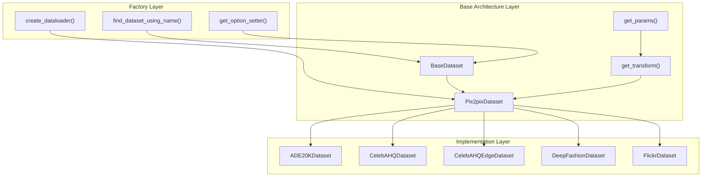
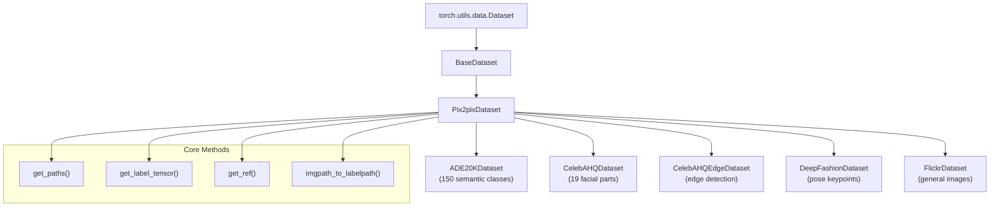
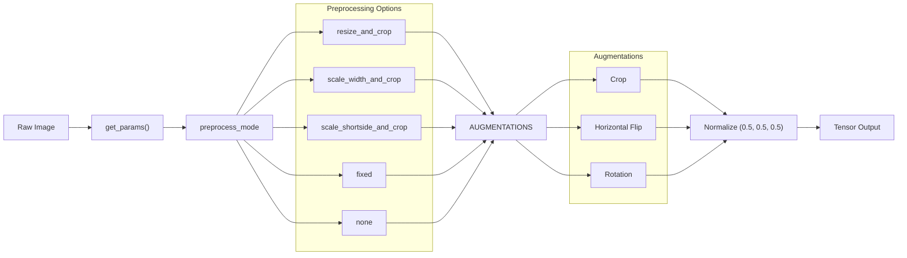
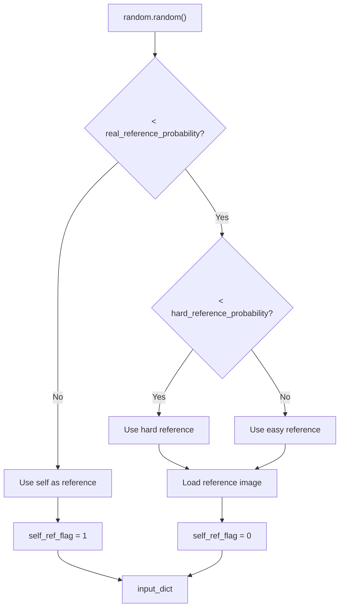
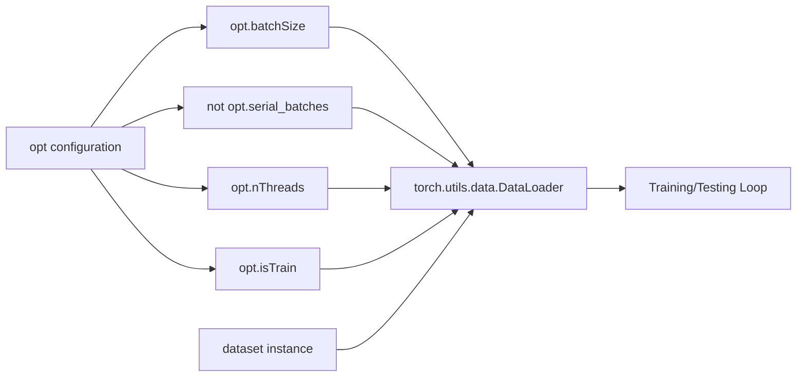

<!-- source: DeepWiki mcp.deepwiki.com · repo microsoft/CoCosNet · page 3 Dataset Management System · fetched 2026-10-26 -->

# Dataset Management System

Relevant source files

The following files were used as context for generating this wiki page:

- [data/__init__.py](data/__init__.py)
- [data/base_dataset.py](data/base_dataset.py)
- [data/pix2pix_dataset.py](data/pix2pix_dataset.py)

## Purpose and Scope

The Dataset Management System provides a unified framework for loading, preprocessing, and managing diverse datasets used in CoCosNet's cross-domain correspondence learning. This system implements a factory pattern for dynamic dataset discovery and instantiation, supporting multiple data modalities including semantic masks, edge maps, pose keypoints, and general images.

For detailed information about specific dataset implementations, see [Dataset Implementations](#3.2). For file organization and data formats, see [Data Formats and Organization](#4).

## System Overview

The Dataset Management System consists of three main architectural layers:

**Sources:** [data/__init__.py:11-54](), [data/base_dataset.py:13-23](), [data/pix2pix_dataset.py:14-161]()

## Dynamic Dataset Loading

The system uses a sophisticated factory pattern to discover and instantiate datasets at runtime based on command-line arguments:

### Factory Pattern Implementation

**Sources:** [data/__init__.py:11-33](), [data/__init__.py:41-54]()

The factory function `find_dataset_using_name()` follows a strict naming convention:
- Dataset files must be named `{dataset_name}_dataset.py`
- Classes must be named `{DatasetName}Dataset` 
- All dataset classes must inherit from `BaseDataset`

### Dynamic Option Configuration

Each dataset can modify command-line options through the `modify_commandline_options()` static method:

| Function | Purpose | Location |
|----------|---------|----------|
| `get_option_setter()` | Retrieves dataset-specific option modifier | [data/__init__.py:36-38]() |
| `modify_commandline_options()` | Adds dataset-specific CLI arguments | [data/base_dataset.py:17-19]() |
| `create_dataloader()` | Creates PyTorch DataLoader with configuration | [data/__init__.py:41-54]() |

**Sources:** [data/__init__.py:36-38](), [data/base_dataset.py:17-19]()

## Dataset Architecture Overview

### Class Hierarchy

**Sources:** [data/base_dataset.py:13-23](), [data/pix2pix_dataset.py:14-161]()

### Key Abstract Methods

The `Pix2pixDataset` class defines several abstract methods that concrete implementations must override:

| Method | Purpose | Required Override |
|--------|---------|-------------------|
| `get_paths()` | Return label and image file paths | Yes |
| `get_ref()` | Load reference image mappings | Yes |
| `imgpath_to_labelpath()` | Convert image paths to label paths | Yes |
| `postprocess()` | Modify final output dict | Optional |

**Sources:** [data/pix2pix_dataset.py:48-52](), [data/pix2pix_dataset.py:157-161]()

## Data Processing Pipeline

### Transform Pipeline Architecture

**Sources:** [data/base_dataset.py:25-84](), [data/base_dataset.py:89-137]()

### Reference Image Selection

The system implements sophisticated reference image selection logic:

**Sources:** [data/pix2pix_dataset.py:87-136]()

## Integration with CoCosNet Framework

### Training Integration

The dataset system integrates with CoCosNet's training pipeline through standardized data dictionaries:

| Key | Type | Purpose |
|-----|------|---------|
| `label` | Tensor | Semantic labels or input modality |
| `image` | Tensor | Ground truth target image |
| `ref` | Tensor | Reference/exemplar image |
| `label_ref` | Tensor | Reference image labels |
| `self_ref` | Tensor | Flag indicating self-reference |
| `path` | String | Original image file path |

**Sources:** [data/pix2pix_dataset.py:138-149]()

### DataLoader Configuration

The `create_dataloader()` function configures PyTorch DataLoaders with CoCosNet-specific settings:

**Sources:** [data/__init__.py:47-54]()

This architecture provides a flexible, extensible foundation for supporting diverse datasets while maintaining consistent interfaces for the CoCosNet training and inference pipelines.

---

