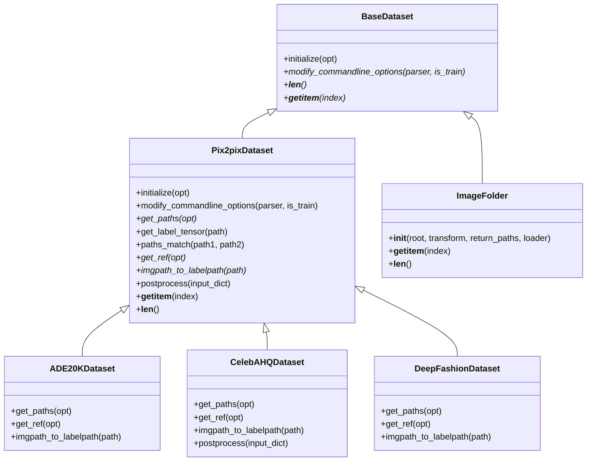
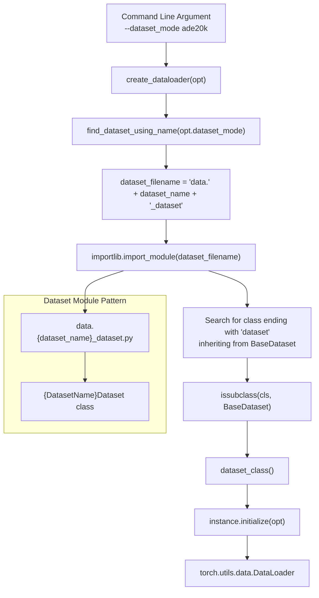
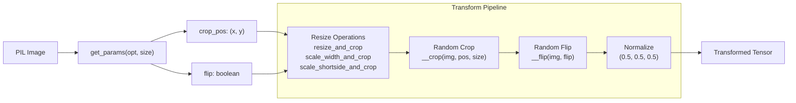
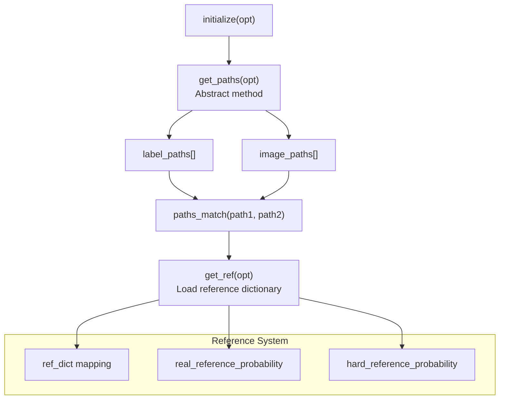
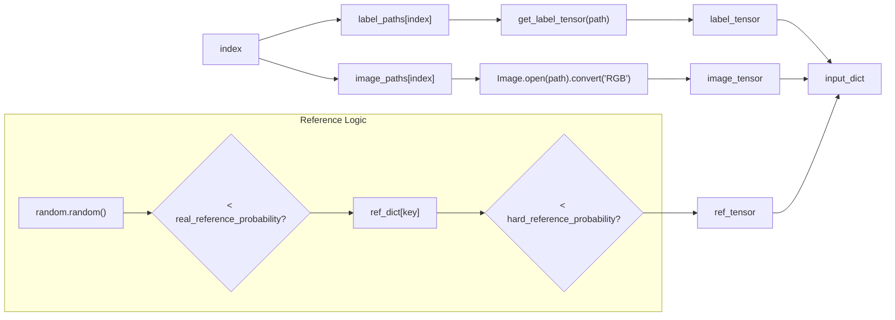

<!-- source: DeepWiki mcp.deepwiki.com · repo microsoft/CoCosNet · page 3.1 Dataset Architecture · fetched 2026-10-26 -->

# Dataset Architecture

Relevant source files

The following files were used as context for generating this wiki page:

- [data/__init__.py](data/__init__.py)
- [data/base_dataset.py](data/base_dataset.py)
- [data/image_folder.py](data/image_folder.py)
- [data/pix2pix_dataset.py](data/pix2pix_dataset.py)

This document covers the core dataset classes, inheritance hierarchy, and dynamic loading mechanisms that form the foundation of CoCosNet's data management system. It focuses on the `BaseDataset` abstract class, the `Pix2pixDataset` implementation, and the factory pattern used for dynamic dataset instantiation.

For information about specific dataset implementations for different domains, see [Dataset Implementations](#3.2). For details about data file formats and organization, see [Data Formats and Organization](#4).

## Dataset Class Hierarchy

The CoCosNet dataset architecture follows a hierarchical design pattern with `BaseDataset` as the abstract base class and `Pix2pixDataset` as the primary implementation for paired image translation tasks.

**Sources:** [data/base_dataset.py:13-23](), [data/pix2pix_dataset.py:14-161](), [data/image_folder.py:65-93]()

## Dynamic Dataset Loading System

The dataset loading system uses a factory pattern with dynamic module importing to instantiate dataset classes based on command-line arguments.

**Sources:** [data/__init__.py:11-54]()

## BaseDataset Abstract Class

The `BaseDataset` class provides the foundation for all dataset implementations in the system, inheriting from PyTorch's `torch.utils.data.Dataset`.

### Core Interface

| Method | Description | Implementation |
|--------|-------------|----------------|
| `initialize(opt)` | Initialize dataset with command-line options | Must be implemented by subclasses |
| `modify_commandline_options(parser, is_train)` | Add dataset-specific command-line arguments | Static method, overridden by subclasses |
| `__getitem__(index)` | Return data sample at given index | Inherited from torch Dataset |
| `__len__()` | Return dataset size | Inherited from torch Dataset |

### Transform Pipeline

The `BaseDataset` module provides comprehensive image transformation utilities:

**Sources:** [data/base_dataset.py:13-137](), [data/base_dataset.py:25-86]()

## Pix2pixDataset Core Implementation

The `Pix2pixDataset` class serves as the primary base class for paired image translation tasks, implementing the core functionality for loading label-image pairs and reference images.

### Key Features

- **Paired Data Loading**: Handles label and image path pairing with optional validation
- **Reference Image System**: Supports real reference images and self-reference modes
- **Flexible Path Management**: Abstract methods for subclass customization

### Data Loading Pipeline

### Sample Generation Process

The `__getitem__` method in `Pix2pixDataset` follows a structured process:

1. **Label Processing**: Load and transform label image using `get_label_tensor()`
2. **Image Processing**: Load and transform input image 
3. **Reference Selection**: Choose between real reference or self-reference based on probability
4. **Output Assembly**: Create input dictionary with all components

**Sources:** [data/pix2pix_dataset.py:14-161](), [data/pix2pix_dataset.py:67-149]()

## Image Processing Pipeline

The system provides a comprehensive set of image transformation utilities that handle various preprocessing modes and augmentation techniques.

### Preprocessing Modes

| Mode | Description | Implementation |
|------|-------------|----------------|
| `resize_and_crop` | Resize to `load_size`, then random crop | `transforms.Resize()` + `__crop()` |
| `scale_width_and_crop` | Scale width to `load_size`, maintain aspect ratio | `__scale_width()` + `__crop()` |
| `scale_shortside_and_crop` | Scale shortest side to `load_size` | `__scale_shortside()` + `__crop()` |
| `none` | Make dimensions power of 2 | `__make_power_2()` |
| `fixed` | Resize to fixed dimensions with aspect ratio | `__resize()` |

### Transform Function Parameters

The `get_transform()` function accepts several key parameters:

- `method`: Interpolation method (Image.BICUBIC, Image.NEAREST)
- `normalize`: Whether to apply normalization (default: True)
- `toTensor`: Whether to convert to PyTorch tensor (default: True)

**Sources:** [data/base_dataset.py:47-137](), [data/base_dataset.py:89-135]()

## Factory Pattern Implementation

The dataset factory system enables runtime dataset selection through a standardized naming convention and dynamic importing mechanism.

### Naming Convention

- **Module Name**: `data.{dataset_name}_dataset.py`
- **Class Name**: `{DatasetName}Dataset` (case-insensitive matching)
- **Inheritance**: Must inherit from `BaseDataset`

### Factory Functions

| Function | Purpose | Parameters |
|----------|---------|------------|
| `find_dataset_using_name()` | Locate and return dataset class | `dataset_name: str` |
| `get_option_setter()` | Get dataset-specific option modifier | `dataset_name: str` |
| `create_dataloader()` | Create configured PyTorch DataLoader | `opt: Namespace` |

The factory validates that discovered classes properly inherit from `BaseDataset` using `issubclass()` checks, ensuring type safety in the dynamic loading process.

**Sources:** [data/__init__.py:11-54](), [data/__init__.py:21-33]()

---

