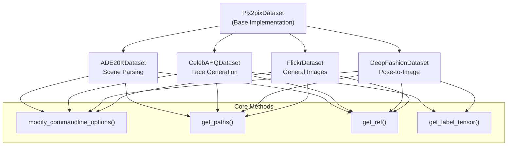
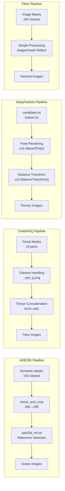
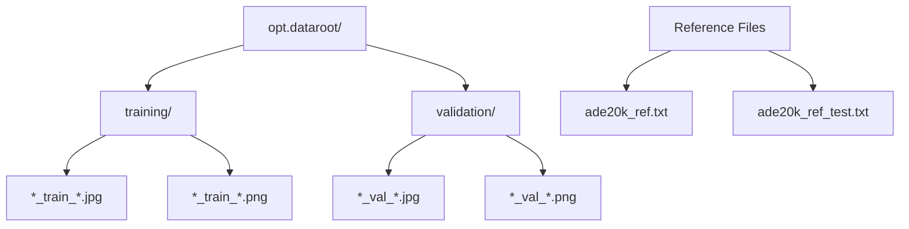
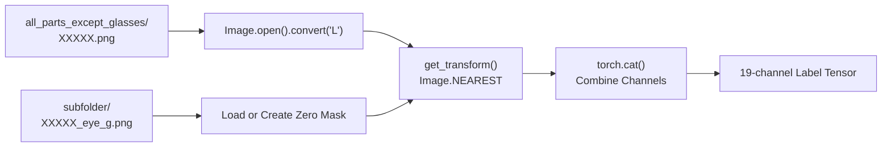
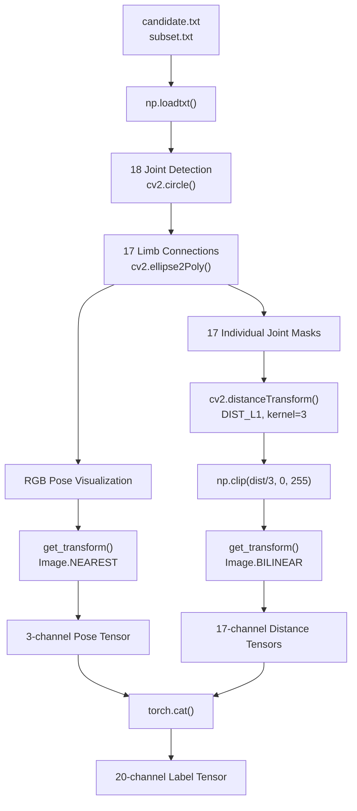
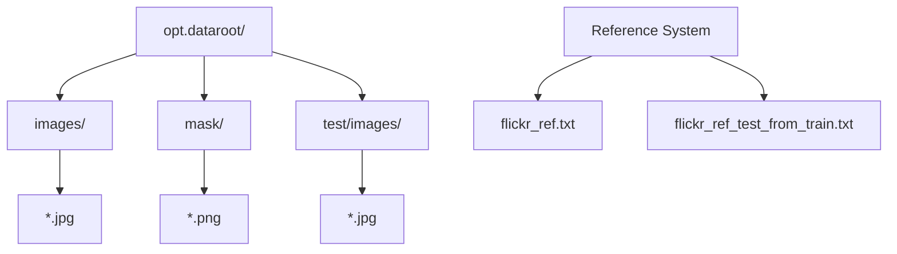

<!-- source: DeepWiki mcp.deepwiki.com · repo microsoft/CoCosNet · page 3.2 Dataset Implementations · fetched 2026-10-26 -->

# Dataset Implementations

<details>
<summary>Relevant source files</summary>

The following files were used as context for generating this wiki page:

- [data/ade20k_dataset.py](data/ade20k_dataset.py)
- [data/celebahq_dataset.py](data/celebahq_dataset.py)
- [data/deepfashion_dataset.py](data/deepfashion_dataset.py)
- [data/flickr_dataset.py](data/flickr_dataset.py)

</details>


This document covers the specific dataset implementations provided in CoCosNet for different domains and modalities. Each implementation extends the base dataset architecture to handle domain-specific data formats, preprocessing requirements, and reference systems. For information about the core dataset architecture and factory pattern, see [Dataset Architecture](#3.1).

## Overview

CoCosNet provides four primary dataset implementations, each designed for specific cross-domain correspondence learning tasks:

| Dataset | Domain | Input Modality | Label Channels | Primary Use Case |
|---------|--------|----------------|----------------|------------------|
| `ADE20KDataset` | Scene Parsing | Semantic Masks | 150 | Mask-to-image translation |
| `CelebAHQDataset` | Face Generation | Facial Masks | 19 | Mask-to-face synthesis |
| `DeepFashionDataset` | Fashion/Pose | Human Poses | 20 | Pose-to-person generation |
| `FlickrDataset` | General Images | Semantic Masks | 150 | General image translation |

All implementations inherit from `Pix2pixDataset` and follow the same basic interface while providing domain-specific customizations.

## Dataset Implementation Architecture



Sources: [data/ade20k_dataset.py:9](), [data/celebahq_dataset.py:11](), [data/deepfashion_dataset.py:15](), [data/flickr_dataset.py:7]()

## Domain-Specific Processing Pipelines



Sources: [data/ade20k_dataset.py:14-25](), [data/celebahq_dataset.py:67-84](), [data/deepfashion_dataset.py:111-169](), [data/flickr_dataset.py:25-34]()

## ADE20K Scene Parsing Dataset

The `ADE20KDataset` handles semantic scene parsing with 150 predefined classes for mask-to-image translation tasks.

### Configuration
- **Label channels**: 150 semantic classes
- **Preprocessing**: `resize_and_crop` mode
- **Load size**: 286 (train) / 256 (test)
- **Crop size**: 256×256
- **Don't care labels**: Enabled for unknown regions

### File Organization


### Key Implementation Details
- Uses [make_dataset()]() from `image_folder.py` for recursive file discovery
- Filters files based on phase-specific naming patterns ([data/ade20k_dataset.py:36]())
- Separates JPG images from PNG masks during path collection
- Reference dictionary maps image keys to exemplar candidates

Sources: [data/ade20k_dataset.py:27-43](), [data/ade20k_dataset.py:45-59]()

## CelebAHQ Face Generation Dataset

The `CelebAHQDataset` specializes in face generation tasks, supporting both standard facial part masks and glasses-aware processing.

### Configuration
- **Label channels**: 19 facial parts (hair, skin, eyes, nose, mouth, etc.)
- **Preprocessing**: `resize_and_crop` mode with no pairing check
- **Load size**: 286 (train) / 256 (test)
- **Special handling**: Glasses masks processed separately

### Facial Parts Structure
The dataset handles 19 facial components:
```
hair, skin, l_brow, r_brow, l_eye, r_eye, l_ear, r_ear, nose, 
u_lip, mouth, l_lip, neck, cloth, hat, eye_g, ear_r, neck_l
```

### Glasses Processing Pipeline


### Implementation Highlights
- Custom `get_label_tensor()` method combines base masks with glasses ([data/celebahq_dataset.py:67-84]())
- Hierarchical folder structure with 2000-image subdirectories ([data/celebahq_dataset.py:73]())
- Automatic glasses mask detection and zero-padding when missing ([data/celebahq_dataset.py:74-77]())

Sources: [data/celebahq_dataset.py:31-47](), [data/celebahq_dataset.py:67-84]()

## DeepFashion Pose-to-Image Dataset

The `DeepFashionDataset` implements human pose-to-image generation using complex pose rendering and distance transform techniques.

### Configuration
- **Label channels**: 20 (pose + 17 distance transform channels)
- **Preprocessing**: `resize_and_crop` mode with no pairing check
- **Pose data**: Uses `candidate.txt` and `subset.txt` files
- **Reference modes**: VGG-based or video-like reference selection

### Pose Processing Architecture


### Limb Sequence Definition
The pose skeleton uses a predefined limb connectivity structure:
```python
limbSeq = [[2, 3], [2, 6], [3, 4], [4, 5], [6, 7], [7, 8], [2, 9], [9, 10], 
           [10, 11], [2, 12], [12, 13], [13, 14], [2, 1], [1, 15], [15, 17], 
           [1, 16], [16, 18], [3, 17], [6, 18]]
```

### Reference Selection Modes
- **VGG Mode**: Uses `deepfashion_ref.txt` for similarity-based selection
- **Video-like Mode**: Uses `deepfashion_self_pair.txt` for temporal consistency
- Training phase adds random image sampling for diversity

Sources: [data/deepfashion_dataset.py:111-169](), [data/deepfashion_dataset.py:98-102](), [data/deepfashion_dataset.py:54-96]()

## Flickr General Dataset

The `FlickrDataset` provides a simplified implementation for general image collections with semantic masks.

### Configuration
- **Label channels**: 150 (similar to ADE20K)
- **File structure**: Simple `images/` and `mask/` folders
- **Reference system**: Uses `flickr_ref.txt` and `flickr_ref_test_from_train.txt`

### File Organization


### Implementation
- Simplified path discovery using `os.listdir()` ([data/flickr_dataset.py:29-32]())
- Direct mapping between image and mask folders via `imgpath_to_labelpath()` ([data/flickr_dataset.py:52-54]())
- Supports cross-split reference selection during test phase

Sources: [data/flickr_dataset.py:25-50]()

## Reference File Systems

All datasets use text-based reference files to define exemplar relationships for cross-domain correspondence learning:

| Dataset | Training Reference | Test Reference | Format |
|---------|-------------------|----------------|---------|
| ADE20K | `ade20k_ref.txt` | `ade20k_ref_test.txt` | `key,ref1,ref2,...,refN` |
| CelebAHQ | `celebahq_ref.txt` | `celebahq_ref_test.txt` | `key,ref1,ref2,...,refN` |
| DeepFashion | `deepfashion_ref.txt` | `deepfashion_ref_test.txt` | `key,ref1,ref2,...,refN` |
| Flickr | `flickr_ref.txt` | `flickr_ref_test_from_train.txt` | `key,ref1,ref2,...,refN` |

During training, datasets typically use only the first and last reference for efficiency, while test phase utilizes all available references for comprehensive evaluation.

Sources: [data/ade20k_dataset.py:45-59](), [data/celebahq_dataset.py:49-65](), [data/deepfashion_dataset.py:80-96](), [data/flickr_dataset.py:36-50]()

---

