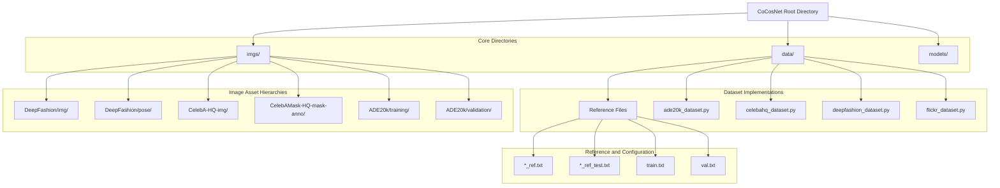
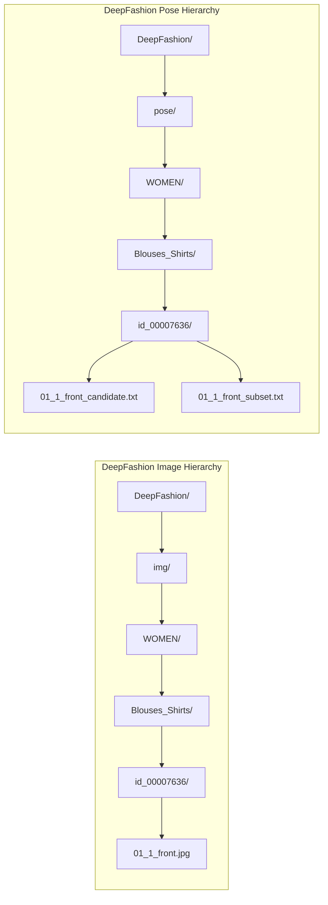
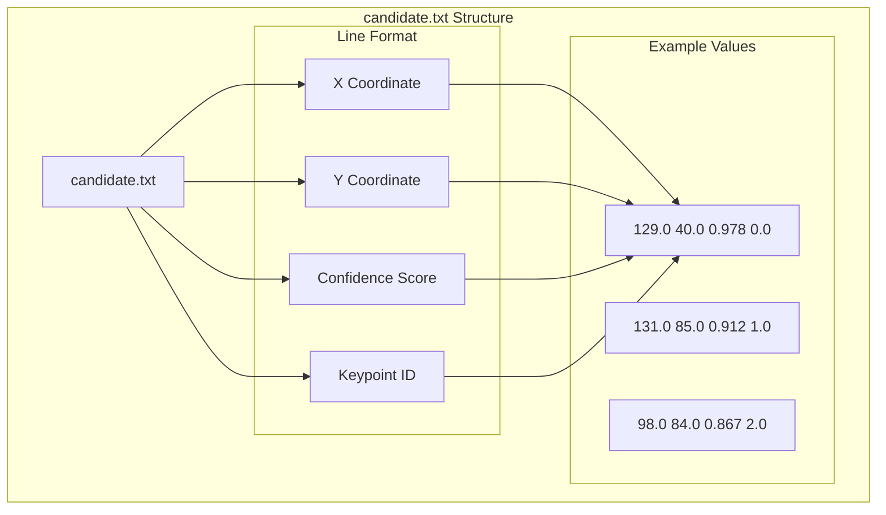
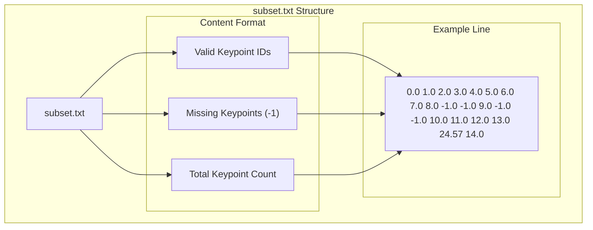

<!-- source: DeepWiki mcp.deepwiki.com · repo microsoft/CoCosNet · page 4 Data Formats and Organization · fetched 2026-10-26 -->

# Data Formats and Organization

<details>
<summary>Relevant source files</summary>

The following files were used as context for generating this wiki page:

- [imgs/DeepFashion/img/WOMEN/Blouses_Shirts/id_00007636/01_1_front.jpg](imgs/DeepFashion/img/WOMEN/Blouses_Shirts/id_00007636/01_1_front.jpg)
- [imgs/DeepFashion/pose/WOMEN/Blouses_Shirts/id_00007636/01_1_front_candidate.txt](imgs/DeepFashion/pose/WOMEN/Blouses_Shirts/id_00007636/01_1_front_candidate.txt)
- [imgs/DeepFashion/pose/WOMEN/Blouses_Shirts/id_00007636/01_1_front_subset.txt](imgs/DeepFashion/pose/WOMEN/Blouses_Shirts/id_00007636/01_1_front_subset.txt)
- [imgs/DeepFashion/pose/WOMEN/Cardigans/id_00006266/02_2_side_candidate.txt](imgs/DeepFashion/pose/WOMEN/Cardigans/id_00006266/02_2_side_candidate.txt)
- [imgs/DeepFashion/pose/WOMEN/Cardigans/id_00006266/02_2_side_subset.txt](imgs/DeepFashion/pose/WOMEN/Cardigans/id_00006266/02_2_side_subset.txt)

</details>


This document describes the file structures, naming conventions, and data formats used across different datasets in the CoCosNet framework. It covers the organization of image files, reference files, pose data formats, and dataset-specific directory hierarchies that support the cross-domain correspondence learning system.

For information about how these data formats are processed by the dataset implementations, see [Dataset Implementations](#3.2). For details on the dataset loading architecture that consumes these formats, see [Dataset Architecture](#3.1).

## File System Organization

The CoCosNet codebase organizes data assets using a hierarchical structure that separates different types of content while maintaining consistent naming patterns across datasets.



**Sources:** [imgs/DeepFashion/img/WOMEN/Blouses_Shirts/id_00007636/01_1_front.jpg](), [imgs/DeepFashion/pose/WOMEN/Blouses_Shirts/id_00007636/01_1_front_candidate.txt]()

## Dataset-Specific Directory Structures

Each dataset follows a specific organizational pattern that reflects its domain and data characteristics.

### DeepFashion Dataset Structure

The DeepFashion dataset uses a hierarchical structure that separates images and pose data while maintaining parallel directory trees.



**Sources:** [imgs/DeepFashion/img/WOMEN/Blouses_Shirts/id_00007636/01_1_front.jpg](), [imgs/DeepFashion/pose/WOMEN/Blouses_Shirts/id_00007636/01_1_front_candidate.txt](), [imgs/DeepFashion/pose/WOMEN/Blouses_Shirts/id_00007636/01_1_front_subset.txt]()

| Directory Level | Purpose | Example Values |
|-----------------|---------|----------------|
| `DeepFashion/` | Dataset root | Fixed |
| `img/` or `pose/` | Content type | `img`, `pose` |
| Gender | Target demographic | `WOMEN`, `MEN` |
| Category | Clothing type | `Blouses_Shirts`, `Cardigans` |
| Item ID | Unique item identifier | `id_00007636`, `id_00006266` |
| Filename | Specific view/angle | `01_1_front.jpg`, `02_2_side_candidate.txt` |

### CelebAHQ Dataset Structure

The CelebAHQ dataset maintains separate directories for images and mask annotations with synchronized naming.

| Component | Directory Path | File Pattern |
|-----------|----------------|--------------|
| Face Images | `CelebA-HQ-img/` | `{id}.jpg` |
| Mask Annotations | `CelebAMask-HQ-mask-anno/` | `{id}.png` |
| Glasses Masks | `CelebAMask-HQ-mask-anno/` | `{id}_eye_g.png` |

### ADE20K Dataset Structure

The ADE20K dataset uses a simpler structure with training and validation splits.

| Component | Directory Path | File Pattern |
|-----------|----------------|--------------|
| Training Images | `ADE20k/training/` | `*.jpg` |
| Validation Images | `ADE20k/validation/` | `*.jpg` |
| Training Masks | `ADE20k/training/` | `*_seg.png` |
| Validation Masks | `ADE20k/validation/` | `*_seg.png` |

## Pose Data Format

The DeepFashion dataset includes human pose keypoint data stored in two complementary file types: candidate files and subset files.

### Candidate Files Format

Candidate files (`*_candidate.txt`) contain detected keypoint coordinates with confidence scores.



**Sources:** [imgs/DeepFashion/pose/WOMEN/Blouses_Shirts/id_00007636/01_1_front_candidate.txt:1-14]()

Each line in a candidate file follows the format:
```
<x_coordinate> <y_coordinate> <confidence_score> <keypoint_index>
```

| Field | Type | Description | Example |
|-------|------|-------------|---------|
| X Coordinate | `float` | Pixel x-position | `129.0` |
| Y Coordinate | `float` | Pixel y-position | `40.0` |
| Confidence Score | `float` | Detection confidence (0-1) | `0.978` |
| Keypoint Index | `float` | Keypoint identifier | `0.0` (head), `1.0` (neck), etc. |

### Subset Files Format

Subset files (`*_subset.txt`) define which keypoints from the candidate file are valid and should be used for pose rendering.



**Sources:** [imgs/DeepFashion/pose/WOMEN/Blouses_Shirts/id_00007636/01_1_front_subset.txt:1-1](), [imgs/DeepFashion/pose/WOMEN/Cardigans/id_00006266/02_2_side_subset.txt:1-1]()

The subset file contains a single line with space-separated values:
- **Valid keypoint IDs**: References to keypoints in the candidate file
- **Missing keypoints**: Marked with `-1.0` when not detected
- **Calculated values**: Derived metrics for pose analysis

| Position | Keypoint | Example Value | Meaning |
|----------|----------|---------------|---------|
| 0 | Head | `0.0` | References candidate line 0 |
| 1 | Neck | `1.0` | References candidate line 1 |
| 9-10 | Ankles | `-1.0` | Not detected/visible |
| 18 | Score | `24.57` | Calculated pose quality |

## Reference File Formats

Reference files establish relationships between input labels and target images for training and testing phases.

### Training Reference Files

Files ending with `_ref.txt` define label-image pairs for training data.

### Test Reference Files  

Files ending with `_ref_test.txt` define label-image pairs for evaluation data.

### Data Split Files

| File | Purpose | Content |
|------|---------|---------|
| `train.txt` | Training set definition | List of training image identifiers |
| `val.txt` | Validation set definition | List of validation image identifiers |

**Sources:** Based on the dataset management system architecture and file organization patterns observed in the provided examples.

---

