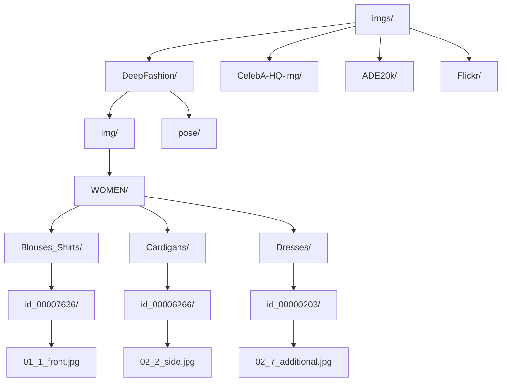
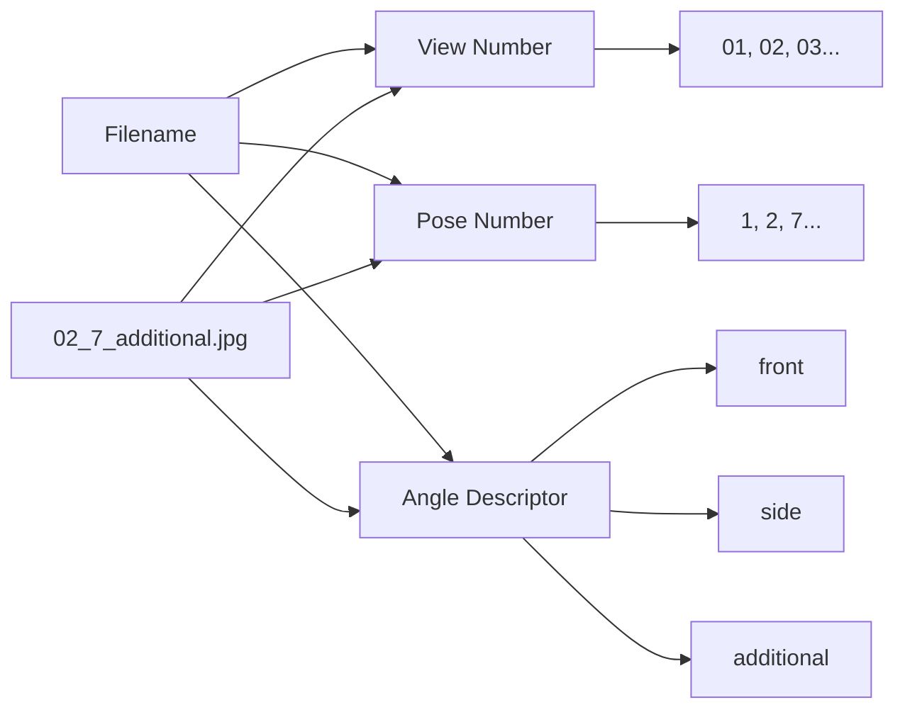
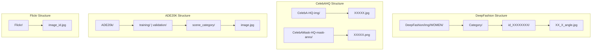
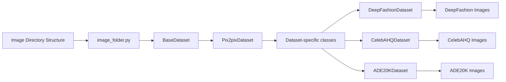

<!-- source: DeepWiki mcp.deepwiki.com · repo microsoft/CoCosNet · page 4.1 Image Data Structure · fetched 2026-10-26 -->

# Image Data Structure

Relevant source files

The following files were used as context for generating this wiki page:

- [imgs/DeepFashion/img/WOMEN/Blouses_Shirts/id_00007636/01_1_front.jpg](imgs/DeepFashion/img/WOMEN/Blouses_Shirts/id_00007636/01_1_front.jpg)
- [imgs/DeepFashion/img/WOMEN/Cardigans/id_00006266/02_2_side.jpg](imgs/DeepFashion/img/WOMEN/Cardigans/id_00006266/02_2_side.jpg)
- [imgs/DeepFashion/img/WOMEN/Cardigans/id_00006462/02_7_additional.jpg](imgs/DeepFashion/img/WOMEN/Cardigans/id_00006462/02_7_additional.jpg)
- [imgs/DeepFashion/img/WOMEN/Dresses/id_00000203/03_1_front.jpg](imgs/DeepFashion/img/WOMEN/Dresses/id_00000203/03_1_front.jpg)
- [imgs/DeepFashion/img/WOMEN/Dresses/id_00000244/02_1_front.jpg](imgs/DeepFashion/img/WOMEN/Dresses/id_00000244/02_1_front.jpg)
- [imgs/DeepFashion/img/WOMEN/Dresses/id_00002791/01_2_side.jpg](imgs/DeepFashion/img/WOMEN/Dresses/id_00002791/01_2_side.jpg)
- [imgs/DeepFashion/img/WOMEN/Dresses/id_00006245/03_2_side.jpg](imgs/DeepFashion/img/WOMEN/Dresses/id_00006245/03_2_side.jpg)
- [imgs/DeepFashion/img/WOMEN/Tees_Tanks/id_00007059/03_3_back.jpg](imgs/DeepFashion/img/WOMEN/Tees_Tanks/id_00007059/03_3_back.jpg)

This document describes the organization and structure of image files across different datasets used by CoCosNet, including naming conventions, directory hierarchies, and file relationships. For information about pose data formats and keypoint structures, see [Pose Data Format](#4.2). For details about how these images are loaded and processed by the dataset classes, see [Dataset Architecture](#3.1).

## Overview

CoCosNet supports multiple image datasets with different organizational structures and naming conventions. Each dataset follows its own hierarchy while maintaining consistent patterns for programmatic access. The image organization supports various input modalities including fashion images, facial images, scene images, and their corresponding annotations.

## Dataset Directory Structure

The image data is organized under the `imgs/` directory with separate subdirectories for each dataset:

Sources: `imgs/DeepFashion/img/WOMEN/Blouses_Shirts/id_00007636/01_1_front.jpg`, `imgs/DeepFashion/img/WOMEN/Cardigans/id_00006266/02_2_side.jpg`, `imgs/DeepFashion/img/WOMEN/Dresses/id_00000203/03_1_front.jpg`

## DeepFashion Dataset Structure

The DeepFashion dataset follows a hierarchical organization pattern designed for fashion item categorization and pose-based image generation:

### Directory Hierarchy

| Level | Pattern | Description |
|-------|---------|-------------|
| Root | `imgs/DeepFashion/` | Dataset root directory |
| Data Type | `img/` or `pose/` | Separates images from pose annotations |
| Gender | `WOMEN/` | Gender-based categorization |
| Category | `{CategoryName}/` | Fashion category (e.g., Dresses, Cardigans) |
| Item ID | `id_{XXXXXXXX}/` | Unique 8-digit identifier for each item |
| File | `{view}_{pose}_{angle}.jpg` | Individual image files |

### Naming Convention

DeepFashion images use a structured naming pattern:

### Category Examples

| Category | Example IDs | Views Available |
|----------|-------------|-----------------|
| `Blouses_Shirts` | `id_00007636` | `01_1_front.jpg` |
| `Cardigans` | `id_00006266`, `id_00006462` | `02_2_side.jpg`, `02_7_additional.jpg` |
| `Dresses` | `id_00000203`, `id_00000244`, `id_00002791` | `03_1_front.jpg`, `02_1_front.jpg`, `01_2_side.jpg` |

Sources: `imgs/DeepFashion/img/WOMEN/Blouses_Shirts/id_00007636/01_1_front.jpg`, `imgs/DeepFashion/img/WOMEN/Cardigans/id_00006266/02_2_side.jpg`, `imgs/DeepFashion/img/WOMEN/Cardigans/id_00006462/02_7_additional.jpg`, `imgs/DeepFashion/img/WOMEN/Dresses/id_00000203/03_1_front.jpg`, `imgs/DeepFashion/img/WOMEN/Dresses/id_00000244/02_1_front.jpg`, `imgs/DeepFashion/img/WOMEN/Dresses/id_00002791/01_2_side.jpg`

## Cross-Dataset Image Organization

Different datasets follow distinct organizational patterns optimized for their specific use cases:

## File Naming Patterns

Each dataset implements specific naming conventions that encode metadata:

### DeepFashion Pattern
- **Format**: `{view_number}_{pose_number}_{angle_descriptor}.jpg`
- **Example**: `02_7_additional.jpg`
- **Encoding**: View 02, Pose 7, Additional angle

### CelebAHQ Pattern  
- **Format**: `{id}.jpg` for images, `{id}.png` for masks
- **Example**: `00001.jpg`, `00001_eye_g.png`
- **Encoding**: Sequential ID with optional part suffixes

### ADE20K Pattern
- **Format**: `ADE_{split}_{scene_id}.jpg`
- **Example**: `ADE_train_00001234.jpg`
- **Encoding**: Split type and unique scene identifier

## Integration with Data Loading

The image structure directly supports the dataset loading pipeline:

The structured organization enables:
- **Programmatic discovery** via `image_folder.py` utilities
- **Efficient filtering** by category, pose, or view
- **Batch loading** of related images
- **Cross-reference** with annotation files

Sources: Based on directory structure patterns observed in the provided file paths and integration with the data loading architecture described in the system overview.

---

