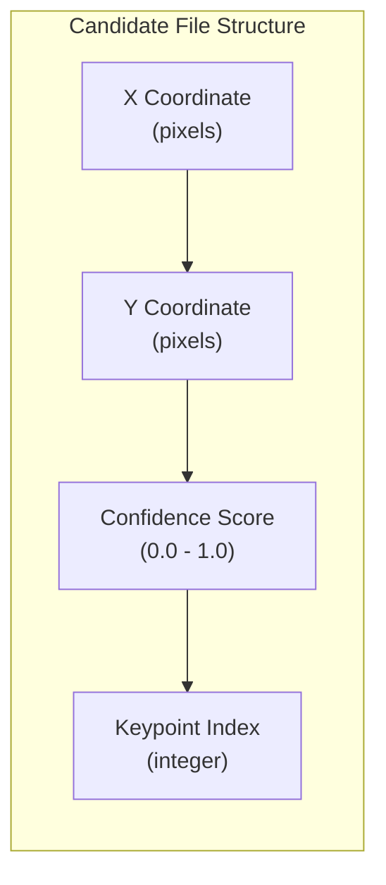
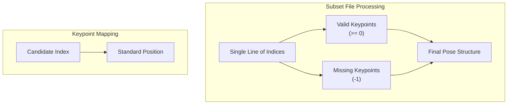
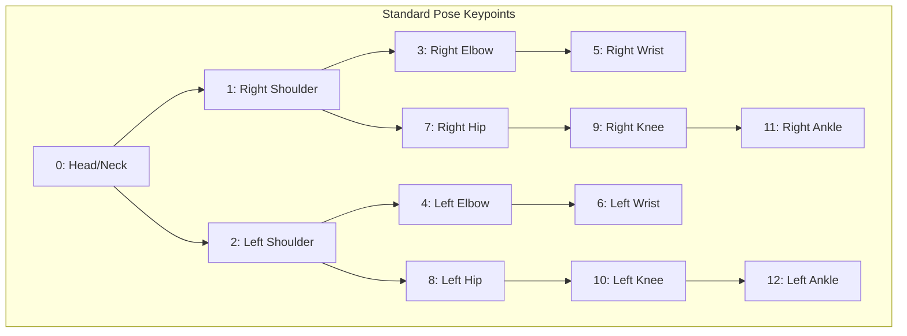
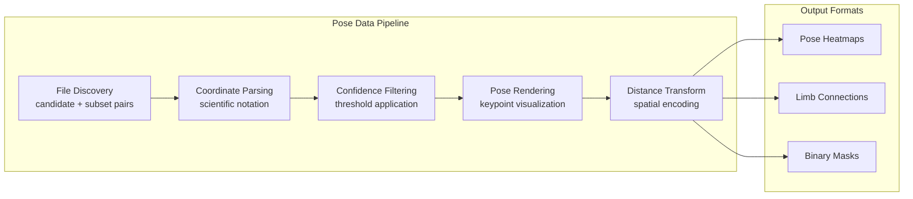

<!-- source: DeepWiki mcp.deepwiki.com · repo microsoft/CoCosNet · page 4.2 Pose Data Format · fetched 2026-10-26 -->

# Pose Data Format

<details>
<summary>Relevant source files</summary>

The following files were used as context for generating this wiki page:

- [imgs/DeepFashion/pose/WOMEN/Blouses_Shirts/id_00007636/01_1_front_candidate.txt](imgs/DeepFashion/pose/WOMEN/Blouses_Shirts/id_00007636/01_1_front_candidate.txt)
- [imgs/DeepFashion/pose/WOMEN/Blouses_Shirts/id_00007636/01_1_front_subset.txt](imgs/DeepFashion/pose/WOMEN/Blouses_Shirts/id_00007636/01_1_front_subset.txt)
- [imgs/DeepFashion/pose/WOMEN/Cardigans/id_00006266/02_2_side_candidate.txt](imgs/DeepFashion/pose/WOMEN/Cardigans/id_00006266/02_2_side_candidate.txt)
- [imgs/DeepFashion/pose/WOMEN/Cardigans/id_00006266/02_2_side_subset.txt](imgs/DeepFashion/pose/WOMEN/Cardigans/id_00006266/02_2_side_subset.txt)

</details>


This document describes the pose keypoint data format used by the CoCosNet framework for human pose estimation and pose-to-image generation tasks. The pose data is specifically used by the DeepFashion dataset implementation to enable pose-guided person image synthesis.

For information about the DeepFashion dataset implementation that utilizes this pose data, see [DeepFashion Dataset](#3.2.3). For broader context on data organization and file structures, see [Image Data Structure](#4.1).

## Purpose and Scope

The pose data format defines the structure for storing human keypoint coordinates, confidence scores, and keypoint relationships extracted from fashion images. This data enables the CoCosNet framework to perform pose-to-image translation by providing spatial guidance for person generation tasks.

## File Structure and Organization

Pose data files are organized within the DeepFashion directory hierarchy following a consistent naming pattern:

```
imgs/DeepFashion/pose/{GENDER}/{CATEGORY}/id_{ID}/{IMAGE_NAME}_{TYPE}.txt
```

Where:
- `{GENDER}`: Gender category (e.g., "WOMEN", "MEN")
- `{CATEGORY}`: Clothing category (e.g., "Blouses_Shirts", "Cardigans")
- `{ID}`: Unique item identifier (e.g., "00007636")
- `{IMAGE_NAME}`: Base image filename without extension
- `{TYPE}`: Either "candidate" or "subset"

### File Types

Each pose annotation consists of two complementary files:

| File Type | Suffix | Purpose |
|-----------|--------|---------|
| Candidate | `_candidate.txt` | Raw keypoint detections with coordinates and confidence |
| Subset | `_subset.txt` | Selected keypoint indices and relationships |

## Candidate File Format

The candidate file contains detected keypoint coordinates with confidence scores. Each line represents a single keypoint detection with four space-separated values in scientific notation:



### Data Format Specification

| Column | Type | Range | Description |
|--------|------|-------|-------------|
| 1 | Float | 0.0 - image_width | X coordinate in pixels |
| 2 | Float | 0.0 - image_height | Y coordinate in pixels |
| 3 | Float | 0.0 - 1.0 | Detection confidence score |
| 4 | Integer | 0 - N | Keypoint type identifier |

### Example Candidate Data

```
1.290000000000000000e+02 4.000000000000000000e+01 9.781419634819030762e-01 0.000000000000000000e+00
1.310000000000000000e+02 8.500000000000000000e+01 9.124031066894531250e-01 1.000000000000000000e+00
9.800000000000000000e+01 8.400000000000000000e+01 8.668758273124694824e-01 2.000000000000000000e+00
```

This represents:
- Head/neck keypoint at (129.0, 40.0) with 97.8% confidence
- Right shoulder at (131.0, 85.0) with 91.2% confidence  
- Left shoulder at (98.0, 84.0) with 86.7% confidence

Sources: [imgs/DeepFashion/pose/WOMEN/Blouses_Shirts/id_00007636/01_1_front_candidate.txt:1-15]()

## Subset File Format

The subset file defines which keypoints from the candidate file are selected for pose representation. It contains a single line with space-separated values indicating the mapping between standard pose keypoints and detected candidates.



### Index Mapping

- **Positive integers**: Reference to candidate file line number (0-indexed)
- **-1**: Indicates missing or undetected keypoint
- **Decimal values**: May indicate interpolated or computed keypoint positions

### Example Subset Data

```
0.000000000000000000e+00 1.000000000000000000e+00 2.000000000000000000e+00 3.000000000000000000e+00 4.000000000000000000e+00 5.000000000000000000e+00 6.000000000000000000e+00 7.000000000000000000e+00 8.000000000000000000e+00 -1.000000000000000000e+00 -1.000000000000000000e+00 9.000000000000000000e+00
```

This mapping indicates:
- Standard pose positions 0-8 map to candidate keypoints 0-8
- Positions 9-10 are missing (value -1)
- Position 11 maps to candidate keypoint 9

Sources: [imgs/DeepFashion/pose/WOMEN/Blouses_Shirts/id_00007636/01_1_front_subset.txt:1-2](), [imgs/DeepFashion/pose/WOMEN/Cardigans/id_00006266/02_2_side_subset.txt:1-2]()

## Coordinate System and Keypoint Schema

The pose data uses a standard image coordinate system where:

- **Origin**: Top-left corner (0, 0)
- **X-axis**: Increases rightward
- **Y-axis**: Increases downward
- **Units**: Pixels



## Data Processing and Usage

The pose data format integrates with the CoCosNet dataset pipeline through structured file discovery and coordinate transformation:



The parsed pose data is consumed by the dataset implementation to generate pose-guided training samples for cross-domain correspondence learning.

Sources: [imgs/DeepFashion/pose/WOMEN/Blouses_Shirts/id_00007636/01_1_front_candidate.txt:1-15](), [imgs/DeepFashion/pose/WOMEN/Cardigans/id_00006266/02_2_side_candidate.txt:1-13]()

---

