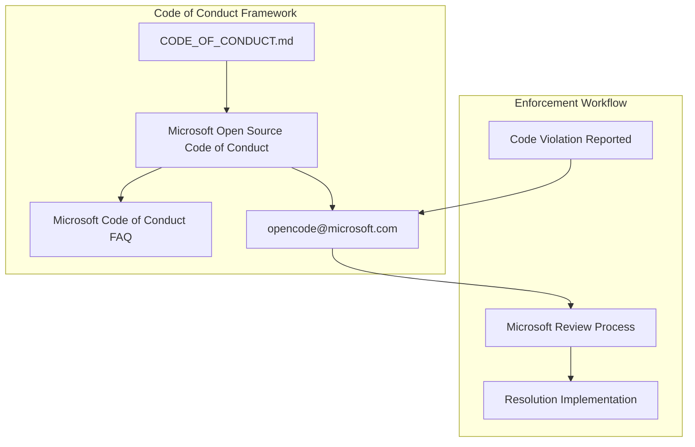
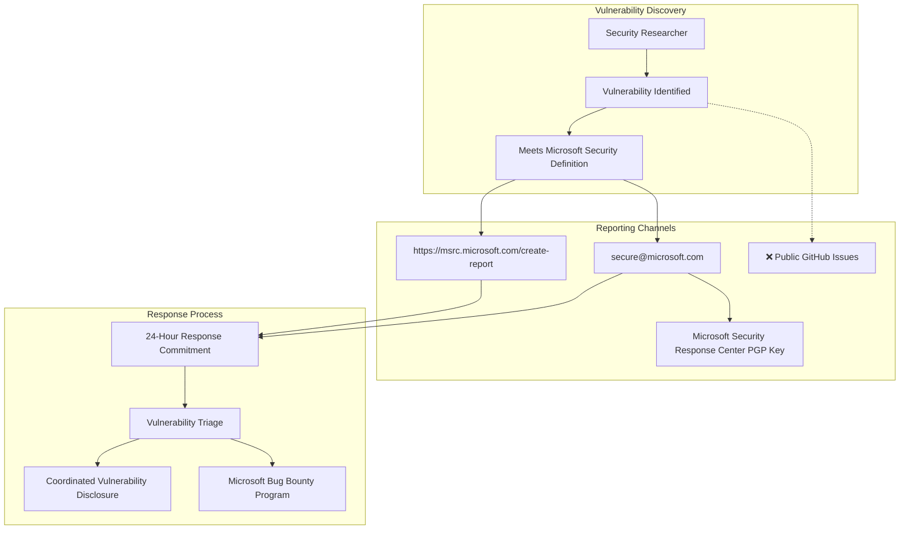
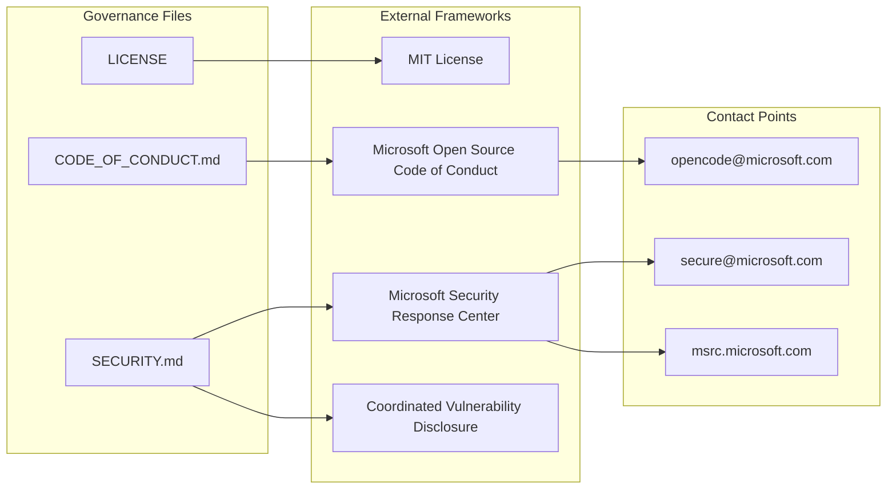

<!-- source: DeepWiki mcp.deepwiki.com · repo microsoft/CoCosNet · page 5 Project Configuration and Governance · fetched 2026-10-26 -->

# Project Configuration and Governance

Relevant source files

The following files were used as context for generating this wiki page:

- [CODE_OF_CONDUCT.md](CODE_OF_CONDUCT.md)
- [LICENSE](LICENSE)
- [SECURITY.md](SECURITY.md)

## Purpose and Scope

This document covers the governance framework, licensing terms, security policies, and contribution guidelines for the CoCosNet project. It provides technical details about project configuration files, compliance requirements, and operational procedures for maintaining code quality and security standards.

For information about dataset configuration and data management, see [Dataset Management System](#3). For details about training and inference setup, see [Getting Started](#2).

## Licensing Framework

The CoCosNet project operates under the MIT License with Microsoft Corporation as the copyright holder. The licensing framework provides broad permissions for software usage while maintaining proper attribution requirements.

### License Terms

The project utilizes the MIT License as defined in [LICENSE:1-22](). Key provisions include:

| Permission | Restriction | Condition |
|------------|-------------|-----------|
| Commercial use | No warranty provided | Copyright notice required |
| Modification | No liability assumed | License notice required |
| Distribution | - | - |
| Private use | - | - |

The license grants unlimited rights to use, modify, publish, distribute, sublicense, and sell copies of the software, subject to inclusion of the copyright notice and license terms in all distributions.

**Sources:** [LICENSE:1-22]()

## Code of Conduct

The project adopts the Microsoft Open Source Code of Conduct framework as specified in [CODE_OF_CONDUCT.md:1-10]().

### Governance Structure

The code of conduct establishes behavioral standards for project participation and provides escalation procedures through Microsoft's open source governance infrastructure.

**Sources:** [CODE_OF_CONDUCT.md:1-10]()

## Security Policy and Vulnerability Management

The project implements Microsoft's standard security vulnerability disclosure and management procedures as documented in [SECURITY.md:1-41]().

### Security Reporting Workflow

### Required Vulnerability Information

Security reports must include specific technical details as outlined in [SECURITY.md:19-28]():

| Information Type | Purpose | Examples |
|------------------|---------|----------|
| Issue type | Classification | Buffer overflow, SQL injection, XSS |
| Source file paths | Location identification | Full paths to affected files |
| Source location | Version identification | Tag/branch/commit or direct URL |
| Configuration | Reproduction setup | Special environment requirements |
| Reproduction steps | Validation process | Step-by-step instructions |
| Proof-of-concept | Impact demonstration | Exploit code if available |
| Impact analysis | Risk assessment | Attack vectors and potential damage |

### Communication Protocols

- **Preferred language:** English [SECURITY.md:35]()
- **Response timeframe:** 24 hours [SECURITY.md:17]()
- **Disclosure policy:** Coordinated Vulnerability Disclosure [SECURITY.md:39]()
- **Encryption support:** PGP key available for sensitive communications [SECURITY.md:15]()

**Sources:** [SECURITY.md:1-41]()

## Project Governance Structure

The CoCosNet project operates within Microsoft's open source governance framework, implementing standardized policies across licensing, conduct, and security domains.

### Governance File Architecture

### Compliance Requirements

All project contributors and users must adhere to:

1. **License compliance:** Proper attribution and license notice inclusion
2. **Conduct standards:** Microsoft Open Source Code of Conduct adherence
3. **Security reporting:** Responsible disclosure through designated channels
4. **Communication protocols:** English language preference and official contact channels

The governance framework ensures consistent policy application across all Microsoft open source projects while maintaining project-specific flexibility for technical implementation decisions.

**Sources:** [LICENSE:1-22](), [CODE_OF_CONDUCT.md:1-10](), [SECURITY.md:1-41]()