# Page: CoCosNet Overview

# CoCosNet Overview

<details>
<summary>Relevant source files</summary>

The following files were used as context for generating this wiki page:

- [.gitignore](.gitignore)
- [README.md](README.md)

</details>


## Purpose and Scope

This document provides an overview of the CoCosNet framework, a PyTorch implementation for cross-domain correspondence learning and exemplar-based image translation. CoCosNet enables synthesis of photo-realistic images from inputs in distinct domains (semantic segmentation masks, edge maps, pose keypoints) while maintaining style consistency with a provided exemplar image.

For detailed information about specific dataset implementations, see [Dataset Implementations](#3.2). For training and inference instructions, see [Getting Started](#2). For data format specifications, see [Data Formats and Organization](#4).

Sources: [README.md:1-11]()

## Framework Overview

CoCosNet is a general framework that jointly learns cross-domain correspondence and image translation in a weakly supervised manner. The core innovation lies in aligning images from distinct domains to an intermediate domain where dense correspondence is established, then synthesizing images based on semantically corresponding patches in the exemplar.

The framework supports multiple translation tasks:
- **Mask-to-image**: Semantic segmentation masks to realistic images (ADE20k, CelebAHQ)
- **Edge-to-face**: Edge maps to face images (CelebAHQ)  
- **Pose-to-image**: Human pose keypoints to person images (DeepFashion)

Sources: [README.md:10-11]()

## Core Training and Inference Architecture

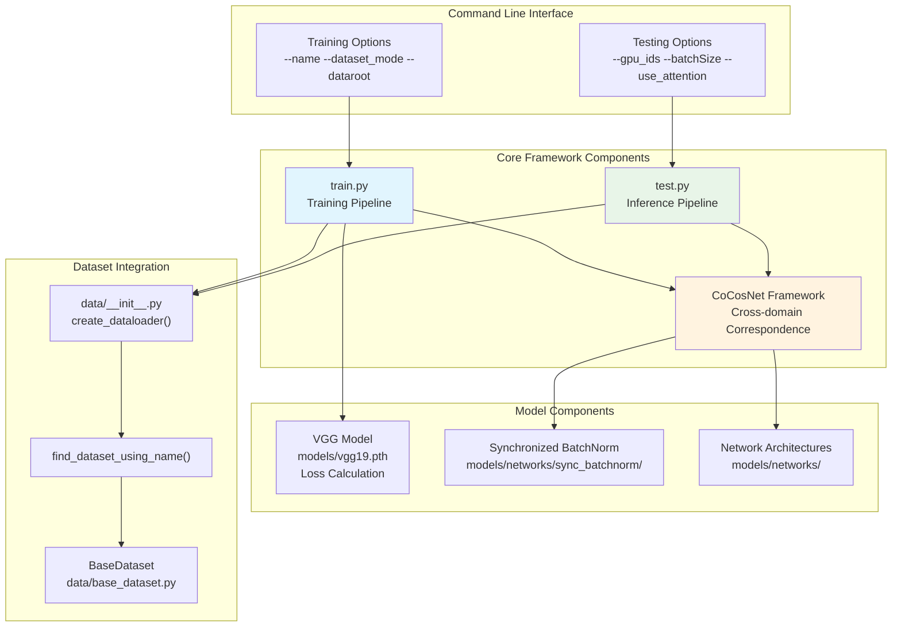

Sources: [README.md:40-116]()

## Cross-Domain Correspondence Learning Pipeline

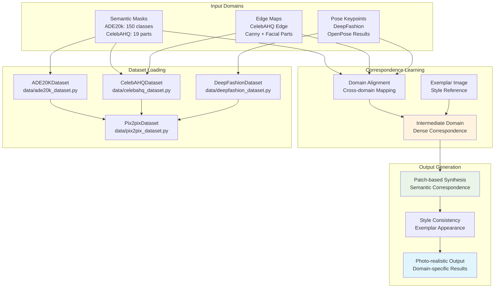

Sources: [README.md:10-11](), [data/base_dataset.py](), [data/pix2pix_dataset.py]()

## Supported Domains and Datasets

The framework supports four primary translation domains, each with specialized dataset implementations:

| Domain | Input Type | Output Type | Dataset Class | Key Features |
|--------|------------|-------------|---------------|--------------|
| **ADE20k** | Semantic masks (150 classes) | Scene images | `ADE20KDataset` | Scene parsing, object segmentation |
| **CelebAHQ (Mask)** | Facial part masks (19 parts) | Face images | `CelebAHQDataset` | Face generation, part-based control |
| **CelebAHQ (Edge)** | Edge maps | Face images | `CelebAHQEdgeDataset` | Edge-to-face translation |
| **DeepFashion** | Pose keypoints | Person images | `DeepFashionDataset` | Human pose transfer |

Each dataset implements domain-specific preprocessing, reference file management, and data augmentation strategies optimized for their respective translation tasks.

Sources: [README.md:42-116]()

## Key Technical Components

### Dynamic Dataset Loading
The framework uses a factory pattern for dynamic dataset instantiation through `find_dataset_using_name()` in [data/__init__.py](). This enables runtime selection of dataset implementations based on command-line arguments.

### Cross-Domain Training Options
Key training parameters include:
- `--use_attention`: Enables attention mechanisms for correspondence learning
- `--maskmix`: Applies mask mixing augmentation
- `--PONO` / `--PONO_C`: Positional normalization techniques
- `--warp_bilinear`: Bilinear warping for geometric consistency

### Model Architecture Features
- **Synchronized BatchNorm**: Cross-GPU normalization via `sync_batchnorm/`
- **VGG Perceptual Loss**: Pre-trained VGG19 model for feature matching
- **Patch-based Synthesis**: Dense correspondence-guided generation
- **Exemplar Style Transfer**: Appearance consistency with reference images

Sources: [README.md:40-116](), [models/networks/]()

## System Dependencies

The framework integrates several external components:

- **PyTorch**: Core deep learning framework
- **Synchronized-BatchNorm-PyTorch**: Multi-GPU batch normalization from [vacancy/Synchronized-BatchNorm-PyTorch](https://github.com/vacancy/Synchronized-BatchNorm-PyTorch)
- **VGG19**: Pre-trained perceptual loss model
- **OpenPose**: Human pose estimation for DeepFashion dataset

Installation requires cloning the synchronized batch normalization repository into `models/networks/` and downloading pre-trained models for both training and inference.

Sources: [README.md:28-38](), [README.md:75]()

---

# Page: Getting Started

# Getting Started

<details>
<summary>Relevant source files</summary>

The following files were used as context for generating this wiki page:

- [README.md](README.md)

</details>


This document provides practical instructions for setting up, training, and running inference with CoCosNet models. It covers command-line usage, model downloads, dataset preparation, and the essential workflows for both inference and training across all supported datasets.

For detailed information about the dataset management system and how different datasets are integrated, see [Dataset Management System](#3). For understanding the overall framework architecture and cross-domain correspondence learning concepts, see [CoCosNet Overview](#1).

## Prerequisites and Installation

### System Requirements

CoCosNet requires PyTorch and several dependencies for cross-domain image translation. The framework supports multiple GPU training and inference.

### Installation Steps

1. **Clone Synchronized BatchNorm dependency**:
   ```bash
   cd models/networks/
   git clone https://github.com/vacancy/Synchronized-BatchNorm-PyTorch
   cp -rf Synchronized-BatchNorm-PyTorch/sync_batchnorm .
   cd ../../
   ```

2. **Install Python dependencies**:
   ```bash
   pip install -r requirements.txt
   ```

3. **Download pretrained VGG model** (required for training):
   Download from Google Drive and place in `models/` directory. This model is used by the loss calculation components.

**Sources:** [README.md:27-38]()

## Quick Start with Pretrained Models

The fastest way to get started is using pretrained models for inference. CoCosNet provides pretrained models for four different translation tasks.

### Inference Workflow

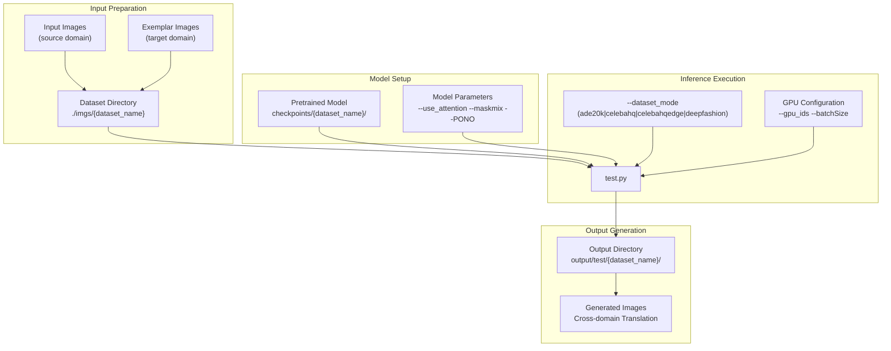

### Supported Translation Tasks

| Task | Dataset Mode | Input Domain | Output Domain | Model Download |
|------|--------------|--------------|---------------|----------------|
| Scene Translation | `ade20k` | Semantic masks | Scene images | [Google Drive](https://drive.google.com/drive/folders/1BEBBENbEr9tutZsyGGc3REUuuOYqf6M3) |
| Face Generation | `celebahq` | Face masks | Face images | [Google Drive](https://drive.google.com/drive/folders/16xgIrGzGBKJWbAUROM71wiA1cf7zrQk5) |
| Edge-to-Face | `celebahqedge` | Edge maps | Face images | [Google Drive](https://drive.google.com/drive/folders/1SCUrAPsEb6HOx8EtI89ED4wsOR8mrPDF) |
| Pose-to-Image | `deepfashion` | Pose keypoints | Fashion images | [Google Drive](https://drive.google.com/drive/folders/1vyzTdhQqY9ljsAx4u4xPvytX3wR75GYB) |

### Example Inference Commands

**ADE20k (mask-to-image)**:
```bash
python test.py --name ade20k --dataset_mode ade20k --dataroot ./imgs/ade20k \
    --gpu_ids 0 --nThreads 0 --batchSize 6 --use_attention --maskmix \
    --warp_mask_losstype direct --PONO --PONO_C
```

**CelebAHQ (mask-to-face)**:
```bash
python test.py --name celebahq --dataset_mode celebahq --dataroot ./imgs/celebahq \
    --gpu_ids 0 --nThreads 0 --batchSize 4 --use_attention --maskmix \
    --warp_mask_losstype direct --PONO --PONO_C --warp_bilinear --adaptor_kernel 4
```

**DeepFashion (pose-to-image)**:
```bash
python test.py --name deepfashion --dataset_mode deepfashion --dataroot ./imgs/DeepFashion \
    --gpu_ids 0 --nThreads 0 --batchSize 4 --use_attention --PONO --PONO_C \
    --warp_bilinear --no_flip --warp_patch --video_like --adaptor_kernel 4
```

**Sources:** [README.md:40-71]()

## Training Your Own Models

Training CoCosNet requires dataset preparation, reference file setup, and proper command-line configuration. The training process uses the correspondence learning framework with exemplar-based supervision.

### Training Pipeline

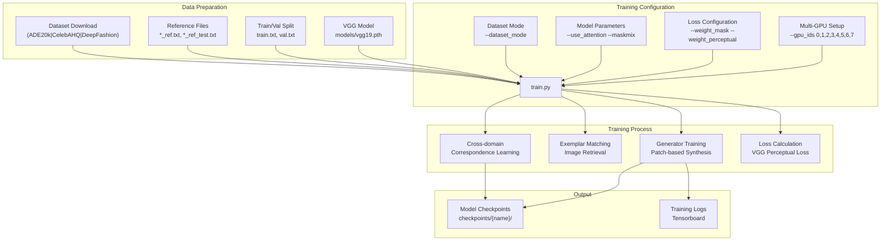

### Dataset-Specific Training Setup

**ADE20k Training**:
1. Download ADE20k dataset and organize annotations
2. Download `ade20k_ref.txt` and `ade20k_ref_test.txt` reference files
3. Run training command:
```bash
python train.py --name ade20k --dataset_mode ade20k --dataroot dataset_path \
    --niter 100 --niter_decay 100 --use_attention --maskmix \
    --warp_mask_losstype direct --weight_mask 100.0 --PONO --PONO_C \
    --batchSize 32 --vgg_normal_correct --gpu_ids 0,1,2,3,4,5,6,7
```

**CelebAHQ Training**:
1. Download CelebAHQ dataset and mask annotations
2. Download reference files: `celebahq_ref.txt`, `celebahq_ref_test.txt`
3. Download train/val split files: `train.txt`, `val.txt`
4. Run training command:
```bash
python train.py --name celebahq --dataset_mode celebahq --dataroot dataset_path \
    --niter 30 --niter_decay 30 --which_perceptual 4_2 --weight_perceptual 0.001 \
    --use_attention --maskmix --warp_mask_losstype direct --weight_mask 100.0 \
    --PONO --PONO_C --vgg_normal_correct --fm_ratio 1.0 --warp_bilinear \
    --warp_cycle_w 0.1 --batchSize 32 --gpu_ids 0,1,2,3,4,5,6,7
```

**Sources:** [README.md:73-116]()

## Command Line Interface Reference

### Core Parameters

The `train.py` and `test.py` scripts share a common parameter interface for dataset selection and model configuration.

```mermaid
graph LR
    subgraph "Script Entry Points"
        TRAIN_PY["train.py"]
        TEST_PY["test.py"]
    end
    
    subgraph "Dataset Selection"
        DATASET_MODE["--dataset_mode<br/>(ade20k|celebahq|celebahqedge|deepfashion)"]
        DATAROOT["--dataroot<br/>Dataset path"]
        NAME["--name<br/>Experiment name"]
    end
    
    subgraph "Model Configuration"
        ATTENTION["--use_attention<br/>Attention mechanism"]
        MASKMIX["--maskmix<br/>Mask mixing strategy"]
        PONO["--PONO --PONO_C<br/>Positional normalization"]
        WARP_PARAMS["--warp_bilinear<br/>--warp_mask_losstype"]
    end
    
    subgraph "Hardware Configuration"
        GPU_IDS["--gpu_ids<br/>GPU device selection"]
        BATCH_SIZE["--batchSize<br/>Batch size"]
        NTHREADS["--nThreads<br/>Data loading threads"]
    end
    
    TRAIN_PY --> DATASET_MODE
    TEST_PY --> DATASET_MODE
    
    DATASET_MODE --> DATAROOT
    DATASET_MODE --> NAME
    
    NAME --> ATTENTION
    ATTENTION --> MASKMIX
    MASKMIX --> PONO
    PONO --> WARP_PARAMS
    
    WARP_PARAMS --> GPU_IDS
    GPU_IDS --> BATCH_SIZE
    BATCH_SIZE --> NTHREADS
```

### Key Parameter Categories

| Category | Parameters | Purpose |
|----------|------------|---------|
| **Dataset** | `--dataset_mode`, `--dataroot`, `--name` | Specify dataset type and paths |
| **Model Architecture** | `--use_attention`, `--maskmix`, `--PONO`, `--PONO_C` | Core model components |
| **Training** | `--niter`, `--niter_decay`, `--weight_mask`, `--weight_perceptual` | Training configuration |
| **Warping** | `--warp_bilinear`, `--warp_mask_losstype`, `--adaptor_kernel` | Correspondence warping |
| **Hardware** | `--gpu_ids`, `--batchSize`, `--nThreads` | Resource allocation |

**Sources:** [README.md:44-115]()

## File Organization and Setup

### Required Directory Structure

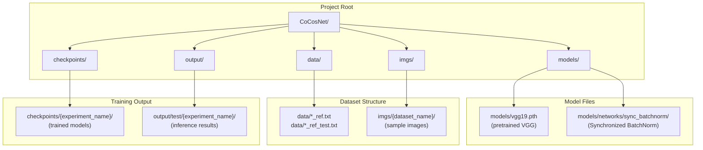

### Essential Files for Setup

1. **Reference Files** (`data/` directory):
   - `ade20k_ref.txt`, `ade20k_ref_test.txt`
   - `celebahq_ref.txt`, `celebahq_ref_test.txt`
   - `deepfashion_ref.txt`, `deepfashion_ref_test.txt`

2. **Model Files** (`models/` directory):
   - `vgg19.pth` (pretrained VGG model for loss calculation)
   - `networks/sync_batchnorm/` (synchronized batch normalization)

3. **Sample Data** (`imgs/` directory):
   - `imgs/ade20k/` (ADE20k samples)
   - `imgs/celebahq/` (CelebAHQ samples)
   - `imgs/DeepFashion/` (DeepFashion samples)

For detailed information about dataset file formats and organization patterns, see [Data Formats and Organization](#4).

**Sources:** [README.md:27-116]()

---

# Page: Dataset Management System

# Dataset Management System

<details>
<summary>Relevant source files</summary>

The following files were used as context for generating this wiki page:

- [data/__init__.py](data/__init__.py)
- [data/base_dataset.py](data/base_dataset.py)
- [data/pix2pix_dataset.py](data/pix2pix_dataset.py)

</details>


## Purpose and Scope

The Dataset Management System provides a unified framework for loading, preprocessing, and managing diverse datasets used in CoCosNet's cross-domain correspondence learning. This system implements a factory pattern for dynamic dataset discovery and instantiation, supporting multiple data modalities including semantic masks, edge maps, pose keypoints, and general images.

For detailed information about specific dataset implementations, see [Dataset Implementations](#3.2). For file organization and data formats, see [Data Formats and Organization](#4).

## System Overview

The Dataset Management System consists of three main architectural layers:

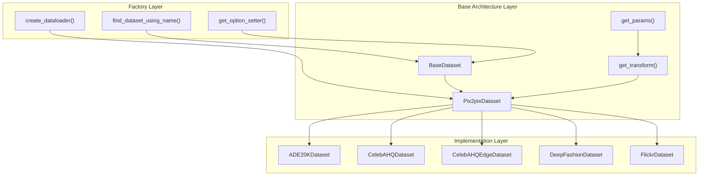

**Sources:** [data/__init__.py:11-54](), [data/base_dataset.py:13-23](), [data/pix2pix_dataset.py:14-161]()

## Dynamic Dataset Loading

The system uses a sophisticated factory pattern to discover and instantiate datasets at runtime based on command-line arguments:

### Factory Pattern Implementation


**Sources:** [data/__init__.py:11-33](), [data/__init__.py:41-54]()

The factory function `find_dataset_using_name()` follows a strict naming convention:
- Dataset files must be named `{dataset_name}_dataset.py`
- Classes must be named `{DatasetName}Dataset` 
- All dataset classes must inherit from `BaseDataset`

### Dynamic Option Configuration

Each dataset can modify command-line options through the `modify_commandline_options()` static method:

| Function | Purpose | Location |
|----------|---------|----------|
| `get_option_setter()` | Retrieves dataset-specific option modifier | [data/__init__.py:36-38]() |
| `modify_commandline_options()` | Adds dataset-specific CLI arguments | [data/base_dataset.py:17-19]() |
| `create_dataloader()` | Creates PyTorch DataLoader with configuration | [data/__init__.py:41-54]() |

**Sources:** [data/__init__.py:36-38](), [data/base_dataset.py:17-19]()

## Dataset Architecture Overview

### Class Hierarchy

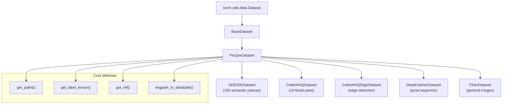

**Sources:** [data/base_dataset.py:13-23](), [data/pix2pix_dataset.py:14-161]()

### Key Abstract Methods

The `Pix2pixDataset` class defines several abstract methods that concrete implementations must override:

| Method | Purpose | Required Override |
|--------|---------|-------------------|
| `get_paths()` | Return label and image file paths | Yes |
| `get_ref()` | Load reference image mappings | Yes |
| `imgpath_to_labelpath()` | Convert image paths to label paths | Yes |
| `postprocess()` | Modify final output dict | Optional |

**Sources:** [data/pix2pix_dataset.py:48-52](), [data/pix2pix_dataset.py:157-161]()

## Data Processing Pipeline

### Transform Pipeline Architecture

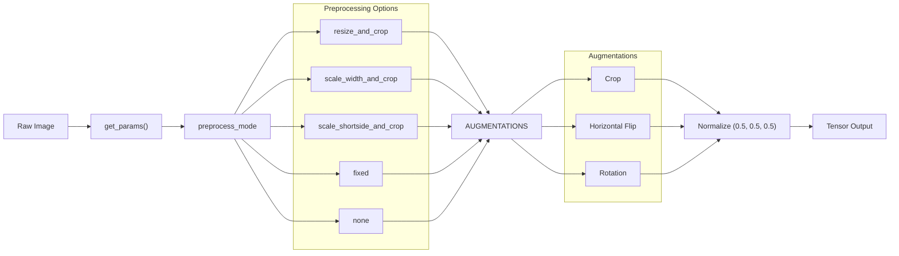

**Sources:** [data/base_dataset.py:25-84](), [data/base_dataset.py:89-137]()

### Reference Image Selection

The system implements sophisticated reference image selection logic:

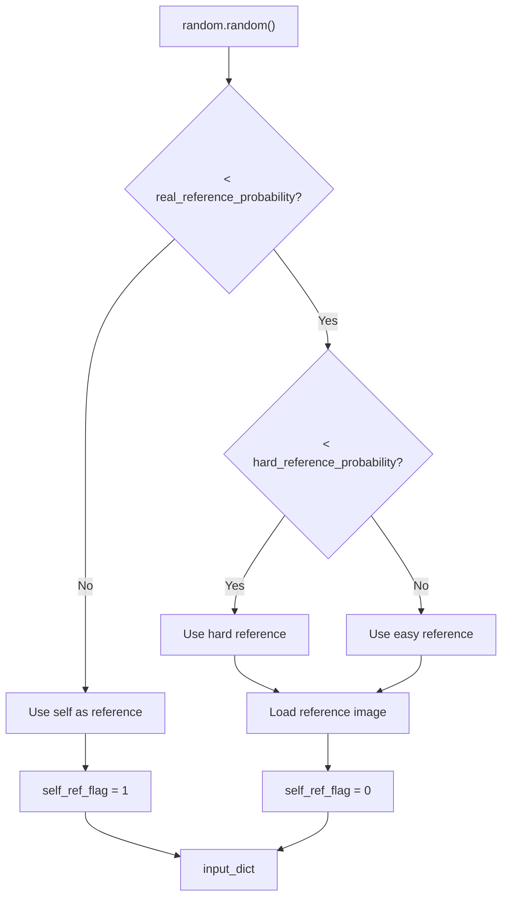

**Sources:** [data/pix2pix_dataset.py:87-136]()

## Integration with CoCosNet Framework

### Training Integration

The dataset system integrates with CoCosNet's training pipeline through standardized data dictionaries:

| Key | Type | Purpose |
|-----|------|---------|
| `label` | Tensor | Semantic labels or input modality |
| `image` | Tensor | Ground truth target image |
| `ref` | Tensor | Reference/exemplar image |
| `label_ref` | Tensor | Reference image labels |
| `self_ref` | Tensor | Flag indicating self-reference |
| `path` | String | Original image file path |

**Sources:** [data/pix2pix_dataset.py:138-149]()

### DataLoader Configuration

The `create_dataloader()` function configures PyTorch DataLoaders with CoCosNet-specific settings:

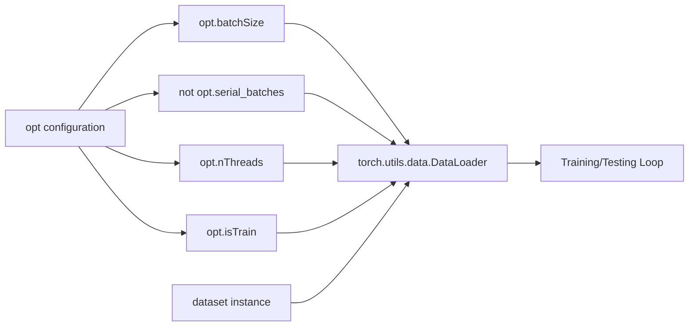

**Sources:** [data/__init__.py:47-54]()

This architecture provides a flexible, extensible foundation for supporting diverse datasets while maintaining consistent interfaces for the CoCosNet training and inference pipelines.

---

# Page: Dataset Architecture

# Dataset Architecture

<details>
<summary>Relevant source files</summary>

The following files were used as context for generating this wiki page:

- [data/__init__.py](data/__init__.py)
- [data/base_dataset.py](data/base_dataset.py)
- [data/image_folder.py](data/image_folder.py)
- [data/pix2pix_dataset.py](data/pix2pix_dataset.py)

</details>


This document covers the core dataset classes, inheritance hierarchy, and dynamic loading mechanisms that form the foundation of CoCosNet's data management system. It focuses on the `BaseDataset` abstract class, the `Pix2pixDataset` implementation, and the factory pattern used for dynamic dataset instantiation.

For information about specific dataset implementations for different domains, see [Dataset Implementations](#3.2). For details about data file formats and organization, see [Data Formats and Organization](#4).

## Dataset Class Hierarchy

The CoCosNet dataset architecture follows a hierarchical design pattern with `BaseDataset` as the abstract base class and `Pix2pixDataset` as the primary implementation for paired image translation tasks.

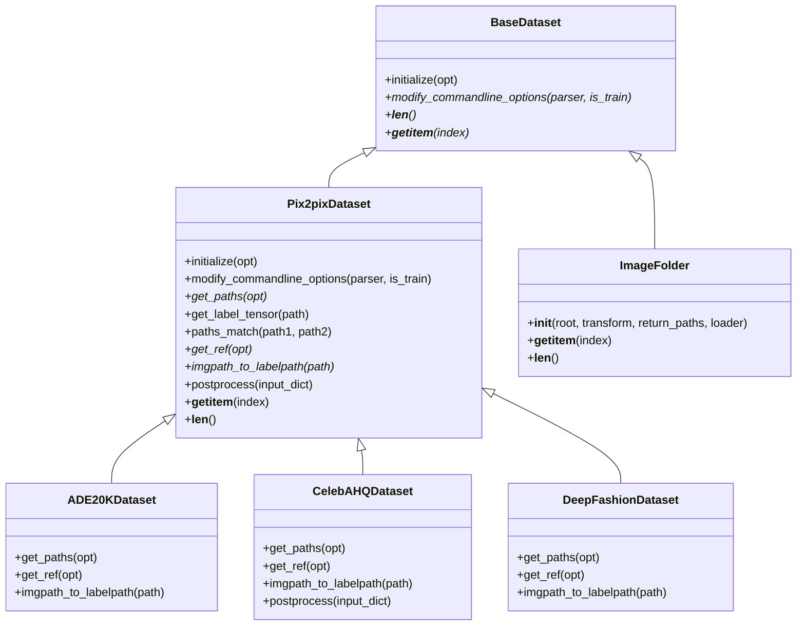

**Sources:** [data/base_dataset.py:13-23](), [data/pix2pix_dataset.py:14-161](), [data/image_folder.py:65-93]()

## Dynamic Dataset Loading System

The dataset loading system uses a factory pattern with dynamic module importing to instantiate dataset classes based on command-line arguments.

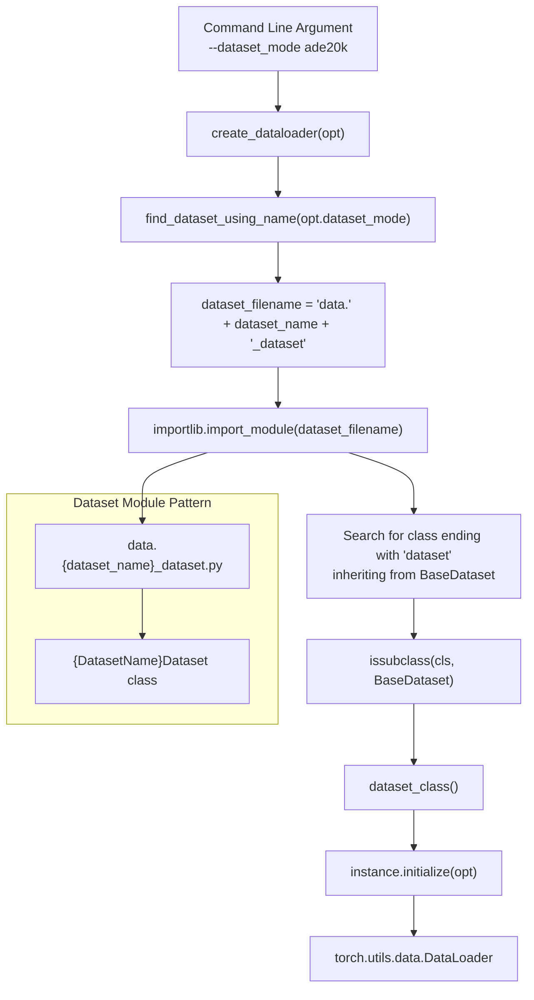

**Sources:** [data/__init__.py:11-54]()

## BaseDataset Abstract Class

The `BaseDataset` class provides the foundation for all dataset implementations in the system, inheriting from PyTorch's `torch.utils.data.Dataset`.

### Core Interface

| Method | Description | Implementation |
|--------|-------------|----------------|
| `initialize(opt)` | Initialize dataset with command-line options | Must be implemented by subclasses |
| `modify_commandline_options(parser, is_train)` | Add dataset-specific command-line arguments | Static method, overridden by subclasses |
| `__getitem__(index)` | Return data sample at given index | Inherited from torch Dataset |
| `__len__()` | Return dataset size | Inherited from torch Dataset |

### Transform Pipeline

The `BaseDataset` module provides comprehensive image transformation utilities:

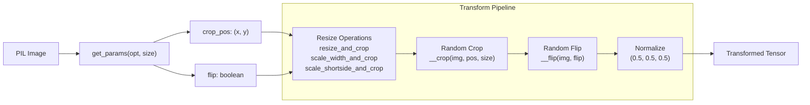

**Sources:** [data/base_dataset.py:13-137](), [data/base_dataset.py:25-86]()

## Pix2pixDataset Core Implementation

The `Pix2pixDataset` class serves as the primary base class for paired image translation tasks, implementing the core functionality for loading label-image pairs and reference images.

### Key Features

- **Paired Data Loading**: Handles label and image path pairing with optional validation
- **Reference Image System**: Supports real reference images and self-reference modes
- **Flexible Path Management**: Abstract methods for subclass customization

### Data Loading Pipeline

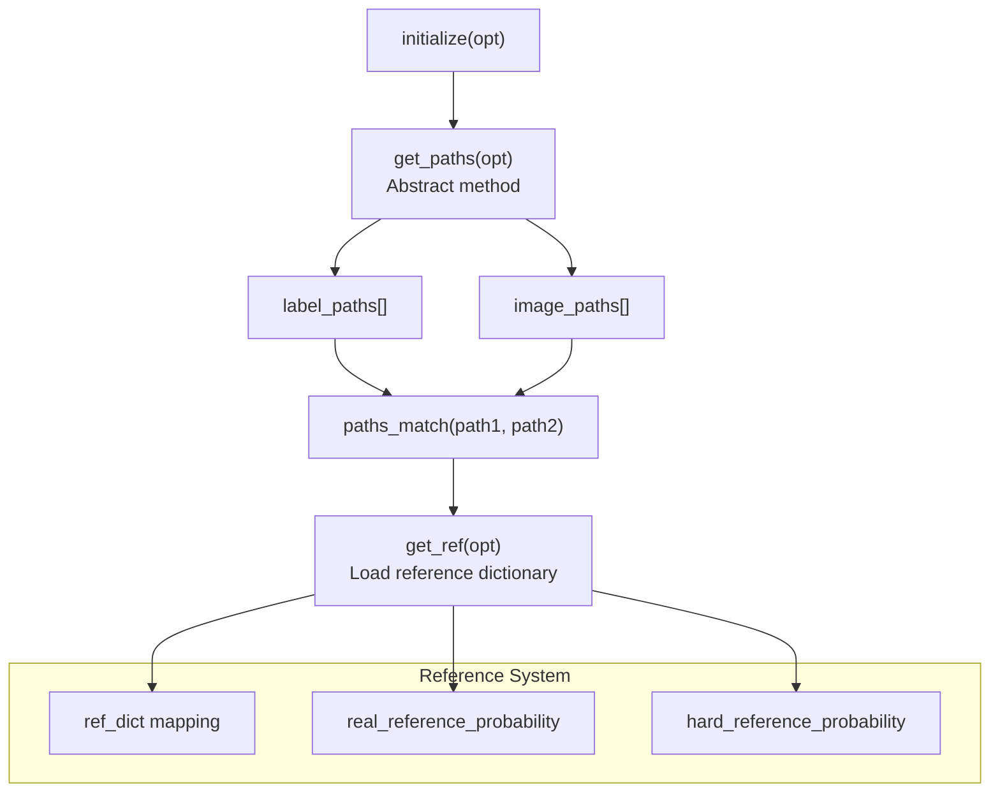

### Sample Generation Process

The `__getitem__` method in `Pix2pixDataset` follows a structured process:

1. **Label Processing**: Load and transform label image using `get_label_tensor()`
2. **Image Processing**: Load and transform input image 
3. **Reference Selection**: Choose between real reference or self-reference based on probability
4. **Output Assembly**: Create input dictionary with all components

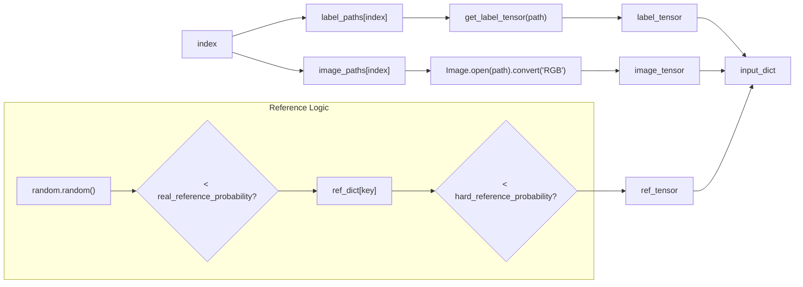

**Sources:** [data/pix2pix_dataset.py:14-161](), [data/pix2pix_dataset.py:67-149]()

## Image Processing Pipeline

The system provides a comprehensive set of image transformation utilities that handle various preprocessing modes and augmentation techniques.

### Preprocessing Modes

| Mode | Description | Implementation |
|------|-------------|----------------|
| `resize_and_crop` | Resize to `load_size`, then random crop | `transforms.Resize()` + `__crop()` |
| `scale_width_and_crop` | Scale width to `load_size`, maintain aspect ratio | `__scale_width()` + `__crop()` |
| `scale_shortside_and_crop` | Scale shortest side to `load_size` | `__scale_shortside()` + `__crop()` |
| `none` | Make dimensions power of 2 | `__make_power_2()` |
| `fixed` | Resize to fixed dimensions with aspect ratio | `__resize()` |

### Transform Function Parameters

The `get_transform()` function accepts several key parameters:

- `method`: Interpolation method (Image.BICUBIC, Image.NEAREST)
- `normalize`: Whether to apply normalization (default: True)
- `toTensor`: Whether to convert to PyTorch tensor (default: True)

**Sources:** [data/base_dataset.py:47-137](), [data/base_dataset.py:89-135]()

## Factory Pattern Implementation

The dataset factory system enables runtime dataset selection through a standardized naming convention and dynamic importing mechanism.

### Naming Convention

- **Module Name**: `data.{dataset_name}_dataset.py`
- **Class Name**: `{DatasetName}Dataset` (case-insensitive matching)
- **Inheritance**: Must inherit from `BaseDataset`

### Factory Functions

| Function | Purpose | Parameters |
|----------|---------|------------|
| `find_dataset_using_name()` | Locate and return dataset class | `dataset_name: str` |
| `get_option_setter()` | Get dataset-specific option modifier | `dataset_name: str` |
| `create_dataloader()` | Create configured PyTorch DataLoader | `opt: Namespace` |

The factory validates that discovered classes properly inherit from `BaseDataset` using `issubclass()` checks, ensuring type safety in the dynamic loading process.

**Sources:** [data/__init__.py:11-54](), [data/__init__.py:21-33]()

---

# Page: Dataset Implementations

# Dataset Implementations

<details>
<summary>Relevant source files</summary>

The following files were used as context for generating this wiki page:

- [data/ade20k_dataset.py](data/ade20k_dataset.py)
- [data/celebahq_dataset.py](data/celebahq_dataset.py)
- [data/deepfashion_dataset.py](data/deepfashion_dataset.py)
- [data/flickr_dataset.py](data/flickr_dataset.py)

</details>


This document covers the specific dataset implementations provided in CoCosNet for different domains and modalities. Each implementation extends the base dataset architecture to handle domain-specific data formats, preprocessing requirements, and reference systems. For information about the core dataset architecture and factory pattern, see [Dataset Architecture](#3.1).

## Overview

CoCosNet provides four primary dataset implementations, each designed for specific cross-domain correspondence learning tasks:

| Dataset | Domain | Input Modality | Label Channels | Primary Use Case |
|---------|--------|----------------|----------------|------------------|
| `ADE20KDataset` | Scene Parsing | Semantic Masks | 150 | Mask-to-image translation |
| `CelebAHQDataset` | Face Generation | Facial Masks | 19 | Mask-to-face synthesis |
| `DeepFashionDataset` | Fashion/Pose | Human Poses | 20 | Pose-to-person generation |
| `FlickrDataset` | General Images | Semantic Masks | 150 | General image translation |

All implementations inherit from `Pix2pixDataset` and follow the same basic interface while providing domain-specific customizations.

## Dataset Implementation Architecture

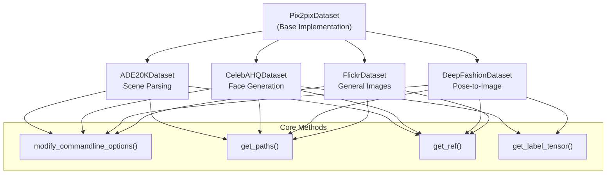

Sources: [data/ade20k_dataset.py:9](), [data/celebahq_dataset.py:11](), [data/deepfashion_dataset.py:15](), [data/flickr_dataset.py:7]()

## Domain-Specific Processing Pipelines

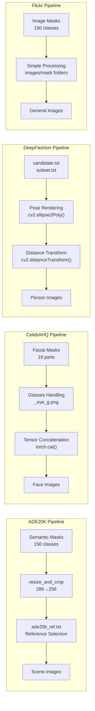

Sources: [data/ade20k_dataset.py:14-25](), [data/celebahq_dataset.py:67-84](), [data/deepfashion_dataset.py:111-169](), [data/flickr_dataset.py:25-34]()

## ADE20K Scene Parsing Dataset

The `ADE20KDataset` handles semantic scene parsing with 150 predefined classes for mask-to-image translation tasks.

### Configuration
- **Label channels**: 150 semantic classes
- **Preprocessing**: `resize_and_crop` mode
- **Load size**: 286 (train) / 256 (test)
- **Crop size**: 256×256
- **Don't care labels**: Enabled for unknown regions

### File Organization
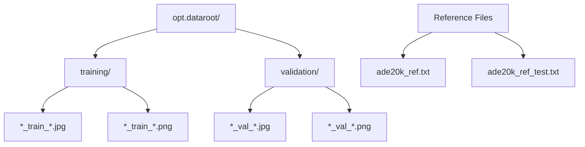

### Key Implementation Details
- Uses [make_dataset()]() from `image_folder.py` for recursive file discovery
- Filters files based on phase-specific naming patterns ([data/ade20k_dataset.py:36]())
- Separates JPG images from PNG masks during path collection
- Reference dictionary maps image keys to exemplar candidates

Sources: [data/ade20k_dataset.py:27-43](), [data/ade20k_dataset.py:45-59]()

## CelebAHQ Face Generation Dataset

The `CelebAHQDataset` specializes in face generation tasks, supporting both standard facial part masks and glasses-aware processing.

### Configuration
- **Label channels**: 19 facial parts (hair, skin, eyes, nose, mouth, etc.)
- **Preprocessing**: `resize_and_crop` mode with no pairing check
- **Load size**: 286 (train) / 256 (test)
- **Special handling**: Glasses masks processed separately

### Facial Parts Structure
The dataset handles 19 facial components:
```
hair, skin, l_brow, r_brow, l_eye, r_eye, l_ear, r_ear, nose, 
u_lip, mouth, l_lip, neck, cloth, hat, eye_g, ear_r, neck_l
```

### Glasses Processing Pipeline
```mermaid
graph LR
    MainMask["all_parts_except_glasses/<br/>XXXXX.png"] --> LoadMain["Image.open().convert('L')"]
    GlassesMask["subfolder/<br/>XXXXX_eye_g.png"] --> LoadGlasses["Load or Create Zero Mask"]
    
    LoadMain --> Transform["get_transform()<br/>Image.NEAREST"]
    LoadGlasses --> Transform
    
    Transform --> Concat["torch.cat()<br/>Combine Channels"]
    Concat --> Output["19-channel Label Tensor"]
```

### Implementation Highlights
- Custom `get_label_tensor()` method combines base masks with glasses ([data/celebahq_dataset.py:67-84]())
- Hierarchical folder structure with 2000-image subdirectories ([data/celebahq_dataset.py:73]())
- Automatic glasses mask detection and zero-padding when missing ([data/celebahq_dataset.py:74-77]())

Sources: [data/celebahq_dataset.py:31-47](), [data/celebahq_dataset.py:67-84]()

## DeepFashion Pose-to-Image Dataset

The `DeepFashionDataset` implements human pose-to-image generation using complex pose rendering and distance transform techniques.

### Configuration
- **Label channels**: 20 (pose + 17 distance transform channels)
- **Preprocessing**: `resize_and_crop` mode with no pairing check
- **Pose data**: Uses `candidate.txt` and `subset.txt` files
- **Reference modes**: VGG-based or video-like reference selection

### Pose Processing Architecture
```mermaid
graph TB
    PoseFiles["candidate.txt<br/>subset.txt"] --> LoadPose["np.loadtxt()"]
    
    LoadPose --> JointDetection["18 Joint Detection<br/>cv2.circle()"]
    JointDetection --> LimbConnection["17 Limb Connections<br/>cv2.ellipse2Poly()"]
    
    LimbConnection --> PoseCanvas["RGB Pose Visualization"]
    LimbConnection --> JointMasks["17 Individual Joint Masks"]
    
    JointMasks --> DistTransform["cv2.distanceTransform()<br/>DIST_L1, kernel=3"]
    DistTransform --> ClipNormalize["np.clip(dist/3, 0, 255)"]
    
    PoseCanvas --> Transform1["get_transform()<br/>Image.NEAREST"]
    ClipNormalize --> Transform2["get_transform()<br/>Image.BILINEAR"]
    
    Transform1 --> PoseTensor["3-channel Pose Tensor"]
    Transform2 --> DistTensors["17-channel Distance Tensors"]
    
    PoseTensor --> Concatenate["torch.cat()"]
    DistTensors --> Concatenate
    Concatenate --> Output["20-channel Label Tensor"]
```

### Limb Sequence Definition
The pose skeleton uses a predefined limb connectivity structure:
```python
limbSeq = [[2, 3], [2, 6], [3, 4], [4, 5], [6, 7], [7, 8], [2, 9], [9, 10], 
           [10, 11], [2, 12], [12, 13], [13, 14], [2, 1], [1, 15], [15, 17], 
           [1, 16], [16, 18], [3, 17], [6, 18]]
```

### Reference Selection Modes
- **VGG Mode**: Uses `deepfashion_ref.txt` for similarity-based selection
- **Video-like Mode**: Uses `deepfashion_self_pair.txt` for temporal consistency
- Training phase adds random image sampling for diversity

Sources: [data/deepfashion_dataset.py:111-169](), [data/deepfashion_dataset.py:98-102](), [data/deepfashion_dataset.py:54-96]()

## Flickr General Dataset

The `FlickrDataset` provides a simplified implementation for general image collections with semantic masks.

### Configuration
- **Label channels**: 150 (similar to ADE20K)
- **File structure**: Simple `images/` and `mask/` folders
- **Reference system**: Uses `flickr_ref.txt` and `flickr_ref_test_from_train.txt`

### File Organization
```mermaid
graph TD
    Root["opt.dataroot/"] --> Images["images/"]
    Root --> Masks["mask/"]
    Root --> TestImages["test/images/"]
    
    Images --> ImgFiles["*.jpg"]
    Masks --> MaskFiles["*.png"]
    TestImages --> TestFiles["*.jpg"]
    
    RefSystem["Reference System"] --> FlickrRef["flickr_ref.txt"]
    RefSystem --> FlickrTestRef["flickr_ref_test_from_train.txt"]
```

### Implementation
- Simplified path discovery using `os.listdir()` ([data/flickr_dataset.py:29-32]())
- Direct mapping between image and mask folders via `imgpath_to_labelpath()` ([data/flickr_dataset.py:52-54]())
- Supports cross-split reference selection during test phase

Sources: [data/flickr_dataset.py:25-50]()

## Reference File Systems

All datasets use text-based reference files to define exemplar relationships for cross-domain correspondence learning:

| Dataset | Training Reference | Test Reference | Format |
|---------|-------------------|----------------|---------|
| ADE20K | `ade20k_ref.txt` | `ade20k_ref_test.txt` | `key,ref1,ref2,...,refN` |
| CelebAHQ | `celebahq_ref.txt` | `celebahq_ref_test.txt` | `key,ref1,ref2,...,refN` |
| DeepFashion | `deepfashion_ref.txt` | `deepfashion_ref_test.txt` | `key,ref1,ref2,...,refN` |
| Flickr | `flickr_ref.txt` | `flickr_ref_test_from_train.txt` | `key,ref1,ref2,...,refN` |

During training, datasets typically use only the first and last reference for efficiency, while test phase utilizes all available references for comprehensive evaluation.

Sources: [data/ade20k_dataset.py:45-59](), [data/celebahq_dataset.py:49-65](), [data/deepfashion_dataset.py:80-96](), [data/flickr_dataset.py:36-50]()

---

# Page: ADE20K Dataset

# ADE20K Dataset

<details>
<summary>Relevant source files</summary>

The following files were used as context for generating this wiki page:

- [data/ade20k_dataset.py](data/ade20k_dataset.py)
- [data/ade20k_ref_test.txt](data/ade20k_ref_test.txt)

</details>


## Purpose and Scope

This document covers the ADE20K dataset implementation in CoCosNet, specifically the `ADE20KDataset` class that enables mask-to-image translation for scene parsing tasks. The ADE20K dataset contains scene images with corresponding semantic segmentation masks across 150 object and scene categories.

For information about the broader dataset architecture and factory pattern, see [Dataset Architecture](#3.1). For other dataset implementations, see [Dataset Implementations](#3.2).

## Dataset Overview

The `ADE20KDataset` class provides integration with the ADE20K scene parsing dataset, enabling cross-domain correspondence learning between semantic masks and natural scene images. This implementation supports both training and inference phases with appropriate data splits and reference mappings.

```mermaid
graph TD
    subgraph "ADE20K Integration"
        ADE20K["ADE20KDataset"]
        PIX2PIX["Pix2pixDataset"]
        BASE["BaseDataset"]
        
        ADE20K --> PIX2PIX
        PIX2PIX --> BASE
    end
    
    subgraph "Core Functionality"
        MODIFY["modify_commandline_options()"]
        GET_PATHS["get_paths()"]
        GET_REF["get_ref()"]
        
        ADE20K --> MODIFY
        ADE20K --> GET_PATHS
        ADE20K --> GET_REF
    end
    
    subgraph "Data Sources"
        TRAIN_FOLDER["training/"]
        VAL_FOLDER["validation/"]
        REF_TRAIN["ade20k_ref.txt"]
        REF_TEST["ade20k_ref_test.txt"]
        
        GET_PATHS --> TRAIN_FOLDER
        GET_PATHS --> VAL_FOLDER
        GET_REF --> REF_TRAIN
        GET_REF --> REF_TEST
    end
```

Sources: [data/ade20k_dataset.py:9-61]()

## Class Structure and Configuration

The `ADE20KDataset` class inherits from `Pix2pixDataset` and customizes configuration options specific to scene parsing tasks. The class defines preprocessing parameters, image dimensions, and dataset-specific settings through the `modify_commandline_options` static method.

### Configuration Parameters

| Parameter | Training Value | Test Value | Purpose |
|-----------|---------------|------------|---------|
| `preprocess_mode` | `resize_and_crop` | `resize_and_crop` | Image preprocessing strategy |
| `load_size` | 286 | 256 | Initial image loading size |
| `crop_size` | 256 | 256 | Final cropped image size |
| `label_nc` | 150 | 150 | Number of semantic label classes |
| `contain_dontcare_label` | True | True | Handle undefined label regions |
| `cache_filelist_read` | False | False | Disable file list caching |

```mermaid
graph LR
    subgraph "Configuration Pipeline"
        PARSER["ArgumentParser"]
        PIX2PIX_OPTS["Pix2pixDataset.modify_commandline_options()"]
        ADE20K_OPTS["ADE20KDataset.modify_commandline_options()"]
        DEFAULTS["set_defaults()"]
        
        PARSER --> PIX2PIX_OPTS
        PIX2PIX_OPTS --> ADE20K_OPTS
        ADE20K_OPTS --> DEFAULTS
    end
    
    subgraph "Parameter Categories"
        PREPROCESS["preprocess_mode='resize_and_crop'"]
        DIMENSIONS["load_size, crop_size, display_winsize"]
        LABELS["label_nc=150, contain_dontcare_label=True"]
        CACHE["cache_filelist_read/write=False"]
        
        DEFAULTS --> PREPROCESS
        DEFAULTS --> DIMENSIONS
        DEFAULTS --> LABELS
        DEFAULTS --> CACHE
    end
```

Sources: [data/ade20k_dataset.py:11-25]()

## Data Organization and File Structure

The `get_paths` method handles the discovery and organization of image and label files within the ADE20K dataset directory structure. It differentiates between training and validation phases and filters files based on naming conventions.

### Directory Structure

```
dataroot/
├── training/
│   ├── *_train_*.jpg (scene images)
│   └── *_train_*.png (semantic masks)
└── validation/
    ├── *_val_*.jpg (scene images)
    └── *_val_*.png (semantic masks)
```

### File Discovery Pipeline

```mermaid
graph TD
    subgraph "Path Resolution"
        OPT_DATAROOT["opt.dataroot"]
        PHASE_MAP["phase='test' → subfolder='validation'<br/>phase='train' → subfolder='training'"]
        MAKE_DATASET["make_dataset()"]
        
        OPT_DATAROOT --> PHASE_MAP
        PHASE_MAP --> MAKE_DATASET
    end
    
    subgraph "File Filtering"
        ALL_IMAGES["all_images (sorted)"]
        PHASE_FILTER["filter by '_train_' or '_val_'"]
        EXT_FILTER["split by .jpg/.png extension"]
        
        MAKE_DATASET --> ALL_IMAGES
        ALL_IMAGES --> PHASE_FILTER
        PHASE_FILTER --> EXT_FILTER
    end
    
    subgraph "Output Paths"
        IMAGE_PATHS["image_paths (.jpg files)"]
        LABEL_PATHS["label_paths (.png files)"]
        
        EXT_FILTER --> IMAGE_PATHS
        EXT_FILTER --> LABEL_PATHS
    end
```

Sources: [data/ade20k_dataset.py:27-43]()

## Reference File System

The ADE20K dataset implementation uses reference files to establish correspondences between validation images and training images. This enables exemplar-based generation during inference by providing reference images for style transfer.

### Reference File Format

The reference files (`ade20k_ref.txt` and `ade20k_ref_test.txt`) contain comma-separated mappings:

```
ADE_val_00001232.jpg,ADE_train_00004996.jpg
ADE_val_00001517.jpg,ADE_train_00007201.jpg
ADE_val_00001697.jpg,ADE_train_00015171.jpg
```

### Reference Loading Logic

```mermaid
graph TD
    subgraph "Reference File Selection"
        PHASE_CHECK["opt.phase == 'test'"]
        FILE_TRAIN["./data/ade20k_ref.txt"]
        FILE_TEST["./data/ade20k_ref_test.txt"]
        
        PHASE_CHECK -->|True| FILE_TEST
        PHASE_CHECK -->|False| FILE_TRAIN
    end
    
    subgraph "Reference Parsing"
        READ_LINES["fd.readlines()"]
        PARSE_CSV["items = line.strip().split(',')"]
        BUILD_DICT["ref_dict[key] = val"]
        
        READ_LINES --> PARSE_CSV
        PARSE_CSV --> BUILD_DICT
    end
    
    subgraph "Value Assignment"
        TEST_MODE["phase='test': val = items[1:]"]
        TRAIN_MODE["phase='train': val = [items[1], items[-1]]"]
        FOLDER_TUPLE["train_test_folder = ('training', 'validation')"]
        
        BUILD_DICT --> TEST_MODE
        BUILD_DICT --> TRAIN_MODE
        BUILD_DICT --> FOLDER_TUPLE
    end
```

Sources: [data/ade20k_dataset.py:45-59](), [data/ade20k_ref_test.txt:1-6]()

## Data Loading Integration

The `ADE20KDataset` integrates with the broader CoCosNet data loading pipeline through inheritance from `Pix2pixDataset`. The class provides dataset-specific implementations while leveraging the core functionality of the parent classes.

### Integration Points

```mermaid
graph TB
    subgraph "Dataset Factory"
        FIND_DATASET["find_dataset_using_name('ade20k')"]
        IMPORT_MODULE["importlib.import_module('data.ade20k_dataset')"]
        GET_CLASS["getattr(module, 'ADE20KDataset')"]
        
        FIND_DATASET --> IMPORT_MODULE
        IMPORT_MODULE --> GET_CLASS
    end
    
    subgraph "Initialization Pipeline"
        CREATE_INSTANCE["ADE20KDataset()"]
        INITIALIZE["dataset.initialize(opt)"]
        GET_PATHS_CALL["self.get_paths(opt)"]
        GET_REF_CALL["self.get_ref(opt)"]
        
        GET_CLASS --> CREATE_INSTANCE
        CREATE_INSTANCE --> INITIALIZE
        INITIALIZE --> GET_PATHS_CALL
        INITIALIZE --> GET_REF_CALL
    end
    
    subgraph "Data Processing"
        PIX2PIX_INIT["Pix2pixDataset.initialize()"]
        LOAD_SIZE["load_size=286/256"]
        CROP_SIZE["crop_size=256"]
        LABEL_NC["label_nc=150"]
        
        GET_REF_CALL --> PIX2PIX_INIT
        PIX2PIX_INIT --> LOAD_SIZE
        PIX2PIX_INIT --> CROP_SIZE
        PIX2PIX_INIT --> LABEL_NC
    end
```

Sources: [data/ade20k_dataset.py:9-61]()

## Implementation Details

### Method Signatures

The `ADE20KDataset` class implements three key methods:

- **`modify_commandline_options(parser, is_train)`**: Static method that configures dataset-specific command-line options
- **`get_paths(opt)`**: Returns tuple of `(label_paths, image_paths)` for the specified phase
- **`get_ref(opt)`**: Returns tuple of `(ref_dict, train_test_folder)` containing reference mappings

### Key Features

1. **150 Semantic Classes**: Supports the full ADE20K label vocabulary with `label_nc=150`
2. **Phase-Aware Processing**: Handles both training and validation phases with appropriate folder mapping
3. **Reference-Based Generation**: Enables exemplar-based image synthesis through reference file system
4. **Optimized Caching**: Disables file list caching for test phase to ensure fresh data loading

Sources: [data/ade20k_dataset.py:11-61]()

---

# Page: CelebAHQ Datasets

# CelebAHQ Datasets

<details>
<summary>Relevant source files</summary>

The following files were used as context for generating this wiki page:

- [data/celebahq_dataset.py](data/celebahq_dataset.py)
- [data/celebahq_ref_test.txt](data/celebahq_ref_test.txt)
- [data/celebahqedge_dataset.py](data/celebahqedge_dataset.py)

</details>


This document covers the CelebAHQ dataset implementations in the CoCosNet framework, which provide face generation capabilities through both mask-to-face and edge-to-face translation. The CelebAHQ datasets support facial part segmentation with detailed semantic labels for high-quality face synthesis.

For information about the overall dataset architecture and factory pattern, see [Dataset Architecture](#3.1). For other dataset implementations, see [Dataset Implementations](#3.2).

## Dataset Implementations Overview

The CelebAHQ datasets consist of two main implementations that extend the base `Pix2pixDataset` class:

```mermaid
graph TB
    subgraph "CelebAHQ Dataset Hierarchy"
        Pix2pixDataset["Pix2pixDataset<br/>Base Implementation"]
        CelebAHQDataset["CelebAHQDataset<br/>Mask-to-Face Translation"]
        CelebAHQEdgeDataset["CelebAHQEdgeDataset<br/>Edge-to-Face Translation"]
    end
    
    subgraph "Data Processing Pipeline"
        ImageInput["Face Images<br/>CelebA-HQ-img/*.jpg"]
        MaskInput["Facial Masks<br/>CelebAMask-HQ-mask-anno"]
        GlassesMask["Glasses Masks<br/>*_eye_g.png"]
        EdgeProcessing["Edge Detection<br/>Canny + Facial Parts"]
        DistanceTransform["Distance Transform<br/>cv2.distanceTransform"]
    end
    
    subgraph "Output Configurations"
        MaskOutput["19 Label Channels<br/>Including Glasses"]
        EdgeOutput["15 Label Channels<br/>Edge + Distance Maps"]
    end
    
    Pix2pixDataset --> CelebAHQDataset
    Pix2pixDataset --> CelebAHQEdgeDataset
    
    ImageInput --> CelebAHQDataset
    MaskInput --> CelebAHQDataset
    GlassesMask --> CelebAHQDataset
    
    ImageInput --> CelebAHQEdgeDataset
    MaskInput --> EdgeProcessing
    EdgeProcessing --> DistanceTransform
    DistanceTransform --> CelebAHQEdgeDataset
    
    CelebAHQDataset --> MaskOutput
    CelebAHQEdgeDataset --> EdgeOutput
```

Sources: [data/celebahq_dataset.py:1-90](), [data/celebahqedge_dataset.py:1-142]()

## CelebAHQDataset Implementation

The `CelebAHQDataset` class implements mask-to-face translation with detailed facial part segmentation. It processes 19 semantic label channels including facial features and accessories.

### Facial Part Labels

The dataset handles the following facial parts as documented in the code:

| Category | Parts |
|----------|-------|
| Facial Features | `hair`, `skin`, `l_brow`, `r_brow`, `l_eye`, `r_eye`, `nose`, `u_lip`, `mouth`, `l_lip` |
| Accessories | `l_ear`, `r_ear`, `neck`, `cloth`, `hat`, `eye_g` (glasses), `ear_r`, `neck_l` |

### Configuration Parameters

The dataset configures specific parameters for CelebAHQ processing:

| Parameter | Training Value | Test Value | Purpose |
|-----------|---------------|------------|---------|
| `load_size` | 286 | 256 | Image loading dimension |
| `crop_size` | 256 | 256 | Final crop dimension |
| `label_nc` | 19 | 19 | Number of label channels |
| `preprocess_mode` | `resize_and_crop` | `resize_and_crop` | Preprocessing strategy |

Sources: [data/celebahq_dataset.py:15-29]()

### Label Processing Pipeline

```mermaid
graph LR
    subgraph "Label Tensor Construction"
        BaseLabel["Base Facial Parts<br/>all_parts_except_glasses/*.png"]
        GlassesLabel["Glasses Mask<br/>*_eye_g.png"]
        Transform["Image Transform<br/>get_transform()"]
        Combine["torch.cat()<br/>Concatenate Channels"]
    end
    
    subgraph "Path Resolution"
        ImagePath["Image Path<br/>CelebA-HQ-img/*.jpg"]
        LabelPath["Label Path<br/>all_parts_except_glasses/*.png"]
        GlassesPath["Glasses Path<br/>*/idx_eye_g.png"]
    end
    
    ImagePath --> LabelPath
    BaseLabel --> Transform
    GlassesLabel --> Transform
    Transform --> Combine
    LabelPath --> BaseLabel
    LabelPath --> GlassesPath
    GlassesPath --> GlassesLabel
```

The `get_label_tensor` method combines base facial parts with glasses masks:

Sources: [data/celebahq_dataset.py:67-84]()

## CelebAHQEdgeDataset Implementation

The `CelebAHQEdgeDataset` class implements edge-to-face translation using edge detection and distance transforms. It processes 15 label channels focused on edge maps and distance-based features.

### Edge Processing Components

```mermaid
graph TB
    subgraph "Edge Detection Pipeline"
        FacialParts["Inner Facial Parts<br/>skin, brow, eye, ear, nose, lip, hair"]
        EdgeDetection["get_edges()<br/>Boundary Detection"]
        DistanceTransform["cv2.distanceTransform<br/>Distance Maps"]
        CannyEdge["Canny Edge Detection<br/>Background Edges"]
    end
    
    subgraph "Label Channel Assembly"
        AllEdges["Combined Edges<br/>tensor_edges_all"]
        DistanceMaps["Distance Maps<br/>tensors_dist (13 channels)"]
        FacialEdges["Facial Edges Only<br/>tensor_edges"]
        FinalTensor["Final Label Tensor<br/>15 channels total"]
    end
    
    FacialParts --> EdgeDetection
    EdgeDetection --> DistanceTransform
    EdgeDetection --> CannyEdge
    
    EdgeDetection --> AllEdges
    DistanceTransform --> DistanceMaps
    EdgeDetection --> FacialEdges
    
    AllEdges --> FinalTensor
    DistanceMaps --> FinalTensor
    FacialEdges --> FinalTensor
```

Sources: [data/celebahqedge_dataset.py:69-116]()

### Inner Facial Parts Processing

The edge dataset focuses on 13 specific inner facial parts:

```python
inner_parts = ['skin', 'l_brow', 'r_brow', 'l_eye', 'r_eye', 'l_ear', 'r_ear', 
               'nose', 'u_lip', 'mouth', 'l_lip', 'eye_g', 'hair']
```

Each part undergoes edge detection and distance transform processing to create feature-rich edge representations.

Sources: [data/celebahqedge_dataset.py:77-103]()

## Data Organization and File Structure

### Directory Structure

```mermaid
graph TD
    subgraph "CelebAHQ Data Organization"
        DataRoot["dataroot/"]
        TrainTxt["train.txt<br/>Training file list"]
        ValTxt["val.txt<br/>Validation file list"]
        
        ImageDir["CelebA-HQ-img/<br/>Face images"]
        MaskDir["CelebAMask-HQ-mask-anno/<br/>Segmentation masks"]
        
        AllParts["all_parts_except_glasses/<br/>Base facial parts"]
        Subfolders["Subfolders 0/, 1/, 2/, ...<br/>Organized by image ID"]
        
        PartMasks["Individual part masks<br/>*_skin.png, *_hair.png, etc."]
        GlassesMasks["Glasses masks<br/>*_eye_g.png"]
    end
    
    DataRoot --> TrainTxt
    DataRoot --> ValTxt
    DataRoot --> ImageDir
    DataRoot --> MaskDir
    
    MaskDir --> AllParts
    MaskDir --> Subfolders
    
    Subfolders --> PartMasks
    Subfolders --> GlassesMasks
```

### Path Resolution Methods

Both dataset classes implement path conversion methods:

| Method | Purpose | Source Dataset |
|--------|---------|----------------|
| `imgpath_to_labelpath` | Convert image path to label path | Both |
| `labelpath_to_imgpath` | Convert label path to image path | Edge dataset only |

The path resolution handles the subfolder organization where images are grouped by ID ranges (every 2000 images).

Sources: [data/celebahq_dataset.py:86-89](), [data/celebahqedge_dataset.py:118-128]()

## Reference System

### Reference File Structure

The datasets use reference files to define training and test pairs:

```mermaid
graph LR
    subgraph "Reference File System"
        RefTrain["celebahq_ref.txt<br/>Training References"]
        RefTest["celebahq_ref_test.txt<br/>Test References"]
        
        TrainPairs["Training: [source, target1, target2]<br/>Multiple references"]
        TestPairs["Test: [source, target]<br/>Single reference"]
    end
    
    RefTrain --> TrainPairs
    RefTest --> TestPairs
```

### Reference Data Format

The reference system provides correspondence between source and target images:

- **Training**: Each source image maps to first and last reference targets
- **Testing**: Each source image maps to one or more reference targets

Example from test reference file:
```
29922.jpg,26768.jpg
29883.jpg,5487.jpg
26969.jpg,6897.jpg
```

Sources: [data/celebahq_dataset.py:49-66](), [data/celebahqedge_dataset.py:51-67](), [data/celebahq_ref_test.txt:1-8]()

---

# Page: DeepFashion Dataset

# DeepFashion Dataset

<details>
<summary>Relevant source files</summary>

The following files were used as context for generating this wiki page:

- [data/deepfashion_dataset.py](data/deepfashion_dataset.py)
- [data/deepfashion_ref_test.txt](data/deepfashion_ref_test.txt)
- [data/deepfashion_self_pair.txt](data/deepfashion_self_pair.txt)

</details>


This document describes the `DeepFashionDataset` implementation, which provides pose-to-image generation capabilities for fashion images using human keypoint detection. The dataset processes pose keypoint data and transforms it into multi-channel pose representations for training and inference with the CoCosNet framework.

For general dataset architecture information, see [Dataset Architecture](#3.1). For other dataset implementations, see [Dataset Implementations](#3.2).

## Purpose and Scope

The `DeepFashionDataset` class enables pose-conditioned image synthesis by:
- Loading fashion images with corresponding human pose keypoint data
- Converting pose annotations into multi-channel tensor representations
- Applying distance transforms to joint and limb information
- Managing reference image selection for exemplar-based generation
- Supporting both training and test phases with appropriate data splits

## Class Architecture

```mermaid
graph TD
    BaseDataset["BaseDataset"] --> Pix2pixDataset["Pix2pixDataset"]
    Pix2pixDataset --> DeepFashionDataset["DeepFashionDataset"]
    
    DeepFashionDataset --> modify_commandline_options["modify_commandline_options()"]
    DeepFashionDataset --> get_paths["get_paths()"]
    DeepFashionDataset --> get_ref["get_ref()"]
    DeepFashionDataset --> get_label_tensor["get_label_tensor()"]
    
    get_ref --> get_ref_video_like["get_ref_video_like()"]
    get_ref --> get_ref_vgg["get_ref_vgg()"]
    
    get_label_tensor --> pose_rendering["Pose Rendering Pipeline"]
    get_label_tensor --> distance_transforms["Distance Transform Computation"]
```

Sources: [data/deepfashion_dataset.py:15-178]()

## Configuration Parameters

The dataset configures specific parameters optimized for fashion image generation:

| Parameter | Training Value | Test Value | Purpose |
|-----------|---------------|------------|---------|
| `preprocess_mode` | resize_and_crop | resize_and_crop | Image preprocessing method |
| `load_size` | 286 | 256 | Initial image size before cropping |
| `crop_size` | 256 | 256 | Final image size after cropping |
| `label_nc` | 20 | 20 | Number of label channels (pose + distance maps) |
| `no_pairing_check` | True | True | Disable strict image-label pairing validation |

The configuration is handled by the `modify_commandline_options` static method which inherits from `Pix2pixDataset` and applies fashion-specific overrides.

Sources: [data/deepfashion_dataset.py:16-31]()

## Data Loading Pipeline

```mermaid
graph TB
    subgraph "File System Structure"
        train_txt["train.txt / val.txt"]
        image_paths["img/WOMEN/Category/id_XXXXX/*.jpg"]
        pose_paths["pose/WOMEN/Category/id_XXXXX/*_{candidate,subset}.txt"]
    end
    
    subgraph "Path Resolution"
        get_paths["get_paths()"]
        path_conversion["Image → Pose Path Conversion"]
        imgpath_to_labelpath["imgpath_to_labelpath()"]
        labelpath_to_imgpath["labelpath_to_imgpath()"]
    end
    
    subgraph "Reference Management"
        ref_files["deepfashion_ref.txt / deepfashion_ref_test.txt"]
        self_pair["deepfashion_self_pair.txt"]
        get_ref_video_like["get_ref_video_like()"]
        get_ref_vgg["get_ref_vgg()"]
    end
    
    train_txt --> get_paths
    get_paths --> image_paths
    get_paths --> pose_paths
    
    path_conversion --> imgpath_to_labelpath
    path_conversion --> labelpath_to_imgpath
    
    ref_files --> get_ref_vgg
    self_pair --> get_ref_video_like
```

Sources: [data/deepfashion_dataset.py:33-52](), [data/deepfashion_dataset.py:171-177]()

## Pose Processing Architecture

The core functionality converts human pose keypoint data into multi-channel tensor representations:

```mermaid
graph TB
    subgraph "Input Data"
        candidate_txt["candidate.txt<br/>Keypoint coordinates"]
        subset_txt["subset.txt<br/>Limb connectivity"]
    end
    
    subgraph "Pose Rendering"
        limbSeq["limbSeq[19]<br/>Joint connectivity pairs"]
        joint_circles["Joint Circle Rendering<br/>cv2.circle()"]
        limb_polygons["Limb Polygon Rendering<br/>cv2.ellipse2Poly()"]
        canvas_composition["Canvas Composition<br/>cv2.addWeighted()"]
    end
    
    subgraph "Distance Transform Pipeline"
        individual_joints["Individual Joint Masks"]
        distance_maps["cv2.distanceTransform()<br/>DIST_L1, kernel=3"]
        tensor_conversion["Transform to Tensors"]
    end
    
    subgraph "Output Tensor"
        pose_tensor["pose_tensor[3]<br/>RGB pose visualization"]
        dist_tensors["dist_tensors[17]<br/>Distance maps per joint"]
        final_tensor["label_tensor[20]<br/>Concatenated output"]
    end
    
    candidate_txt --> joint_circles
    subset_txt --> limb_polygons
    limbSeq --> limb_polygons
    
    joint_circles --> canvas_composition
    limb_polygons --> canvas_composition
    canvas_composition --> pose_tensor
    
    limb_polygons --> individual_joints
    individual_joints --> distance_maps
    distance_maps --> tensor_conversion
    tensor_conversion --> dist_tensors
    
    pose_tensor --> final_tensor
    dist_tensors --> final_tensor
```

Sources: [data/deepfashion_dataset.py:111-169]()

## Reference Image Selection

The dataset supports two modes for reference image selection during training and inference:

### VGG Mode (Default)
- Uses pre-computed reference pairs from `deepfashion_ref.txt` files
- Training: Combines specified reference with random image selection
- Testing: Uses only pre-specified reference images

### Video-Like Mode
- Leverages `deepfashion_self_pair.txt` for self-paired images
- Incorporates additional random sampling for augmented reference sets
- Provides multiple reference candidates per target image

```mermaid
graph LR
    subgraph "Reference Selection Strategy"
        opt_video_like{"`opt.video_like`"}
        get_ref_vgg["get_ref_vgg()<br/>Fixed reference pairs"]
        get_ref_video_like["get_ref_video_like()<br/>Self-pairs + random"]
        
        opt_video_like -->|False| get_ref_vgg
        opt_video_like -->|True| get_ref_video_like
    end
    
    subgraph "Reference Files"
        ref_txt["deepfashion_ref.txt<br/>deepfashion_ref_test.txt"]
        self_pair_txt["deepfashion_self_pair.txt"]
        
        ref_txt --> get_ref_vgg
        self_pair_txt --> get_ref_video_like
    end
    
    subgraph "Output Format"
        ref_dict["ref_dict<br/>target_path → [ref_paths...]"]
    end
    
    get_ref_vgg --> ref_dict
    get_ref_video_like --> ref_dict
```

Sources: [data/deepfashion_dataset.py:54-102]()

## Pose Keypoint Schema

The dataset processes 18 keypoints using the following limb sequence definition:

| Limb Index | Connection | Body Part |
|------------|-----------|-----------|
| 0-6 | Upper body | Head, shoulders, arms |
| 7-11 | Torso | Spine, hips |
| 12-18 | Lower body | Legs, feet |

The `limbSeq` array defines 19 connections between keypoints, creating a skeletal representation that is rendered as colored polygons and converted to distance transforms for neural network processing.

Sources: [data/deepfashion_dataset.py:115-117]()

## Distance Transform Processing

Each limb segment generates an individual distance map using OpenCV's `cv2.distanceTransform` with L1 distance metric. The distance values are normalized and clipped to create smooth gradients around pose structures, providing the network with spatial relationship information between pose elements and image regions.

The final output tensor contains 20 channels:
- 3 channels: RGB pose visualization
- 17 channels: Distance maps for each limb segment

Sources: [data/deepfashion_dataset.py:158-169]()

---

# Page: Flickr Dataset

# Flickr Dataset

<details>
<summary>Relevant source files</summary>

The following files were used as context for generating this wiki page:

- [data/flickr_dataset.py](data/flickr_dataset.py)

</details>


## Purpose and Scope

The `FlickrDataset` class provides a general-purpose dataset implementation for processing Flickr image collections within the CoCosNet framework. This implementation supports image-to-image translation tasks using semantic masks and follows the standard dataset interface established by the framework's dataset management system.

For information about the broader dataset architecture, see [Dataset Architecture](#3.1). For other domain-specific implementations, see [ADE20K Dataset](#3.2.1), [CelebAHQ Datasets](#3.2.2), and [DeepFashion Dataset](#3.2.3).

## Class Architecture

The `FlickrDataset` follows the framework's inheritance hierarchy, extending the base `Pix2pixDataset` class with Flickr-specific configurations and path handling logic.

### Class Inheritance Diagram

```mermaid
graph TD
    BaseDataset["BaseDataset<br/>(Abstract Base)"]
    Pix2pixDataset["Pix2pixDataset<br/>(Core Implementation)"]
    FlickrDataset["FlickrDataset<br/>(Flickr-specific)"]
    
    BaseDataset --> Pix2pixDataset
    Pix2pixDataset --> FlickrDataset
    
    subgraph "Key Methods"
        modify_commandline_options["modify_commandline_options()"]
        get_paths["get_paths()"]
        get_ref["get_ref()"]
        imgpath_to_labelpath["imgpath_to_labelpath()"]
    end
    
    FlickrDataset --> modify_commandline_options
    FlickrDataset --> get_paths
    FlickrDataset --> get_ref
    FlickrDataset --> imgpath_to_labelpath
```

Sources: [data/flickr_dataset.py:1-67]()

### Class Definition

The `FlickrDataset` class is implemented as a minimal extension of `Pix2pixDataset`, overriding specific methods to handle Flickr dataset characteristics:

| Method | Purpose | Line Reference |
|--------|---------|----------------|
| `modify_commandline_options` | Sets dataset-specific configuration defaults | [data/flickr_dataset.py:10-23]() |
| `get_paths` | Discovers and organizes image and mask file paths | [data/flickr_dataset.py:25-34]() |
| `get_ref` | Loads reference mappings for training/testing | [data/flickr_dataset.py:36-50]() |
| `imgpath_to_labelpath` | Converts image paths to corresponding mask paths | [data/flickr_dataset.py:52-54]() |

Sources: [data/flickr_dataset.py:7-67]()

## Configuration and Options

The `FlickrDataset` establishes specific defaults through the `modify_commandline_options` static method, configuring the dataset for optimal Flickr image processing.

### Configuration Parameters

```mermaid
graph LR
    subgraph "Image Processing"
        preprocess_mode["preprocess_mode='resize_and_crop'"]
        load_size_train["load_size=286 (training)"]
        load_size_test["load_size=256 (testing)"]
        crop_size["crop_size=256"]
        display_winsize["display_winsize=256"]
    end
    
    subgraph "Label Configuration"
        label_nc["label_nc=150"]
        contain_dontcare["contain_dontcare_label=True"]
    end
    
    subgraph "Caching Settings"
        cache_read["cache_filelist_read=False"]
        cache_write["cache_filelist_write=False"]
    end
    
    FlickrDataset --> preprocess_mode
    FlickrDataset --> load_size_train
    FlickrDataset --> load_size_test
    FlickrDataset --> crop_size
    FlickrDataset --> display_winsize
    FlickrDataset --> label_nc
    FlickrDataset --> contain_dontcare
    FlickrDataset --> cache_read
    FlickrDataset --> cache_write
```

The configuration uses 150 label classes (`label_nc=150`), matching the semantic richness expected for general image datasets. Training uses a larger load size (286) than testing (256) to enable data augmentation during training phases.

Sources: [data/flickr_dataset.py:12-22]()

## Data Organization and File Paths

The `FlickrDataset` expects a specific directory structure that separates images from their corresponding semantic masks, with different organization for training and testing phases.

### File Structure and Path Resolution

```mermaid
graph TD
    subgraph "Training Phase"
        dataroot_train["opt.dataroot/"]
        images_train["images/"]
        mask_train["mask/"]
        
        dataroot_train --> images_train
        dataroot_train --> mask_train
    end
    
    subgraph "Testing Phase"
        dataroot_test["opt.dataroot/"]
        test_images["test/images/"]
        test_mask["test/mask/"]
        
        dataroot_test --> test_images
        dataroot_test --> test_mask
    end
    
    subgraph "Path Processing"
        get_paths["get_paths()"]
        os_listdir["os.listdir()"]
        path_sorting["sorted()"]
        path_joining["os.path.join()"]
        
        get_paths --> os_listdir
        os_listdir --> path_sorting
        path_sorting --> path_joining
    end
    
    images_train --> get_paths
    test_images --> get_paths
    mask_train --> get_paths
    test_mask --> get_paths
```

The `get_paths` method constructs file paths dynamically based on the training phase, using `root.replace('images', 'mask')` to derive mask paths from image paths.

Sources: [data/flickr_dataset.py:25-34]()

### Path Mapping Implementation

The dataset implements bidirectional path mapping between images and labels:

| Function | Input | Output | Implementation |
|----------|-------|--------|----------------|
| `get_paths` | `opt.dataroot`, `opt.phase` | `label_paths`, `image_paths` | [data/flickr_dataset.py:26-33]() |
| `imgpath_to_labelpath` | Image file path | Corresponding mask file path | [data/flickr_dataset.py:53]() |

Sources: [data/flickr_dataset.py:25-34](), [data/flickr_dataset.py:52-54]()

## Reference System

The `FlickrDataset` uses external reference files to manage training and testing splits, enabling controlled cross-validation and consistent evaluation.

### Reference File Processing

```mermaid
graph LR
    subgraph "Reference Files"
        flickr_ref["flickr_ref.txt<br/>(training)"]
        flickr_ref_test["flickr_ref_test_from_train.txt<br/>(testing)"]
    end
    
    subgraph "Processing Logic"
        get_ref["get_ref()"]
        file_reading["fd.readlines()"]
        line_parsing["items = lines[i].strip().split(',')"]
        dict_building["ref_dict[key] = val"]
    end
    
    subgraph "Output Structure"
        ref_dict["ref_dict<br/>(key-value mappings)"]
        train_test_folder["train_test_folder<br/>('', 'test')"]
    end
    
    flickr_ref --> get_ref
    flickr_ref_test --> get_ref
    get_ref --> file_reading
    file_reading --> line_parsing
    line_parsing --> dict_building
    dict_building --> ref_dict
    get_ref --> train_test_folder
```

The reference system processes comma-separated files where each line contains a key followed by reference values. Training phase uses the first and last reference (`[items[1], items[-1]]`), while testing uses all references (`items[1:]`).

Sources: [data/flickr_dataset.py:36-50]()

### Reference File Format

| Phase | File | Line Format | Value Selection |
|-------|------|-------------|-----------------|
| Training | `flickr_ref.txt` | `key,ref1,ref2,...,refN` | `[ref1, refN]` |
| Testing | `flickr_ref_test_from_train.txt` | `key,ref1,ref2,...,refN` | `[ref1,ref2,...,refN]` |

Sources: [data/flickr_dataset.py:42-47]()

## Integration with CoCosNet Framework

The `FlickrDataset` integrates seamlessly with the CoCosNet framework's dataset management system through the established factory pattern and dynamic loading mechanism.

### Framework Integration Flow

```mermaid
graph TD
    subgraph "Dataset Factory"
        find_dataset_using_name["find_dataset_using_name('flickr')"]
        import_module["importlib.import_module('data.flickr_dataset')"]
        class_instantiation["FlickrDataset()"]
    end
    
    subgraph "Initialization"
        modify_commandline_options["FlickrDataset.modify_commandline_options()"]
        dataset_initialize["dataset.initialize()"]
        get_paths["get_paths()"]
        get_ref["get_ref()"]
    end
    
    subgraph "Runtime Operations"
        getitem["__getitem__()"]
        imgpath_to_labelpath["imgpath_to_labelpath()"]
        data_loading["Data Loading Pipeline"]
    end
    
    find_dataset_using_name --> import_module
    import_module --> class_instantiation
    class_instantiation --> modify_commandline_options
    modify_commandline_options --> dataset_initialize
    dataset_initialize --> get_paths
    dataset_initialize --> get_ref
    
    get_paths --> getitem
    get_ref --> getitem
    getitem --> imgpath_to_labelpath
    imgpath_to_labelpath --> data_loading
```

The dataset follows the framework's naming convention (`flickr_dataset.py` containing `FlickrDataset` class) and implements the required interface methods inherited from `Pix2pixDataset`.

Sources: [data/flickr_dataset.py:7](), [data/flickr_dataset.py:10-23]()

---

# Page: Data Formats and Organization

# Data Formats and Organization

<details>
<summary>Relevant source files</summary>

The following files were used as context for generating this wiki page:

- [imgs/DeepFashion/img/WOMEN/Blouses_Shirts/id_00007636/01_1_front.jpg](imgs/DeepFashion/img/WOMEN/Blouses_Shirts/id_00007636/01_1_front.jpg)
- [imgs/DeepFashion/pose/WOMEN/Blouses_Shirts/id_00007636/01_1_front_candidate.txt](imgs/DeepFashion/pose/WOMEN/Blouses_Shirts/id_00007636/01_1_front_candidate.txt)
- [imgs/DeepFashion/pose/WOMEN/Blouses_Shirts/id_00007636/01_1_front_subset.txt](imgs/DeepFashion/pose/WOMEN/Blouses_Shirts/id_00007636/01_1_front_subset.txt)
- [imgs/DeepFashion/pose/WOMEN/Cardigans/id_00006266/02_2_side_candidate.txt](imgs/DeepFashion/pose/WOMEN/Cardigans/id_00006266/02_2_side_candidate.txt)
- [imgs/DeepFashion/pose/WOMEN/Cardigans/id_00006266/02_2_side_subset.txt](imgs/DeepFashion/pose/WOMEN/Cardigans/id_00006266/02_2_side_subset.txt)

</details>


This document describes the file structures, naming conventions, and data formats used across different datasets in the CoCosNet framework. It covers the organization of image files, reference files, pose data formats, and dataset-specific directory hierarchies that support the cross-domain correspondence learning system.

For information about how these data formats are processed by the dataset implementations, see [Dataset Implementations](#3.2). For details on the dataset loading architecture that consumes these formats, see [Dataset Architecture](#3.1).

## File System Organization

The CoCosNet codebase organizes data assets using a hierarchical structure that separates different types of content while maintaining consistent naming patterns across datasets.

```mermaid
graph TD
    ROOT["CoCosNet Root Directory"]
    
    subgraph "Core Directories"
        DATA_DIR["data/"]
        IMGS_DIR["imgs/"]
        MODELS_DIR["models/"]
    end
    
    subgraph "Dataset Implementations"
        REF_FILES["Reference Files"]
        ADE_DS["ade20k_dataset.py"]
        CELEB_DS["celebahq_dataset.py"]
        FASHION_DS["deepfashion_dataset.py"]
        FLICKR_DS["flickr_dataset.py"]
    end
    
    subgraph "Image Asset Hierarchies"
        DF_IMG["DeepFashion/img/"]
        DF_POSE["DeepFashion/pose/"]
        CELEB_IMG["CelebA-HQ-img/"]
        CELEB_MASK["CelebAMask-HQ-mask-anno/"]
        ADE_TRAIN["ADE20k/training/"]
        ADE_VAL["ADE20k/validation/"]
    end
    
    subgraph "Reference and Configuration"
        REF_TRAIN["*_ref.txt"]
        REF_TEST["*_ref_test.txt"]
        TRAIN_SPLIT["train.txt"]
        VAL_SPLIT["val.txt"]
    end
    
    ROOT --> DATA_DIR
    ROOT --> IMGS_DIR
    ROOT --> MODELS_DIR
    
    DATA_DIR --> REF_FILES
    DATA_DIR --> ADE_DS
    DATA_DIR --> CELEB_DS
    DATA_DIR --> FASHION_DS
    DATA_DIR --> FLICKR_DS
    
    IMGS_DIR --> DF_IMG
    IMGS_DIR --> DF_POSE
    IMGS_DIR --> CELEB_IMG
    IMGS_DIR --> CELEB_MASK
    IMGS_DIR --> ADE_TRAIN
    IMGS_DIR --> ADE_VAL
    
    REF_FILES --> REF_TRAIN
    REF_FILES --> REF_TEST
    REF_FILES --> TRAIN_SPLIT
    REF_FILES --> VAL_SPLIT
```

**Sources:** [imgs/DeepFashion/img/WOMEN/Blouses_Shirts/id_00007636/01_1_front.jpg](), [imgs/DeepFashion/pose/WOMEN/Blouses_Shirts/id_00007636/01_1_front_candidate.txt]()

## Dataset-Specific Directory Structures

Each dataset follows a specific organizational pattern that reflects its domain and data characteristics.

### DeepFashion Dataset Structure

The DeepFashion dataset uses a hierarchical structure that separates images and pose data while maintaining parallel directory trees.

```mermaid
graph LR
    subgraph "DeepFashion Image Hierarchy"
        DF_ROOT["DeepFashion/"]
        IMG_DIR["img/"]
        GENDER["WOMEN/"]
        CATEGORY["Blouses_Shirts/"]
        ITEM_ID["id_00007636/"]
        IMG_FILE["01_1_front.jpg"]
        
        DF_ROOT --> IMG_DIR
        IMG_DIR --> GENDER
        GENDER --> CATEGORY
        CATEGORY --> ITEM_ID
        ITEM_ID --> IMG_FILE
    end
    
    subgraph "DeepFashion Pose Hierarchy"
        DF_ROOT2["DeepFashion/"]
        POSE_DIR["pose/"]
        GENDER2["WOMEN/"]
        CATEGORY2["Blouses_Shirts/"]
        ITEM_ID2["id_00007636/"]
        CANDIDATE["01_1_front_candidate.txt"]
        SUBSET["01_1_front_subset.txt"]
        
        DF_ROOT2 --> POSE_DIR
        POSE_DIR --> GENDER2
        GENDER2 --> CATEGORY2
        CATEGORY2 --> ITEM_ID2
        ITEM_ID2 --> CANDIDATE
        ITEM_ID2 --> SUBSET
    end
```

**Sources:** [imgs/DeepFashion/img/WOMEN/Blouses_Shirts/id_00007636/01_1_front.jpg](), [imgs/DeepFashion/pose/WOMEN/Blouses_Shirts/id_00007636/01_1_front_candidate.txt](), [imgs/DeepFashion/pose/WOMEN/Blouses_Shirts/id_00007636/01_1_front_subset.txt]()

| Directory Level | Purpose | Example Values |
|-----------------|---------|----------------|
| `DeepFashion/` | Dataset root | Fixed |
| `img/` or `pose/` | Content type | `img`, `pose` |
| Gender | Target demographic | `WOMEN`, `MEN` |
| Category | Clothing type | `Blouses_Shirts`, `Cardigans` |
| Item ID | Unique item identifier | `id_00007636`, `id_00006266` |
| Filename | Specific view/angle | `01_1_front.jpg`, `02_2_side_candidate.txt` |

### CelebAHQ Dataset Structure

The CelebAHQ dataset maintains separate directories for images and mask annotations with synchronized naming.

| Component | Directory Path | File Pattern |
|-----------|----------------|--------------|
| Face Images | `CelebA-HQ-img/` | `{id}.jpg` |
| Mask Annotations | `CelebAMask-HQ-mask-anno/` | `{id}.png` |
| Glasses Masks | `CelebAMask-HQ-mask-anno/` | `{id}_eye_g.png` |

### ADE20K Dataset Structure

The ADE20K dataset uses a simpler structure with training and validation splits.

| Component | Directory Path | File Pattern |
|-----------|----------------|--------------|
| Training Images | `ADE20k/training/` | `*.jpg` |
| Validation Images | `ADE20k/validation/` | `*.jpg` |
| Training Masks | `ADE20k/training/` | `*_seg.png` |
| Validation Masks | `ADE20k/validation/` | `*_seg.png` |

## Pose Data Format

The DeepFashion dataset includes human pose keypoint data stored in two complementary file types: candidate files and subset files.

### Candidate Files Format

Candidate files (`*_candidate.txt`) contain detected keypoint coordinates with confidence scores.

```mermaid
graph TD
    subgraph "candidate.txt Structure"
        CANDIDATE_FILE["candidate.txt"]
        
        subgraph "Line Format"
            X_COORD["X Coordinate"]
            Y_COORD["Y Coordinate"] 
            CONFIDENCE["Confidence Score"]
            KEYPOINT_ID["Keypoint ID"]
        end
        
        subgraph "Example Values"
            LINE1["129.0 40.0 0.978 0.0"]
            LINE2["131.0 85.0 0.912 1.0"]
            LINE3["98.0 84.0 0.867 2.0"]
        end
        
        CANDIDATE_FILE --> X_COORD
        CANDIDATE_FILE --> Y_COORD
        CANDIDATE_FILE --> CONFIDENCE
        CANDIDATE_FILE --> KEYPOINT_ID
        
        X_COORD --> LINE1
        Y_COORD --> LINE1
        CONFIDENCE --> LINE1
        KEYPOINT_ID --> LINE1
    end
```

**Sources:** [imgs/DeepFashion/pose/WOMEN/Blouses_Shirts/id_00007636/01_1_front_candidate.txt:1-14]()

Each line in a candidate file follows the format:
```
<x_coordinate> <y_coordinate> <confidence_score> <keypoint_index>
```

| Field | Type | Description | Example |
|-------|------|-------------|---------|
| X Coordinate | `float` | Pixel x-position | `129.0` |
| Y Coordinate | `float` | Pixel y-position | `40.0` |
| Confidence Score | `float` | Detection confidence (0-1) | `0.978` |
| Keypoint Index | `float` | Keypoint identifier | `0.0` (head), `1.0` (neck), etc. |

### Subset Files Format

Subset files (`*_subset.txt`) define which keypoints from the candidate file are valid and should be used for pose rendering.

```mermaid
graph TD
    subgraph "subset.txt Structure"
        SUBSET_FILE["subset.txt"]
        
        subgraph "Content Format"
            VALID_IDS["Valid Keypoint IDs"]
            MISSING_IDS["Missing Keypoints (-1)"]
            TOTAL_COUNT["Total Keypoint Count"]
        end
        
        subgraph "Example Line"
            EXAMPLE["0.0 1.0 2.0 3.0 4.0 5.0 6.0 7.0 8.0 -1.0 -1.0 9.0 -1.0 -1.0 10.0 11.0 12.0 13.0 24.57 14.0"]
        end
        
        SUBSET_FILE --> VALID_IDS
        SUBSET_FILE --> MISSING_IDS
        SUBSET_FILE --> TOTAL_COUNT
        
        VALID_IDS --> EXAMPLE
        MISSING_IDS --> EXAMPLE
        TOTAL_COUNT --> EXAMPLE
    end
```

**Sources:** [imgs/DeepFashion/pose/WOMEN/Blouses_Shirts/id_00007636/01_1_front_subset.txt:1-1](), [imgs/DeepFashion/pose/WOMEN/Cardigans/id_00006266/02_2_side_subset.txt:1-1]()

The subset file contains a single line with space-separated values:
- **Valid keypoint IDs**: References to keypoints in the candidate file
- **Missing keypoints**: Marked with `-1.0` when not detected
- **Calculated values**: Derived metrics for pose analysis

| Position | Keypoint | Example Value | Meaning |
|----------|----------|---------------|---------|
| 0 | Head | `0.0` | References candidate line 0 |
| 1 | Neck | `1.0` | References candidate line 1 |
| 9-10 | Ankles | `-1.0` | Not detected/visible |
| 18 | Score | `24.57` | Calculated pose quality |

## Reference File Formats

Reference files establish relationships between input labels and target images for training and testing phases.

### Training Reference Files

Files ending with `_ref.txt` define label-image pairs for training data.

### Test Reference Files  

Files ending with `_ref_test.txt` define label-image pairs for evaluation data.

### Data Split Files

| File | Purpose | Content |
|------|---------|---------|
| `train.txt` | Training set definition | List of training image identifiers |
| `val.txt` | Validation set definition | List of validation image identifiers |

**Sources:** Based on the dataset management system architecture and file organization patterns observed in the provided examples.

---

# Page: Image Data Structure

# Image Data Structure

<details>
<summary>Relevant source files</summary>

The following files were used as context for generating this wiki page:

- [imgs/DeepFashion/img/WOMEN/Blouses_Shirts/id_00007636/01_1_front.jpg](imgs/DeepFashion/img/WOMEN/Blouses_Shirts/id_00007636/01_1_front.jpg)
- [imgs/DeepFashion/img/WOMEN/Cardigans/id_00006266/02_2_side.jpg](imgs/DeepFashion/img/WOMEN/Cardigans/id_00006266/02_2_side.jpg)
- [imgs/DeepFashion/img/WOMEN/Cardigans/id_00006462/02_7_additional.jpg](imgs/DeepFashion/img/WOMEN/Cardigans/id_00006462/02_7_additional.jpg)
- [imgs/DeepFashion/img/WOMEN/Dresses/id_00000203/03_1_front.jpg](imgs/DeepFashion/img/WOMEN/Dresses/id_00000203/03_1_front.jpg)
- [imgs/DeepFashion/img/WOMEN/Dresses/id_00000244/02_1_front.jpg](imgs/DeepFashion/img/WOMEN/Dresses/id_00000244/02_1_front.jpg)
- [imgs/DeepFashion/img/WOMEN/Dresses/id_00002791/01_2_side.jpg](imgs/DeepFashion/img/WOMEN/Dresses/id_00002791/01_2_side.jpg)
- [imgs/DeepFashion/img/WOMEN/Dresses/id_00006245/03_2_side.jpg](imgs/DeepFashion/img/WOMEN/Dresses/id_00006245/03_2_side.jpg)
- [imgs/DeepFashion/img/WOMEN/Tees_Tanks/id_00007059/03_3_back.jpg](imgs/DeepFashion/img/WOMEN/Tees_Tanks/id_00007059/03_3_back.jpg)

</details>


This document describes the organization and structure of image files across different datasets used by CoCosNet, including naming conventions, directory hierarchies, and file relationships. For information about pose data formats and keypoint structures, see [Pose Data Format](#4.2). For details about how these images are loaded and processed by the dataset classes, see [Dataset Architecture](#3.1).

## Overview

CoCosNet supports multiple image datasets with different organizational structures and naming conventions. Each dataset follows its own hierarchy while maintaining consistent patterns for programmatic access. The image organization supports various input modalities including fashion images, facial images, scene images, and their corresponding annotations.

## Dataset Directory Structure

The image data is organized under the `imgs/` directory with separate subdirectories for each dataset:

```mermaid
graph TD
    ROOT["imgs/"] --> DF["DeepFashion/"]
    ROOT --> CELEB["CelebA-HQ-img/"]
    ROOT --> ADE["ADE20k/"]
    ROOT --> FLICKR["Flickr/"]
    
    DF --> DF_IMG["img/"]
    DF --> DF_POSE["pose/"]
    
    DF_IMG --> WOMEN["WOMEN/"]
    WOMEN --> BLOUSES["Blouses_Shirts/"]
    WOMEN --> CARDS["Cardigans/"]
    WOMEN --> DRESS["Dresses/"]
    
    BLOUSES --> ID1["id_00007636/"]
    CARDS --> ID2["id_00006266/"]
    DRESS --> ID3["id_00000203/"]
    
    ID1 --> IMG1["01_1_front.jpg"]
    ID2 --> IMG2["02_2_side.jpg"]
    ID3 --> IMG3["02_7_additional.jpg"]
```

Sources: `imgs/DeepFashion/img/WOMEN/Blouses_Shirts/id_00007636/01_1_front.jpg`, `imgs/DeepFashion/img/WOMEN/Cardigans/id_00006266/02_2_side.jpg`, `imgs/DeepFashion/img/WOMEN/Dresses/id_00000203/03_1_front.jpg`

## DeepFashion Dataset Structure

The DeepFashion dataset follows a hierarchical organization pattern designed for fashion item categorization and pose-based image generation:

### Directory Hierarchy

| Level | Pattern | Description |
|-------|---------|-------------|
| Root | `imgs/DeepFashion/` | Dataset root directory |
| Data Type | `img/` or `pose/` | Separates images from pose annotations |
| Gender | `WOMEN/` | Gender-based categorization |
| Category | `{CategoryName}/` | Fashion category (e.g., Dresses, Cardigans) |
| Item ID | `id_{XXXXXXXX}/` | Unique 8-digit identifier for each item |
| File | `{view}_{pose}_{angle}.jpg` | Individual image files |

### Naming Convention

DeepFashion images use a structured naming pattern:

```mermaid
graph LR
    FNAME["Filename"] --> VIEW["View Number"]
    FNAME --> POSE["Pose Number"] 
    FNAME --> ANGLE["Angle Descriptor"]
    
    VIEW --> V1["01, 02, 03..."]
    POSE --> P1["1, 2, 7..."]
    ANGLE --> A1["front"]
    ANGLE --> A2["side"]
    ANGLE --> A3["additional"]
    
    EXAMPLE["02_7_additional.jpg"] --> VIEW
    EXAMPLE --> POSE
    EXAMPLE --> ANGLE
```

### Category Examples

| Category | Example IDs | Views Available |
|----------|-------------|-----------------|
| `Blouses_Shirts` | `id_00007636` | `01_1_front.jpg` |
| `Cardigans` | `id_00006266`, `id_00006462` | `02_2_side.jpg`, `02_7_additional.jpg` |
| `Dresses` | `id_00000203`, `id_00000244`, `id_00002791` | `03_1_front.jpg`, `02_1_front.jpg`, `01_2_side.jpg` |

Sources: `imgs/DeepFashion/img/WOMEN/Blouses_Shirts/id_00007636/01_1_front.jpg`, `imgs/DeepFashion/img/WOMEN/Cardigans/id_00006266/02_2_side.jpg`, `imgs/DeepFashion/img/WOMEN/Cardigans/id_00006462/02_7_additional.jpg`, `imgs/DeepFashion/img/WOMEN/Dresses/id_00000203/03_1_front.jpg`, `imgs/DeepFashion/img/WOMEN/Dresses/id_00000244/02_1_front.jpg`, `imgs/DeepFashion/img/WOMEN/Dresses/id_00002791/01_2_side.jpg`

## Cross-Dataset Image Organization

Different datasets follow distinct organizational patterns optimized for their specific use cases:

```mermaid
graph TB
    subgraph "DeepFashion Structure"
        DF_ROOT["DeepFashion/img/WOMEN/"] --> DF_CAT["Category/"]
        DF_CAT --> DF_ID["id_XXXXXXXX/"]
        DF_ID --> DF_FILE["XX_X_angle.jpg"]
    end
    
    subgraph "CelebAHQ Structure"
        CELEB_ROOT["CelebA-HQ-img/"] --> CELEB_FILE["XXXXX.jpg"]
        CELEB_MASK["CelebAMask-HQ-mask-anno/"] --> CELEB_MFILE["XXXXX.png"]
    end
    
    subgraph "ADE20K Structure"
        ADE_ROOT["ADE20k/"] --> ADE_SPLIT["training/ | validation/"]
        ADE_SPLIT --> ADE_SCENE["scene_category/"]
        ADE_SCENE --> ADE_FILE["image.jpg"]
    end
    
    subgraph "Flickr Structure"
        FLICKR_ROOT["Flickr/"] --> FLICKR_FILE["image_id.jpg"]
    end
```

## File Naming Patterns

Each dataset implements specific naming conventions that encode metadata:

### DeepFashion Pattern
- **Format**: `{view_number}_{pose_number}_{angle_descriptor}.jpg`
- **Example**: `02_7_additional.jpg`
- **Encoding**: View 02, Pose 7, Additional angle

### CelebAHQ Pattern  
- **Format**: `{id}.jpg` for images, `{id}.png` for masks
- **Example**: `00001.jpg`, `00001_eye_g.png`
- **Encoding**: Sequential ID with optional part suffixes

### ADE20K Pattern
- **Format**: `ADE_{split}_{scene_id}.jpg`
- **Example**: `ADE_train_00001234.jpg`
- **Encoding**: Split type and unique scene identifier

## Integration with Data Loading

The image structure directly supports the dataset loading pipeline:

```mermaid
graph LR
    IMG_STRUCT["Image Directory Structure"] --> IMG_FOLDER["image_folder.py"]
    IMG_FOLDER --> BASE_DS["BaseDataset"]
    BASE_DS --> PIX2PIX["Pix2pixDataset"]
    PIX2PIX --> SPECIFIC["Dataset-specific classes"]
    
    SPECIFIC --> DF_DS["DeepFashionDataset"]
    SPECIFIC --> CELEB_DS["CelebAHQDataset"]
    SPECIFIC --> ADE_DS["ADE20KDataset"]
    
    DF_DS --> DF_IMGS["DeepFashion Images"]
    CELEB_DS --> CELEB_IMGS["CelebAHQ Images"]
    ADE_DS --> ADE_IMGS["ADE20K Images"]
```

The structured organization enables:
- **Programmatic discovery** via `image_folder.py` utilities
- **Efficient filtering** by category, pose, or view
- **Batch loading** of related images
- **Cross-reference** with annotation files

Sources: Based on directory structure patterns observed in the provided file paths and integration with the data loading architecture described in the system overview.

---

# Page: Pose Data Format

# Pose Data Format

<details>
<summary>Relevant source files</summary>

The following files were used as context for generating this wiki page:

- [imgs/DeepFashion/pose/WOMEN/Blouses_Shirts/id_00007636/01_1_front_candidate.txt](imgs/DeepFashion/pose/WOMEN/Blouses_Shirts/id_00007636/01_1_front_candidate.txt)
- [imgs/DeepFashion/pose/WOMEN/Blouses_Shirts/id_00007636/01_1_front_subset.txt](imgs/DeepFashion/pose/WOMEN/Blouses_Shirts/id_00007636/01_1_front_subset.txt)
- [imgs/DeepFashion/pose/WOMEN/Cardigans/id_00006266/02_2_side_candidate.txt](imgs/DeepFashion/pose/WOMEN/Cardigans/id_00006266/02_2_side_candidate.txt)
- [imgs/DeepFashion/pose/WOMEN/Cardigans/id_00006266/02_2_side_subset.txt](imgs/DeepFashion/pose/WOMEN/Cardigans/id_00006266/02_2_side_subset.txt)

</details>


This document describes the pose keypoint data format used by the CoCosNet framework for human pose estimation and pose-to-image generation tasks. The pose data is specifically used by the DeepFashion dataset implementation to enable pose-guided person image synthesis.

For information about the DeepFashion dataset implementation that utilizes this pose data, see [DeepFashion Dataset](#3.2.3). For broader context on data organization and file structures, see [Image Data Structure](#4.1).

## Purpose and Scope

The pose data format defines the structure for storing human keypoint coordinates, confidence scores, and keypoint relationships extracted from fashion images. This data enables the CoCosNet framework to perform pose-to-image translation by providing spatial guidance for person generation tasks.

## File Structure and Organization

Pose data files are organized within the DeepFashion directory hierarchy following a consistent naming pattern:

```
imgs/DeepFashion/pose/{GENDER}/{CATEGORY}/id_{ID}/{IMAGE_NAME}_{TYPE}.txt
```

Where:
- `{GENDER}`: Gender category (e.g., "WOMEN", "MEN")
- `{CATEGORY}`: Clothing category (e.g., "Blouses_Shirts", "Cardigans")
- `{ID}`: Unique item identifier (e.g., "00007636")
- `{IMAGE_NAME}`: Base image filename without extension
- `{TYPE}`: Either "candidate" or "subset"

### File Types

Each pose annotation consists of two complementary files:

| File Type | Suffix | Purpose |
|-----------|--------|---------|
| Candidate | `_candidate.txt` | Raw keypoint detections with coordinates and confidence |
| Subset | `_subset.txt` | Selected keypoint indices and relationships |

## Candidate File Format

The candidate file contains detected keypoint coordinates with confidence scores. Each line represents a single keypoint detection with four space-separated values in scientific notation:

```mermaid
graph LR
    subgraph "Candidate File Structure"
        COORD_X["X Coordinate<br/>(pixels)"]
        COORD_Y["Y Coordinate<br/>(pixels)"] 
        CONF["Confidence Score<br/>(0.0 - 1.0)"]
        INDEX["Keypoint Index<br/>(integer)"]
    end
    
    COORD_X --> COORD_Y
    COORD_Y --> CONF
    CONF --> INDEX
```

### Data Format Specification

| Column | Type | Range | Description |
|--------|------|-------|-------------|
| 1 | Float | 0.0 - image_width | X coordinate in pixels |
| 2 | Float | 0.0 - image_height | Y coordinate in pixels |
| 3 | Float | 0.0 - 1.0 | Detection confidence score |
| 4 | Integer | 0 - N | Keypoint type identifier |

### Example Candidate Data

```
1.290000000000000000e+02 4.000000000000000000e+01 9.781419634819030762e-01 0.000000000000000000e+00
1.310000000000000000e+02 8.500000000000000000e+01 9.124031066894531250e-01 1.000000000000000000e+00
9.800000000000000000e+01 8.400000000000000000e+01 8.668758273124694824e-01 2.000000000000000000e+00
```

This represents:
- Head/neck keypoint at (129.0, 40.0) with 97.8% confidence
- Right shoulder at (131.0, 85.0) with 91.2% confidence  
- Left shoulder at (98.0, 84.0) with 86.7% confidence

Sources: [imgs/DeepFashion/pose/WOMEN/Blouses_Shirts/id_00007636/01_1_front_candidate.txt:1-15]()

## Subset File Format

The subset file defines which keypoints from the candidate file are selected for pose representation. It contains a single line with space-separated values indicating the mapping between standard pose keypoints and detected candidates.

```mermaid
graph TD
    subgraph "Subset File Processing"
        SUBSET_LINE["Single Line of Indices"]
        VALID_KP["Valid Keypoints<br/>(>= 0)"]
        MISSING_KP["Missing Keypoints<br/>(-1)"]
        POSE_STRUCT["Final Pose Structure"]
        
        SUBSET_LINE --> VALID_KP
        SUBSET_LINE --> MISSING_KP
        VALID_KP --> POSE_STRUCT
        MISSING_KP --> POSE_STRUCT
    end
    
    subgraph "Keypoint Mapping"
        CANDIDATE_IDX["Candidate Index"]
        STANDARD_POS["Standard Position"]
        
        CANDIDATE_IDX --> STANDARD_POS
    end
```

### Index Mapping

- **Positive integers**: Reference to candidate file line number (0-indexed)
- **-1**: Indicates missing or undetected keypoint
- **Decimal values**: May indicate interpolated or computed keypoint positions

### Example Subset Data

```
0.000000000000000000e+00 1.000000000000000000e+00 2.000000000000000000e+00 3.000000000000000000e+00 4.000000000000000000e+00 5.000000000000000000e+00 6.000000000000000000e+00 7.000000000000000000e+00 8.000000000000000000e+00 -1.000000000000000000e+00 -1.000000000000000000e+00 9.000000000000000000e+00
```

This mapping indicates:
- Standard pose positions 0-8 map to candidate keypoints 0-8
- Positions 9-10 are missing (value -1)
- Position 11 maps to candidate keypoint 9

Sources: [imgs/DeepFashion/pose/WOMEN/Blouses_Shirts/id_00007636/01_1_front_subset.txt:1-2](), [imgs/DeepFashion/pose/WOMEN/Cardigans/id_00006266/02_2_side_subset.txt:1-2]()

## Coordinate System and Keypoint Schema

The pose data uses a standard image coordinate system where:

- **Origin**: Top-left corner (0, 0)
- **X-axis**: Increases rightward
- **Y-axis**: Increases downward
- **Units**: Pixels

```mermaid
graph TB
    subgraph "Standard Pose Keypoints"
        HEAD["0: Head/Neck"]
        R_SHLDR["1: Right Shoulder"]
        L_SHLDR["2: Left Shoulder"] 
        R_ELBOW["3: Right Elbow"]
        L_ELBOW["4: Left Elbow"]
        R_WRIST["5: Right Wrist"]
        L_WRIST["6: Left Wrist"]
        R_HIP["7: Right Hip"]
        L_HIP["8: Left Hip"]
        R_KNEE["9: Right Knee"]
        L_KNEE["10: Left Knee"]
        R_ANKLE["11: Right Ankle"]
        L_ANKLE["12: Left Ankle"]
    end
    
    HEAD --> R_SHLDR
    HEAD --> L_SHLDR
    R_SHLDR --> R_ELBOW
    L_SHLDR --> L_ELBOW
    R_ELBOW --> R_WRIST
    L_ELBOW --> L_WRIST
    R_SHLDR --> R_HIP
    L_SHLDR --> L_HIP
    R_HIP --> R_KNEE
    L_HIP --> L_KNEE
    R_KNEE --> R_ANKLE
    L_KNEE --> L_ANKLE
```

## Data Processing and Usage

The pose data format integrates with the CoCosNet dataset pipeline through structured file discovery and coordinate transformation:

```mermaid
graph LR
    subgraph "Pose Data Pipeline"
        FILE_DISC["File Discovery<br/>candidate + subset pairs"]
        COORD_PARSE["Coordinate Parsing<br/>scientific notation"]
        CONF_FILTER["Confidence Filtering<br/>threshold application"]
        POSE_RENDER["Pose Rendering<br/>keypoint visualization"]
        DIST_TRANS["Distance Transform<br/>spatial encoding"]
        
        FILE_DISC --> COORD_PARSE
        COORD_PARSE --> CONF_FILTER
        CONF_FILTER --> POSE_RENDER
        POSE_RENDER --> DIST_TRANS
    end
    
    subgraph "Output Formats"
        POSE_MAP["Pose Heatmaps"]
        LIMB_MAP["Limb Connections"]
        MASK_GEN["Binary Masks"]
        
        DIST_TRANS --> POSE_MAP
        DIST_TRANS --> LIMB_MAP
        DIST_TRANS --> MASK_GEN
    end
```

The parsed pose data is consumed by the dataset implementation to generate pose-guided training samples for cross-domain correspondence learning.

Sources: [imgs/DeepFashion/pose/WOMEN/Blouses_Shirts/id_00007636/01_1_front_candidate.txt:1-15](), [imgs/DeepFashion/pose/WOMEN/Cardigans/id_00006266/02_2_side_candidate.txt:1-13]()

---

# Page: Project Configuration and Governance

# Project Configuration and Governance

<details>
<summary>Relevant source files</summary>

The following files were used as context for generating this wiki page:

- [CODE_OF_CONDUCT.md](CODE_OF_CONDUCT.md)
- [LICENSE](LICENSE)
- [SECURITY.md](SECURITY.md)

</details>


## Purpose and Scope

This document covers the governance framework, licensing terms, security policies, and contribution guidelines for the CoCosNet project. It provides technical details about project configuration files, compliance requirements, and operational procedures for maintaining code quality and security standards.

For information about dataset configuration and data management, see [Dataset Management System](#3). For details about training and inference setup, see [Getting Started](#2).

## Licensing Framework

The CoCosNet project operates under the MIT License with Microsoft Corporation as the copyright holder. The licensing framework provides broad permissions for software usage while maintaining proper attribution requirements.

### License Terms

The project utilizes the MIT License as defined in [LICENSE:1-22](). Key provisions include:

| Permission | Restriction | Condition |
|------------|-------------|-----------|
| Commercial use | No warranty provided | Copyright notice required |
| Modification | No liability assumed | License notice required |
| Distribution | - | - |
| Private use | - | - |

The license grants unlimited rights to use, modify, publish, distribute, sublicense, and sell copies of the software, subject to inclusion of the copyright notice and license terms in all distributions.

**Sources:** [LICENSE:1-22]()

## Code of Conduct

The project adopts the Microsoft Open Source Code of Conduct framework as specified in [CODE_OF_CONDUCT.md:1-10]().

### Governance Structure

```mermaid
graph TD
    subgraph "Code of Conduct Framework"
        COC_FILE["CODE_OF_CONDUCT.md"]
        MS_COC["Microsoft Open Source Code of Conduct"]
        FAQ["Microsoft Code of Conduct FAQ"]
        CONTACT["opencode@microsoft.com"]
    end
    
    subgraph "Enforcement Workflow"
        VIOLATION["Code Violation Reported"]
        REVIEW["Microsoft Review Process"]
        RESOLUTION["Resolution Implementation"]
    end
    
    COC_FILE --> MS_COC
    MS_COC --> FAQ
    MS_COC --> CONTACT
    
    VIOLATION --> CONTACT
    CONTACT --> REVIEW
    REVIEW --> RESOLUTION
```

The code of conduct establishes behavioral standards for project participation and provides escalation procedures through Microsoft's open source governance infrastructure.

**Sources:** [CODE_OF_CONDUCT.md:1-10]()

## Security Policy and Vulnerability Management

The project implements Microsoft's standard security vulnerability disclosure and management procedures as documented in [SECURITY.md:1-41]().

### Security Reporting Workflow

```mermaid
graph TB
    subgraph "Vulnerability Discovery"
        RESEARCHER["Security Researcher"]
        VULN_FOUND["Vulnerability Identified"]
        ASSESSMENT["Meets Microsoft Security Definition"]
    end
    
    subgraph "Reporting Channels"
        MSRC_WEB["https://msrc.microsoft.com/create-report"]
        SECURE_EMAIL["secure@microsoft.com"]
        PGP_KEY["Microsoft Security Response Center PGP Key"]
        NO_GITHUB["❌ Public GitHub Issues"]
    end
    
    subgraph "Response Process"
        INITIAL_RESPONSE["24-Hour Response Commitment"]
        TRIAGE["Vulnerability Triage"]
        CVD["Coordinated Vulnerability Disclosure"]
        BOUNTY["Microsoft Bug Bounty Program"]
    end
    
    RESEARCHER --> VULN_FOUND
    VULN_FOUND --> ASSESSMENT
    ASSESSMENT --> MSRC_WEB
    ASSESSMENT --> SECURE_EMAIL
    SECURE_EMAIL --> PGP_KEY
    
    MSRC_WEB --> INITIAL_RESPONSE
    SECURE_EMAIL --> INITIAL_RESPONSE
    INITIAL_RESPONSE --> TRIAGE
    TRIAGE --> CVD
    TRIAGE --> BOUNTY
    
    VULN_FOUND -.-> NO_GITHUB
```

### Required Vulnerability Information

Security reports must include specific technical details as outlined in [SECURITY.md:19-28]():

| Information Type | Purpose | Examples |
|------------------|---------|----------|
| Issue type | Classification | Buffer overflow, SQL injection, XSS |
| Source file paths | Location identification | Full paths to affected files |
| Source location | Version identification | Tag/branch/commit or direct URL |
| Configuration | Reproduction setup | Special environment requirements |
| Reproduction steps | Validation process | Step-by-step instructions |
| Proof-of-concept | Impact demonstration | Exploit code if available |
| Impact analysis | Risk assessment | Attack vectors and potential damage |

### Communication Protocols

- **Preferred language:** English [SECURITY.md:35]()
- **Response timeframe:** 24 hours [SECURITY.md:17]()
- **Disclosure policy:** Coordinated Vulnerability Disclosure [SECURITY.md:39]()
- **Encryption support:** PGP key available for sensitive communications [SECURITY.md:15]()

**Sources:** [SECURITY.md:1-41]()

## Project Governance Structure

The CoCosNet project operates within Microsoft's open source governance framework, implementing standardized policies across licensing, conduct, and security domains.

### Governance File Architecture

```mermaid
graph LR
    subgraph "Governance Files"
        LICENSE_FILE["LICENSE"]
        COC_FILE["CODE_OF_CONDUCT.md"] 
        SEC_FILE["SECURITY.md"]
    end
    
    subgraph "External Frameworks"
        MIT["MIT License"]
        MS_COC_EXT["Microsoft Open Source Code of Conduct"]
        MSRC["Microsoft Security Response Center"]
        CVD_POLICY["Coordinated Vulnerability Disclosure"]
    end
    
    subgraph "Contact Points"
        OPENCODE["opencode@microsoft.com"]
        SECURE["secure@microsoft.com"]
        MSRC_WEB["msrc.microsoft.com"]
    end
    
    LICENSE_FILE --> MIT
    COC_FILE --> MS_COC_EXT
    SEC_FILE --> MSRC
    SEC_FILE --> CVD_POLICY
    
    MS_COC_EXT --> OPENCODE
    MSRC --> SECURE
    MSRC --> MSRC_WEB
```

### Compliance Requirements

All project contributors and users must adhere to:

1. **License compliance:** Proper attribution and license notice inclusion
2. **Conduct standards:** Microsoft Open Source Code of Conduct adherence
3. **Security reporting:** Responsible disclosure through designated channels
4. **Communication protocols:** English language preference and official contact channels

The governance framework ensures consistent policy application across all Microsoft open source projects while maintaining project-specific flexibility for technical implementation decisions.

**Sources:** [LICENSE:1-22](), [CODE_OF_CONDUCT.md:1-10](), [SECURITY.md:1-41]()