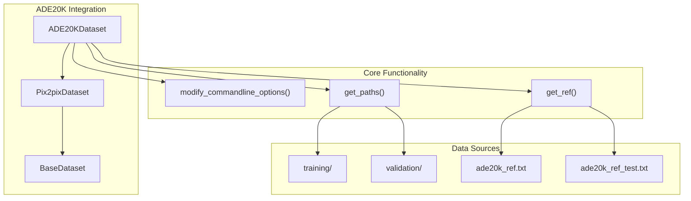
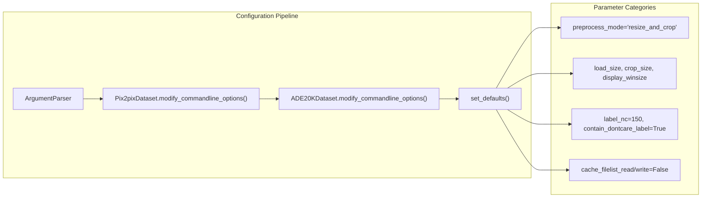
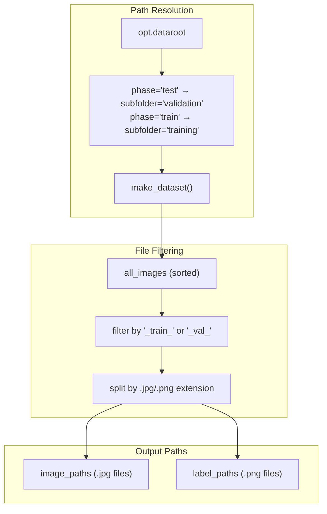
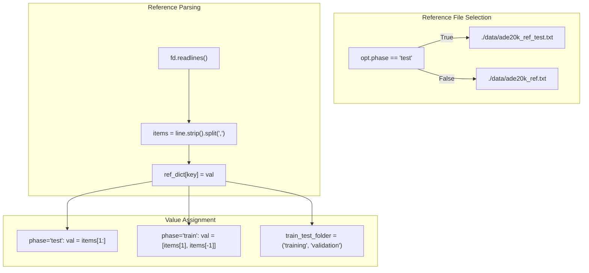
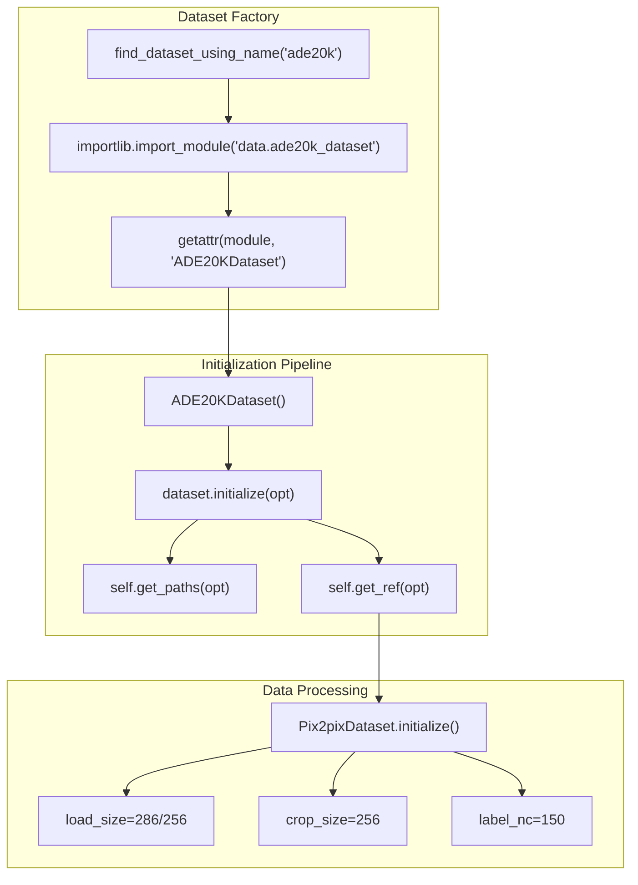

<!-- source: DeepWiki mcp.deepwiki.com · repo microsoft/CoCosNet · extra page ADE20K Dataset · fetched 2026-10-26 -->

# ADE20K Dataset

<details>
<summary>Relevant source files</summary>

The following files were used as context for generating this wiki page:

- [data/ade20k_dataset.py](data/ade20k_dataset.py)
- [data/ade20k_ref_test.txt](data/ade20k_ref_test.txt)

</details>


## Purpose and Scope

This document covers the ADE20K dataset implementation in CoCosNet, specifically the `ADE20KDataset` class that enables mask-to-image translation for scene parsing tasks. The ADE20K dataset contains scene images with corresponding semantic segmentation masks across 150 object and scene categories.

For information about the broader dataset architecture and factory pattern, see [Dataset Architecture](#3.1). For other dataset implementations, see [Dataset Implementations](#3.2).

## Dataset Overview

The `ADE20KDataset` class provides integration with the ADE20K scene parsing dataset, enabling cross-domain correspondence learning between semantic masks and natural scene images. This implementation supports both training and inference phases with appropriate data splits and reference mappings.



Sources: [data/ade20k_dataset.py:9-61]()

## Class Structure and Configuration

The `ADE20KDataset` class inherits from `Pix2pixDataset` and customizes configuration options specific to scene parsing tasks. The class defines preprocessing parameters, image dimensions, and dataset-specific settings through the `modify_commandline_options` static method.

### Configuration Parameters

| Parameter | Training Value | Test Value | Purpose |
|-----------|---------------|------------|---------|
| `preprocess_mode` | `resize_and_crop` | `resize_and_crop` | Image preprocessing strategy |
| `load_size` | 286 | 256 | Initial image loading size |
| `crop_size` | 256 | 256 | Final cropped image size |
| `label_nc` | 150 | 150 | Number of semantic label classes |
| `contain_dontcare_label` | True | True | Handle undefined label regions |
| `cache_filelist_read` | False | False | Disable file list caching |



Sources: [data/ade20k_dataset.py:11-25]()

## Data Organization and File Structure

The `get_paths` method handles the discovery and organization of image and label files within the ADE20K dataset directory structure. It differentiates between training and validation phases and filters files based on naming conventions.

### Directory Structure

```
dataroot/
├── training/
│   ├── *_train_*.jpg (scene images)
│   └── *_train_*.png (semantic masks)
└── validation/
    ├── *_val_*.jpg (scene images)
    └── *_val_*.png (semantic masks)
```

### File Discovery Pipeline



Sources: [data/ade20k_dataset.py:27-43]()

## Reference File System

The ADE20K dataset implementation uses reference files to establish correspondences between validation images and training images. This enables exemplar-based generation during inference by providing reference images for style transfer.

### Reference File Format

The reference files (`ade20k_ref.txt` and `ade20k_ref_test.txt`) contain comma-separated mappings:

```
ADE_val_00001232.jpg,ADE_train_00004996.jpg
ADE_val_00001517.jpg,ADE_train_00007201.jpg
ADE_val_00001697.jpg,ADE_train_00015171.jpg
```

### Reference Loading Logic



Sources: [data/ade20k_dataset.py:45-59](), [data/ade20k_ref_test.txt:1-6]()

## Data Loading Integration

The `ADE20KDataset` integrates with the broader CoCosNet data loading pipeline through inheritance from `Pix2pixDataset`. The class provides dataset-specific implementations while leveraging the core functionality of the parent classes.

### Integration Points



Sources: [data/ade20k_dataset.py:9-61]()

## Implementation Details

### Method Signatures

The `ADE20KDataset` class implements three key methods:

- **`modify_commandline_options(parser, is_train)`**: Static method that configures dataset-specific command-line options
- **`get_paths(opt)`**: Returns tuple of `(label_paths, image_paths)` for the specified phase
- **`get_ref(opt)`**: Returns tuple of `(ref_dict, train_test_folder)` containing reference mappings

### Key Features

1. **150 Semantic Classes**: Supports the full ADE20K label vocabulary with `label_nc=150`
2. **Phase-Aware Processing**: Handles both training and validation phases with appropriate folder mapping
3. **Reference-Based Generation**: Enables exemplar-based image synthesis through reference file system
4. **Optimized Caching**: Disables file list caching for test phase to ensure fresh data loading

Sources: [data/ade20k_dataset.py:11-61]()

---

