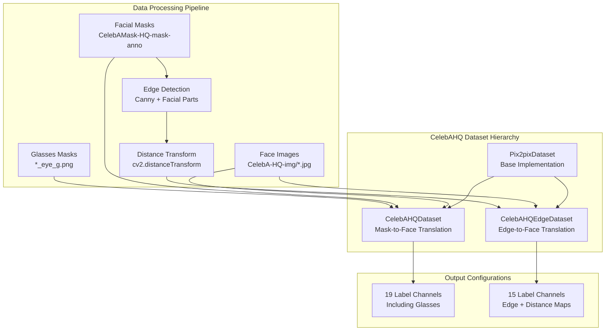
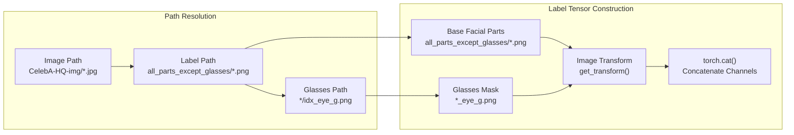
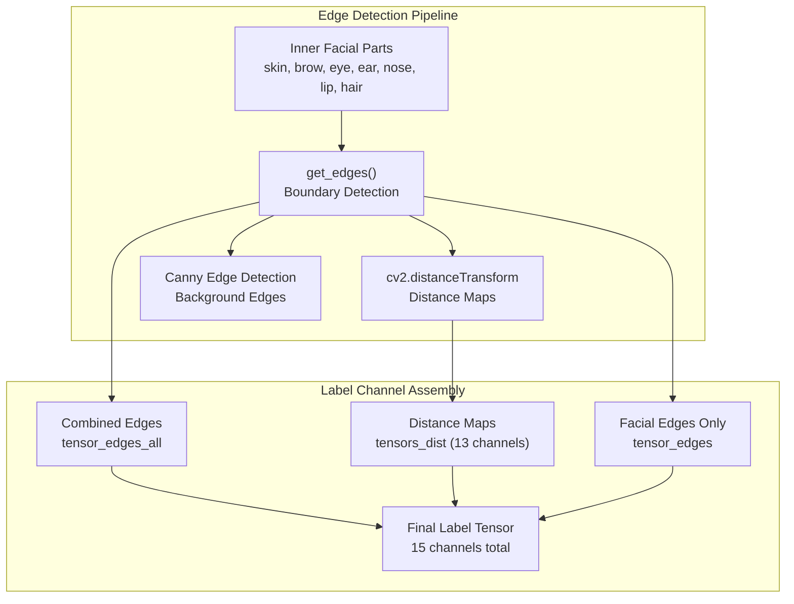
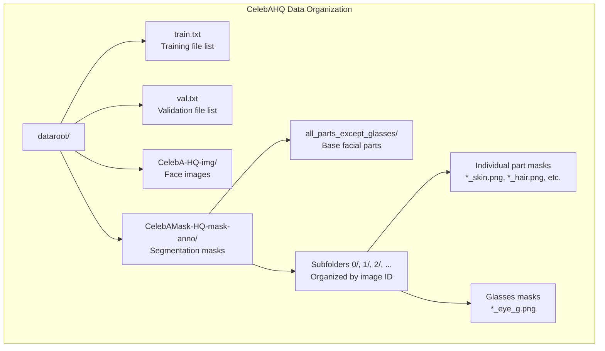
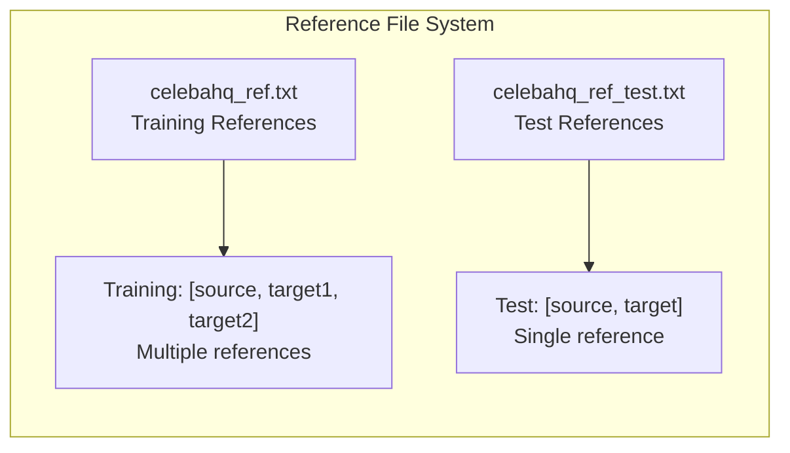

<!-- source: DeepWiki mcp.deepwiki.com · repo microsoft/CoCosNet · extra page CelebAHQ Datasets · fetched 2026-10-26 -->

# CelebAHQ Datasets

<details>
<summary>Relevant source files</summary>

The following files were used as context for generating this wiki page:

- [data/celebahq_dataset.py](data/celebahq_dataset.py)
- [data/celebahq_ref_test.txt](data/celebahq_ref_test.txt)
- [data/celebahqedge_dataset.py](data/celebahqedge_dataset.py)

</details>


This document covers the CelebAHQ dataset implementations in the CoCosNet framework, which provide face generation capabilities through both mask-to-face and edge-to-face translation. The CelebAHQ datasets support facial part segmentation with detailed semantic labels for high-quality face synthesis.

For information about the overall dataset architecture and factory pattern, see [Dataset Architecture](#3.1). For other dataset implementations, see [Dataset Implementations](#3.2).

## Dataset Implementations Overview

The CelebAHQ datasets consist of two main implementations that extend the base `Pix2pixDataset` class:



Sources: [data/celebahq_dataset.py:1-90](), [data/celebahqedge_dataset.py:1-142]()

## CelebAHQDataset Implementation

The `CelebAHQDataset` class implements mask-to-face translation with detailed facial part segmentation. It processes 19 semantic label channels including facial features and accessories.

### Facial Part Labels

The dataset handles the following facial parts as documented in the code:

| Category | Parts |
|----------|-------|
| Facial Features | `hair`, `skin`, `l_brow`, `r_brow`, `l_eye`, `r_eye`, `nose`, `u_lip`, `mouth`, `l_lip` |
| Accessories | `l_ear`, `r_ear`, `neck`, `cloth`, `hat`, `eye_g` (glasses), `ear_r`, `neck_l` |

### Configuration Parameters

The dataset configures specific parameters for CelebAHQ processing:

| Parameter | Training Value | Test Value | Purpose |
|-----------|---------------|------------|---------|
| `load_size` | 286 | 256 | Image loading dimension |
| `crop_size` | 256 | 256 | Final crop dimension |
| `label_nc` | 19 | 19 | Number of label channels |
| `preprocess_mode` | `resize_and_crop` | `resize_and_crop` | Preprocessing strategy |

Sources: [data/celebahq_dataset.py:15-29]()

### Label Processing Pipeline



The `get_label_tensor` method combines base facial parts with glasses masks:

Sources: [data/celebahq_dataset.py:67-84]()

## CelebAHQEdgeDataset Implementation

The `CelebAHQEdgeDataset` class implements edge-to-face translation using edge detection and distance transforms. It processes 15 label channels focused on edge maps and distance-based features.

### Edge Processing Components



Sources: [data/celebahqedge_dataset.py:69-116]()

### Inner Facial Parts Processing

The edge dataset focuses on 13 specific inner facial parts:

```python
inner_parts = ['skin', 'l_brow', 'r_brow', 'l_eye', 'r_eye', 'l_ear', 'r_ear', 
               'nose', 'u_lip', 'mouth', 'l_lip', 'eye_g', 'hair']
```

Each part undergoes edge detection and distance transform processing to create feature-rich edge representations.

Sources: [data/celebahqedge_dataset.py:77-103]()

## Data Organization and File Structure

### Directory Structure



### Path Resolution Methods

Both dataset classes implement path conversion methods:

| Method | Purpose | Source Dataset |
|--------|---------|----------------|
| `imgpath_to_labelpath` | Convert image path to label path | Both |
| `labelpath_to_imgpath` | Convert label path to image path | Edge dataset only |

The path resolution handles the subfolder organization where images are grouped by ID ranges (every 2000 images).

Sources: [data/celebahq_dataset.py:86-89](), [data/celebahqedge_dataset.py:118-128]()

## Reference System

### Reference File Structure

The datasets use reference files to define training and test pairs:



### Reference Data Format

The reference system provides correspondence between source and target images:

- **Training**: Each source image maps to first and last reference targets
- **Testing**: Each source image maps to one or more reference targets

Example from test reference file:
```
29922.jpg,26768.jpg
29883.jpg,5487.jpg
26969.jpg,6897.jpg
```

Sources: [data/celebahq_dataset.py:49-66](), [data/celebahqedge_dataset.py:51-67](), [data/celebahq_ref_test.txt:1-8]()

---

