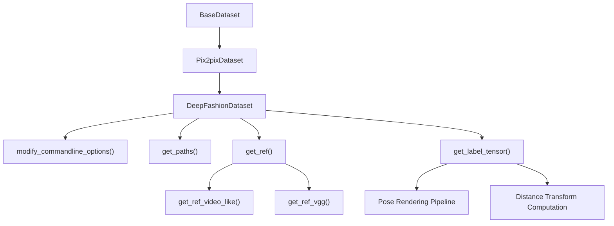
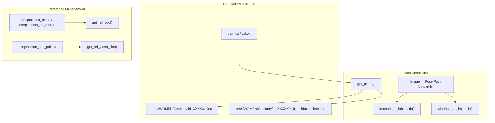
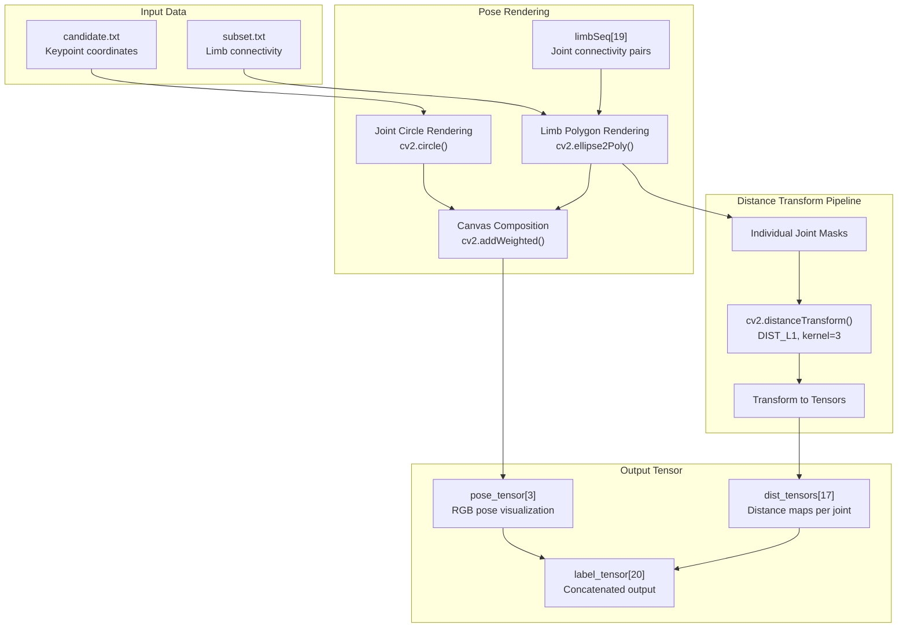
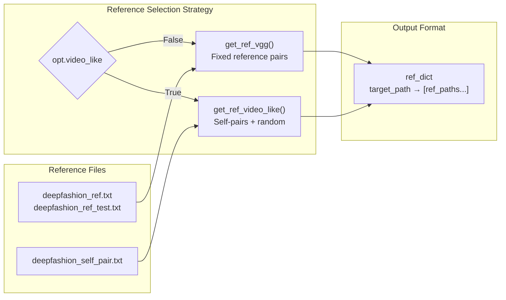

<!-- source: DeepWiki mcp.deepwiki.com · repo microsoft/CoCosNet · extra page DeepFashion Dataset · fetched 2026-10-26 -->

# DeepFashion Dataset

Relevant source files

The following files were used as context for generating this wiki page:

- [data/deepfashion_dataset.py](data/deepfashion_dataset.py)
- [data/deepfashion_ref_test.txt](data/deepfashion_ref_test.txt)
- [data/deepfashion_self_pair.txt](data/deepfashion_self_pair.txt)

This document describes the `DeepFashionDataset` implementation, which provides pose-to-image generation capabilities for fashion images using human keypoint detection. The dataset processes pose keypoint data and transforms it into multi-channel pose representations for training and inference with the CoCosNet framework.

For general dataset architecture information, see [Dataset Architecture](#3.1). For other dataset implementations, see [Dataset Implementations](#3.2).

## Purpose and Scope

The `DeepFashionDataset` class enables pose-conditioned image synthesis by:
- Loading fashion images with corresponding human pose keypoint data
- Converting pose annotations into multi-channel tensor representations
- Applying distance transforms to joint and limb information
- Managing reference image selection for exemplar-based generation
- Supporting both training and test phases with appropriate data splits

## Class Architecture

Sources: [data/deepfashion_dataset.py:15-178]()

## Configuration Parameters

The dataset configures specific parameters optimized for fashion image generation:

| Parameter | Training Value | Test Value | Purpose |
|-----------|---------------|------------|---------|
| `preprocess_mode` | resize_and_crop | resize_and_crop | Image preprocessing method |
| `load_size` | 286 | 256 | Initial image size before cropping |
| `crop_size` | 256 | 256 | Final image size after cropping |
| `label_nc` | 20 | 20 | Number of label channels (pose + distance maps) |
| `no_pairing_check` | True | True | Disable strict image-label pairing validation |

The configuration is handled by the `modify_commandline_options` static method which inherits from `Pix2pixDataset` and applies fashion-specific overrides.

Sources: [data/deepfashion_dataset.py:16-31]()

## Data Loading Pipeline

Sources: [data/deepfashion_dataset.py:33-52](), [data/deepfashion_dataset.py:171-177]()

## Pose Processing Architecture

The core functionality converts human pose keypoint data into multi-channel tensor representations:

Sources: [data/deepfashion_dataset.py:111-169]()

## Reference Image Selection

The dataset supports two modes for reference image selection during training and inference:

### VGG Mode (Default)
- Uses pre-computed reference pairs from `deepfashion_ref.txt` files
- Training: Combines specified reference with random image selection
- Testing: Uses only pre-specified reference images

### Video-Like Mode
- Leverages `deepfashion_self_pair.txt` for self-paired images
- Incorporates additional random sampling for augmented reference sets
- Provides multiple reference candidates per target image

Sources: [data/deepfashion_dataset.py:54-102]()

## Pose Keypoint Schema

The dataset processes 18 keypoints using the following limb sequence definition:

| Limb Index | Connection | Body Part |
|------------|-----------|-----------|
| 0-6 | Upper body | Head, shoulders, arms |
| 7-11 | Torso | Spine, hips |
| 12-18 | Lower body | Legs, feet |

The `limbSeq` array defines 19 connections between keypoints, creating a skeletal representation that is rendered as colored polygons and converted to distance transforms for neural network processing.

Sources: [data/deepfashion_dataset.py:115-117]()

## Distance Transform Processing

Each limb segment generates an individual distance map using OpenCV's `cv2.distanceTransform` with L1 distance metric. The distance values are normalized and clipped to create smooth gradients around pose structures, providing the network with spatial relationship information between pose elements and image regions.

The final output tensor contains 20 channels:
- 3 channels: RGB pose visualization
- 17 channels: Distance maps for each limb segment

Sources: [data/deepfashion_dataset.py:158-169]()

---

