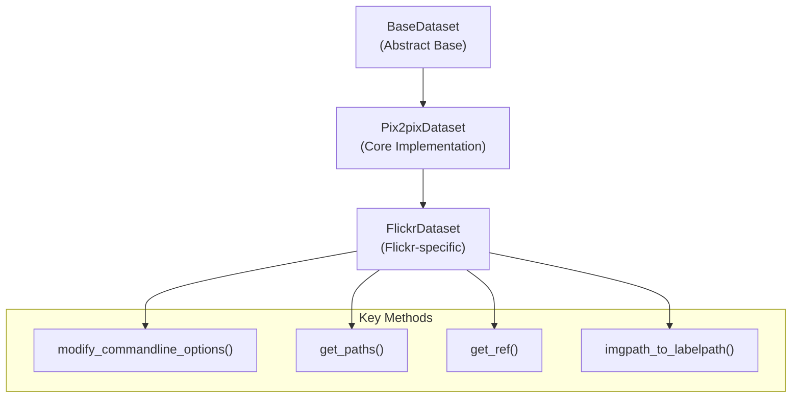
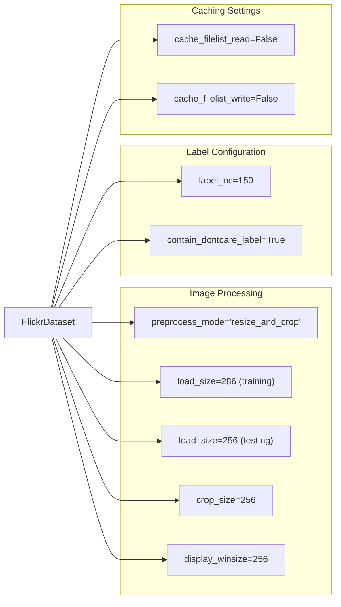
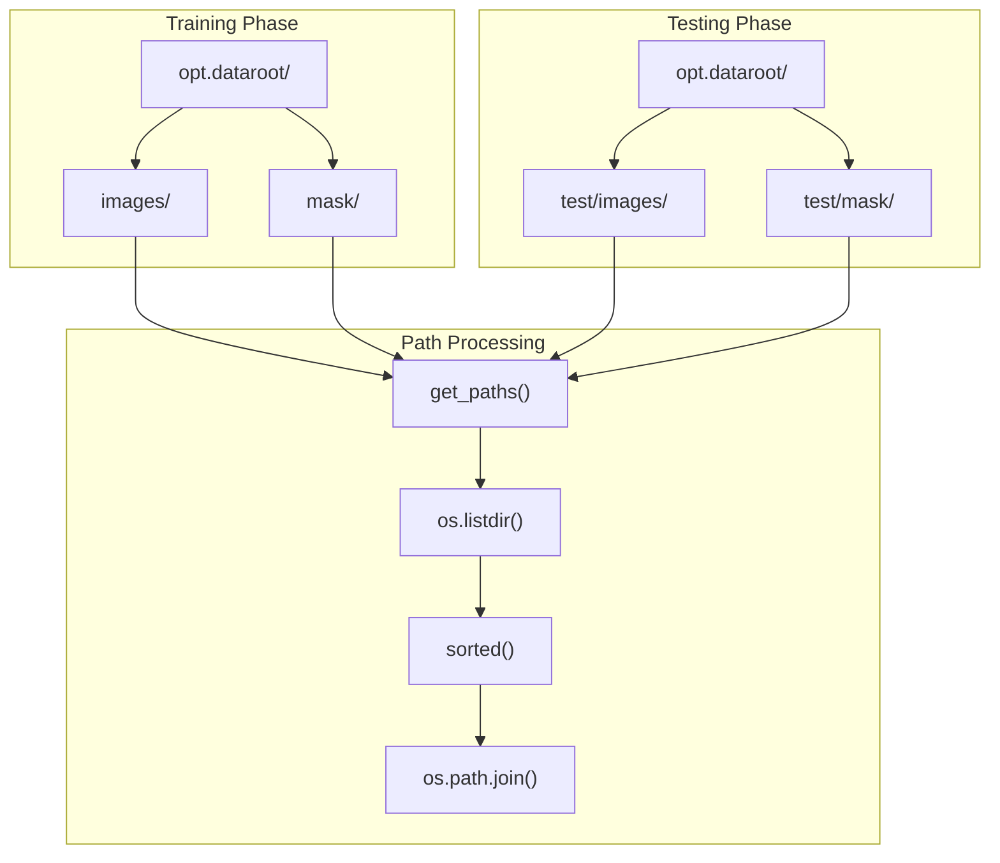
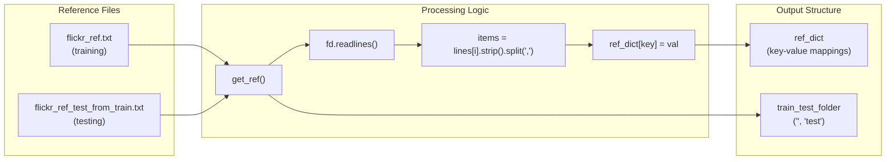
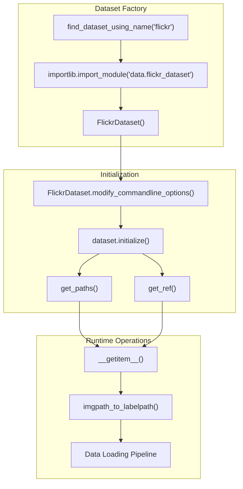

<!-- source: DeepWiki mcp.deepwiki.com · repo microsoft/CoCosNet · extra page Flickr Dataset · fetched 2026-10-26 -->

# Flickr Dataset

Relevant source files

The following files were used as context for generating this wiki page:

- [data/flickr_dataset.py](data/flickr_dataset.py)

## Purpose and Scope

The `FlickrDataset` class provides a general-purpose dataset implementation for processing Flickr image collections within the CoCosNet framework. This implementation supports image-to-image translation tasks using semantic masks and follows the standard dataset interface established by the framework's dataset management system.

For information about the broader dataset architecture, see [Dataset Architecture](#3.1). For other domain-specific implementations, see [ADE20K Dataset](#3.2.1), [CelebAHQ Datasets](#3.2.2), and [DeepFashion Dataset](#3.2.3).

## Class Architecture

The `FlickrDataset` follows the framework's inheritance hierarchy, extending the base `Pix2pixDataset` class with Flickr-specific configurations and path handling logic.

### Class Inheritance Diagram

Sources: [data/flickr_dataset.py:1-67]()

### Class Definition

The `FlickrDataset` class is implemented as a minimal extension of `Pix2pixDataset`, overriding specific methods to handle Flickr dataset characteristics:

| Method | Purpose | Line Reference |
|--------|---------|----------------|
| `modify_commandline_options` | Sets dataset-specific configuration defaults | [data/flickr_dataset.py:10-23]() |
| `get_paths` | Discovers and organizes image and mask file paths | [data/flickr_dataset.py:25-34]() |
| `get_ref` | Loads reference mappings for training/testing | [data/flickr_dataset.py:36-50]() |
| `imgpath_to_labelpath` | Converts image paths to corresponding mask paths | [data/flickr_dataset.py:52-54]() |

Sources: [data/flickr_dataset.py:7-67]()

## Configuration and Options

The `FlickrDataset` establishes specific defaults through the `modify_commandline_options` static method, configuring the dataset for optimal Flickr image processing.

### Configuration Parameters

The configuration uses 150 label classes (`label_nc=150`), matching the semantic richness expected for general image datasets. Training uses a larger load size (286) than testing (256) to enable data augmentation during training phases.

Sources: [data/flickr_dataset.py:12-22]()

## Data Organization and File Paths

The `FlickrDataset` expects a specific directory structure that separates images from their corresponding semantic masks, with different organization for training and testing phases.

### File Structure and Path Resolution

The `get_paths` method constructs file paths dynamically based on the training phase, using `root.replace('images', 'mask')` to derive mask paths from image paths.

Sources: [data/flickr_dataset.py:25-34]()

### Path Mapping Implementation

The dataset implements bidirectional path mapping between images and labels:

| Function | Input | Output | Implementation |
|----------|-------|--------|----------------|
| `get_paths` | `opt.dataroot`, `opt.phase` | `label_paths`, `image_paths` | [data/flickr_dataset.py:26-33]() |
| `imgpath_to_labelpath` | Image file path | Corresponding mask file path | [data/flickr_dataset.py:53]() |

Sources: [data/flickr_dataset.py:25-34](), [data/flickr_dataset.py:52-54]()

## Reference System

The `FlickrDataset` uses external reference files to manage training and testing splits, enabling controlled cross-validation and consistent evaluation.

### Reference File Processing

The reference system processes comma-separated files where each line contains a key followed by reference values. Training phase uses the first and last reference (`[items[1], items[-1]]`), while testing uses all references (`items[1:]`).

Sources: [data/flickr_dataset.py:36-50]()

### Reference File Format

| Phase | File | Line Format | Value Selection |
|-------|------|-------------|-----------------|
| Training | `flickr_ref.txt` | `key,ref1,ref2,...,refN` | `[ref1, refN]` |
| Testing | `flickr_ref_test_from_train.txt` | `key,ref1,ref2,...,refN` | `[ref1,ref2,...,refN]` |

Sources: [data/flickr_dataset.py:42-47]()

## Integration with CoCosNet Framework

The `FlickrDataset` integrates seamlessly with the CoCosNet framework's dataset management system through the established factory pattern and dynamic loading mechanism.

### Framework Integration Flow

The dataset follows the framework's naming convention (`flickr_dataset.py` containing `FlickrDataset` class) and implements the required interface methods inherited from `Pix2pixDataset`.

Sources: [data/flickr_dataset.py:7](), [data/flickr_dataset.py:10-23]()

---

