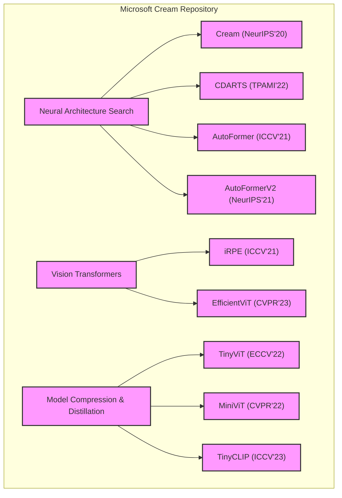
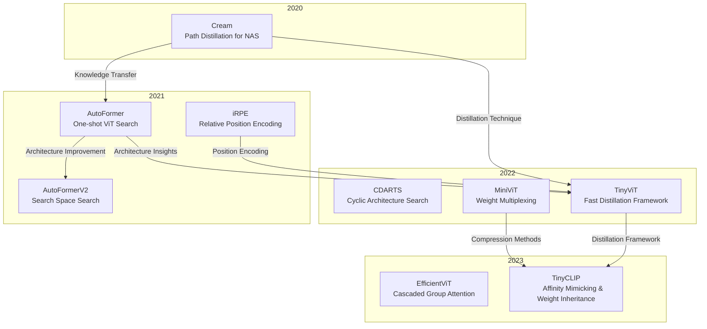
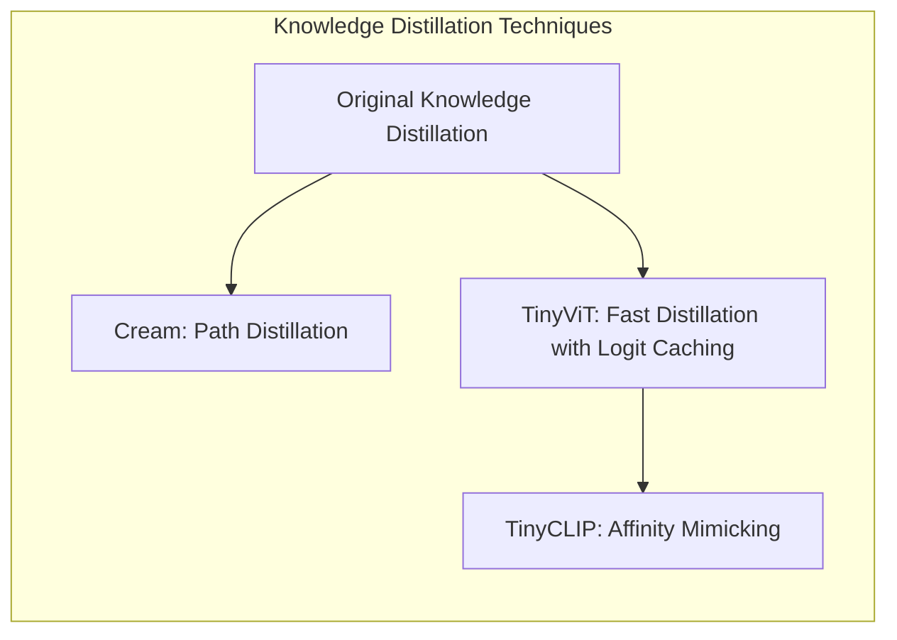
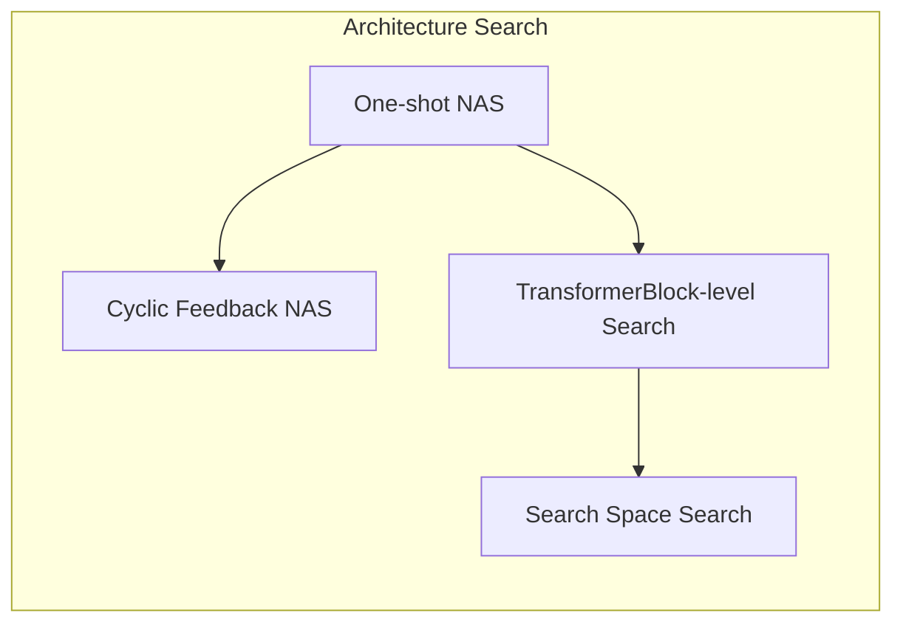
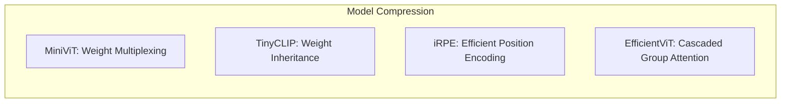
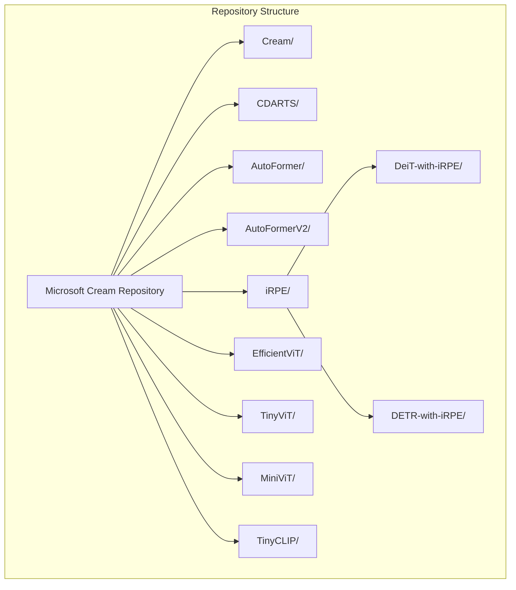

<!-- source: DeepWiki mcp.deepwiki.com · repo microsoft/Cream · page 1 Overview · fetched 2026-10-26 -->

# Overview

Relevant source files

The following files were used as context for generating this wiki page:

- [CDARTS/README.md](CDARTS/README.md)
- [CODE_OF_CONDUCT.md](CODE_OF_CONDUCT.md)
- [LICENSE](LICENSE)
- [README.md](README.md)
- [SECURITY.md](SECURITY.md)
- [iRPE/DETR-with-iRPE/README.md](iRPE/DETR-with-iRPE/README.md)
- [iRPE/DeiT-with-iRPE/README.md](iRPE/DeiT-with-iRPE/README.md)
- [iRPE/README.md](iRPE/README.md)

The Microsoft Cream repository is a comprehensive collection of research projects focusing on Neural Architecture Search (NAS), Vision Transformers, and Model Compression techniques. This repository hosts multiple state-of-the-art (SOTA) projects that explore efficient and high-performing vision models through architecture design, search, and compression techniques.

This page provides a high-level overview of the repository structure, its major projects, and how they relate to each other. For detailed information about specific techniques such as model compression frameworks, see [Model Compression Frameworks](#2), or for neural architecture search approaches, see [Neural Architecture Search](#3).

## Repository Purpose and Scope

The Microsoft Cream repository serves multiple research purposes:

1. Exploring efficient neural architecture search techniques for vision models
2. Advancing vision transformer architectures for better performance and efficiency
3. Developing model compression and distillation methods for creating smaller, faster models
4. Providing implementations of cutting-edge research papers in computer vision

The repository contains projects published at top-tier conferences including NeurIPS, ICCV, ECCV, and CVPR from 2020 to 2023, representing a progression of research in efficient vision models.

Sources: [README.md:1-49](), [LICENSE:1-24]()

## Project Collection

The repository consists of nine major projects organized in three main research directions:

Sources: [README.md:4-26](). [README.md:51-114]()

### Neural Architecture Search Projects

- **Cream**: Distilling prioritized paths for one-shot neural architecture search
- **CDARTS**: Cyclic differentiable architecture search with feedback mechanisms
- **AutoFormer**: One-shot architecture search for vision transformers
- **AutoFormerV2**: Searching the search space for vision transformers

### Vision Transformer Projects

- **iRPE**: Improved relative position encoding for vision transformers
- **EfficientViT**: Memory-efficient vision transformer with cascaded group attention

### Model Compression & Distillation Projects

- **TinyViT**: Fast pretraining distillation for small vision transformers
- **MiniViT**: Compressing vision transformers with weight multiplexing
- **TinyCLIP**: CLIP distillation via affinity mimicking and weight inheritance

Sources: [README.md:51-114](), [iRPE/README.md:1-9](), [CDARTS/README.md:1-9]()

## Project Evolution and Relationships

The repository shows a clear progression of research focus and knowledge transfer between projects. The following diagram illustrates the key relationships and innovations across projects:

Sources: [README.md:30-49](), [README.md:117-189]()

## Technical Approaches

The repository employs three main technical approaches for creating efficient vision models:

### 1. Knowledge Distillation Methods

### 2. Architecture Search Strategies

### 3. Model Compression Techniques

Sources: [README.md:51-114](), [iRPE/README.md:5-9](), [iRPE/DeiT-with-iRPE/README.md:8-22](), [iRPE/DETR-with-iRPE/README.md:9-21]()

## Repository Structure and Implementation

The repository is organized as a collection of independent projects, each with its own directory containing implementations, documentation, and pretrained models:

Each project directory typically contains:
- Implementation code
- README with usage instructions
- Pretrained model downloads
- Evaluation scripts
- Documentation of key techniques

Sources: [README.md:1-114](), [iRPE/README.md:11-31](), [iRPE/DeiT-with-iRPE/README.md:23-85](), [iRPE/DETR-with-iRPE/README.md:25-150]()

## License and Contributions

The Microsoft Cream repository is released under the MIT License, allowing for both academic and commercial use with proper attribution. The repository welcomes contributions and provides guidelines for security and code of conduct.

Sources: [LICENSE:1-24](), [CODE_OF_CONDUCT.md:1-9](), [SECURITY.md:1-41]()

## Project Status and Development

The repository is actively maintained, with regular updates adding new projects. The most recent addition was TinyCLIP in September 2023. The repository also indicates they are hiring research interns for next-generation model design and efficient large model inference.

Sources: [README.md:30-49]()

---

