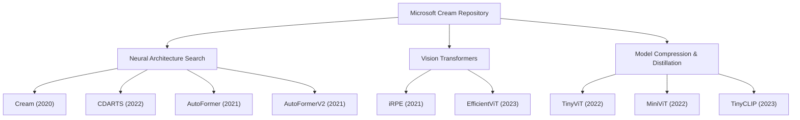
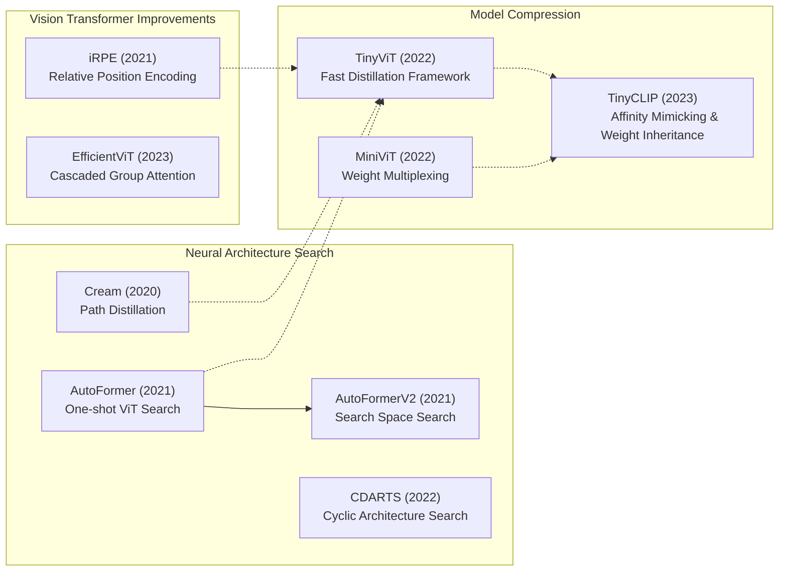
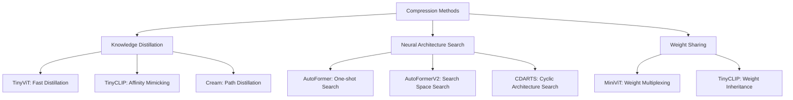

<!-- source: DeepWiki mcp.deepwiki.com · repo microsoft/Cream · page 1.1 Project Collection · fetched 2026-10-26 -->

# Project Collection

Relevant source files

The following files were used as context for generating this wiki page:

- [AutoFormer/.figure/ofa.png](AutoFormer/.figure/ofa.png)
- [AutoFormer/.figure/performance.png](AutoFormer/.figure/performance.png)
- [CDARTS/README.md](CDARTS/README.md)
- [Cream/README.md](Cream/README.md)
- [Cream/data/subclass_list.txt](Cream/data/subclass_list.txt)
- [Cream/data/subimages_list.txt](Cream/data/subimages_list.txt)
- [Cream/demo/intro.jpg](Cream/demo/intro.jpg)
- [Cream/demo/results_100.jpg](Cream/demo/results_100.jpg)
- [Cream/demo/results_600.jpg](Cream/demo/results_600.jpg)
- [Cream/experiments/configs/retrain/114.yaml](Cream/experiments/configs/retrain/114.yaml)
- [README.md](README.md)
- [iRPE/DETR-with-iRPE/README.md](iRPE/DETR-with-iRPE/README.md)
- [iRPE/DeiT-with-iRPE/README.md](iRPE/DeiT-with-iRPE/README.md)
- [iRPE/README.md](iRPE/README.md)

This page provides a comprehensive overview of all projects within the Microsoft Cream repository, which focuses on Neural Architecture Search (NAS), Vision Transformers, and Model Compression techniques. Each project represents a significant contribution to making vision models more efficient and effective through various innovative approaches.

## Repository Overview

The Microsoft Cream repository contains a collection of research projects primarily focused on three areas:

1. **Neural Architecture Search (NAS)**: Automated methods to discover optimal neural network architectures
2. **Vision Transformer Improvements**: Techniques to enhance the efficiency and performance of vision transformers
3. **Model Compression & Distillation**: Methods to reduce model size while maintaining performance

The following diagram illustrates the project organization within the repository:

Sources: [README.md:4-26]()

## Project Descriptions

### Neural Architecture Search Projects

#### Cream (NeurIPS 2020)

**Cream** (Cream of the Crop: Distilling Prioritized Paths For One-Shot Neural Architecture Search) introduces an architecture distillation method where subnetworks learn collaboratively. The central idea is that subnetworks can teach each other throughout the training process to boost individual model convergence. It introduces the concept of prioritized paths, which refers to architecture candidates with superior performance during training. These paths change dynamically based on performance and complexity metrics.

Key features:
- Collaborative learning between subnetworks
- Path prioritization based on performance
- Dynamic selection of the best performing architectures ("cream of the crop")
- Achieves competitive performance compared to MobileNetV3 and EfficientNet

Sources: [README.md:107-113](), [Cream/README.md:3-11]()

#### CDARTS (TPAMI 2022)

**CDARTS** (Cyclic Differentiable Architecture Search) proposes new joint optimization objectives and a novel cyclic feedback mechanism between search and evaluation networks with introspective distillation. The architecture builds a cycle where:
1. The search network generates an initial architecture for evaluation
2. The weights of the evaluation network are optimized
3. The architecture weights in the search network are optimized using both label supervision and regularization from the evaluation network
4. Repeat the cycle for joint optimization

Sources: [README.md:77-81](), [CDARTS/README.md:1-11]()

#### AutoFormer (ICCV 2021)

**AutoFormer** (Searching Transformers for Visual Recognition) is a one-shot architecture search framework dedicated to vision transformer search. It entangles the weights of different vision transformer blocks in the same layers during supernet training, allowing thousands of subnets to be well-trained. The performance of these subnets with weights inherited from the supernet is comparable to those retrained from scratch.

Sources: [README.md:92-98]()

#### AutoFormerV2 (NeurIPS 2021)

**AutoFormerV2** (Searching the Search Space of Vision Transformer) extends AutoFormer by searching for the optimal search space itself instead of searching architectures within a predefined space. The approach first uses AutoFormer to find a great search space automatically, then searches for architectures within this discovered space. The work also provides insights and guidelines for general vision transformer design.

Sources: [README.md:84-89]()

### Vision Transformer Improvements

#### iRPE (ICCV 2021)

**iRPE** (Rethinking and Improving Relative Position Encoding for Vision Transformer) introduces new relative position encoding methods dedicated to 2D images. The method considers directional relative distance modeling and the interactions between queries and relative position embeddings in the self-attention mechanism. 

Key features:
- Simple and lightweight methods easily plugged into transformer blocks
- Improves DeiT and DETR by up to 1.5% (top-1 Accuracy) and 1.3% (mAP)
- Various encoding methods: Euclidean, Quantization, Cross, and Product methods
- Available with CUDA-optimized operations for efficient training

Sources: [README.md:100-104](), [iRPE/README.md:1-9](), [iRPE/DETR-with-iRPE/README.md:1-22](), [iRPE/DeiT-with-iRPE/README.md:1-22]()

#### EfficientViT (CVPR 2023)

**EfficientViT** (Memory Efficient Vision Transformer with Cascaded Group Attention) presents a family of high-speed vision transformers. It's built with:
1. A new memory-efficient building block with a sandwich layout
2. An efficient cascaded group attention operation that mitigates attention computation redundancy

Sources: [README.md:59-63]()

### Model Compression & Distillation

#### TinyViT (ECCV 2022)

**TinyViT** (Fast Pretraining Distillation for Small Vision Transformers) is a family of tiny and efficient vision transformers pretrained on large-scale datasets using a fast distillation framework. The central idea is to transfer knowledge from large pretrained models to small ones. The logits of large teacher models are sparsified and stored in disk in advance to save memory cost and computation overheads.

Sources: [README.md:65-69]()

#### MiniViT (CVPR 2022)

**MiniViT** (Compressing Vision Transformers with Weight Multiplexing) is a compression framework that achieves parameter reduction in vision transformers while retaining performance. The central idea is to multiplex the weights of consecutive transformer blocks. Specifically, weights are shared across layers, while imposing a transformation on the weights to increase diversity. Weight distillation over self-attention is also applied to transfer knowledge from large-scale ViT models to weight-multiplexed compact models.

Sources: [README.md:71-75]()

#### TinyCLIP (ICCV 2023)

**TinyCLIP** (CLIP Distillation via Affinity Mimicking and Weight Inheritance) is a novel cross-modal distillation method for large-scale language-image pre-trained models. The method introduces two core techniques: 
1. **Affinity mimicking** - For preserving cross-modal relationships
2. **Weight inheritance** - For parameter efficiency

This work focuses on making small CLIP models more efficient by leveraging large-scale models and pre-training data to strike the best trade-off between speed and accuracy.

Sources: [README.md:53-57]()

## Project Relationships and Evolution

The projects in the repository show a clear evolution and build upon each other's techniques. The following diagram illustrates these relationships:

Sources: [README.md:1-113]()

## Compression Approaches

The projects employ various compression and efficiency techniques as illustrated in the following diagram:

Sources: [README.md:53-113]()

## Performance Comparison

The repository includes models with varying parameter counts and computational requirements, targeting different efficiency points. The Cream project, for example, provides models ranging from very lightweight (14 million FLOPs) to more computationally intensive (604 million FLOPs), with corresponding accuracy improvements.

| Model | FLOPs | Top-1 Accuracy (%) | Top-5 Accuracy (%) |
|-------|-------|-------------------|-------------------|
| Cream_14 | 14M | 53.8 | 77.2 |
| Cream_43 | 43M | 66.3 | 86.7 |
| Cream_114 | 114M | 72.8 | 90.8 |
| Cream_287 | 287M | 77.6 | 93.3 |
| Cream_481 | 481M | 79.2 | 94.2 |
| Cream_604 | 604M | 80.0 | 94.7 |

Sources: [Cream/README.md:46-55]()

## Key Insights

The Microsoft Cream repository demonstrates several important insights in efficient deep learning:

1. **Progressive Research Focus**: The repository shows a clear progression from architecture search (AutoFormer, CDARTS) to specialized transformer architectures (iRPE, EfficientViT) to compression techniques (TinyViT, MiniViT, TinyCLIP).

2. **Knowledge Transfer**: Techniques developed in earlier projects influence later ones, creating a knowledge transfer pipeline that builds toward increasingly efficient models.

3. **Complementary Approaches**: The projects explore complementary approaches to efficiency - architecture optimization, knowledge distillation, and weight sharing - which can be combined for maximum benefit.

4. **Scale Variation**: The repository provides models at multiple efficiency points, from tiny models with a few million parameters to larger models with tens of millions of parameters, allowing deployment across different compute constraints.

Sources: [README.md:1-189]()

---

