<!-- source: DeepWiki mcp.deepwiki.com · repo microsoft/Cream · page 1.2 Architecture & Design Philosophy · fetched 2026-10-26 -->

# Architecture & Design Philosophy

Relevant source files

The following files were used as context for generating this wiki page:

- [AutoFormer/README.md](AutoFormer/README.md)
- [CDARTS/README.md](CDARTS/README.md)
- [MiniViT/Mini-DeiT/README.md](MiniViT/Mini-DeiT/README.md)
- [MiniViT/Mini-Swin/README.md](MiniViT/Mini-Swin/README.md)
- [MiniViT/README.md](MiniViT/README.md)
- [README.md](README.md)
- [TinyCLIP/README.md](TinyCLIP/README.md)
- [TinyCLIP/script/auto_weight_inherit_50to25.sh](TinyCLIP/script/auto_weight_inherit_50to25.sh)
- [TinyCLIP/script/auto_weight_inherit_75to50.sh](TinyCLIP/script/auto_weight_inherit_75to50.sh)
- [TinyViT/README.md](TinyViT/README.md)
- [TinyViT/models/tiny_vit.py](TinyViT/models/tiny_vit.py)
- [TinyViT/tests/test_models.py](TinyViT/tests/test_models.py)
- [iRPE/DETR-with-iRPE/README.md](iRPE/DETR-with-iRPE/README.md)
- [iRPE/DeiT-with-iRPE/README.md](iRPE/DeiT-with-iRPE/README.md)
- [iRPE/README.md](iRPE/README.md)

This document outlines the architectural patterns and design principles common across projects in the Microsoft Cream repository. It provides a foundation for understanding how different components interact and the philosophy guiding their implementation. For specific project implementations, see the respective project pages such as [TinyViT](#2.1), [TinyCLIP](#2.2), and [MiniViT](#2.3).

## Core Architecture Overview

Microsoft Cream consists of several projects pursuing efficient vision models through three complementary approaches:

1. **Neural Architecture Search (NAS)** - Finding optimal architectures automatically
2. **Vision Transformer Improvements** - Enhancing transformer components 
3. **Model Compression & Distillation** - Reducing model size while preserving performance

The repository follows a progressive research trajectory where techniques developed in earlier projects inform later ones, creating a knowledge transfer pipeline that advances the state-of-the-art in efficient vision models.

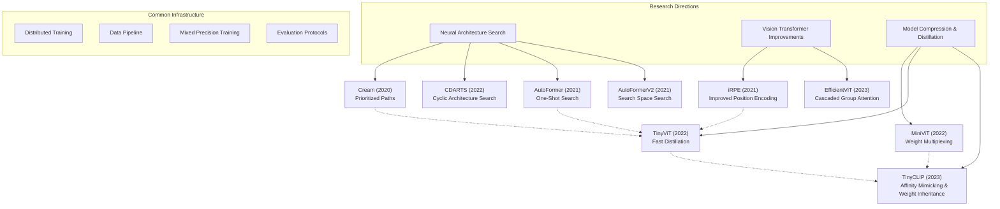

Sources: [README.md:1-189](README.md:1-189)

## Design Philosophy

The projects in Microsoft Cream share several core design principles:

1. **Progressive Efficiency**: Each project builds upon previous work to achieve greater efficiency while maintaining or improving accuracy.

2. **Knowledge Transfer**: Using knowledge distillation to transfer learning from larger models to smaller ones, rather than training from scratch.

3. **Architectural Modularity**: Components are designed to be modular and reusable across different models and tasks.

4. **Parameter Efficiency**: Focus on reducing parameters and computational cost while preserving model capabilities.

5. **Task Adaptability**: Models are designed to be adaptable across different vision tasks beyond classification.

### Modular Component Architecture

The repository employs a modular component architecture where basic building blocks can be combined and modified to create different model variants.

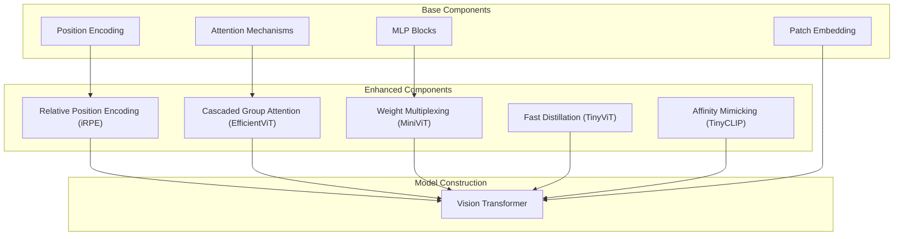

Sources: [TinyViT/models/tiny_vit.py:1-705](TinyViT/models/tiny_vit.py:1-705), [iRPE/README.md:1-64](iRPE/README.md:1-64)

## Architectural Patterns

### Hierarchical Design

Many models in the repository use a hierarchical design with multiple stages of processing, each operating at a different feature resolution.

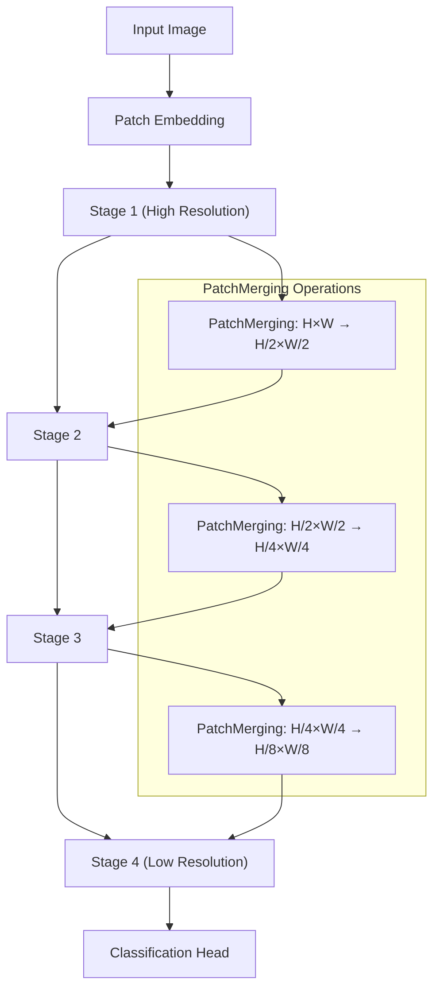

In TinyViT, this is implemented through the `TinyViT` class which consists of multiple layers, each containing blocks operating at different resolutions. The `PatchMerging` class handles downsampling between stages.

Sources: [TinyViT/models/tiny_vit.py:125-151](TinyViT/models/tiny_vit.py:125-151), [TinyViT/models/tiny_vit.py:453-516](TinyViT/models/tiny_vit.py:453-516)

### Transformer Block Design

The transformer blocks in the repository follow a common pattern but with project-specific optimizations:

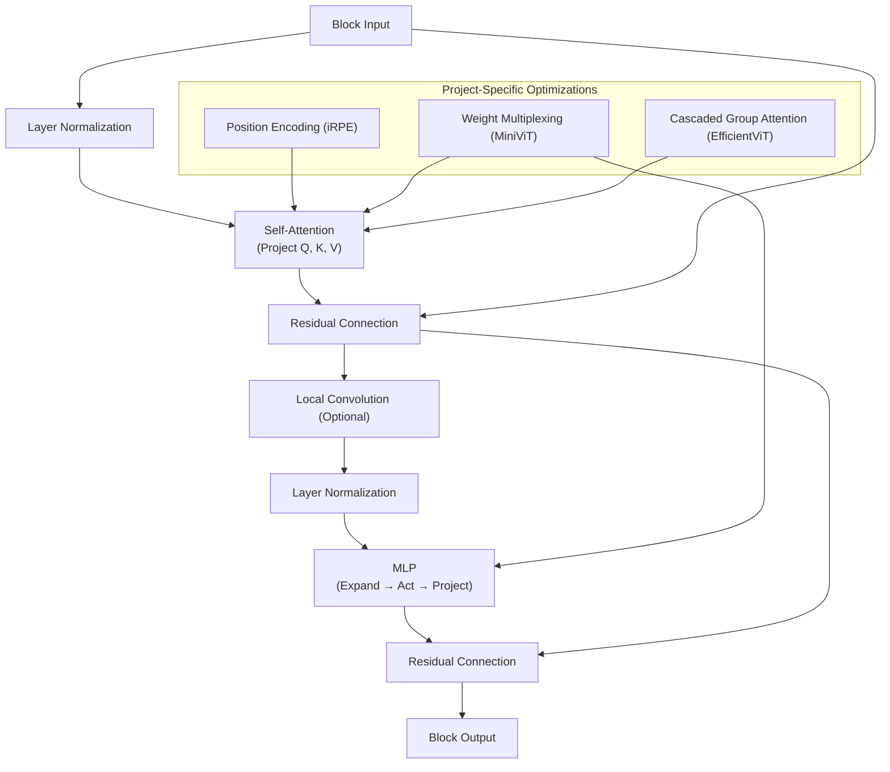

In the codebase, this is implemented through classes like `TinyViTBlock` that incorporate both self-attention and MLP components with residual connections.

Sources: [TinyViT/models/tiny_vit.py:289-384](TinyViT/models/tiny_vit.py:289-384)

## Knowledge Distillation Architecture

A key innovation across projects is the use of knowledge distillation to transfer knowledge from larger models to smaller ones.

### TinyViT Fast Distillation

TinyViT introduces a fast distillation framework where large teacher model logits are cached offline to reduce memory and computation requirements during training.

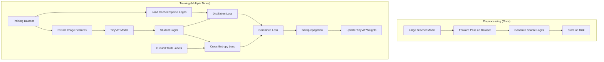

The innovation here is that the teacher model is only used once to generate logits, which are saved and reused for multiple student models, saving computational resources.

Sources: [TinyViT/README.md:1-95](TinyViT/README.md:1-95)

### TinyCLIP Distillation

TinyCLIP extends the knowledge distillation approach with two key techniques:

1. **Affinity Mimicking**: Preserves relationships between images and text by matching affinity matrices
2. **Weight Inheritance**: Allows smaller models to inherit weights from larger ones through structured pruning

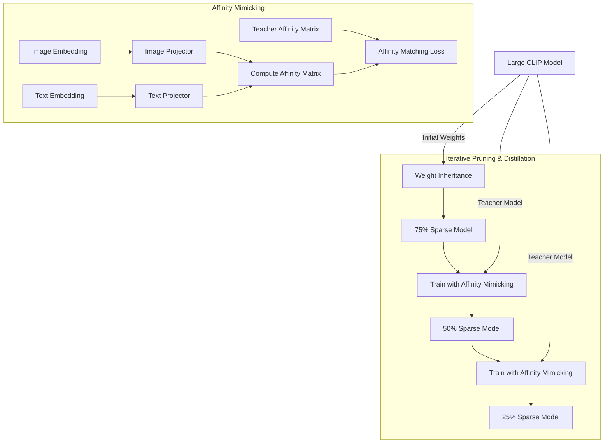

The approach uses scripts like `auto_weight_inherit_75to50.sh` to manage the progressive pruning process.

Sources: [TinyCLIP/README.md:1-78](TinyCLIP/README.md:1-78), [TinyCLIP/script/auto_weight_inherit_75to50.sh:1-38](TinyCLIP/script/auto_weight_inherit_75to50.sh:1-38), [TinyCLIP/script/auto_weight_inherit_50to25.sh:1-38](TinyCLIP/script/auto_weight_inherit_50to25.sh:1-38)

## Neural Architecture Search Approach

The repository includes several approaches to neural architecture search, with progressive improvements:

### One-Shot Architecture Search

Used in AutoFormer, the one-shot approach trains a supernet that contains many sub-architectures, then searches for the optimal architecture without retraining.

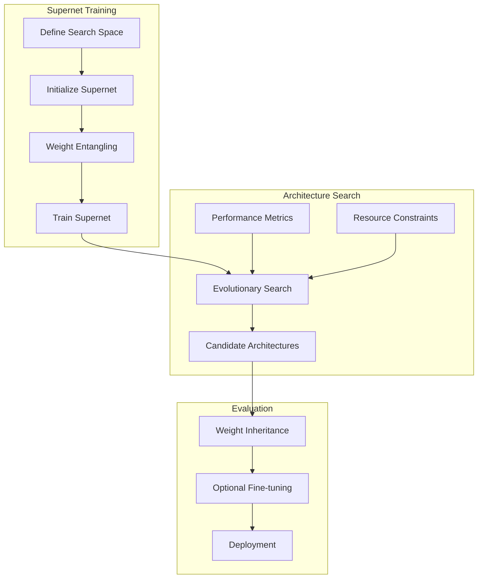

Sources: [AutoFormer/README.md:1-120](AutoFormer/README.md:1-120)

### Cyclic Architecture Search

CDARTS introduces a cyclic feedback mechanism between search and evaluation networks:

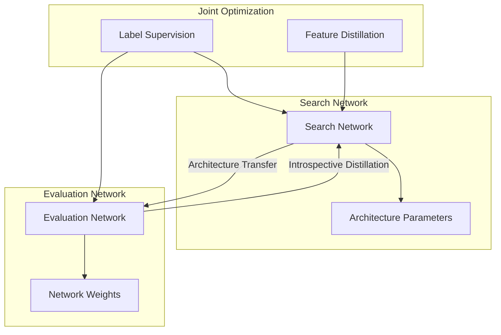

Sources: [CDARTS/README.md:1-67](CDARTS/README.md:1-67)

## Position Encoding Innovations

The iRPE project introduces improved relative position encoding methods for vision transformers.

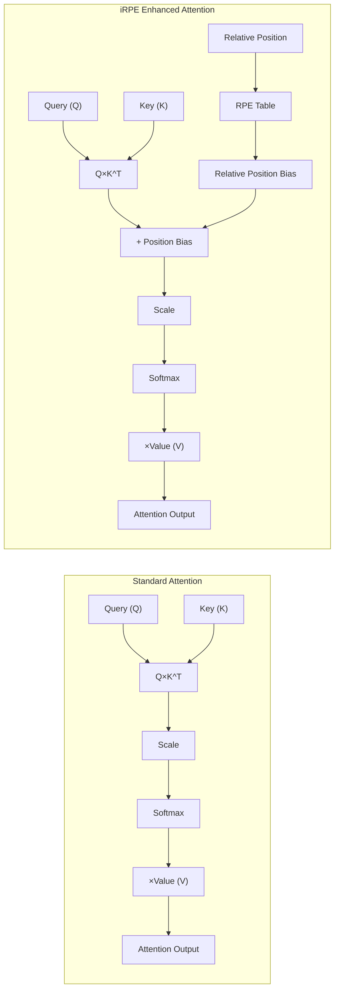

iRPE offers several variants that can be attached to queries, keys, or values with different encoding methods. These innovations improved performance on both classification (DeiT) and detection (DETR) models.

Sources: [iRPE/README.md:1-64](iRPE/README.md:1-64), [iRPE/DETR-with-iRPE/README.md:1-178](iRPE/DETR-with-iRPE/README.md:1-178), [iRPE/DeiT-with-iRPE/README.md:1-115](iRPE/DeiT-with-iRPE/README.md:1-115)

## Shared Training Infrastructure

Projects in the repository share common training infrastructure components:

### Distributed Training Architecture

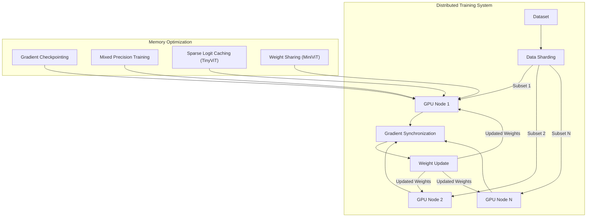

This infrastructure enables efficient training of models on large datasets while managing memory constraints through techniques like gradient checkpointing and mixed precision training.

Sources: [TinyViT/README.md:1-95](TinyViT/README.md:1-95), [TinyCLIP/README.md:1-78](TinyCLIP/README.md:1-78)

## Model Family Comparison

The following table compares the key architectures in the repository:

| Model Family | Design Approach | Key Innovation | Parameter Reduction | Data Efficiency |
|--------------|-----------------|----------------|---------------------|-----------------|
| TinyViT      | Hierarchical ViT with distillation | Fast Pretraining Distillation | 5M-21M (vs 86M DeiT-B) | Teacher logits cached once |
| TinyCLIP     | Compressed CLIP | Affinity Mimicking & Weight Inheritance | 50% reduction from base CLIP | Reuses LAION/YFCC datasets |
| MiniViT      | Weight-multiplexed transformer | Weight sharing with transformations | Up to 10x reduction | Uses weight distillation |
| AutoFormer   | Searched transformer | One-shot search with weight entanglement | Varies by search constraint | Efficient search without retraining |
| iRPE         | Enhanced position encoding | Directional relative distance modeling | Minimal overhead | Compatible with existing models |

Sources: [README.md:1-189](README.md:1-189), [TinyViT/README.md:1-95](TinyViT/README.md:1-95), [TinyCLIP/README.md:1-78](TinyCLIP/README.md:1-78)

## TinyViT Architecture Deep Dive

TinyViT, one of the key projects in the repository, features a hierarchical architecture:

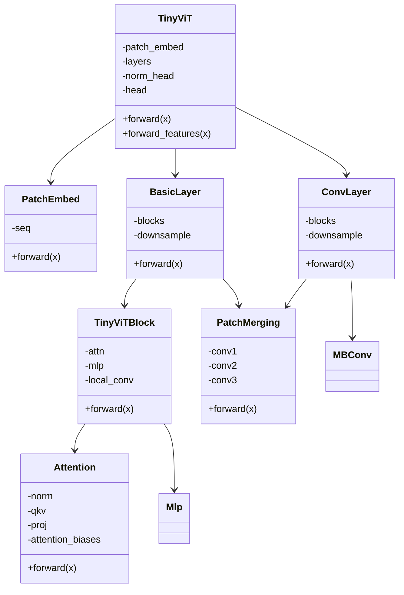

The architecture consists of:
1. Patch embedding that tokenizes the image into patches
2. Multiple transformer layers with varying depths and dimensions
3. Window-based attention to improve efficiency
4. Local convolutions between attention and MLP blocks
5. A hierarchical structure that reduces resolution through patch merging

Sources: [TinyViT/models/tiny_vit.py:453-516](TinyViT/models/tiny_vit.py:453-516), [TinyViT/models/tiny_vit.py:289-384](TinyViT/models/tiny_vit.py:289-384), [TinyViT/models/tiny_vit.py:216-286](TinyViT/models/tiny_vit.py:216-286)

## Integration of Components

The repository demonstrates how different architectural innovations can be integrated:

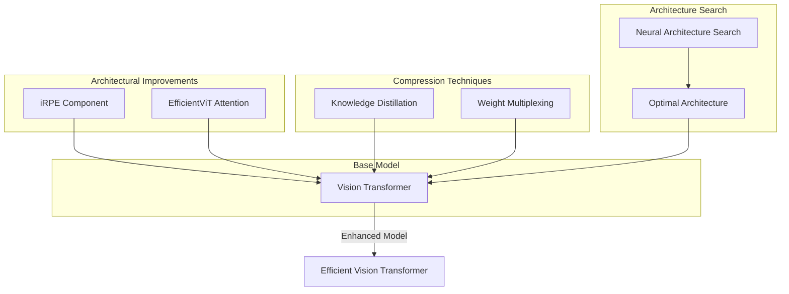

Combining these techniques produces models that are both efficient and effective, demonstrating the complementary nature of the different research directions.

Sources: [README.md:1-189](README.md:1-189)

## Summary of Design Principles

The Microsoft Cream repository demonstrates several key design principles:

1. **Hierarchical architectures** that process information at multiple scales
2. **Knowledge transfer** through various distillation techniques
3. **Parameter efficiency** through weight sharing and multiplexing
4. **Architecture optimization** through automated search procedures
5. **Component enhancement** through improved position encoding and attention mechanisms

These principles enable the creation of efficient vision models that maintain high accuracy while reducing computational requirements, advancing the state-of-the-art in efficient deep learning for computer vision.

Sources: [README.md:1-189](README.md:1-189), [TinyViT/README.md:1-95](TinyViT/README.md:1-95), [TinyCLIP/README.md:1-78](TinyCLIP/README.md:1-78), [MiniViT/README.md:1-59](MiniViT/README.md:1-59)

---

