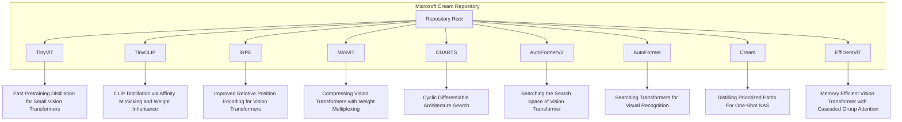
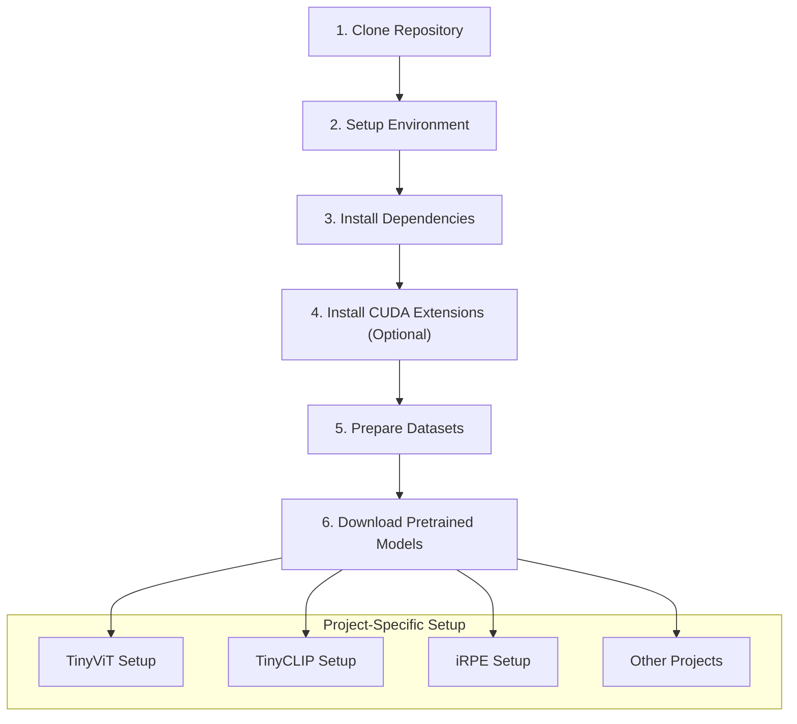
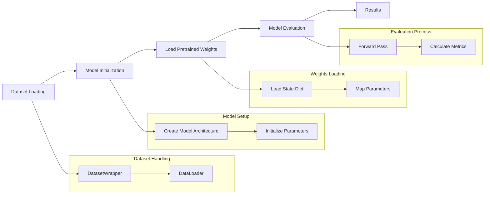

<!-- source: DeepWiki mcp.deepwiki.com · repo microsoft/Cream · page 1.3 Getting Started · fetched 2026-10-26 -->

# Getting Started

<details>
<summary>Relevant source files</summary>

The following files were used as context for generating this wiki page:

- [CDARTS/README.md](CDARTS/README.md)
- [README.md](README.md)
- [TinyCLIP/README.md](TinyCLIP/README.md)
- [TinyCLIP/script/auto_weight_inherit_50to25.sh](TinyCLIP/script/auto_weight_inherit_50to25.sh)
- [TinyCLIP/script/auto_weight_inherit_75to50.sh](TinyCLIP/script/auto_weight_inherit_75to50.sh)
- [TinyViT/README.md](TinyViT/README.md)
- [TinyViT/models/tiny_vit.py](TinyViT/models/tiny_vit.py)
- [TinyViT/tests/test_models.py](TinyViT/tests/test_models.py)
- [iRPE/DETR-with-iRPE/README.md](iRPE/DETR-with-iRPE/README.md)
- [iRPE/DeiT-with-iRPE/README.md](iRPE/DeiT-with-iRPE/README.md)
- [iRPE/README.md](iRPE/README.md)

</details>


This guide provides instructions for setting up and getting started with the Microsoft Cream repository. It covers the essential steps for installation, dependencies, and basic usage of the various neural architecture search and vision transformer projects contained within this repository.

For detailed information about the architecture and design principles of the projects, see [Architecture & Design Philosophy](#1.2). For an overview of all projects in the repository, see [Project Collection](#1.1).

## Repository Overview



Sources: [README.md:4-26]()

## Prerequisites

Before you begin, ensure your system meets the following requirements:

| Requirement | Specification |
|-------------|---------------|
| Python | >= 3.7 |
| PyTorch | >= 1.7.0 |
| CUDA | Compatible with your PyTorch version |
| GPU | Recommended for training and inference |
| Storage | At least 10GB for the repository and pretrained models |

Sources: [iRPE/DeiT-with-iRPE/README.md:29-31]()

## Installation Steps



Sources: [TinyViT/README.md:71-72](), [iRPE/DETR-with-iRPE/README.md:28-42]()

### 1. Clone the Repository

```bash
git clone https://github.com/microsoft/Cream.git
cd Cream
```

### 2. Setting Up Your Python Environment

It's recommended to create a new virtual environment:

```bash
# Using conda
conda create -n cream python=3.8
conda activate cream

# Or using venv
python -m venv cream-env
source cream-env/bin/activate  # On Windows, use: cream-env\Scripts\activate
```

### 3. Installing Dependencies

Each project in the Cream repository has its own set of dependencies. You can install the basic requirements for working with most projects:

```bash
# For TinyViT
cd TinyViT
pip install -r requirements.txt

# For TinyCLIP
cd ../TinyCLIP
pip install -r requirements.txt

# For iRPE
cd ../iRPE
pip install -r requirements.txt
```

Sources: [TinyViT/README.md:72](), [iRPE/DeiT-with-iRPE/README.md:27-32]()

### 4. Installing CUDA Extensions (Optional but Recommended)

Some projects like iRPE provide CUDA extensions for improved performance:

```bash
# For iRPE
cd iRPE/rpe_ops/
python setup.py install --user
```

Sources: [iRPE/DETR-with-iRPE/README.md:35-41](), [iRPE/DeiT-with-iRPE/README.md:34-41]()

### 5. Preparing Datasets

Depending on which projects you plan to use, you'll need to prepare different datasets:

| Project | Datasets | Download Location |
|---------|----------|-------------------|
| TinyViT | ImageNet-1K, ImageNet-22K | [ImageNet Website](http://www.image-net.org/) |
| TinyCLIP | ImageNet-1K, LAION-400M, YFCC-15M | See TinyCLIP docs |
| iRPE | ImageNet-1K, COCO | [ImageNet](http://www.image-net.org/), [COCO](https://cocodataset.org/#download) |

For most vision transformer models, ImageNet-1K is the primary evaluation dataset. Follow each project's instructions for specific dataset preparation.

Sources: [iRPE/DeiT-with-iRPE/README.md:43-66](), [iRPE/DETR-with-iRPE/README.md:44-84]()

### 6. Downloading Pretrained Models

Most projects provide pretrained models that you can download:

```bash
# Example for TinyViT
# Download models from the GitHub release page
# https://github.com/wkcn/TinyViT-model-zoo/releases/download/checkpoints/
```

## Using Pretrained Models

### TinyViT Models

Using TinyViT models is straightforward:

```python
# Import the TinyViT model
from models.tiny_vit import tiny_vit_21m_224

# Create a TinyViT model with pretrained weights
model = tiny_vit_21m_224(pretrained=True)

# Use the model for inference
output = model(image)
```

Sources: [TinyViT/README.md:32-37](), [TinyViT/models/tiny_vit.py:638-640]()

Here is a diagram of how the TinyViT model is structured:

```mermaid
flowchart TB
    subgraph "TinyViT Model Architecture"
        Input["Input Image"] --> PatchEmbed["PatchEmbed"]
        PatchEmbed --> ConvLayer["ConvLayer (Stage 1)"]
        ConvLayer --> BasicLayer1["BasicLayer (Stage 2)"]
        BasicLayer1 --> BasicLayer2["BasicLayer (Stage 3)"]
        BasicLayer2 --> BasicLayer3["BasicLayer (Stage 4)"]
        BasicLayer3 --> Head["Classifier Head"]
        Head --> Output["Output Predictions"]
    end
    
    subgraph "API Flow"
        ModelCreate["tiny_vit_21m_224(pretrained=True)"] --> Forward["model(image)"]
        Forward --> Predict["Output Classification"]
    end
```



Sources: [TinyViT/models/tiny_vit.py:453-591]()

### iRPE Models

For iRPE, you can use the pretrained models for image classification:

```python
# Import the model with iRPE
from timm.models import create_model

# Create a DeiT model with iRPE
model = create_model('deit_small_patch16_224_ctx_product_50_shared_k', pretrained=True)
```

Sources: [iRPE/DeiT-with-iRPE/README.md:86-87]()

### TinyCLIP Models

TinyCLIP provides various pretrained models:

```python
# Using TinyCLIP models
import torch
from open_clip import create_model_and_transforms

# Load the model and transforms
model, _, preprocess = create_model_and_transforms('TinyCLIP-ViT-39M-16-Text-19M', pretrained='YFCC15M')
```

Sources: [TinyCLIP/README.md:52]()

## Running Evaluation

Most projects provide evaluation scripts to assess model performance:

### TinyViT Evaluation

```bash
# Evaluate TinyViT on ImageNet
cd TinyViT
python -m torch.distributed.launch --nproc_per_node=8 main.py \
    --eval \
    --model tiny_vit_21m_224 \
    --resume /path/to/checkpoint.pth \
    --data-path /path/to/imagenet
```

Sources: [TinyViT/README.md:74-75]()

### iRPE Evaluation

```bash
# Evaluate iRPE-enhanced DeiT on ImageNet
cd iRPE/DeiT-with-iRPE
python -m torch.distributed.launch --nproc_per_node=8 --use_env main.py \
    --model deit_small_patch16_224_ctx_product_50_shared_k \
    --batch-size 128 \
    --data-path ./ImageNet/ \
    --output_dir ./outputs/ \
    --eval \
    --resume deit_small_patch16_224_ctx_product_50_shared_k.pth
```

Sources: [iRPE/DeiT-with-iRPE/README.md:80-84]()

### TinyCLIP Evaluation

```bash
# Evaluate TinyCLIP on zero-shot classification
cd TinyCLIP
python -m src.eval.eval_zeroshot \
    --model-config src/open_clip/model_configs/TinyCLIP-ViT-39M-16-Text-19M.json \
    --checkpoint /path/to/checkpoint.pt
```

Sources: [TinyCLIP/README.md:48-50]()

## Data Flow in Evaluation Process



Sources: [TinyViT/README.md:42-45]()

## Training Your Own Models

If you want to train or fine-tune models, each project provides specific training instructions:

### TinyViT Training

TinyViT uses a fast distillation framework that requires saving teacher logits first:

1. Save teacher sparse logits:
```bash
cd TinyViT
python -m torch.distributed.launch --nproc_per_node=8 \
    main.py --sparse-eval \
    --teacher-model-path path/to/teacher_model.pth \
    --data-path path/to/imagenet
```

2. Train with distillation:
```bash
python -m torch.distributed.launch --nproc_per_node=8 \
    main.py --config configs/22k_distill/tiny_vit_21m_22k_distill.yaml
```

Sources: [TinyViT/README.md:78-81]()

### iRPE Training

```bash
cd iRPE/DeiT-with-iRPE
python -m torch.distributed.launch --nproc_per_node=8 --use_env main.py \
    --model deit_small_patch16_224_ctx_product_50_shared_k \
    --batch-size 128 \
    --data-path ./ImageNet/ \
    --output_dir ./outputs/
```

Sources: [iRPE/DeiT-with-iRPE/README.md:73-76]()

### TinyCLIP Training

TinyCLIP offers automated weight inheritance for efficient training:

```bash
cd TinyCLIP
# Example script for automatic weight inheritance
./script/auto_weight_inherit_75to50.sh
```

Sources: [TinyCLIP/script/auto_weight_inherit_75to50.sh:1-37]()

## Troubleshooting

Common issues and their solutions:

| Issue | Solution |
|-------|----------|
| CUDA out of memory | Decrease batch size or use gradient checkpointing |
| ImportError | Check if all dependencies are installed correctly |
| Model loading error | Ensure the model checkpoint path is correct and the model definition matches |
| Dataset loading error | Verify dataset path and format |

## Next Steps

Once you have successfully set up and run basic operations with the models in the Cream repository, you can:

1. Explore model architectures in detail - See [Architecture & Design Philosophy](#1.2)
2. Learn about specific model compression frameworks - See [Model Compression Frameworks](#2)
3. Understand neural architecture search approaches - See [Neural Architecture Search](#3)
4. Try out vision transformer improvements - See [Vision Transformer Improvements](#4)
5. Review advanced topics and features - See [Advanced Topics](#5)

The Cream repository provides a rich collection of models and techniques for efficient and effective vision transformers that can be used for various computer vision tasks.

---

