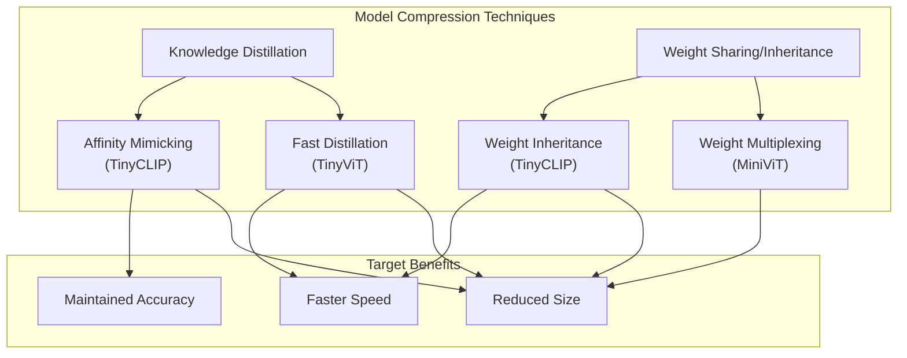
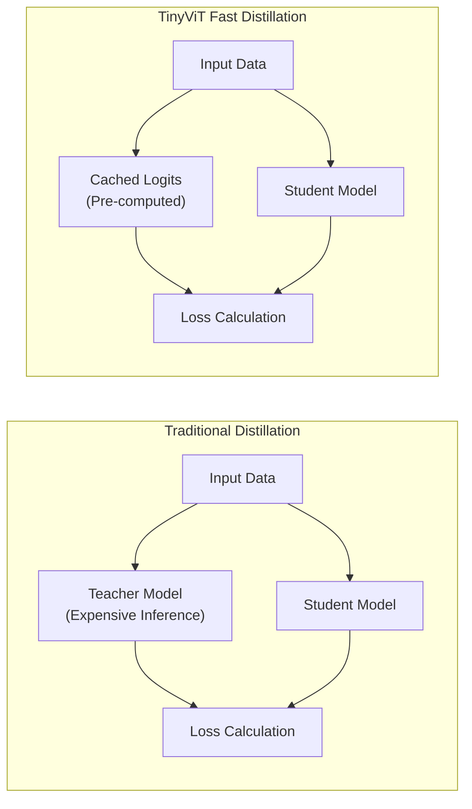
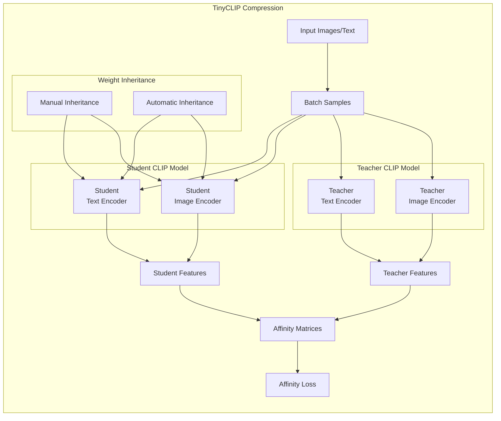
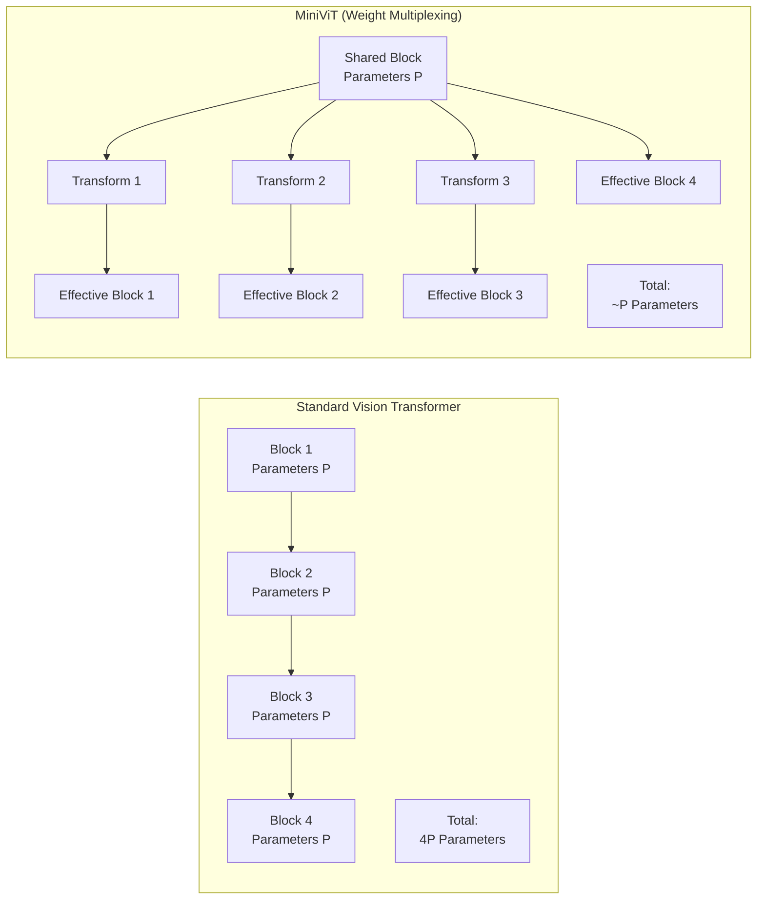
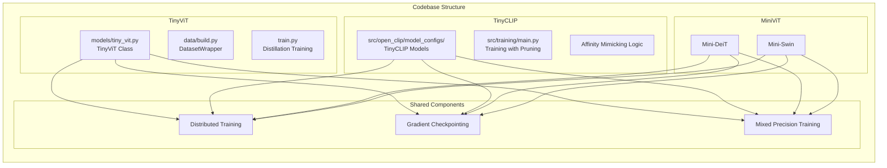

<!-- source: DeepWiki mcp.deepwiki.com · repo microsoft/Cream · page 2 Model Compression Frameworks · fetched 2026-10-26 -->

# Model Compression Frameworks

<details>
<summary>Relevant source files</summary>

The following files were used as context for generating this wiki page:

- [AutoFormer/README.md](AutoFormer/README.md)
- [MiniViT/Mini-DeiT/README.md](MiniViT/Mini-DeiT/README.md)
- [MiniViT/Mini-Swin/README.md](MiniViT/Mini-Swin/README.md)
- [MiniViT/README.md](MiniViT/README.md)
- [TinyCLIP/README.md](TinyCLIP/README.md)
- [TinyCLIP/script/auto_weight_inherit_50to25.sh](TinyCLIP/script/auto_weight_inherit_50to25.sh)
- [TinyCLIP/script/auto_weight_inherit_75to50.sh](TinyCLIP/script/auto_weight_inherit_75to50.sh)
- [TinyViT/README.md](TinyViT/README.md)
- [TinyViT/models/tiny_vit.py](TinyViT/models/tiny_vit.py)
- [TinyViT/tests/test_models.py](TinyViT/tests/test_models.py)

</details>


This document provides an overview of the model compression frameworks used across projects in the Microsoft Cream repository. The frameworks presented here focus on reducing the size and computational requirements of vision transformers while maintaining competitive performance. For specific details on individual compression frameworks, see the respective subpages:

- For TinyViT's architecture and training details, see [TinyViT Framework](#2.1)
- For TinyCLIP's cross-modal compression approach, see [TinyCLIP Framework](#2.2)
- For MiniViT's weight multiplexing technique, see [MiniViT Framework](#2.3)

## Compression Techniques Overview

The repository implements several complementary approaches to model compression, with each project focusing on different techniques. These compression techniques aim to reduce model size, improve inference speed, and maintain competitive accuracy.



**Diagram: Model Compression Techniques Overview**

Sources: [TinyViT/README.md:5-6](), [TinyCLIP/README.md:3-5](), [MiniViT/README.md:8-9]()

### Knowledge Distillation Methods

Knowledge distillation transfers knowledge from a large, high-performance teacher model to a smaller, more efficient student model. The two primary distillation approaches in the repository are:

1. **Fast Distillation (TinyViT)** - Pre-computes and caches teacher logits to avoid repeated teacher inference during training, making the distillation process much more efficient.

2. **Affinity Mimicking (TinyCLIP)** - Focuses on transferring the relationship patterns between samples in a batch rather than just the direct outputs, preserving the structural knowledge the teacher model has learned.

### Weight Sharing Methods

Weight sharing methods reduce model size by reusing weights across different parts of the model:

1. **Weight Multiplexing (MiniViT)** - Shares weights across transformer blocks while applying transformations to maintain expressivity.

2. **Weight Inheritance (TinyCLIP)** - Strategically transfers weights from a larger model to initialize a smaller model, which can be done manually or automatically.

## TinyViT: Fast Distillation Framework

TinyViT introduces a distillation framework that efficiently transfers knowledge from large teacher models to compact student models. The key innovation is the pre-computation and caching of sparse teacher logits to avoid the computational overhead of repeatedly forwarding data through the large teacher model.



**Diagram: TinyViT Fast Distillation vs Traditional Distillation**

Sources: [TinyViT/README.md:6](), [TinyViT/README.md:25]()

TinyViT models come in various sizes (5M, 11M, 21M parameters) and achieve impressive accuracy. For example, TinyViT-21M reaches 84.8% top-1 accuracy on ImageNet-1k with only 21M parameters, and 86.5% accuracy at higher resolutions.

### Implementation Details

TinyViT's distillation process involves:

1. **Saving Teacher Logits**: Teacher logits are computed once and saved in a sparse format to minimize storage requirements
2. **Dataset Wrapper**: A custom dataset wrapper enables transparent loading of pre-computed logits during training
3. **Reusable Framework**: Saved logits can be reused for training different student architectures without recomputing them

The implementation uses a hierarchical architecture with mobile block convolutions (MBConv) in early stages and efficient transformer blocks in later stages.

Sources: [TinyViT/README.md:27-42](), [TinyViT/models/tiny_vit.py:453-591]()

## TinyCLIP: Cross-Modal Distillation

TinyCLIP focuses on compressing CLIP (Contrastive Language-Image Pre-training) models, which involve both image and text encoders. It introduces two complementary techniques: affinity mimicking for effective knowledge transfer and weight inheritance for parameter reduction.



**Diagram: TinyCLIP Compression Framework**

Sources: [TinyCLIP/README.md:3-9](), [TinyCLIP/README.md:27-38]()

### Affinity Mimicking

Instead of directly matching the output logits, affinity mimicking focuses on preserving the relationships between samples that the teacher model has learned:

1. Features from both teacher and student models are extracted
2. Affinity matrices are calculated to represent sample relationships
3. The student is trained to match the teacher's affinity patterns

This approach helps maintain structural knowledge even when the student has much lower capacity.

### Weight Inheritance

TinyCLIP uses two approaches to weight inheritance:

1. **Manual Inheritance**: Carefully designed architectures with pre-determined inheritance patterns
2. **Automatic Inheritance**: Progressive pruning approach that automatically determines which weights to keep

The automatic inheritance process is implemented through a pruning-based approach, as seen in the training scripts:

```
--prune-image
--prune-text
--target-sparsity 0.75
--start-sparsity 0.5
--sparsity-warmup 1000
```

Sources: [TinyCLIP/script/auto_weight_inherit_50to25.sh:30-35](), [TinyCLIP/script/auto_weight_inherit_75to50.sh:30-35]()

## MiniViT: Weight Multiplexing

MiniViT focuses on parameter reduction by multiplexing the weights of consecutive transformer blocks. Unlike other approaches that focus on distillation alone, MiniViT's primary innovation is in the model architecture itself.



**Diagram: MiniViT Weight Multiplexing**

Sources: [MiniViT/README.md:9-11](), [MiniViT/Mini-DeiT/README.md:1-11](), [MiniViT/Mini-Swin/README.md:1-11]()

### How Weight Multiplexing Works

MiniViT makes the weights shared across layers while applying transformations to increase diversity:

1. A single set of transformer block parameters is shared across multiple layers
2. Layer-specific transformations are applied to the shared weights to create different behaviors
3. Weight distillation over self-attention is used to transfer knowledge from the original model

This approach significantly reduces the parameter count while maintaining performance. For example, MiniViT reduces Swin-B by 48% while actually improving accuracy by 1.0%.

### Implementation Variants

MiniViT is implemented for two popular vision transformer architectures:

1. **Mini-DeiT**: Applies weight multiplexing to the DeiT architecture
   - Mini-DeiT-B compresses DeiT-B from 86M to 44M parameters while achieving 83.2% accuracy

2. **Mini-Swin**: Applies weight multiplexing to the Swin Transformer architecture
   - Mini-Swin-B compresses Swin-B to 46M parameters while achieving 84.5% accuracy

Sources: [MiniViT/README.md:16-24](), [MiniViT/Mini-DeiT/README.md:6-11](), [MiniViT/Mini-Swin/README.md:6-11]()

## Comparison of Approaches

The table below compares the key characteristics of the three model compression frameworks:

| Framework | Primary Technique | Parameter Reduction | Speed Improvement | Training Efficiency | Application Focus |
|-----------|------------------|---------------------|-------------------|---------------------|------------------|
| TinyViT   | Fast Distillation | Moderate to High | High | Very High (cached logits) | General Vision Transformers |
| TinyCLIP  | Affinity Mimicking + Weight Inheritance | High | Moderate to High | Moderate | CLIP (Vision-Language) Models |
| MiniViT   | Weight Multiplexing | High | Moderate | Moderate | Vision Transformers (DeiT, Swin) |

### Code Integration

The following diagram shows how these compression frameworks are integrated into the codebase:



**Diagram: Model Compression Code Structure**

Sources: [TinyViT/models/tiny_vit.py:452-591](), [TinyViT/README.md:32-43](), [TinyCLIP/README.md:27-38](), [MiniViT/README.md:42-45]()

## Practical Usage Considerations

When choosing a compression framework for your application, consider:

1. **TinyViT** is best when:
   - You need very fast training with distillation
   - You're working with a large-scale dataset
   - You can afford the storage for cached teacher logits
   - You prioritize inference speed

2. **TinyCLIP** is best when:
   - You're working with multi-modal (vision-language) models
   - You need flexibility in compression ratio
   - You want automated weight pruning/inheritance

3. **MiniViT** is best when:
   - You need extreme parameter reduction
   - You're working with specific architectures (DeiT, Swin)
   - Model size is the primary constraint

All frameworks provide pre-trained model checkpoints for common configurations, making them immediately usable for downstream applications or fine-tuning.

Sources: [TinyViT/README.md:49-67](), [TinyCLIP/README.md:26-38](), [MiniViT/README.md:26-38]()

## Summary

The Microsoft Cream repository provides three complementary approaches to model compression for vision transformers:

1. **TinyViT** uses fast distillation with cached teacher logits to efficiently transfer knowledge from large models to compact architectures
2. **TinyCLIP** applies affinity mimicking and weight inheritance for cross-modal compression of CLIP models
3. **MiniViT** employs weight multiplexing to share parameters across transformer layers with transformations for diversity

Each approach represents a different trade-off between model size, inference speed, and accuracy preservation. Together, they form a comprehensive toolkit for efficient deployment of vision transformers across a wide range of hardware constraints and performance requirements.

---

