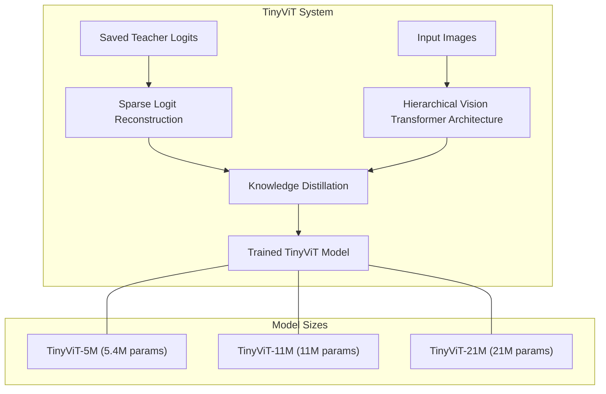
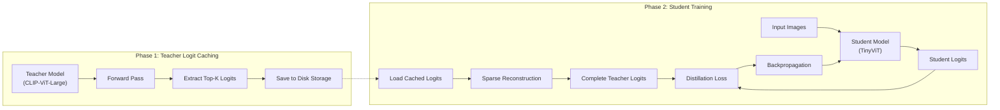
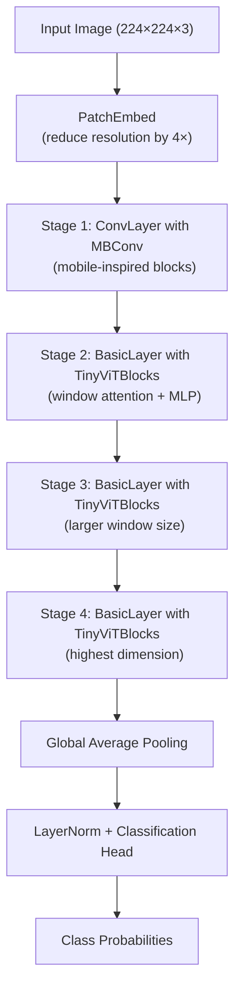
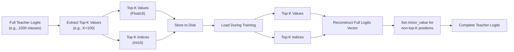
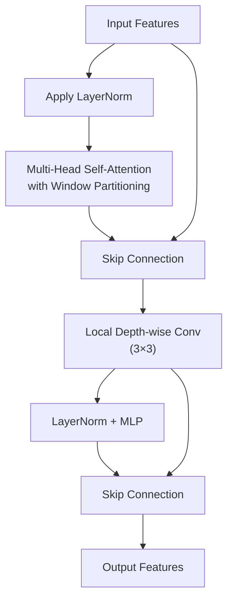

<!-- source: DeepWiki mcp.deepwiki.com · repo microsoft/Cream · page 2.1 TinyViT · fetched 2026-10-26 -->

# TinyViT

<details>
<summary>Relevant source files</summary>

The following files were used as context for generating this wiki page:

- [TinyViT/README.md](TinyViT/README.md)
- [TinyViT/config.py](TinyViT/config.py)
- [TinyViT/data/augmentation/manager.py](TinyViT/data/augmentation/manager.py)
- [TinyViT/main.py](TinyViT/main.py)
- [TinyViT/models/tiny_vit.py](TinyViT/models/tiny_vit.py)
- [TinyViT/my_meter.py](TinyViT/my_meter.py)
- [TinyViT/save_logits.py](TinyViT/save_logits.py)
- [TinyViT/tests/test_models.py](TinyViT/tests/test_models.py)
- [TinyViT/utils.py](TinyViT/utils.py)

</details>


## Purpose and Scope

TinyViT is a family of tiny, efficient vision transformers pretrained on large-scale datasets using a fast distillation framework. This document explains the TinyViT architecture, its fast distillation mechanism, model variants, and implementation details. The central innovation is transferring knowledge from large pretrained teacher models to small student models by sparsifying and storing teacher logits to reduce memory costs and computational overhead during training.

For information about other model compression approaches such as MiniViT with weight multiplexing, see [MiniViT](#2.3). For details on TinyViT's model architecture specifically, see [TinyViT Architecture](#2.1.1).

## System Overview

TinyViT integrates three main components:

1. A hierarchical transformer architecture with mobile-inspired design
2. A fast distillation framework that caches teacher model outputs
3. A sparse logit reconstruction mechanism for efficient knowledge transfer



Sources: [TinyViT/README.md:6-8](), [TinyViT/models/tiny_vit.py:452-591]()

## Fast Distillation Framework

The key innovation in TinyViT is its fast distillation approach that reduces training costs by:

1. Pre-computing and caching teacher model outputs
2. Applying sparse storage of only the top-K logits
3. Eliminating the need to run the teacher model during student training



Sources: [TinyViT/save_logits.py:102-180](), [TinyViT/main.py:284-400]()

## Key Components

### 1. Model Architecture

TinyViT employs a hierarchical architecture with four stages of increasing complexity:



Sources: [TinyViT/models/tiny_vit.py:453-590]()

### 2. Sparse Logit Storage and Reconstruction

The teacher logits are saved in a sparse format and reconstructed during training:



Sources: [TinyViT/save_logits.py:140-158](), [TinyViT/main.py:323-328]()

### 3. TinyViTBlock Structure

The core building block of TinyViT in stages 2-4:



Sources: [TinyViT/models/tiny_vit.py:289-383]()

## Model Variants and Performance

TinyViT offers various sizes to balance efficiency and accuracy:

| Model | Parameters | FLOPs | ImageNet-1k<br>Accuracy | Throughput<br>(imgs/s) | Window Sizes | Embed Dims |
|-------|------------|-------|-------------------------|----------------------|--------------|------------|
| TinyViT-5M | 5.4M | 1.3G | 80.7% | 3,060 | [7,7,14,7] | [64,128,160,320] |
| TinyViT-11M | 11M | 2.0G | 83.2% | 2,468 | [7,7,14,7] | [64,128,256,448] |
| TinyViT-21M | 21M | 4.3G | 84.8% | 1,571 | [7,7,14,7] | [96,192,384,576] |
| TinyViT-21M-384 | 21M | 13.8G | 86.2% | 394 | [12,12,24,12] | [96,192,384,576] |
| TinyViT-21M-512 | 21M | 27.0G | 86.5% | 167 | [16,16,32,16] | [96,192,384,576] |

Sources: [TinyViT/README.md:50-60](), [TinyViT/models/tiny_vit.py:640-704]()

## Training Pipeline

The training process involves two distinct phases:

### Phase 1: Save Teacher Logits

```python
# Run save_logits.py to cache teacher model outputs
# Teacher: CLIP-ViT-Large/16 finetuned on ImageNet-22k
python save_logits.py --cfg configs/22k_distill/teacher_clip_large_336_22k.yaml
```

Sources: [TinyViT/save_logits.py:50-99]()

### Phase 2: Train Student with Distillation

```python
# Train TinyViT using saved logits
python -m torch.distributed.launch --nproc_per_node 8 main.py \
    --cfg configs/22k_distill/tiny_vit_21m_22k_distill.yaml
```

Sources: [TinyViT/main.py:152-153](), [TinyViT/main.py:284-400]()

## Code Organization

TinyViT's implementation is organized into these key files:

1. `models/tiny_vit.py`: Model architecture definition
2. `main.py`: Training and evaluation pipeline
3. `save_logits.py`: Tool to cache teacher model outputs
4. `data/augmentation/manager.py`: Manages logit storage/retrieval

## Usage Example

```python
# Import a TinyViT model
from tiny_vit import tiny_vit_21m_224

# Load pretrained model (with distillation from teacher)
model = tiny_vit_21m_224(pretrained=True)

# Forward pass
output = model(image)  # image: [B, 3, 224, 224]
```

Sources: [TinyViT/README.md:33-37](), [TinyViT/models/tiny_vit.py:640-704]()

## Configuration

TinyViT uses a configuration system to control model and training parameters:

```python
# Distillation settings
config.DISTILL.ENABLED = True  
config.DISTILL.TEACHER_LOGITS_PATH = 'path/to/logits'
config.DISTILL.LOGITS_TOPK = 100  # Number of top logits to save

# Model configuration
config.MODEL.TINY_VIT.DEPTHS = [2, 2, 6, 2]  # Layer depths per stage  
config.MODEL.TINY_VIT.NUM_HEADS = [3, 6, 12, 18]  # Attention heads per stage
config.MODEL.TINY_VIT.WINDOW_SIZES = [7, 7, 14, 7]  # Window sizes per stage
config.MODEL.TINY_VIT.EMBED_DIMS = [96, 192, 384, 576]  # Dimensions per stage
```

Sources: [TinyViT/config.py:67-75](), [TinyViT/config.py:77-82]()

## Summary

TinyViT demonstrates that small vision transformers can achieve high accuracy through effective knowledge distillation. The fast distillation framework allows efficient transfer of knowledge from large teacher models to small student models without the computational overhead of running the teacher during training. TinyViT-21M achieves 84.8% top-1 accuracy on ImageNet-1k with only 21M parameters, and 86.5% accuracy when fine-tuned at 512×512 resolution.

Sources: [TinyViT/README.md:8-9](), [TinyViT/README.md:21-25]()

---

