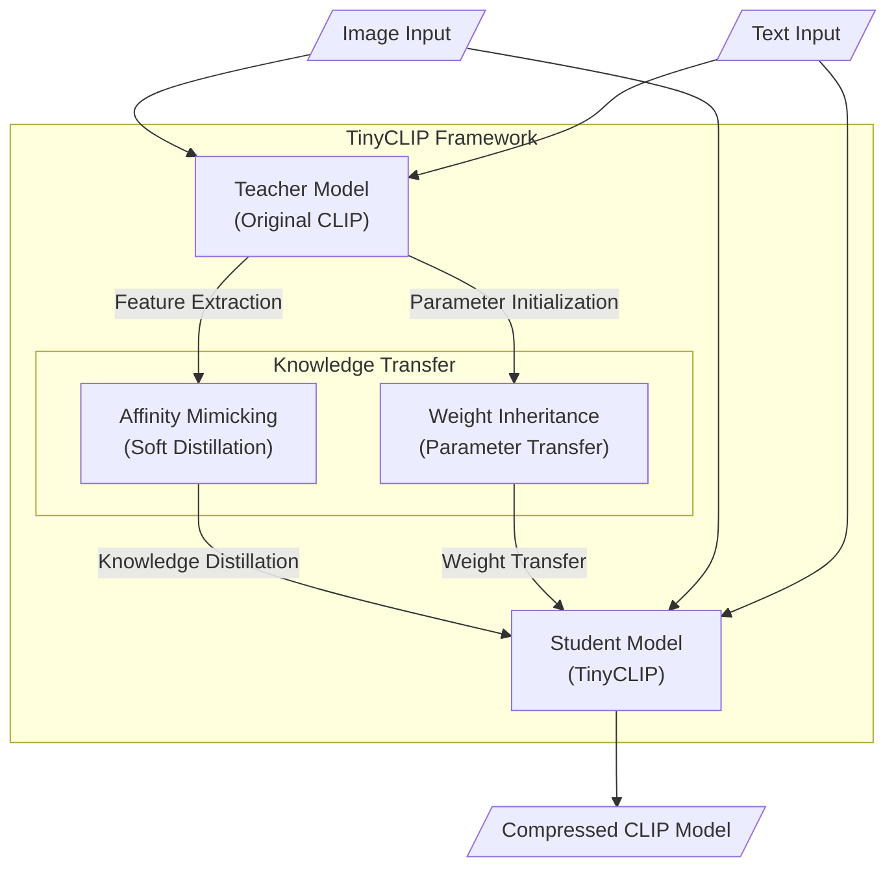
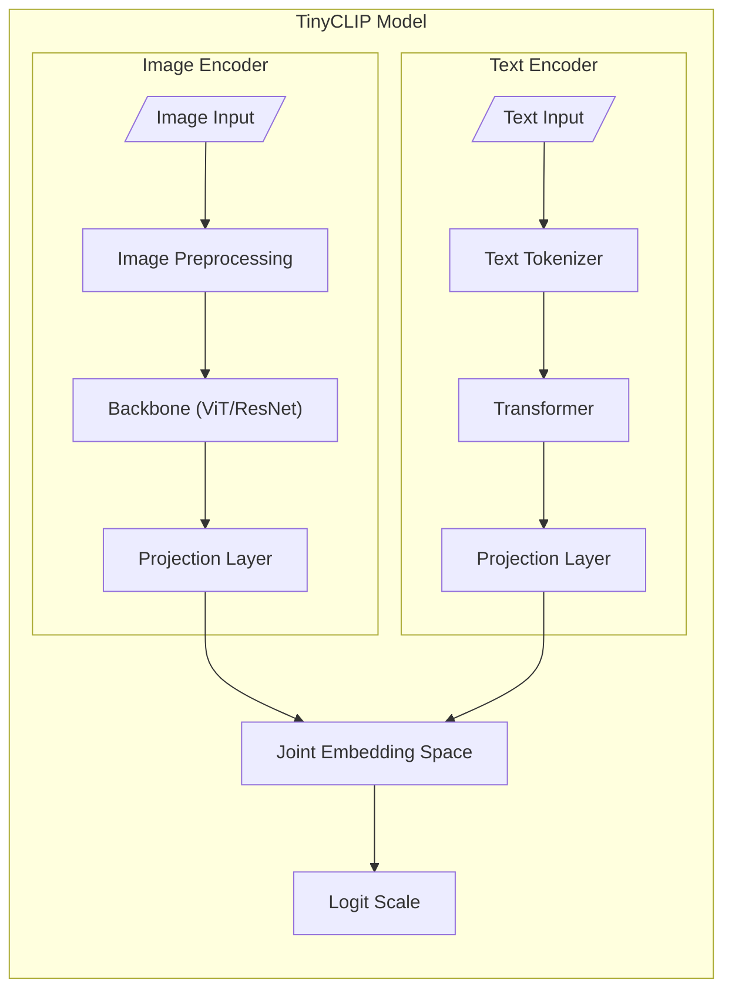
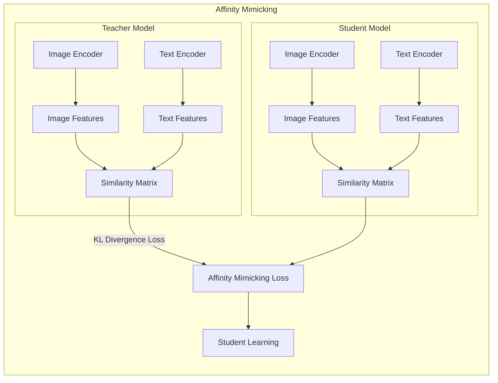
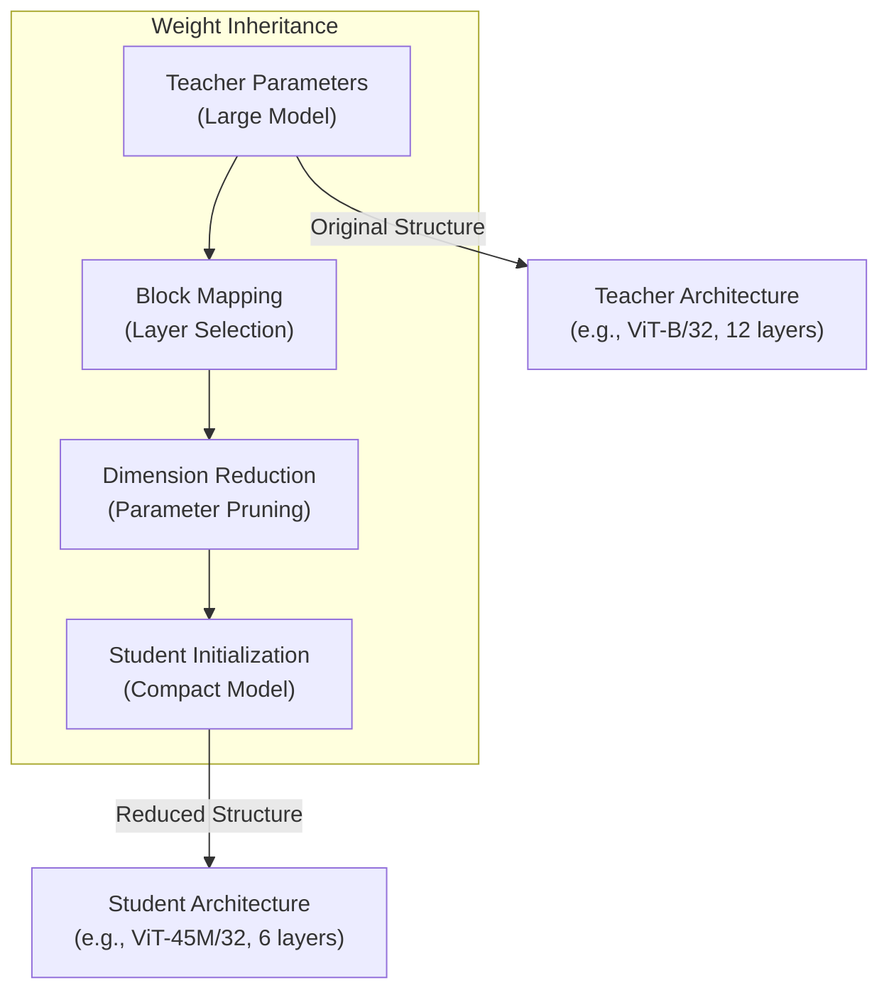
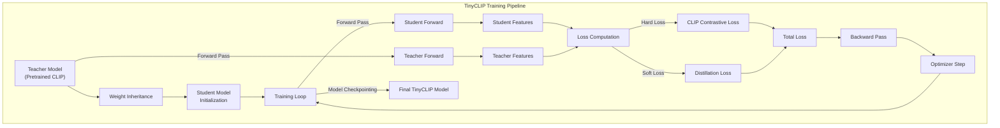
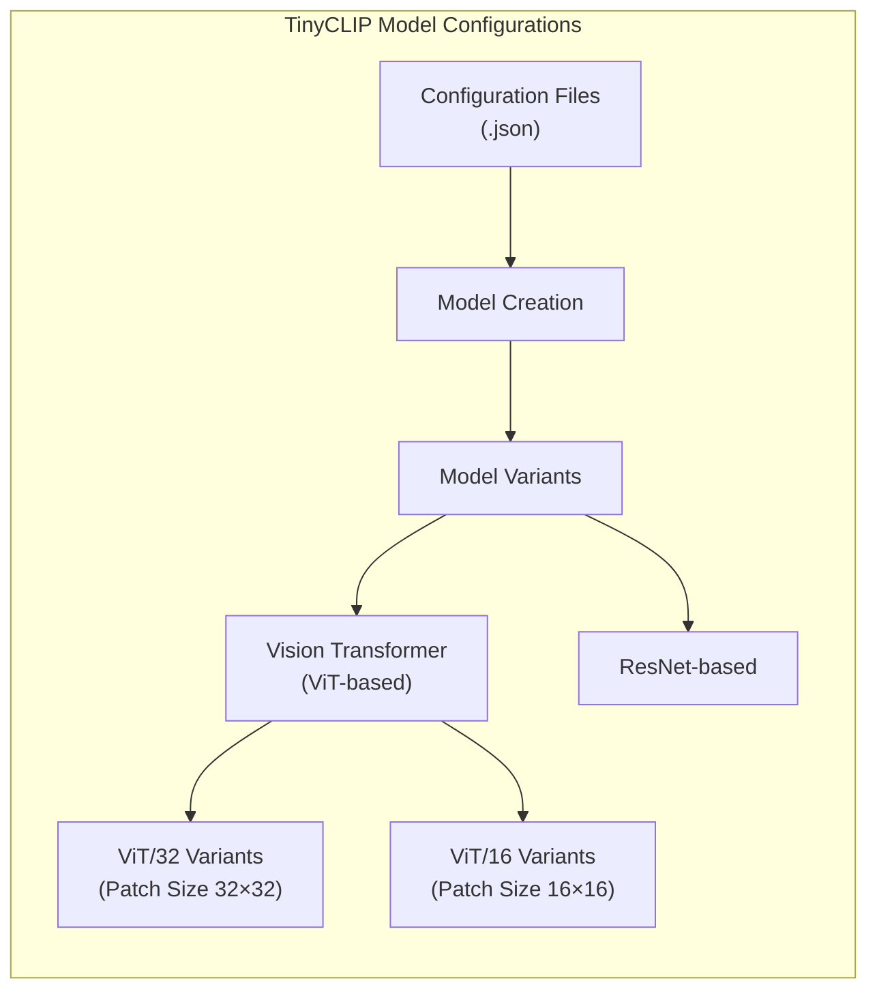
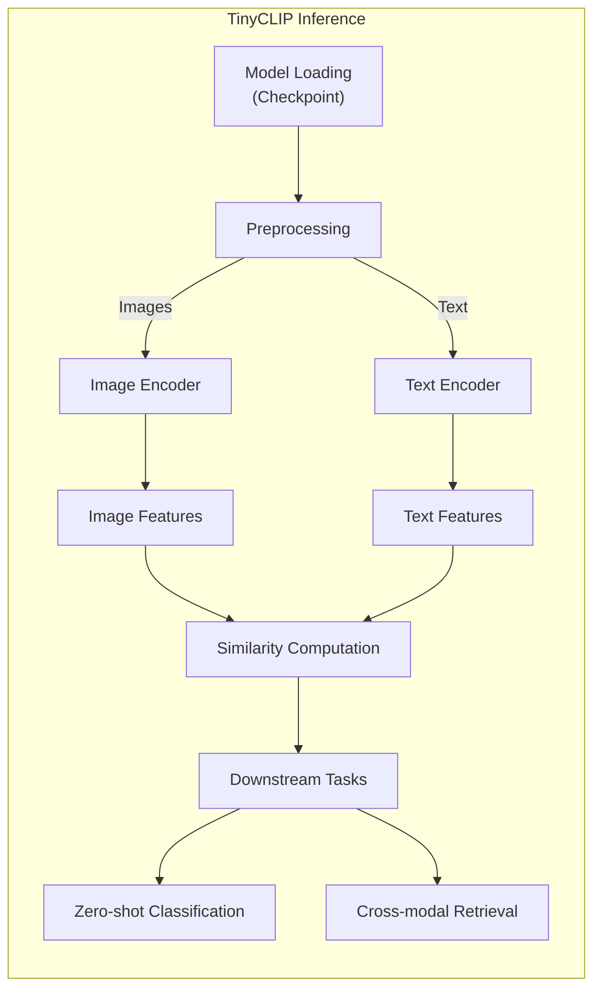
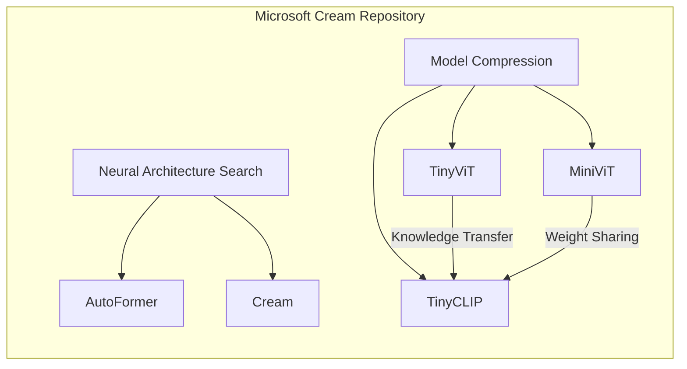

<!-- source: DeepWiki mcp.deepwiki.com · repo microsoft/Cream · page 2.2 TinyCLIP · fetched 2026-10-26 -->

# TinyCLIP

<details>
<summary>Relevant source files</summary>

The following files were used as context for generating this wiki page:

- [TinyCLIP/README.md](TinyCLIP/README.md)
- [TinyCLIP/script/auto_weight_inherit_50to25.sh](TinyCLIP/script/auto_weight_inherit_50to25.sh)
- [TinyCLIP/script/auto_weight_inherit_75to50.sh](TinyCLIP/script/auto_weight_inherit_75to50.sh)
- [TinyCLIP/src/open_clip/model.py](TinyCLIP/src/open_clip/model.py)
- [TinyCLIP/src/open_clip/resnet.py](TinyCLIP/src/open_clip/resnet.py)
- [TinyCLIP/src/open_clip/weight_inherit.py](TinyCLIP/src/open_clip/weight_inherit.py)
- [TinyCLIP/src/training/data.py](TinyCLIP/src/training/data.py)
- [TinyCLIP/src/training/main.py](TinyCLIP/src/training/main.py)
- [TinyCLIP/src/training/main_for_test.py](TinyCLIP/src/training/main_for_test.py)
- [TinyCLIP/src/training/optimizer.py](TinyCLIP/src/training/optimizer.py)
- [TinyCLIP/src/training/train.py](TinyCLIP/src/training/train.py)

</details>


TinyCLIP is a cross-modal distillation framework for creating compact and efficient CLIP (Contrastive Language-Image Pre-training) models. It introduces two novel techniques: **affinity mimicking** for knowledge distillation and **weight inheritance** for efficient parameter transfer. TinyCLIP enables the creation of smaller CLIP models that maintain comparable performance to their larger counterparts while offering significant efficiency improvements.

For information about other model compression frameworks like TinyViT, see [TinyViT](#2.1). For more details on the specific architecture implementation, see [TinyCLIP Architecture](#2.2.1).

## Purpose and Scope

This document covers:
- The TinyCLIP framework's core concepts and techniques
- The distillation methodology for compressing CLIP models
- The training and inference pipeline
- Available model variants and their configurations

TinyCLIP achieves significant model compression with minimal performance loss. For example, TinyCLIP ViT-45M/32 uses only half the parameters of ViT-B/32 while achieving comparable zero-shot performance, and TinyCLIP ResNet-19M reduces parameters by 50% with 2× inference speedup.

Sources: [TinyCLIP/README.md:1-19]()

## System Architecture

TinyCLIP consists of several integrated components that work together to create efficient CLIP models through distillation and weight inheritance.



**Diagram: TinyCLIP Framework Overview**

The TinyCLIP framework consists of two main models: a teacher model (the original CLIP model) and a student model (the target TinyCLIP model). The teacher model provides knowledge to the student through two mechanisms: affinity mimicking for feature-level knowledge distillation and weight inheritance for parameter transfer.

Sources: [TinyCLIP/README.md:3-9](), [TinyCLIP/src/training/main.py:223-238]()

## Model Components

TinyCLIP follows the dual-encoder architecture of CLIP, with separate encoders for image and text that are trained to align in a shared embedding space.



**Diagram: TinyCLIP Model Components**

TinyCLIP supports multiple backbone architectures:
- Vision Transformer (ViT) variants with different sizes (/16 and /32 patch size)
- ResNet variants with different parameter counts

Each encoder produces feature vectors that are projected into a shared embedding space where the similarity between image and text representations is computed.

Sources: [TinyCLIP/src/open_clip/model.py:443-566](), [TinyCLIP/src/open_clip/model.py:682-818](), [TinyCLIP/src/open_clip/resnet.py:96-187]()

## Key Techniques

### Affinity Mimicking

Affinity mimicking is the knowledge distillation component of TinyCLIP that transfers the cross-modal alignment capabilities from the teacher to the student model.



**Diagram: Affinity Mimicking Process**

In affinity mimicking:
1. Both teacher and student models process the same batch of images and texts
2. The similarity matrices (affinities) between image and text features are computed for both models
3. The student model is trained to match the teacher's similarity distribution using KL divergence loss
4. This transfers the cross-modal alignment knowledge from teacher to student

The implementation of affinity mimicking can be found in the `ClipSoftLoss` class, which computes the distillation loss between teacher and student similarity matrices.

Sources: [TinyCLIP/src/training/train.py:162-205](), [TinyCLIP/README.md:5]()

### Weight Inheritance

Weight inheritance is a parameter transfer technique that intelligently initializes the student model using weights from the teacher model.



**Diagram: Weight Inheritance Process**

Weight inheritance works through:
1. **Block mapping**: Selecting which layers from the teacher model to transfer to the student
2. **Dimension reduction**: Reducing the width (feature dimensions) of selected layers
3. **Parameter pruning**: Removing less important parameters to match the student architecture

This technique is implemented in the `weight_inherit` function which handles the intelligent transfer of parameters from teacher to student models.

Sources: [TinyCLIP/src/open_clip/weight_inherit.py:71-138](), [TinyCLIP/src/training/main.py:422-467]()

## Training Pipeline

The TinyCLIP training pipeline involves both the distillation process and optional automated weight inheritance for further compression.



**Diagram: TinyCLIP Training Pipeline**

The training process integrates several components:
1. **Weight inheritance**: Initialize the student model with pruned teacher weights
2. **Distillation**: Teach the student model to mimic the teacher's behavior
3. **Loss computation**: Combine hard contrastive loss and soft distillation loss
4. **Optimization**: Update the student model to improve performance

The training pipeline supports both manual model configurations and automatic weight inheritance for progressive model compression.

Sources: [TinyCLIP/src/training/train.py:84-806](), [TinyCLIP/src/training/main.py:195-238](), [TinyCLIP/script/auto_weight_inherit_50to25.sh:1-37]()

## Model Variants and Configuration

TinyCLIP provides multiple model variants with different architectures and parameter counts:

| Model                     | Image Backbone | Text Model | Parameters | Throughput | IN-1K Acc@1 |
|---------------------------|---------------|------------|------------|------------|-------------|
| TinyCLIP ViT-39M/16      | ViT (16×16)   | Text-19M   | 58M        | 1,469 pairs/s | 63.5% |
| TinyCLIP ViT-8M/16       | ViT (16×16)   | Text-3M    | 11M        | 4,150 pairs/s | 41.1% |
| TinyCLIP ResNet-30M      | ResNet        | Text-29M   | 59M        | 1,811 pairs/s | 59.1% |
| TinyCLIP ResNet-19M      | ResNet        | Text-19M   | 38M        | 3,024 pairs/s | 56.4% |
| TinyCLIP ViT-61M/32      | ViT (32×32)   | Text-29M   | 90M        | 3,191 pairs/s | 62.4% |
| TinyCLIP ViT-45M/32      | ViT (32×32)   | Text-18M   | 63M        | 3,682 pairs/s | 61.4% |

TinyCLIP models are configured using JSON files that specify the architecture hyperparameters. Each model can be loaded and used for inference like a standard CLIP model.



**Diagram: TinyCLIP Model Configuration System**

Model configuration options include:
- Architecture type (ViT or ResNet)
- Layer counts and widths
- Patch sizes for ViT models
- Text encoder dimensions

Sources: [TinyCLIP/README.md:25-38](), [TinyCLIP/src/open_clip/model.py:570-594]()

## Inference and Usage

TinyCLIP models can be loaded and used for inference similar to the original CLIP models. The models provide zero-shot classification and cross-modal retrieval capabilities.



**Diagram: TinyCLIP Inference Pipeline**

The inference pipeline consists of:
1. Model loading from a pre-trained checkpoint
2. Image and text preprocessing using the model's transform functions
3. Feature extraction through the image and text encoders
4. Similarity computation between image and text features
5. Application to downstream tasks like classification or retrieval

TinyCLIP models are compatible with the Hugging Face Transformers library for easy integration into various applications.

Sources: [TinyCLIP/README.md:41-57](), [TinyCLIP/inference.py]()

## Integration with Other Systems

TinyCLIP fits into the larger Microsoft Cream repository ecosystem, complementing other model compression approaches like TinyViT and MiniViT.



**Diagram: TinyCLIP in Microsoft Cream Repository**

Key integration points:
- TinyCLIP builds on techniques from TinyViT's distillation approach
- It adapts MiniViT's weight multiplexing concept for cross-modal models
- TinyCLIP extends these compression methods to the multimodal CLIP architecture

Sources: [TinyCLIP/README.md:71-74]()

## Implementation Details

### Affinity Mimicking Implementation

The affinity mimicking technique is implemented through the distillation loss calculation in the training loop. The soft loss function calculates the KL divergence between the teacher and student similarity distributions.

The core implementation is found in the loss function calculation:

```python
if args.distillation_alpha > 0.0 and args.distillation_weight > 0.0:
    soft_loss_weight = args.distillation_alpha * args.distillation_weight
    img2text_loss, text2img_loss = soft_loss_fn(
        image_features, text_features, logit_scale,
        teacher_image_features, teacher_text_features, teacher_logit_scale,
        labels=labels, average_two_losses=False)
        
    img2text_loss *= 0.5 * soft_loss_weight
    text2img_loss *= 0.5 * soft_loss_weight
    soft_loss = img2text_loss + text2img_loss
```

This combines image-to-text and text-to-image distillation losses to ensure cross-modal alignment is preserved in the student model.

Sources: [TinyCLIP/src/training/train.py:174-185]()

### Weight Inheritance Implementation

The weight inheritance mechanism is implemented in the `weight_inherit` function, which handles mapping teacher model parameters to the student model architecture.

Key steps in the implementation:
1. Extract depth-wise state dictionaries from teacher and student models
2. Map layers from teacher to student using specified sampling strategy
3. Prune parameters to match student dimensions
4. Handle special cases like attention heads and embedding layers

The core implementation samples teacher layers at regular intervals to match the student's reduced depth:

```python
encoder_type = 'interval_front'
step = teacher_depth // max(student_depth, 1)
idx = list(range(0, student_depth * step, step))
```

For multi-head attention layers, special handling ensures proper dimension reduction:

```python
student_head = student_v.size(0) // (3 * head_dim)
teacher_head = v.size(0) // (3 * head_dim)
student_state_dict[new_name] = v.view(3, teacher_head, head_dim, teacher_dim)[
    :, :student_head, :, :student_dim].reshape(3 * student_head * head_dim, student_dim)
```

Sources: [TinyCLIP/src/open_clip/weight_inherit.py:71-138](), [TinyCLIP/src/training/main.py:422-467]()

## Conclusion

TinyCLIP represents an effective approach to compressing CLIP models through a combination of affinity mimicking and weight inheritance. By leveraging these techniques, TinyCLIP achieves significant parameter reduction and inference speedup while maintaining competitive performance on various tasks. The framework supports both ViT and ResNet backbones and provides multiple model variants to suit different efficiency requirements.

For implementation details of the TinyCLIP architecture, see [TinyCLIP Architecture](#2.2.1). For information on the training system, see [TinyCLIP Training System](#2.2.2).

Sources: [TinyCLIP/README.md:3-19]()

---

