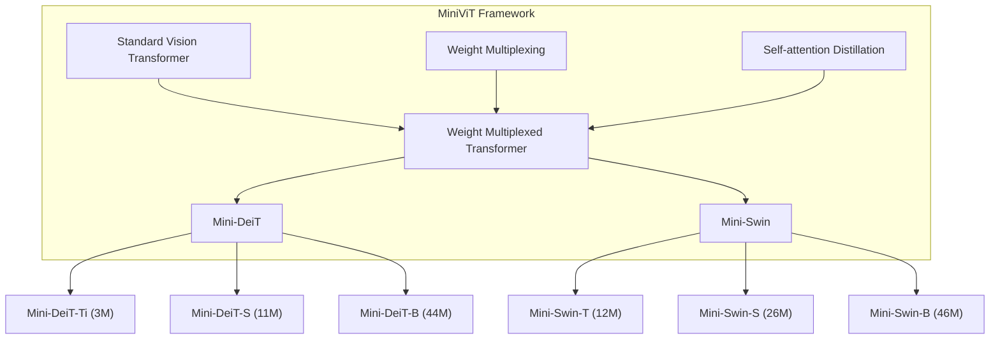
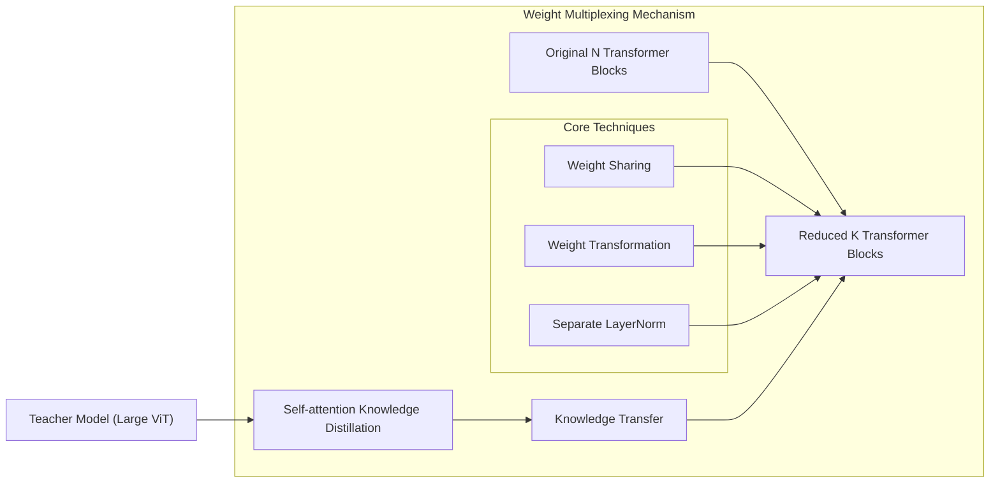
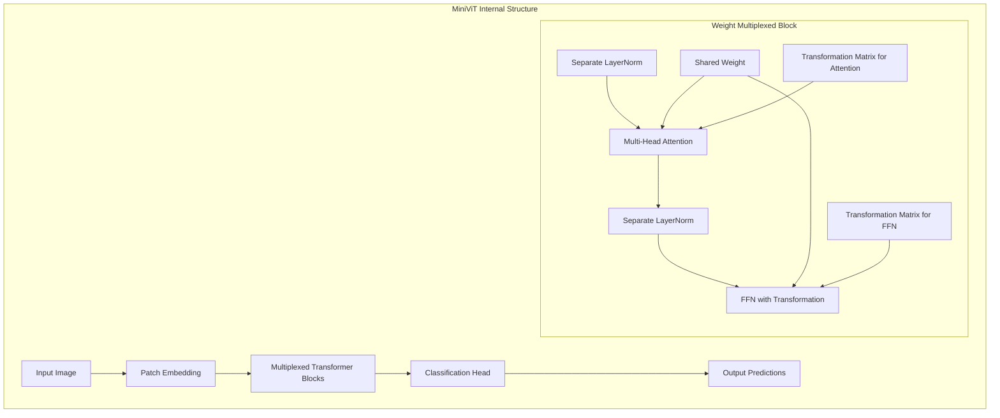
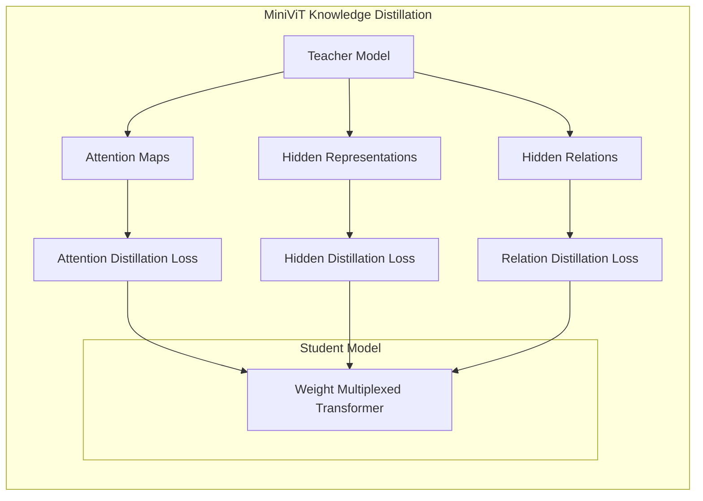
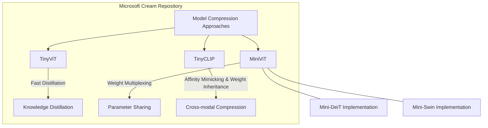

<!-- source: DeepWiki mcp.deepwiki.com · repo microsoft/Cream · page 2.3 MiniViT · fetched 2026-10-26 -->

# MiniViT

<details>
<summary>Relevant source files</summary>

The following files were used as context for generating this wiki page:

- [AutoFormer/README.md](AutoFormer/README.md)
- [MiniViT/Mini-DeiT/README.md](MiniViT/Mini-DeiT/README.md)
- [MiniViT/Mini-Swin/README.md](MiniViT/Mini-Swin/README.md)
- [MiniViT/README.md](MiniViT/README.md)

</details>


MiniViT is a compression framework that reduces the parameter count in Vision Transformers while maintaining model performance. It achieves this through weight multiplexing, where weights are shared across transformer blocks and transformed to increase diversity. This document covers the MiniViT architecture, implementation details, and available model variants.

For information about other model compression approaches like TinyViT, see [TinyViT](#2.1).

## 1. Overview and Purpose

MiniViT addresses the challenge of large parameter counts in Vision Transformers by enabling parameter sharing across layers while preserving model expressivity. The framework provides significant compression rates:

- Reduces Swin-B by 48% while achieving 1.0% better Top-1 accuracy on ImageNet
- Compresses DeiT-B (86M) to only 9M parameters (9.7x reduction) with minimal accuracy loss
- Supports both DeiT and Swin Transformer architectures



Sources: MiniViT/README.md, MiniViT/Mini-DeiT/README.md, MiniViT/Mini-Swin/README.md

## 2. Weight Multiplexing Architecture

The core innovation of MiniViT is weight multiplexing, which allows transformer blocks to share parameters while maintaining diversity through weight transformations.



Sources: MiniViT/README.md

### 2.1 Key Components

1. **Weight Sharing**: Instead of having separate weights for each transformer block, MiniViT shares weights across multiple blocks, significantly reducing parameter count.

2. **Weight Transformation**: To prevent reduced expressivity from naive weight sharing, MiniViT applies transformations to the shared weights:
   - Separate LayerNorm parameters for each block
   - Transformation matrices for attention heads
   - Transformation matrices for feed-forward networks

3. **Knowledge Distillation**: Transfers knowledge from large teacher models to weight-multiplexed student models by:
   - Attention map distillation
   - Hidden representation distillation
   - Hidden relation distillation

Sources: MiniViT/README.md, MiniViT/Mini-Swin/README.md

## 3. Model Variants

MiniViT has two major implementation variants: Mini-DeiT and Mini-Swin, each targeting different transformer architectures.

### 3.1 Mini-DeiT

Mini-DeiT applies weight multiplexing to the DeiT (Data-efficient Image Transformer) architecture. The available models include:

| Model | Parameters | Input Size | Top-1 Acc. (%) | Top-5 Acc. (%) | Compression Rate |
|:------|:----------:|:----------:|:--------------:|:--------------:|:----------------:|
| Mini-DeiT-Ti | 3M | 224×224 | 73.0 | 91.6 | ~2x |
| Mini-DeiT-S | 11M | 224×224 | 80.9 | 95.6 | ~2x |
| Mini-DeiT-B | 44M | 224×224 | 83.2 | 96.5 | ~2x |
| Mini-DeiT-B | 44M | 384×384 | 84.9 | 97.2 | ~2x |

Training involves knowledge distillation from a teacher model (RegNetY-160):

```bash
python -m torch.distributed.launch --nproc_per_node=8 --use_env main.py \
    --model mini_deit_tiny_patch16_224 --batch-size 128 \
    --data-path ./ImageNet --output_dir ./outputs \
    --teacher-model regnety_160 --distillation-type soft \
    --distillation-alpha 1.0 --drop-path 0.0
```

Sources: MiniViT/Mini-DeiT/README.md

### 3.2 Mini-Swin

Mini-Swin applies weight multiplexing to the Swin Transformer architecture, which uses shifted windows for attention computation.

| Model | Parameters | Input Size | Top-1 Acc. (%) | Top-5 Acc. (%) | Compression Rate |
|:------|:----------:|:----------:|:--------------:|:--------------:|:----------------:|
| Mini-Swin-T | 12M | 224×224 | 81.3 | 95.7 | ~2.3x |
| Mini-Swin-S | 26M | 224×224 | 83.9 | 97.0 | ~2.5x |
| Mini-Swin-B | 46M | 224×224 | 84.5 | 97.3 | ~2x |
| Mini-Swin-B | 47M | 384×384 | 85.5 | 97.6 | ~2x |

Training involves more complex distillation:

```bash
python -m torch.distributed.launch --nproc_per_node 8 main.py \
    --cfg configs/swin_tiny_patch4_window7_224_minivit_sharenum6.yaml \
    --data-path <data-path> --output <output-folder> \
    --tag mini-swin-tiny --batch-size 128 \
    --is_sep_layernorm --is_transform_heads --is_transform_ffn \
    --do_distill --alpha 0.0 --teacher <teacher-path> \
    --attn_loss --hidden_loss --hidden_relation \
    --student_layer_list 11_9_7_5_3_1 --teacher_layer_list 23_21_15_9_3_1 \
    --hidden_weight 0.1
```

Sources: MiniViT/Mini-Swin/README.md

## 4. Internal Architecture



Sources: MiniViT/Mini-DeiT/README.md, MiniViT/Mini-Swin/README.md

### 4.1 Weight Multiplexing Implementation

In practice, MiniViT implements weight multiplexing through:

1. **Separate LayerNorm Parameters**: Each transformer block has its own LayerNorm parameters to help distinguish between layers.

2. **Transformation for Attention Heads**: Applies transformation matrices to the shared weights for attention computation to increase expressivity.

3. **Transformation for Feed-Forward Networks**: Similarly applies transformations to the shared feed-forward network weights.

These implementation details are controlled by command-line arguments:
- `--is_sep_layernorm`: Enables separate LayerNorm parameters
- `--is_transform_heads`: Enables transformation matrices for attention heads
- `--is_transform_ffn`: Enables transformation matrices for feed-forward networks

Sources: MiniViT/Mini-Swin/README.md

## 5. Knowledge Distillation

MiniViT leverages knowledge distillation to transfer information from full-sized teacher models to compressed student models. The distillation process includes:



1. **Attention Map Distillation**: The student model learns to mimic the attention patterns of the teacher model.

2. **Hidden Representation Distillation**: Matching intermediate layer outputs between teacher and student.

3. **Hidden Relation Distillation**: Learning the relationships between different hidden representations.

Command-line parameters control these aspects:
- `--attn_loss`: Enables attention distillation
- `--hidden_loss`: Enables hidden representation distillation
- `--hidden_relation`: Enables hidden relation distillation
- `--student_layer_list` and `--teacher_layer_list`: Specify which layers to align during distillation

Sources: MiniViT/Mini-Swin/README.md

## 6. Relationship to Other Compression Frameworks



While other compression frameworks in the repository like [TinyViT](#2.1) focus on specialized distillation techniques or architecture modifications, MiniViT's unique contribution is weight multiplexing, which provides an orthogonal approach to model compression.

Sources: MiniViT/README.md

## 7. Usage and Evaluation

### 7.1 Training MiniViT Models

Training procedures differ slightly between Mini-DeiT and Mini-Swin:

For Mini-DeiT:
```bash
python -m torch.distributed.launch --nproc_per_node=8 --use_env main.py \
    --model mini_deit_base_patch16_224 --batch-size 128 \
    --data-path ./ImageNet --output_dir ./outputs \
    --teacher-model regnety_160 --distillation-type soft \
    --distillation-alpha 1.0 --drop-path 0.1
```

For Mini-Swin:
```bash
python -m torch.distributed.launch --nproc_per_node 8 main.py \
    --cfg configs/swin_base_patch4_window7_224_minivit_sharenum2.yaml \
    --data-path <data-path> --output <output-folder> \
    --tag mini-swin-base --batch-size 128 \
    --is_sep_layernorm --is_transform_heads --is_transform_ffn \
    --do_distill --alpha 0.0 --teacher <teacher-path> \
    --attn_loss --hidden_loss --hidden_relation \
    --student_layer_list 23_21_15_9_3_1 --teacher_layer_list 23_21_15_9_3_1 \
    --hidden_weight 0.1
```

### 7.2 Evaluating MiniViT Models

For Mini-DeiT:
```bash
python -m torch.distributed.launch --nproc_per_node=8 --use_env main.py \
    --model mini_deit_base_patch16_224 --batch-size 128 \
    --data-path ./ImageNet --output_dir ./outputs \
    --resume ./checkpoints/mini_deit_base_patch16_224.pth --eval
```

For Mini-Swin:
```bash
python -m torch.distributed.launch --nproc_per_node 8 main.py \
    --cfg configs/swin_base_patch4_window7_224_minivit_sharenum2.yaml \
    --data-path <data-path> --batch-size 64 \
    --is_sep_layernorm --is_transform_ffn --is_transform_heads \
    --resume checkpoints/mini-swin-base-46m.pth --eval
```

Sources: MiniViT/Mini-DeiT/README.md, MiniViT/Mini-Swin/README.md

## 8. Conclusion

MiniViT demonstrates that weight multiplexing is an effective approach for compressing Vision Transformers without significant performance degradation. The technique provides:

- Substantial parameter reduction (up to 9.7x for some models)
- Minimal accuracy loss or even accuracy improvement in some cases
- Compatibility with different transformer architectures (DeiT, Swin)

This approach is complementary to other compression techniques in the Microsoft Cream repository and represents an important contribution to making Vision Transformers more efficient for practical applications.

Sources: MiniViT/README.md

---

