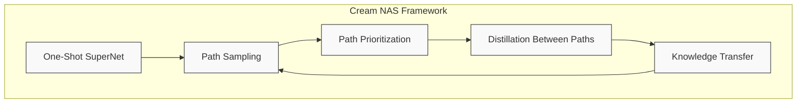
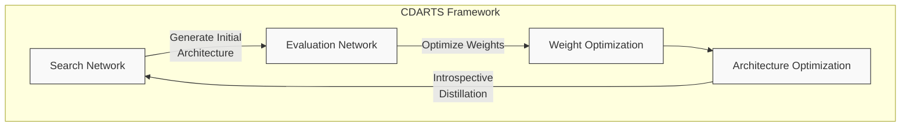
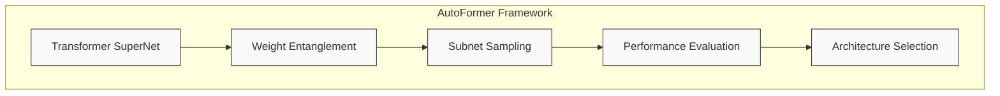
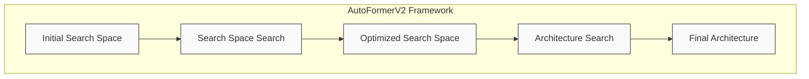
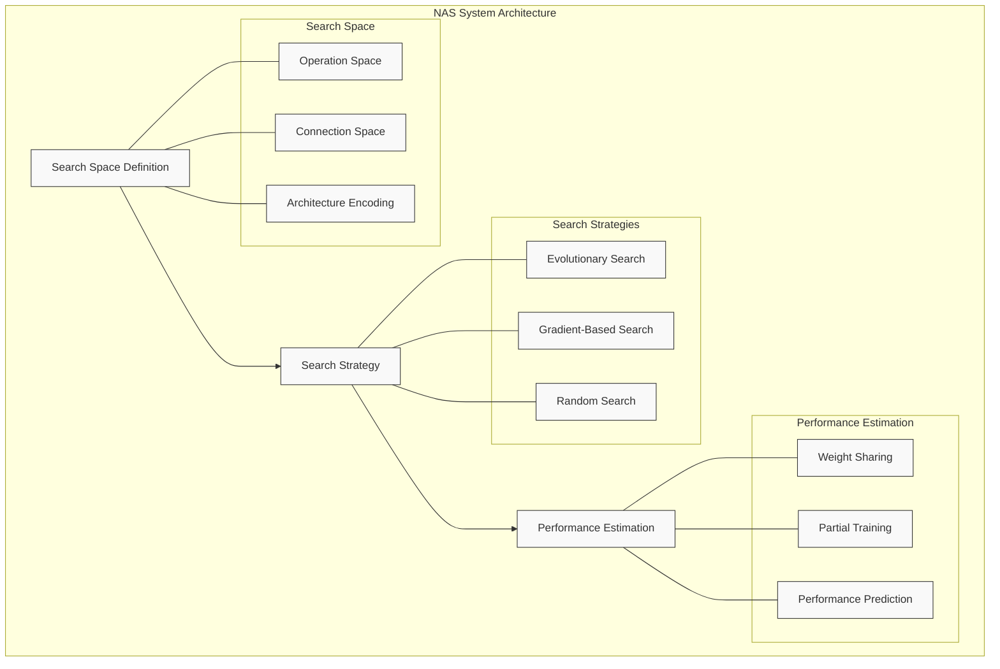
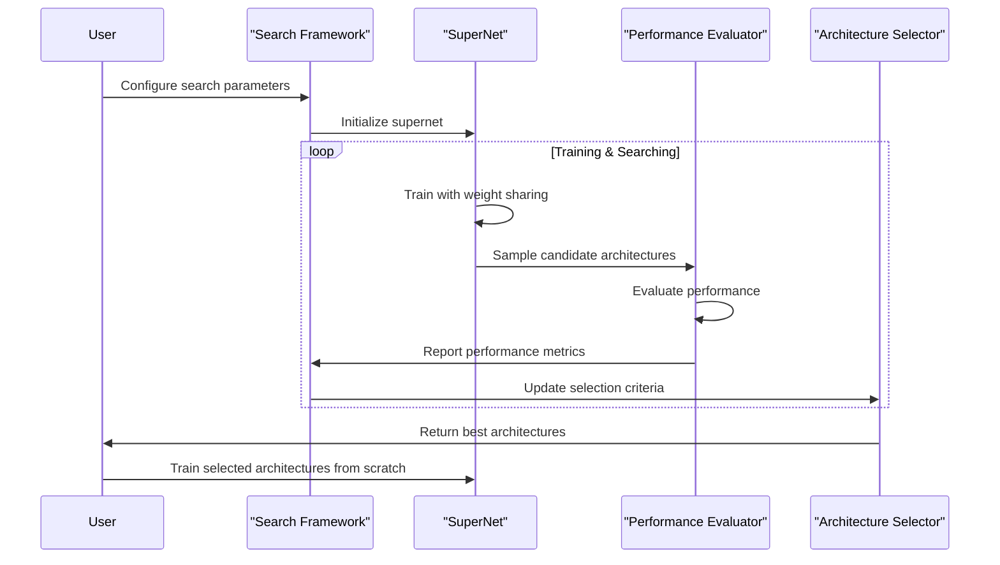
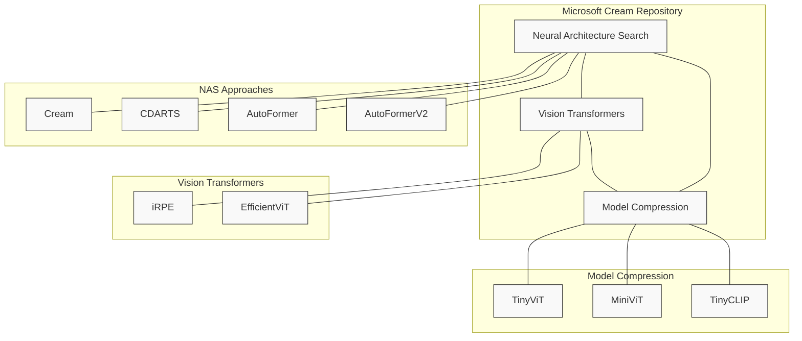

<!-- source: DeepWiki mcp.deepwiki.com · repo microsoft/Cream · page 3 Neural Architecture Search · fetched 2026-10-26 -->

# Neural Architecture Search

<details>
<summary>Relevant source files</summary>

The following files were used as context for generating this wiki page:

- [AutoFormer/.figure/ofa.png](AutoFormer/.figure/ofa.png)
- [AutoFormer/.figure/performance.png](AutoFormer/.figure/performance.png)
- [AutoFormer/README.md](AutoFormer/README.md)
- [CDARTS/README.md](CDARTS/README.md)
- [Cream/README.md](Cream/README.md)
- [Cream/data/subclass_list.txt](Cream/data/subclass_list.txt)
- [Cream/data/subimages_list.txt](Cream/data/subimages_list.txt)
- [Cream/demo/intro.jpg](Cream/demo/intro.jpg)
- [Cream/demo/results_100.jpg](Cream/demo/results_100.jpg)
- [Cream/demo/results_600.jpg](Cream/demo/results_600.jpg)
- [Cream/experiments/configs/retrain/114.yaml](Cream/experiments/configs/retrain/114.yaml)
- [MiniViT/Mini-DeiT/README.md](MiniViT/Mini-DeiT/README.md)
- [MiniViT/Mini-Swin/README.md](MiniViT/Mini-Swin/README.md)
- [MiniViT/README.md](MiniViT/README.md)
- [README.md](README.md)
- [iRPE/DETR-with-iRPE/README.md](iRPE/DETR-with-iRPE/README.md)
- [iRPE/DeiT-with-iRPE/README.md](iRPE/DeiT-with-iRPE/README.md)
- [iRPE/README.md](iRPE/README.md)

</details>


This page provides an overview of the Neural Architecture Search (NAS) methodologies and implementations within the Microsoft Cream repository. Neural Architecture Search automates the design of neural network architectures, reducing the need for manual architecture engineering while achieving competitive or superior performance compared to hand-crafted networks.

The repository contains several pioneering NAS approaches that target different aspects of architecture search, from general neural networks to specific transformer-based architectures for vision tasks.

## What is Neural Architecture Search?

Neural Architecture Search (NAS) is an automated machine learning technique that aims to find optimal neural network architectures for specific tasks. Instead of manually designing neural network architectures, which requires significant domain expertise and trial-and-error, NAS algorithmically searches through a space of possible architectures to identify designs that maximize performance metrics.

In the Microsoft Cream repository, NAS focuses primarily on finding efficient architectures for computer vision tasks, with special emphasis on creating lightweight, high-performance models.


**Search Space**: Defines the possible architectures that can be explored.  
**Search Strategy**: Determines how to explore the search space (e.g., evolutionary algorithms, gradient-based methods).  
**Performance Estimation**: Evaluates candidate architectures, often using weight-sharing or other efficiency techniques.  
**Architecture Selection**: Identifies the most promising architectures based on performance and constraints.  
**Final Training & Evaluation**: Trains selected architectures from scratch and evaluates final performance.

Sources: [README.md:4-28]()

## NAS Approaches in the Repository

The Microsoft Cream repository features four major NAS approaches, each with unique characteristics and innovations:

### 1. Cream: Distilling Prioritized Paths for One-Shot NAS

Cream introduces the concept of distilling prioritized paths within a one-shot neural architecture search framework. The key innovation is that subnetworks can learn collaboratively and teach each other throughout the training process.



**Key Features**:
- **Prioritized Paths**: Identifies and prioritizes promising architectural candidates during training
- **Path Distillation**: Transfers knowledge between subnetworks for collaborative learning
- **Dynamic Path Selection**: Paths are continuously updated based on performance and complexity

Sources: [README.md:106-113](), [Cream/README.md:4-9]()

### 2. CDARTS: Cyclic Differentiable Architecture Search

CDARTS builds a cyclic feedback mechanism between the search and evaluation networks with introspective distillation. This approach addresses the gap between the searched architectures and their actual performance when trained from scratch.



**Key Features**:
- **Cyclic Feedback**: Establishes a feedback loop between search and evaluation
- **Introspective Distillation**: Transfers knowledge from evaluation back to search
- **Joint Optimization**: Simultaneously optimizes architecture and weights

Sources: [README.md:14-15](), [CDARTS/README.md:1-9]()

### 3. AutoFormer: Searching Transformers for Visual Recognition

AutoFormer is a one-shot architecture search framework specifically designed for vision transformers. It entangles the weights of different transformer blocks in the same layers during supernet training.



**Key Features**:
- **Weight Entanglement**: Shares weights among different architectural configurations
- **Vision Transformer Focus**: Specifically designed for transformer-based vision models
- **Once-for-all Training**: Single training process produces well-trained weights for thousands of subnets

Sources: [README.md:22-24](), [AutoFormer/README.md:1-11]()

### 4. AutoFormerV2: Searching the Search Space

AutoFormerV2 takes a meta-approach by searching for the search space itself. Instead of operating within a predefined search space, it automatically discovers a great search space first, then searches architectures within this optimized space.



**Key Features**:
- **Meta Search**: Searches for the optimal search space before searching for architectures
- **Transformer Guidelines**: Provides insights for general vision transformer design
- **Double-level Optimization**: Optimizes both search space and architectures

Sources: [README.md:16-18](), [README.md:84-89]()

## NAS Components and Implementation

The NAS framework in the Microsoft Cream repository consists of several key components that work together to enable efficient architecture search:



Sources: [Cream/README.md:13-29](), [AutoFormer/README.md:13-25](), [CDARTS/README.md:1-9]()

### Common Components Across NAS Approaches

Despite their differences, the NAS approaches in the repository share several common components:

1. **Search Space Definition**: All approaches define a specific search space of possible architectures.
2. **Weight Sharing Mechanisms**: Most approaches use some form of weight sharing to make the search process more efficient.
3. **Performance Evaluation**: Methods to evaluate the performance of candidate architectures without full training.
4. **Architecture Selection**: Strategies to select the best architectures based on performance metrics and constraints.

### Approach Comparison

| Approach | Main Innovation | Target Models | Search Method | Weight Sharing |
|----------|----------------|--------------|--------------|---------------|
| Cream | Path Distillation | CNN-based | Prioritized path sampling | Yes - Between subnetworks |
| CDARTS | Cyclic Feedback | CNN-based | Differentiable | Yes - Between search and evaluation |
| AutoFormer | Weight Entanglement | Vision Transformers | One-shot | Yes - Across transformer blocks |
| AutoFormerV2 | Search Space Search | Vision Transformers | Hierarchical search | Yes - Across search spaces |

Sources: [README.md:4-28](), [README.md:106-113](), [README.md:77-98]()

## NAS Search Process Implementation

The implementation of the NAS process in the repository generally follows these steps:



Sources: [Cream/README.md:58-115](), [AutoFormer/README.md:65-96]()

### Cream NAS Implementation

In the Cream approach, the search process is implemented as follows:

1. **Search Configuration**: Define the desired model Flops range using the `FLOPS_MINIMUM` and `FLOPS_MAXIMUM` parameters in the configuration file.
2. **Path Sampling**: Sample different paths (subnetworks) from the supernet during training.
3. **Path Evaluation**: Evaluate the performance of different paths.
4. **Knowledge Distillation**: Transfer knowledge between paths to improve training efficiency.
5. **Architecture Selection**: Select the best architectures based on accuracy and efficiency metrics.

The performance of Cream NAS models ranges from very small networks (14M FLOPs) to larger models (604M FLOPs), with top-1 accuracy on ImageNet ranging from 53.8% to 80.0%.

Sources: [Cream/README.md:58-67](), [Cream/README.md:47-54]()

### AutoFormer Implementation

AutoFormer specifically targets the search of vision transformer architectures:

1. **Supernet Training**: Train a transformer supernet with weight entanglement between different blocks.
2. **Evolution Search**: Perform evolution search on a subset of ImageNet to find optimal architectures.
3. **Architecture Retraining**: Train selected architectures from scratch for final evaluation.

The search process is configured using YAML files that specify the supernet architecture and search constraints.

Sources: [AutoFormer/README.md:68-90](), [AutoFormer/README.md:65-96]()

## NAS Evaluation and Results

The NAS approaches in the repository have been evaluated on various computer vision tasks:

### Image Classification Performance

Models discovered by the NAS approaches achieve competitive performance on ImageNet classification:

| Model | Parameters (M) | FLOPs (M) | Top-1 Accuracy (%) |
|-------|---------------|-----------|-------------------|
| Cream_14 | - | 14 | 53.8 |
| Cream_43 | - | 43 | 66.3 |
| Cream_114 | - | 114 | 72.8 |
| Cream_287 | - | 287 | 77.6 |
| Cream_481 | - | 481 | 79.2 |
| Cream_604 | - | 604 | 80.0 |
| AutoFormer-T | 5.8 | - | 75.3 |
| AutoFormer-S | 22.9 | - | 81.7 |
| AutoFormer-B | 53.7 | - | 82.4 |

Sources: [Cream/README.md:47-54](), [AutoFormer/README.md:60-62]()

### CDARTS Results

CDARTS models have been evaluated on CIFAR-10, ImageNet, and also transferred to other tasks like object detection and semantic segmentation:

**Object Detection Performance (CDARTS backbones):**
- CDARTS-a: 35.2 AP on COCO
- CDARTS-b: 36.2 AP on COCO

**Semantic Segmentation Performance:**
- CDARTS-b on Cityscapes: 78.1 mIoU
- CDARTS-b on ADE20K: 40.4 mIoU

Sources: [CDARTS/README.md:36-54]()

## Usage Guidelines

### Running NAS Search

To perform a neural architecture search using the repository, follow these general steps:

1. **Setup Environment**:
   - Clone the repository
   - Install dependencies
   - Prepare dataset (e.g., ImageNet)

2. **Configure Search Parameters**:
   - Define search space
   - Set constraints (e.g., FLOPs, parameters)
   - Configure search strategy

3. **Run Search**:
   - Execute search script
   - Monitor search progress
   - Analyze intermediate results

4. **Train Final Models**:
   - Select best architectures
   - Train from scratch
   - Evaluate performance

### Example Commands

For Cream NAS:

```bash
# Search
python ./tools/main.py train ./experiments/configs/train/train.yaml

# Retrain specific model
python ./tools/main.py retrain ./experiments/configs/retrain/retrain.yaml

# Test model
python ./tools/main.py test ./experiments/configs/test/test.yaml
```

For AutoFormer:

```bash
# Train supernet
python -m torch.distributed.launch --nproc_per_node=8 --use_env supernet_train.py --data-path /PATH/TO/IMAGENT --gp --change_qk --relative_position --mode super --dist-eval --cfg ./experiments/supernet/supernet-B.yaml --epochs 500 --warmup-epochs 20 --output /OUTPUT_PATH --batch-size 128

# Search
python -m torch.distributed.launch --nproc_per_node=8 --use_env evolution.py --data-path /PATH/TO/IMAGENT --gp --change_qk --relative_position --dist-eval --cfg ./experiments/supernet/supernet-B.yaml --resume /PATH/TO/CHECKPOINT --min-param-limits YOUR/CONFIG --param-limits YOUR/CONFIG --data-set EVO_IMNET
```

Sources: [Cream/README.md:58-113](), [AutoFormer/README.md:65-96]()

## Integration with Other Projects

The NAS components in the repository are designed to integrate with other projects for various computer vision tasks:



Sources: [README.md:4-28](), [README.md:51-113]()

The NAS approaches can be used to discover architectures that are later optimized using techniques from the Model Compression projects (TinyViT, MiniViT, TinyCLIP) or that incorporate innovations from the Vision Transformer projects (iRPE, EfficientViT).

## Summary

Neural Architecture Search in the Microsoft Cream repository represents a comprehensive suite of techniques for automatically discovering high-performance neural network architectures. The approaches range from general CNN search (Cream, CDARTS) to specialized transformer search (AutoFormer, AutoFormerV2), each with unique innovations addressing different aspects of the architecture search problem.

These NAS approaches have produced state-of-the-art models across different efficiency-performance trade-offs, demonstrating the effectiveness of automated architecture design in the deep learning field.

For more detailed information on specific NAS approaches:
- For Cream NAS, see [Cream NAS](#3.3)
- For CDARTS, see [CDARTS](#3.1)
- For AutoFormer, see [AutoFormer](#3.2)
- For Vision Transformer improvements, see [Vision Transformer Improvements](#4)

---

