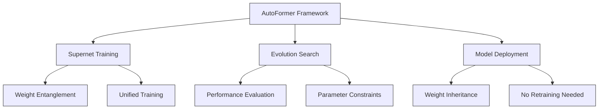
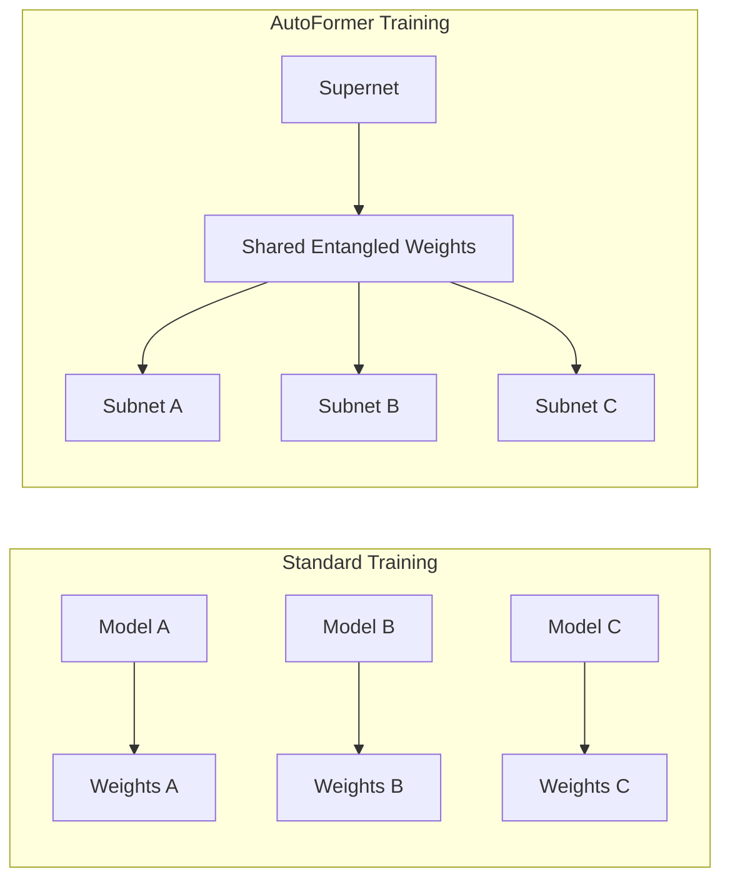
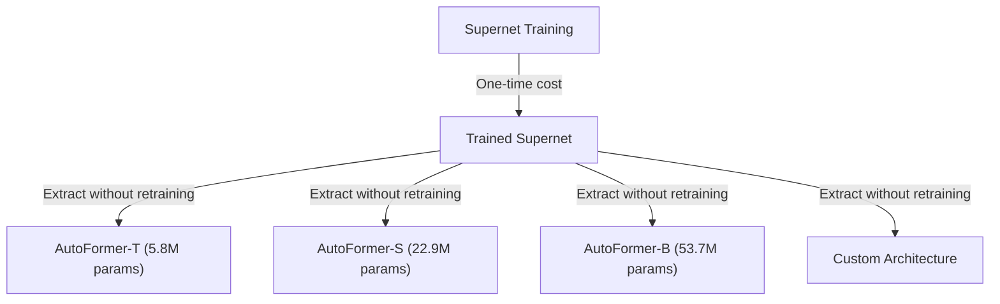
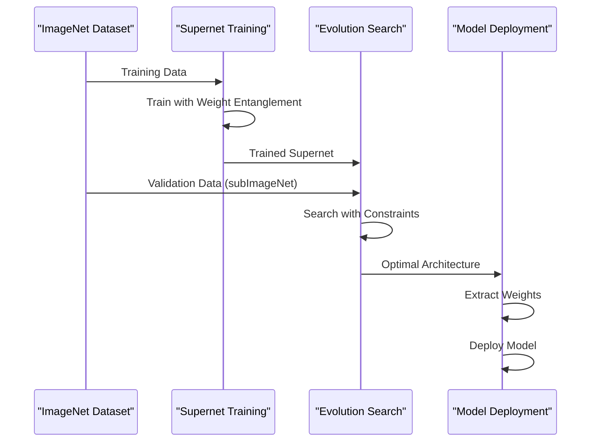
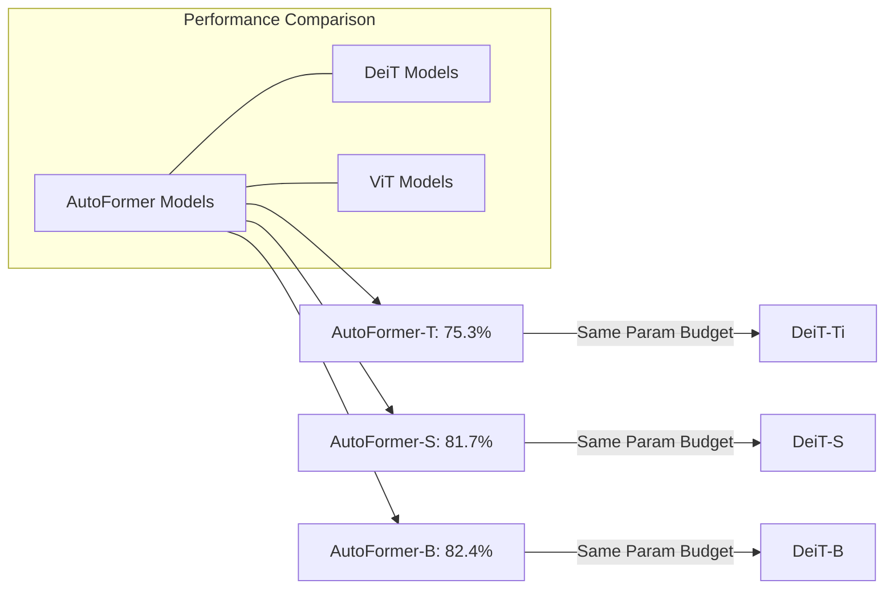
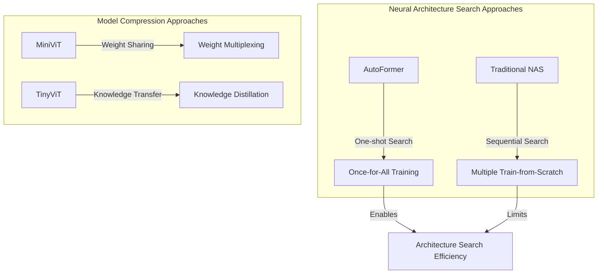

<!-- source: DeepWiki mcp.deepwiki.com · repo microsoft/Cream · page 3.1 AutoFormer · fetched 2026-10-26 -->

# AutoFormer

<details>
<summary>Relevant source files</summary>

The following files were used as context for generating this wiki page:

- [AutoFormer/README.md](AutoFormer/README.md)
- [MiniViT/Mini-DeiT/README.md](MiniViT/Mini-DeiT/README.md)
- [MiniViT/Mini-Swin/README.md](MiniViT/Mini-Swin/README.md)
- [MiniViT/README.md](MiniViT/README.md)

</details>


## Purpose and Scope

This document describes AutoFormer, a one-shot neural architecture search (NAS) framework specifically designed for searching efficient vision transformer architectures. AutoFormer entangles the weights of different vision transformer blocks in the same layers during supernet training, enabling the discovery of high-performing transformer architectures with minimal training overhead.

For related architecture search frameworks, see [AutoFormerV2](#3.2) and [Cream](#3.3).

## Overview

AutoFormer is a framework that allows efficient search of vision transformer architectures through a weight-entangled supernet training strategy. It addresses the challenge of searching for optimal transformer architectures while minimizing computational resources.

The key innovation in AutoFormer is its ability to train a single supernet that allows thousands of subnets to inherit weights without significant performance degradation. This "once-for-all" approach significantly reduces the computational cost typically associated with neural architecture search.



Sources: [AutoFormer/README.md:4-6]()

## Core Concepts

### Weight Entanglement

The key innovation in AutoFormer is the weight entanglement strategy. Rather than training separate weights for different architecture configurations, AutoFormer entangles the weights of different transformer blocks within the same layer. This approach allows a single training process to effectively optimize many different architectural configurations simultaneously.



Sources: [AutoFormer/README.md:5-6]()

### Once-for-All Training

AutoFormer implements a once-for-all training paradigm where a single supernet is trained, from which many subnets can be derived without requiring retraining. This dramatically reduces the computational overhead of traditional neural architecture search methods that require training each candidate architecture from scratch.



Sources: [AutoFormer/README.md:14-17]()

## Architecture Search Pipeline

AutoFormer's architecture search process consists of three main stages:

1. **Supernet Training**: Training a comprehensive supernet with weight entanglement
2. **Evolution Search**: Using evolutionary algorithms to find optimal architectures within the supernet
3. **Deployment**: Extracting the discovered architecture with inherited weights



Sources: [AutoFormer/README.md:65-97]()

## Implementation Details

### Supernet Configuration

AutoFormer provides three standard supernet configurations:

| Supernet | Parameter Range | Top-1 Accuracy Range |
|----------|----------------|----------------------|
| Supernet-T | ~5.8M | Up to 75.3% |
| Supernet-S | ~22.9M | Up to 81.7% |
| Supernet-B | ~53.7M | Up to 82.4% |

Configuration files for these supernets are located in the `/experiments/supernet/` directory.

Sources: [AutoFormer/README.md:58-62](), [AutoFormer/README.md:70]()

### Training Process

Training the AutoFormer supernet involves the following steps:

1. Configure the supernet size (Tiny, Small, or Base)
2. Train the supernet with weight entanglement
3. Search within the trained supernet using evolutionary algorithms
4. Extract the optimal subnet

The training command structure uses distributed training to accelerate the process:

```
python -m torch.distributed.launch --nproc_per_node=8 --use_env supernet_train.py 
--data-path /PATH/TO/IMAGENT --gp --change_qk --relative_position 
--mode super --dist-eval --cfg ./experiments/supernet/supernet-B.yaml 
--epochs 500 --warmup-epochs 20 --output /OUTPUT_PATH --batch-size 128
```

Sources: [AutoFormer/README.md:68-76]()

### Evolution Search

After training the supernet, AutoFormer uses evolutionary search to find optimal architectures within the supernet. This search is typically performed on a subset of ImageNet to accelerate the process:

```
python -m torch.distributed.launch --nproc_per_node=8 --use_env evolution.py 
--data-path /PATH/TO/IMAGENT --gp --change_qk --relative_position --dist-eval 
--cfg ./experiments/supernet/supernet-B.yaml --resume /PATH/TO/CHECKPOINT 
--min-param-limits YOUR/CONFIG --param-limits YOUR/CONFIG --data-set EVO_IMNET
```

The search requires specifying parameter constraints to guide the search toward architectures with desired resource usage profiles.

Sources: [AutoFormer/README.md:83-90]()

## Model Performance

AutoFormer demonstrates competitive performance compared to standard vision transformers like DeiT and ViT. The models achieve impressive accuracy with various parameter sizes:

| Model | Parameters | Top-1 Accuracy | Top-5 Accuracy |
|-------|------------|----------------|----------------|
| AutoFormer-T | 5.8M | 75.3% | 92.7% |
| AutoFormer-S | 22.9M | 81.7% | 95.7% |
| AutoFormer-B | 53.7M | 82.4% | 95.7% |

The key advantage of AutoFormer is that all these models are derived from a single trained supernet, significantly reducing the overall computational cost of architecture search.



Sources: [AutoFormer/README.md:99-106]()

## Usage Guide

### Environment Setup

To use AutoFormer, you need to set up the environment:

```
conda create -n Autoformer python=3.6
conda activate Autoformer
pip install -r requirements.txt
```

Sources: [AutoFormer/README.md:23-30]()

### Data Preparation

AutoFormer requires ImageNet data to be prepared in a standard format:

```
/path/to/imagenet/
  train/
    class1/
      img1.jpeg
    class2/
      img2.jpeg
  val/
    class1/
      img3.jpeg
    class/2
      img4.jpeg
```

For evolution search, a subset of ImageNet is generated using:

```
python ./lib/subImageNet.py --data-path /PATH/TO/IMAGENT
```

Sources: [AutoFormer/README.md:32-48](), [AutoFormer/README.md:79-82]()

### Model Evaluation

To evaluate a pretrained AutoFormer model:

```
python -m torch.distributed.launch --nproc_per_node=8 --use_env supernet_train.py 
--data-path /PATH/TO/IMAGENT --gp --change_qk --relative_position 
--mode retrain --dist-eval --cfg ./experiments/subnet/AutoFormer-B.yaml 
--resume /PATH/TO/CHECKPOINT --eval
```

Pretrained models can be downloaded from the provided model zoo links.

Sources: [AutoFormer/README.md:92-97](), [AutoFormer/README.md:51-63]()

## Comparison with Other Approaches

AutoFormer differs from traditional NAS approaches by using weight entanglement and once-for-all training. It also differs from other vision transformer optimization methods:

| Approach | Primary Method | Training Cost | Model Customization |
|----------|---------------|---------------|---------------------|
| AutoFormer | Weight-entangled Supernet | Single supernet training | High flexibility |
| Traditional NAS | Train-from-scratch | Multiple full trainings | High flexibility |
| MiniViT | Weight Multiplexing | Single model training | Fixed architecture |
| TinyViT | Knowledge Distillation | Teacher-student training | Fixed architecture |



Sources: [AutoFormer/README.md:4-6](), [MiniViT/README.md:9-12]()

## Future Directions

AutoFormer serves as the foundation for more advanced transformer architecture search methods, including AutoFormerV2 which extends the concept to search space search. For more details on these advanced approaches, see [AutoFormerV2](#3.2).

---

