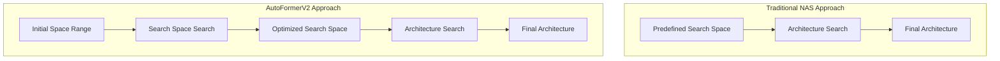
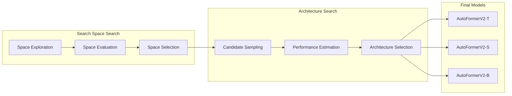
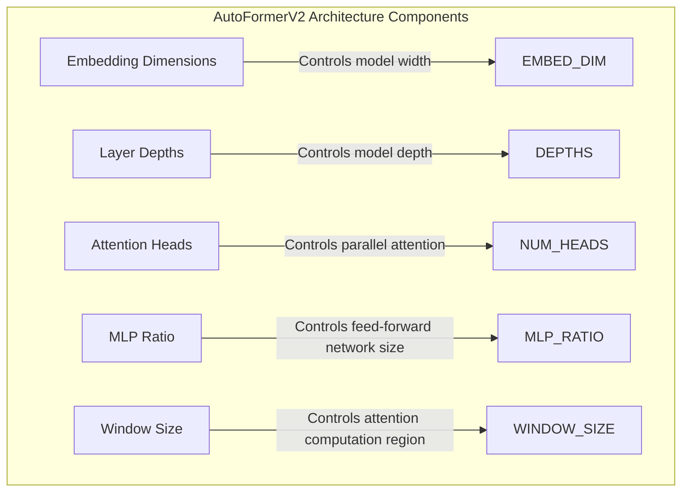
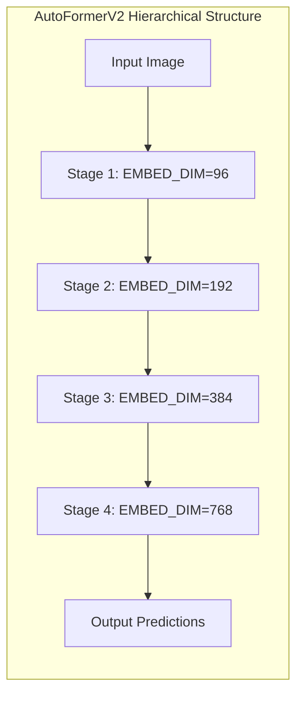
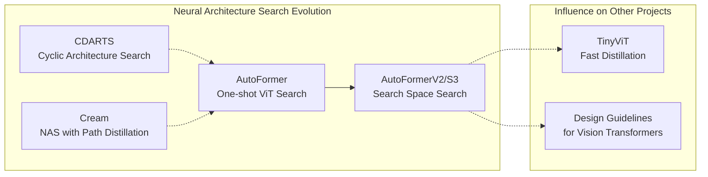

<!-- source: DeepWiki mcp.deepwiki.com · repo microsoft/Cream · page 3.2 AutoFormerV2 · fetched 2026-10-26 -->

# AutoFormerV2

<details>
<summary>Relevant source files</summary>

The following files were used as context for generating this wiki page:

- [AutoFormerV2/README.md](AutoFormerV2/README.md)
- [AutoFormerV2/configs/S3-B.yaml](AutoFormerV2/configs/S3-B.yaml)
- [AutoFormerV2/configs/S3-S.yaml](AutoFormerV2/configs/S3-S.yaml)
- [AutoFormerV2/configs/S3-T.yaml](AutoFormerV2/configs/S3-T.yaml)

</details>


## Purpose and Scope

This document provides technical documentation on AutoFormerV2 (also known as S3 - Searching the Search Space), a neural architecture search approach that innovates by searching for optimal search spaces before conducting architecture search. The system is specifically designed for Vision Transformers and represents an evolution from the original AutoFormer (for information about the original AutoFormer, see [AutoFormer](#3.1)).

## Overview

AutoFormerV2 introduces a novel two-stage search methodology: 
1. Search for a high-quality search space first
2. Search for optimal architectures within the identified space

This approach fundamentally differs from traditional neural architecture search methods which operate within predefined, potentially suboptimal search spaces.


**Diagram: Traditional NAS vs AutoFormerV2 Search Approach**

Sources: [AutoFormerV2/README.md:4-6]()

## System Architecture

AutoFormerV2 leverages an automated approach to identify optimal search spaces for Vision Transformers. The system consists of two primary components that work in sequence:


**Diagram: AutoFormerV2 System Architecture**

Sources: [AutoFormerV2/README.md:5-10]()

## Model Configurations and Variants

AutoFormerV2 offers three model variants with different parameter counts and computational requirements:

| Model | Parameters | Top-1 Accuracy | Top-5 Accuracy |
|-------|------------|----------------|----------------|
| AutoFormerV2-T | 28M | 82.1% | 95.8% |
| AutoFormerV2-S | 50M | 83.7% | 96.4% |
| AutoFormerV2-B | 71M | 84.0% | 96.6% |

Sources: [AutoFormerV2/README.md:48-52]()

Each model variant follows a hierarchical structure with a specific configuration. The key architectural components include:


**Diagram: AutoFormerV2 Configuration Parameters**

Sources: [AutoFormerV2/configs/S3-T.yaml](), [AutoFormerV2/configs/S3-S.yaml](), [AutoFormerV2/configs/S3-B.yaml]()

### Model Structure Details

All AutoFormerV2 variants follow a 4-stage hierarchical structure with progressive downsampling, but differ in depth and complexity:


**Diagram: AutoFormerV2 Model Structure**

Sources: [AutoFormerV2/configs/S3-T.yaml:3-5](), [AutoFormerV2/configs/S3-S.yaml:3-5](), [AutoFormerV2/configs/S3-B.yaml:3-5]()

The three model variants primarily differ in the depth of the third stage:
- **AutoFormerV2-T**: 6 layers in stage 3 (total 12 layers)
- **AutoFormerV2-S**: 18 layers in stage 3 (total 24 layers)
- **AutoFormerV2-B**: 30 layers in stage 3 (total 36 layers)

All variants maintain the same embedding dimension progression (96→192→384→768) but differ in the number of layers at each stage.

Sources: [AutoFormerV2/configs/S3-T.yaml:4](), [AutoFormerV2/configs/S3-S.yaml:4](), [AutoFormerV2/configs/S3-B.yaml:4]()

## Configuration Details

The configuration files specify the architectural parameters for each model variant:

### Common Configuration Elements

- **EMBED_DIM**: Embedding dimensions at each stage (represents model width)
- **DEPTHS**: Number of transformer blocks at each stage (represents model depth)
- **NUM_HEADS**: Number of attention heads for each transformer block
- **MLP_RATIO**: Expansion ratio for the MLP in each transformer block
- **WINDOW_SIZE**: Size of attention windows for efficient computation

### Specific Values (AutoFormerV2-B Example)

```
EMBED_DIM: [96, 192, 384, 768]  # Dimensions for each stage
DEPTHS: [2, 2, 30, 2]           # 30 blocks in the third stage
NUM_HEADS: [[3,3], [6,6], [12,12,...], [24,24]]  # Attention heads per block
WINDOW_SIZE: [[7,7], [7,7], [14,14,...], [7,7]]  # Window sizes per block
MLP_RATIO: [[4.0, 4.0], [4.0, 4.0], [4.0, 4.0,...], [4.0, 4.0]]  # MLP expansion ratio
```

Sources: [AutoFormerV2/configs/S3-B.yaml:1-5]()

## Performance Comparison

AutoFormerV2 achieves competitive performance compared to other state-of-the-art vision transformer models:

- Outperforms DeiT, ViT, and Swin Transformer under comparable parameter constraints
- Achieves favorable accuracy-parameter tradeoffs across different model sizes
- Demonstrates the effectiveness of search space search as a methodology

Sources: [AutoFormerV2/README.md:62-66]()

## Usage and Evaluation

### Model Evaluation

To evaluate pre-trained AutoFormerV2 models:

1. Download the model checkpoint
2. Use the distributed evaluation script with the appropriate configuration file

```
python -m torch.distributed.launch --nproc_per_node=8 --use_env evaluation.py --data-path /PATH/TO/IMAGENT \
--dist-eval --cfg ./config/S3-B.yaml --resume /PATH/TO/CHECKPOINT --eval
```

Sources: [AutoFormerV2/README.md:54-59]()

## Relationship to Other Systems

AutoFormerV2 builds upon the original AutoFormer and represents a part of the broader neural architecture search efforts within the Microsoft Cream repository. It influences subsequent model compression techniques and provides insights for general vision transformer design.


**Diagram: AutoFormerV2 in the Cream Repository Ecosystem**

Sources: [AutoFormerV2/README.md:81-82]()

## Data Requirements

The system requires the ImageNet-2012 dataset for training and evaluation, organized in a standard directory structure:

```
/path/to/imagenet/
  train/
    class1/
      img1.jpeg
    class2/
      img2.jpeg
  val/
    class1/
      img3.jpeg
    class/2
      img4.jpeg
```

Sources: [AutoFormerV2/README.md:22-38]()

## Summary

AutoFormerV2 (S3) introduces an innovative approach to neural architecture search by focusing on the meta-problem of finding optimal search spaces. It demonstrates that the quality of the search space significantly impacts the performance of discovered architectures. The system produces competitive vision transformer models across different parameter regimes and provides valuable insights for vision transformer design.

---

