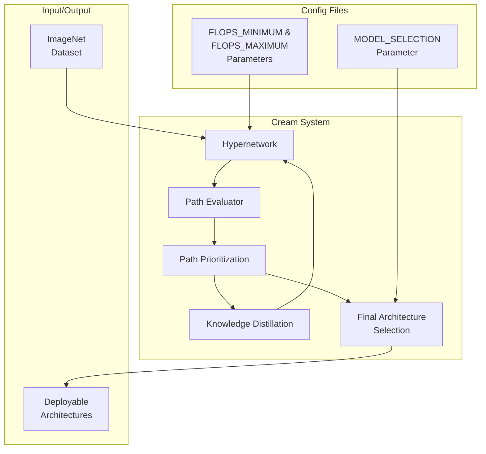
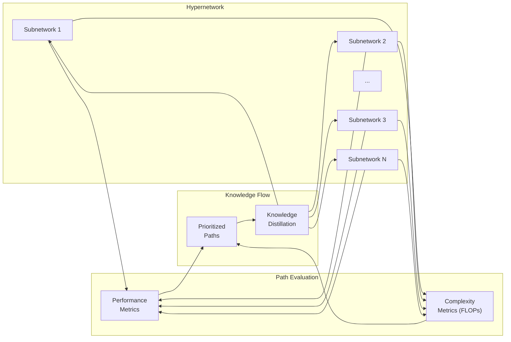
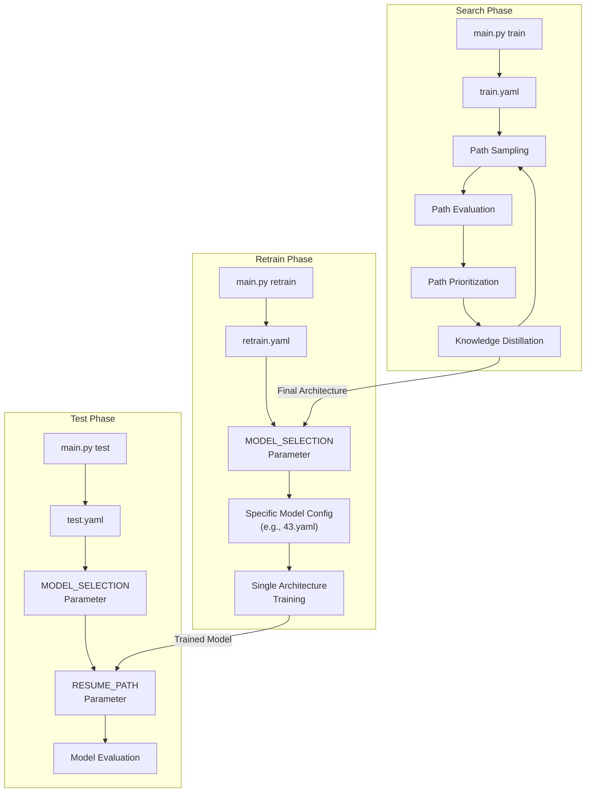
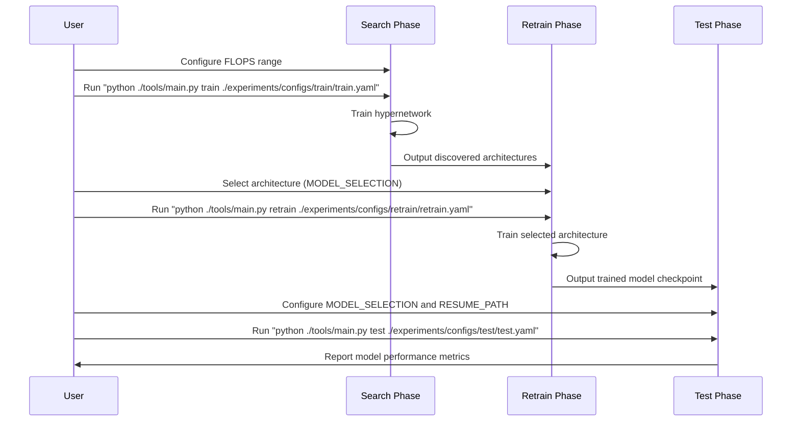
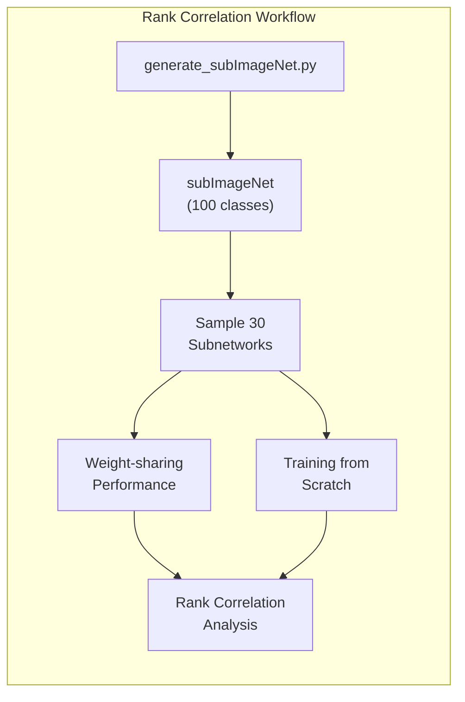

<!-- source: DeepWiki mcp.deepwiki.com · repo microsoft/Cream · page 3.3 Cream · fetched 2026-10-26 -->

# Cream

Relevant source files

The following files were used as context for generating this wiki page:

- [AutoFormer/.figure/ofa.png](AutoFormer/.figure/ofa.png)
- [AutoFormer/.figure/performance.png](AutoFormer/.figure/performance.png)
- [Cream/README.md](Cream/README.md)
- [Cream/data/subclass_list.txt](Cream/data/subclass_list.txt)
- [Cream/data/subimages_list.txt](Cream/data/subimages_list.txt)
- [Cream/demo/intro.jpg](Cream/demo/intro.jpg)
- [Cream/demo/results_100.jpg](Cream/demo/results_100.jpg)
- [Cream/demo/results_600.jpg](Cream/demo/results_600.jpg)
- [Cream/experiments/configs/retrain/114.yaml](Cream/experiments/configs/retrain/114.yaml)

## Purpose and Scope

This document describes Cream, a one-shot neural architecture search approach using path distillation. Cream introduces the concept of prioritized paths, where subnetworks learn collaboratively and teach each other throughout the training process, boosting the convergence of individual models. This page covers the system architecture, core concepts, workflow, and usage patterns of the Cream implementation in the Microsoft Cream repository.

Cream is one of several neural architecture search approaches in the repository. For information about related approaches, see [AutoFormer](#3.1) and [AutoFormerV2](#3.2).

## System Overview

Cream (Crop of Distilled Architecture Members) is a novel neural architecture search technique that involves training an over-parameterized network (the hypernetwork) from which several subnetworks can be derived. The key innovation of Cream is its prioritized path distillation mechanism, which allows high-performing subnetworks to share knowledge with other paths during training.

**Architecture Diagram: Cream System Overview**

Sources: [Cream/README.md:1-12](), [Cream/README.md:58-66]()

## Core Concepts

### Prioritized Paths

The central innovation in Cream is the concept of "prioritized paths," which refers to architecture candidates exhibiting superior performance during training. Cream changes which paths are prioritized throughout training based on both performance and computational complexity (measured in FLOPs).

**Concept Diagram: Prioritized Paths and Knowledge Distillation**

Sources: [Cream/README.md:7-11]()

### Path Distillation

Knowledge distillation in Cream works by having high-performing subnetworks (prioritized paths) serve as teachers to other paths. This collaborative learning process improves the overall quality of all subnetworks, with the best ones ultimately being selected for deployment.

## System Components

Cream consists of three main operational phases: Search, Retrain, and Test.

**Component Diagram: Cream Operational Phases**

Sources: [Cream/README.md:58-108]()

### Search

The search phase involves training the hypernetwork and identifying promising architecture candidates. During this phase:

1. The system samples various subnetworks from the hypernetwork
2. Evaluates their performance
3. Prioritizes high-performing paths
4. Performs knowledge distillation from prioritized paths to other paths

Users can specify the desired FLOPs range using `FLOPS_MINIMUM` and `FLOPS_MAXIMUM` parameters in the configuration file.

Sources: [Cream/README.md:61-66]()

### Retrain

Once promising architectures are identified, they can be retrained from scratch to verify their performance. The retrain phase involves:

1. Selecting a specific model using the `MODEL_SELECTION` parameter
2. Loading the appropriate configuration for that model
3. Training the selected architecture to convergence

Cream provides configurations for models with various FLOPs levels: 14M, 43M, 114M, 287M, 481M, and 604M.

Sources: [Cream/README.md:73-93](), [Cream/experiments/configs/retrain/114.yaml:1-52]()

### Test

The test phase evaluates trained models on the validation set. This phase involves:

1. Selecting a model using the `MODEL_SELECTION` parameter
2. Specifying the path to the trained model checkpoint using `RESUME_PATH`
3. Evaluating the model's performance (top-1 and top-5 accuracy)

Sources: [Cream/README.md:95-108]()

## Workflow

The typical workflow for using Cream consists of three sequential steps:

**Workflow Diagram: Cream Usage Process**

Sources: [Cream/README.md:58-115]()

## Rank Correlation Analysis

Cream includes functionality to evaluate the correlation between weight-sharing performance and true performance of architectures trained from scratch. This analysis uses a subset of ImageNet (subImageNet) with 100 classes randomly sampled from the full dataset.

**Workflow Diagram: Rank Correlation Analysis**

Sources: [Cream/README.md:117-125](), [Cream/data/subclass_list.txt:1-100](), [Cream/data/subimages_list.txt:1-300]()

## Performance

Cream achieves competitive performance across a range of model sizes, outperforming other approaches like MobileNetV3 and EfficientNet-B0/B1 at similar computational budgets.

| Model | FLOPs | Top-1 Acc. % | Top-5 Acc. % |
|-------|-------|--------------|--------------|
| Cream_14 | 14M | 53.8 | 77.2 |
| Cream_43 | 43M | 66.3 | 86.7 |
| Cream_114 | 114M | 72.8 | 90.8 |
| Cream_287 | 287M | 77.6 | 93.3 |
| Cream_481 | 481M | 79.2 | 94.2 |
| Cream_604 | 604M | 80.0 | 94.7 |

Sources: [Cream/README.md:46-53](), [Cream/README.md:128-133]()

## Usage Instructions

### Environment Setup

To set up the environment for Cream:

1. Clone the repository
2. Create and activate a conda environment
3. Install required dependencies
4. Install APEX for accelerated training

See the README for detailed setup instructions.

Sources: [Cream/README.md:13-27]()

### Data Preparation

Cream requires the ImageNet-2012 dataset to be placed in the `./data/imagenet` directory with the validation set moved to the appropriate subfolder.

Sources: [Cream/README.md:29-37]()

### Running the Search Process

To search for architectures:

1. Configure the desired FLOPs range in `./experiments/configs/train/train.yaml`
2. Run the search command: `python ./tools/main.py train ./experiments/configs/train/train.yaml`

Sources: [Cream/README.md:61-71]()

### Retraining Discovered Architectures

To retrain discovered architectures:

1. Specify which model to train using `MODEL_SELECTION` in `./experiments/configs/retrain/retrain.yaml`
2. Run the retrain command: `python ./tools/main.py retrain ./experiments/configs/retrain/retrain.yaml`

Sources: [Cream/README.md:73-93]()

### Testing Models

To test trained models:

1. Specify which model to test using `MODEL_SELECTION` in `./experiments/configs/test/test.yaml`
2. Specify the path to the trained model using `RESUME_PATH`
3. Run the test command: `python ./tools/main.py test ./experiments/configs/test/test.yaml`

Sources: [Cream/README.md:95-115]()

## Conclusion

Cream represents a significant advancement in neural architecture search by introducing the concept of prioritized paths and knowledge distillation between subnetworks. The system achieves state-of-the-art performance across a range of computational budgets, demonstrating the effectiveness of its approach. The three-phase workflow (search, retrain, test) provides a systematic way to discover, train, and evaluate neural network architectures.

Sources: [Cream/README.md:1-12](), [Cream/README.md:128-148]()

---

