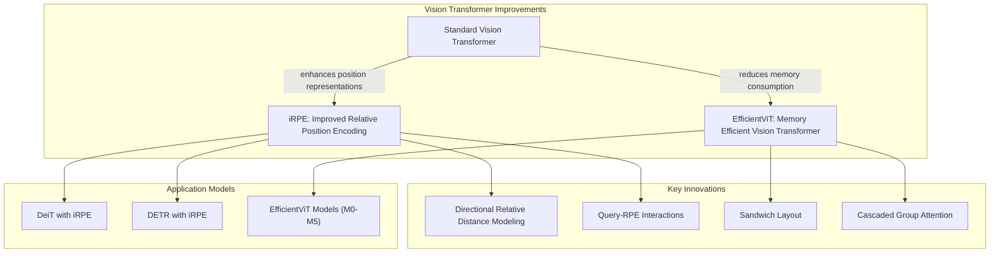
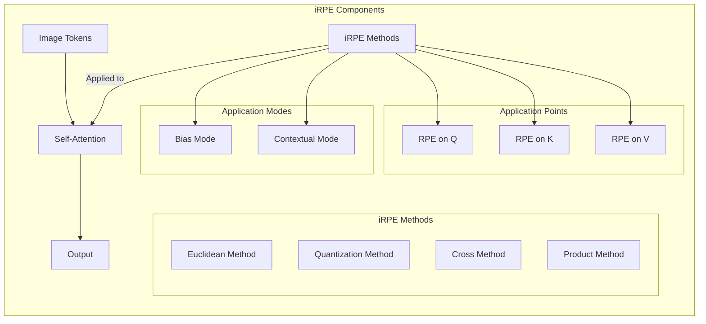
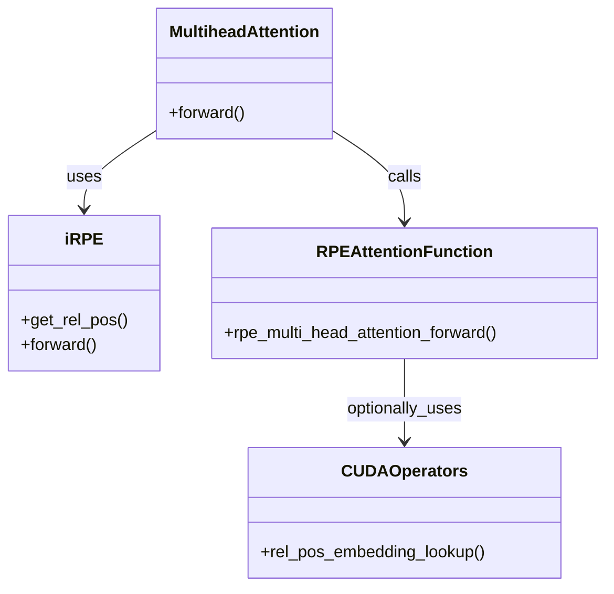
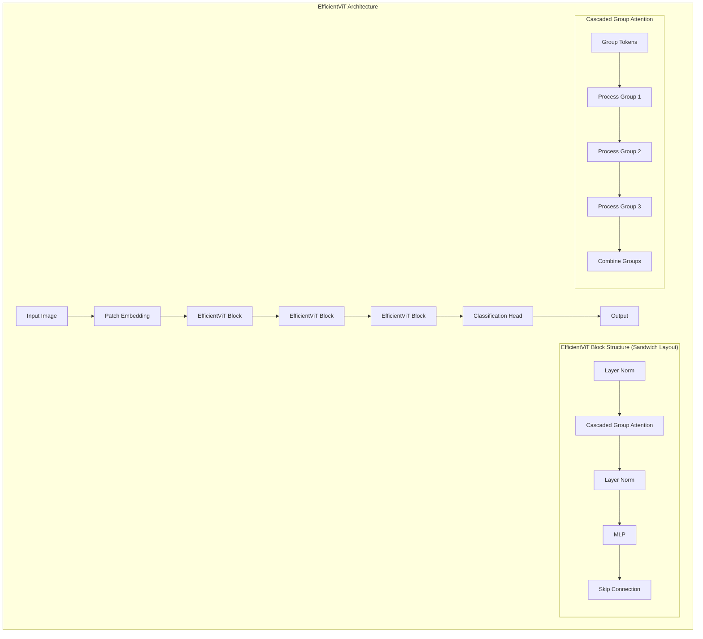
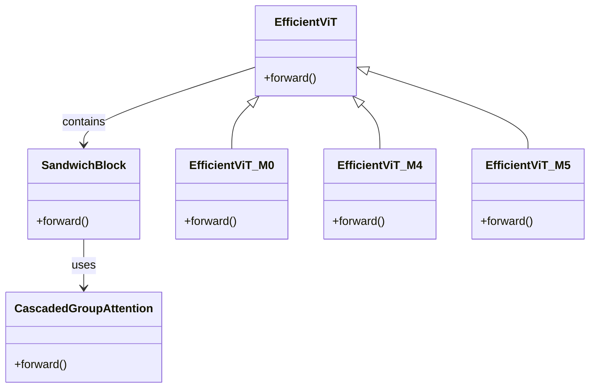

<!-- source: DeepWiki mcp.deepwiki.com · repo microsoft/Cream · page 4 Vision Transformer Improvements · fetched 2026-10-26 -->

# Vision Transformer Improvements

<details>
<summary>Relevant source files</summary>

The following files were used as context for generating this wiki page:

- [CDARTS/README.md](CDARTS/README.md)
- [EfficientViT/.gitignore](EfficientViT/.gitignore)
- [EfficientViT/LICENSE](EfficientViT/LICENSE)
- [EfficientViT/README.md](EfficientViT/README.md)
- [EfficientViT/classification/.figures/efficientvit_main.gif](EfficientViT/classification/.figures/efficientvit_main.gif)
- [README.md](README.md)
- [iRPE/DETR-with-iRPE/README.md](iRPE/DETR-with-iRPE/README.md)
- [iRPE/DeiT-with-iRPE/README.md](iRPE/DeiT-with-iRPE/README.md)
- [iRPE/README.md](iRPE/README.md)

</details>


This page documents the specialized architectural improvements to Vision Transformers (ViT) implemented within the Microsoft Cream repository. The focus is on innovations that enhance the efficiency, accuracy, and computational characteristics of vision transformers. For information about model compression techniques, see [Model Compression Frameworks](#2).

The Microsoft Cream repository includes two primary Vision Transformer improvements:

1. **iRPE (improved Relative Position Encoding)** - Enhances position encoding for vision transformers
2. **EfficientViT** - Implements memory-efficient transformers with cascaded group attention

## Vision Transformer Improvements Overview



Sources: [README.md:1-189](), [iRPE/README.md:1-64](), [EfficientViT/README.md:1-70]()

## iRPE: Improved Relative Position Encoding

iRPE introduces new relative position encoding methods specifically designed for 2D images. Standard vision transformers typically use absolute position encoding, which doesn't effectively capture the spatial relationships between tokens. iRPE addresses this limitation by introducing encodings that consider directional relative distances and the interactions between queries and position embeddings.

### Key Innovations of iRPE

1. **Directional relative distance modeling** - Considers both horizontal and vertical distances between tokens
2. **Query-RPE interactions** - Models the relationship between queries and relative positions
3. **Lightweight implementation** - Adds minimal parameters while providing significant accuracy improvements
4. **Flexibility** - Can be applied to queries (Q), keys (K), and/or values (V) in self-attention



Sources: [iRPE/README.md:1-64](), [iRPE/DETR-with-iRPE/README.md:1-178]()

### iRPE Implementation Details

iRPE can be implemented in different configurations:

| Method | Description | 
|--------|-------------|
| Euclidean | Based on Euclidean distance between token positions |
| Quantization | Quantizes relative positions into discrete buckets |
| Cross | Separates horizontal and vertical relative positions |
| Product | Uses product of horizontal and vertical encodings |

Additionally, iRPE offers two modes:
- **Bias mode**: Adds relative position bias to attention scores
- **Contextual mode**: Position encodings interact with query content

iRPE can be applied to different components of self-attention:
- Q: Queries only
- K: Keys only
- V: Values only
- QK: Both queries and keys
- QKV: All components

### iRPE Code Architecture



Sources: [iRPE/DETR-with-iRPE/README.md:152-161](), [iRPE/DeiT-with-iRPE/README.md:90-97]()

### iRPE Performance Improvements

When applied to standard vision transformer models, iRPE provides significant performance improvements:

**DeiT with iRPE**:
- Up to 1.5% Top-1 accuracy improvement on ImageNet
- Best configuration: base model with RPE applied to Q, K, and V (82.8% Top-1 accuracy)

**DETR with iRPE**:
- Up to 1.3% mAP improvement on COCO object detection
- Best configuration: contextual product shared-head RPE with 9x9 buckets (42.2% AP after 300 epochs)

The improvements are achieved with minimal parameter overhead, making iRPE a highly efficient enhancement to vision transformers.

Sources: [iRPE/README.md:6-9](), [iRPE/DeiT-with-iRPE/README.md:11-31](), [iRPE/DETR-with-iRPE/README.md:10-21]()

## EfficientViT: Memory Efficient Vision Transformer

EfficientViT is a family of high-speed vision transformers designed to maximize both computational efficiency and accuracy. The architecture introduces two key innovations: a sandwich layout for memory efficiency and cascaded group attention to reduce computational redundancy.

### Key Innovations of EfficientViT

#### Sandwich Layout

The sandwich layout is designed to reduce memory consumption in vision transformer blocks. This layout organizes the components of transformer blocks for optimal memory utilization during both forward and backward passes.

#### Cascaded Group Attention

Cascaded group attention mitigates the computational redundancy in standard self-attention mechanisms. It divides tokens into groups and processes them in a cascaded manner, reducing the computational complexity while maintaining representative power.



Sources: [EfficientViT/README.md:8-12](), [EfficientViT/README.md:18-36]()

### EfficientViT Model Variants

EfficientViT offers several model variants with different parameter counts and computational requirements:

| Model | Parameters | Top-1 Accuracy | Throughput (V100 GPU) |
|-------|------------|----------------|----------------------|
| M0    | Small      | 63.2%          | 27,644 images/s      |
| M4    | Medium     | 74.3%          | 15,914 images/s      |
| M5    | Larger     | 77.1%          | 10,621 images/s      |

These models provide different trade-offs between accuracy and speed, allowing users to select the appropriate model for their specific requirements.

Sources: [EfficientViT/README.md:22-36]()

### Code Entity to Concept Mapping



Sources: [EfficientViT/README.md:42-46]()

## Usage Examples

### Using iRPE with DeiT or DETR

iRPE can be integrated with existing vision transformer models like DeiT and DETR. The integration process involves:

1. Replacing the standard multi-head attention with iRPE-enhanced multi-head attention
2. Configuring the iRPE parameters (method, mode, application points)
3. Training or fine-tuning the model

For DETR, iRPE can be configured using the `--enc_rpe2d` argument following the format:
```
--enc_rpe2d rpe-{ratio}-{method}-{mode}-{shared_head}-{rpe_on}
```

For example, to use iRPE with contextual product shared-head and 9×9 buckets applied to keys:
```
--enc_rpe2d rpe-2.0-product-ctx-1-k
```

Sources: [iRPE/DETR-with-iRPE/README.md:86-130]()

### Using EfficientViT Models

EfficientViT models can be used directly for image classification tasks:

```python
from classification.model.build import EfficientViT_M4
model = EfficientViT_M4(pretrained='efficientvit_m4')
out = model(image)
```

The models can also be used for downstream tasks like object detection and instance segmentation by using them as backbone networks.

Sources: [EfficientViT/README.md:40-46]()

## Performance Comparison

The following table compares the performance of Vision Transformer models with and without the improvements:

| Model | Base Accuracy | With Improvements | Improvement |
|-------|---------------|-------------------|-------------|
| DeiT-Small | 79.8% | 81.2% (iRPE) | +1.4% |
| DeiT-Base | 81.8% | 82.8% (iRPE) | +1.0% |
| DETR | 40.9% | 42.2% (iRPE) | +1.3% |
| Standard ViT | ~70% | 74.3% (EfficientViT-M4) | +4.3% |

The improvements demonstrate that both iRPE and EfficientViT provide significant enhancements to vision transformer models in terms of accuracy and efficiency.

Sources: [iRPE/README.md:6-9](), [iRPE/DeiT-with-iRPE/README.md:11-31](), [EfficientViT/README.md:22-36]()

## Summary

Vision Transformer improvements in the Microsoft Cream repository focus on enhancing the efficiency and effectiveness of vision transformers through:

1. **iRPE** - Improved relative position encoding that better captures spatial relationships in 2D images
2. **EfficientViT** - Memory-efficient architecture with sandwich layout and cascaded group attention

These improvements enable vision transformers to achieve better accuracy with reduced computational requirements, making them more practical for a wide range of applications.

---

