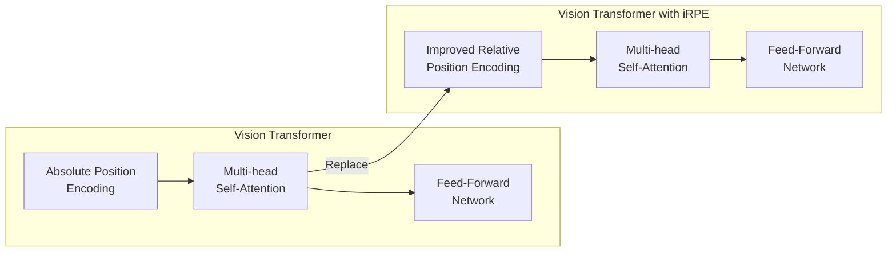
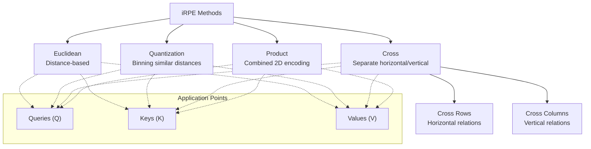
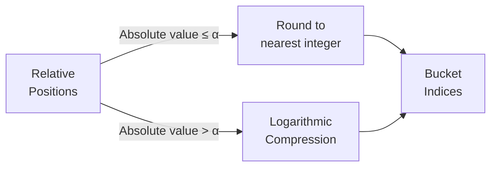
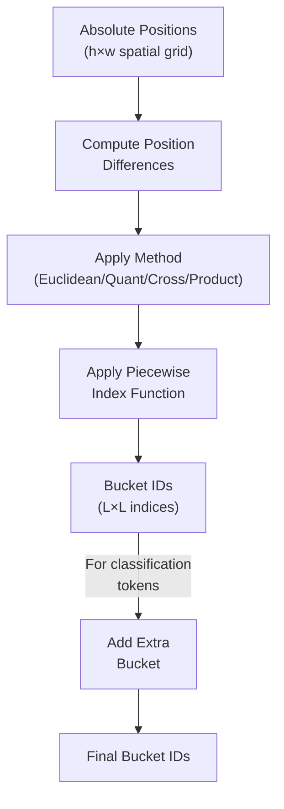
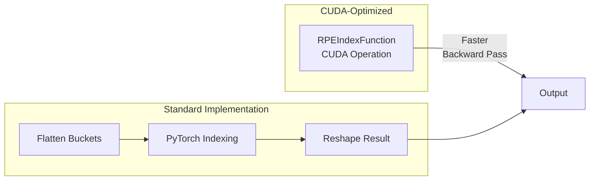
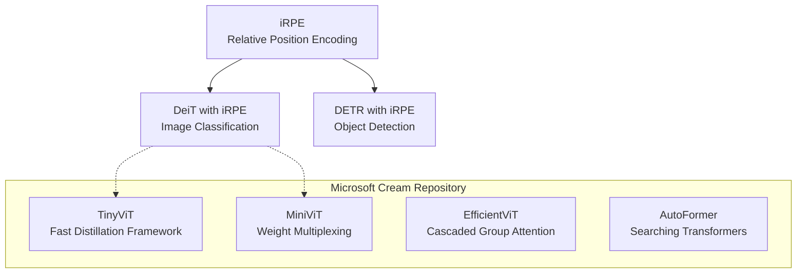

<!-- source: DeepWiki mcp.deepwiki.com · repo microsoft/Cream · page 4.1 iRPE · fetched 2026-10-26 -->

# iRPE

<details>
<summary>Relevant source files</summary>

The following files were used as context for generating this wiki page:

- [CDARTS/README.md](CDARTS/README.md)
- [MiniViT/Mini-DeiT/irpe.py](MiniViT/Mini-DeiT/irpe.py)
- [README.md](README.md)
- [iRPE/DETR-with-iRPE/README.md](iRPE/DETR-with-iRPE/README.md)
- [iRPE/DETR-with-iRPE/models/rpe_attention/irpe.py](iRPE/DETR-with-iRPE/models/rpe_attention/irpe.py)
- [iRPE/DeiT-with-iRPE/README.md](iRPE/DeiT-with-iRPE/README.md)
- [iRPE/DeiT-with-iRPE/irpe.py](iRPE/DeiT-with-iRPE/irpe.py)
- [iRPE/DeiT-with-iRPE/main.py](iRPE/DeiT-with-iRPE/main.py)
- [iRPE/DeiT-with-iRPE/rpe_models.py](iRPE/DeiT-with-iRPE/rpe_models.py)
- [iRPE/README.md](iRPE/README.md)

</details>


## Purpose and Scope

This document describes iRPE (improved Relative Position Encoding), a method for enhancing Vision Transformers with more effective position encoding. iRPE is specifically designed for 2D images, considering directional relative distance modeling and query-position interactions in self-attention mechanisms. The techniques outlined here are lightweight and can be easily plugged into transformer architectures like DeiT and DETR to achieve significant performance improvements.

## Overview

iRPE enhances Vision Transformers by replacing standard position encodings with more effective 2D-aware relative position encodings. By modeling positional relationships more effectively, iRPE achieves up to 1.5% top-1 accuracy improvement on ImageNet and 1.3% mAP improvement on COCO datasets without changing other hyperparameters.



Sources: [iRPE/README.md:6-9](). [iRPE/DETR-with-iRPE/README.md:11-15](), [iRPE/DeiT-with-iRPE/README.md:11-22]()

## Methods and Algorithms

iRPE provides four distinct methods for computing relative position encodings, each with different characteristics:



Sources: [iRPE/DeiT-with-iRPE/irpe.py:117-128](), [iRPE/DETR-with-iRPE/models/rpe_attention/irpe.py:117-128]()

### Piecewise Index Function

At the core of iRPE is a piecewise index function that maps relative positions to encoding bucket indices:



The piecewise function is defined as:
- For |x| ≤ α: f(x) = round(x)
- For |x| > α: f(x) = sign(x) * (α + log(|x|/α) / log(γ/α) * (β-α))

Where α, β, and γ are hyperparameters that control the mapping behavior.

Sources: [iRPE/DeiT-with-iRPE/irpe.py:19-52](), [iRPE/DETR-with-iRPE/models/rpe_attention/irpe.py:19-52]()

## Implementation Architecture

The iRPE implementation consists of several key components:

```mermaid
flowchart TD
    class["Input Feature"] --> GET_BUCKET["Get Bucket IDs"]
    GET_BUCKET --> RPE["Relative Position\nEncoding (iRPE)"]
    
    RPE --> BIAS["Bias Mode"]
    RPE --> CTX["Contextual Mode"]
    
    BIAS --> |"Add to attention\nscores"| ATT_SCORES["Attention Scores"]
    CTX --> |"Lookup embedding\nbased on query"| ATT_VALUES["Attention Values"]
    
    subgraph "Main Classes"
        iRPE_CLASS["iRPE"]
        iRPE_CROSS["iRPE_Cross"]
    end
    
    iRPE_CLASS --> |"Standard\nimplementation"| RPE
    iRPE_CROSS --> |"Specialized for\nCross method"| RPE
```

Sources: [iRPE/DeiT-with-iRPE/irpe.py:418-448](), [iRPE/DeiT-with-iRPE/irpe.py:696-729]()

### Bucket System

To efficiently process relative positions, iRPE converts 2D relative positions to bucket indices:



Sources: [iRPE/DeiT-with-iRPE/irpe.py:362-416](), [iRPE/DETR-with-iRPE/models/rpe_attention/irpe.py:363-416]()

## Modes of Operation

iRPE supports two main modes of operation:

1. **Bias Mode**: Adds relative position bias directly to attention scores
   - Simpler implementation
   - Lower parameter count

2. **Contextual Mode**: Computes position encodings based on content
   - More expressive
   - Allows interactions between content and position

### Integration Points

iRPE can be applied to different components of the self-attention mechanism:

| Integration Point | Description | Parameter Impact |
|-------------------|-------------|-----------------|
| Query (Q) | Applies relative position encoding to queries | Moderate increase |
| Key (K) | Applies relative position encoding to keys | Moderate increase |
| Value (V) | Applies relative position encoding to values | Moderate increase |
| Multiple (QK, QKV) | Combines encodings on multiple components | Larger increase |

Sources: [iRPE/DeiT-with-iRPE/irpe.py:822-886](), [iRPE/DeiT-with-iRPE/rpe_models.py:114-159]()

## Configuration Options

iRPE can be configured with several parameters to control its behavior:

| Parameter | Description | Default Value |
|-----------|-------------|--------------|
| `ratio` | Controls number of buckets | 1.9 |
| `method` | Encoding method (euc, quant, cross, product) | product |
| `mode` | Operating mode (bias, contextual) | contextual |
| `shared_head` | Whether to share weights across attention heads | True |
| `skip` | Number of special tokens before spatial tokens | 1 (for cls token) |
| `rpe_on` | Where to apply RPE (q, k, v, qk, qkv) | k |

Sources: [iRPE/DeiT-with-iRPE/irpe.py:769-821](), [iRPE/DeiT-with-iRPE/irpe.py:822-887]()

## Performance Results

### Image Classification (DeiT)

DeiT models equipped with contextual product shared-head RPE with 50 buckets show significant improvements:

| Model | RPE-Q | RPE-K | RPE-V | Parameters | MACs | Top-1 Acc (%) | Top-5 Acc (%) |
|-------|-------|-------|-------|------------|------|--------------|--------------|
| tiny | | ✓ | | 5.76M | 1284M | 73.7 | 92.0 |
| small | | ✓ | | 22.09M | 4659M | 80.9 | 95.4 |
| small | ✓ | ✓ | | 22.13M | 4706M | 81.0 | 95.5 |
| small | ✓ | ✓ | ✓ | 22.17M | 4885M | 81.2 | 95.5 |
| base | | ✓ | | 86.61M | 17684M | 82.3 | 95.9 |
| base | ✓ | ✓ | ✓ | 86.68M | 18137M | 82.8 | 96.1 |

Sources: [iRPE/DeiT-with-iRPE/README.md:14-22]()

### Object Detection (DETR)

DETR models with iRPE show consistent improvements on COCO dataset:

| Encoding Config | Backbone | Buckets | Epochs | AP | AP₅₀ | AP₇₅ | AP_S | AP_M | AP_L |
|-----------------|----------|---------|--------|-----|------|------|------|------|------|
| rpe-1.9-product-ctx-1-k | ResNet-50 | 7×7 | 150 | 40.9 | 61.4 | 42.9 | 19.5 | 44.3 | 60.5 |
| rpe-2.0-product-ctx-1-k | ResNet-50 | 9×9 | 150 | 41.0 | 61.5 | 43.4 | 19.2 | 44.5 | 60.8 |
| rpe-2.0-product-ctx-1-k | ResNet-50 | 9×9 | 300 | 42.2 | 62.3 | 44.6 | 20.5 | 45.7 | 61.3 |

Sources: [iRPE/DETR-with-iRPE/README.md:17-21]()

## Usage Examples

### DeiT with iRPE

To equip a DeiT model with iRPE, use the following configuration format:

```
deit_[size]_patch16_224_ctx_[method]_[buckets]_shared_[rpe_on]
```

For example:
- `deit_small_patch16_224_ctx_product_50_shared_k`: DeiT-Small with contextual product shared-head RPE on keys
- `deit_base_patch16_224_ctx_product_50_shared_qkv`: DeiT-Base with contextual product shared-head RPE on queries, keys and values

Sources: [iRPE/DeiT-with-iRPE/rpe_models.py:48-193]()

### DETR with iRPE

To equip DETR with iRPE, use the `--enc_rpe2d` argument with format:

```
rpe-[ratio]-[method]-[mode]-[shared_head]-[rpe_on]
```

For example:
- `rpe-2.0-product-ctx-1-k`: Contextual product shared-head RPE with 9×9 buckets on keys

Sources: [iRPE/DETR-with-iRPE/README.md:86-130]()

## CUDA Optimization

For improved performance, iRPE provides CUDA-optimized operations for efficient training. While the implementation can use PyTorch native functions, building the CUDA operators is recommended for faster backward propagation.



Sources: [iRPE/DeiT-with-iRPE/README.md:34-41](), [iRPE/DETR-with-iRPE/README.md:35-42]()

## Integration with Other Microsoft Cream Projects

iRPE serves as a fundamental building block for Vision Transformers within the Microsoft Cream repository and can be integrated with other projects:



Sources: [README.md:100-104]()

## Conclusion

iRPE provides a simple yet effective way to enhance Vision Transformers through improved relative position encoding. The method is modular, lightweight, and consistently delivers performance improvements across different vision tasks.

---

