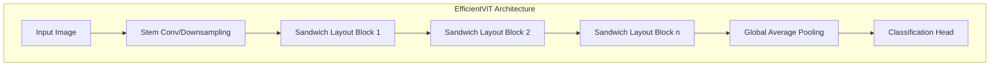
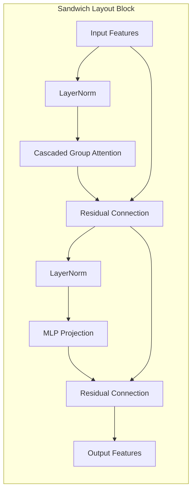
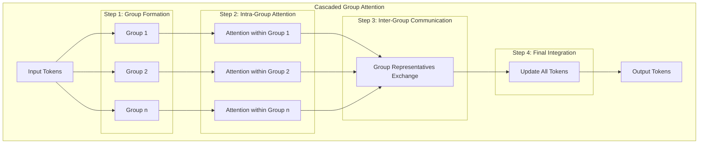
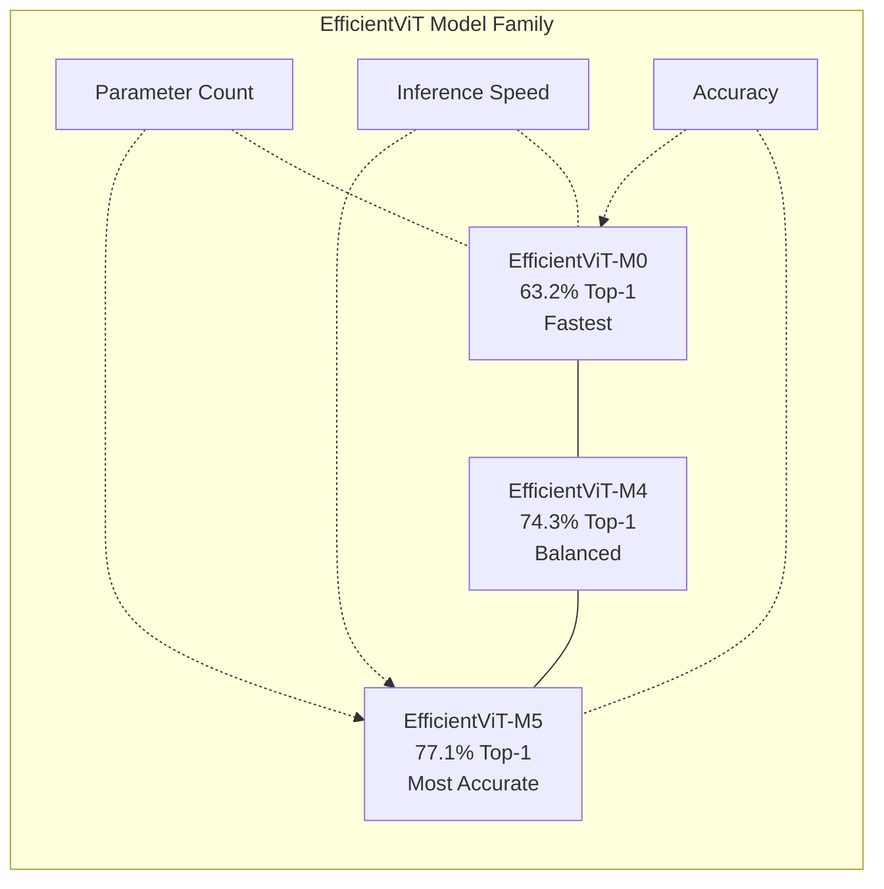
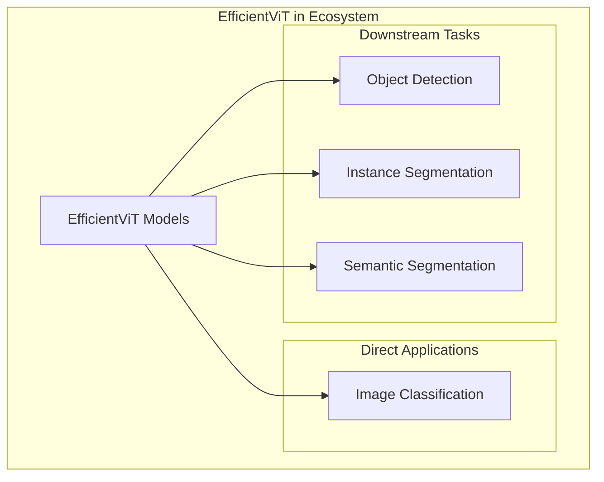

<!-- source: DeepWiki mcp.deepwiki.com · repo microsoft/Cream · page 4.2 EfficientViT · fetched 2026-10-26 -->

# EfficientViT

<details>
<summary>Relevant source files</summary>

The following files were used as context for generating this wiki page:

- [EfficientViT/.gitignore](EfficientViT/.gitignore)
- [EfficientViT/LICENSE](EfficientViT/LICENSE)
- [EfficientViT/README.md](EfficientViT/README.md)
- [EfficientViT/classification/.figures/efficientvit_main.gif](EfficientViT/classification/.figures/efficientvit_main.gif)

</details>


## Purpose and Scope

This document provides a technical overview of EfficientViT, a family of high-speed vision transformers that achieve significant efficiency gains through novel architectural designs. EfficientViT models are optimized for both computational efficiency and memory usage while maintaining competitive accuracy for image classification and other vision tasks.

For information about other vision transformer improvements like improved relative position encoding, see [iRPE](#4.1).

## Overview

EfficientViT is a memory-efficient vision transformer architecture that addresses two key challenges in transformer-based vision models:

1. High memory consumption during attention computation
2. Computational redundancy in the self-attention mechanism

It introduces two core innovations:
- Sandwich layout block design
- Cascaded group attention mechanism

These innovations enable EfficientViT to achieve superior throughput while maintaining competitive accuracy on vision tasks.



Sources: [EfficientViT/README.md:8-12]()

## Key Innovations

### Sandwich Layout Block

The sandwich layout block is a memory-efficient building block that forms the core of EfficientViT's architecture. It's designed to reduce memory consumption during training and inference while maintaining the expressiveness of the transformer architecture.



The sandwich layout arranges components in a way that optimizes memory usage during backpropagation, reducing the peak memory requirements compared to traditional transformer blocks.

Sources: [EfficientViT/README.md:29]()

### Cascaded Group Attention

The cascaded group attention mechanism is designed to reduce computational redundancy in the self-attention operation. Traditional self-attention requires computing attention scores between all pairs of tokens, which is computationally expensive for high-resolution images.



The cascaded group attention works by:
1. Dividing tokens into groups
2. Computing attention within each group
3. Enabling communication between groups through representative tokens
4. Integrating the information back to all tokens

This approach drastically reduces the computational complexity from O(n²) to approximately O(n), where n is the number of tokens, while preserving the model's ability to capture global dependencies.

Sources: [EfficientViT/README.md:29]()

## Model Variants

EfficientViT includes several model variants with different parameter counts and performance characteristics:

| Model | Parameters | Top-1 Accuracy | Throughput (V100 GPU) | Use Case |
|-------|------------|----------------|----------------------|----------|
| EfficientViT-M0 | Smallest | 63.2% | 27,644 img/s | Edge devices, resource-constrained environments |
| EfficientViT-M4 | Medium | 74.3% | 15,914 img/s | Balanced performance/efficiency |
| EfficientViT-M5 | Largest | 77.1% | 10,621 img/s | High accuracy requirements with good efficiency |



Sources: [EfficientViT/README.md:31-35]()

## Usage and Implementation

EfficientViT models can be easily integrated into existing PyTorch workflows. The models are designed to be used for image classification tasks, and they can also serve as backbones for downstream tasks like object detection and instance segmentation.

Basic usage example:

```python
from classification.model.build import EfficientViT_M4
model = EfficientViT_M4(pretrained='efficientvit_m4')
out = model(image)
```

The model can be instantiated with pre-trained weights for immediate use or trained from scratch for custom tasks.

Sources: [EfficientViT/README.md:42-46]()

## Performance Characteristics

EfficientViT models deliver exceptional throughput on various hardware platforms:

| Model | V100 GPU | Intel CPU | ONNX Models |
|-------|----------|-----------|-------------|
| EfficientViT-M0 | 27,644 img/s | 228.4 img/s | 340.1 img/s |
| EfficientViT-M4 | 15,914 img/s | - | - |
| EfficientViT-M5 | 10,621 img/s | - | - |

The smaller models are particularly suitable for deployment on edge devices or in resource-constrained environments, while the larger models provide a good balance between accuracy and efficiency for more demanding applications.

EfficientViT-M5 can be trained in approximately 30 hours on 8 V100 GPUs, making it relatively accessible even for organizations with limited computational resources.

Sources: [EfficientViT/README.md:31-35]()

## Integration with Other Systems

EfficientViT can be used as:

1. A standalone image classification model
2. A backbone for downstream tasks like object detection and instance segmentation



EfficientViT fits into the broader Microsoft Cream repository ecosystem as part of the Vision Transformer Improvements section, alongside other innovations like iRPE (improved Relative Position Encoding).

Sources: [EfficientViT/README.md:54-56]()

## Summary

EfficientViT introduces key innovations in vision transformer design that address fundamental efficiency challenges in terms of both memory consumption and computational complexity. The sandwich layout block and cascaded group attention mechanism combine to create a family of models that deliver exceptional throughput while maintaining competitive accuracy across a range of vision tasks.

These architectural innovations make EfficientViT particularly suitable for applications where computational efficiency is important, such as edge devices, real-time processing, or large-scale deployment scenarios.

Sources: [EfficientViT/README.md:8-35]()

---

