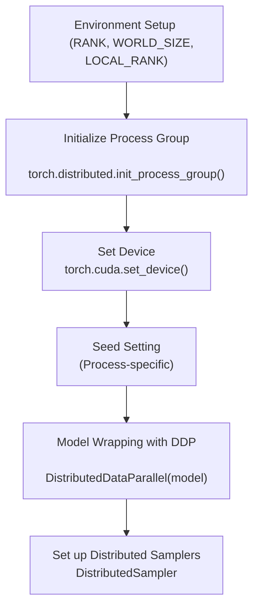
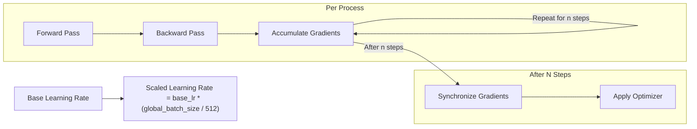
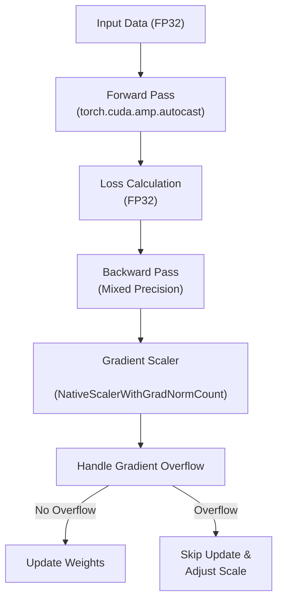
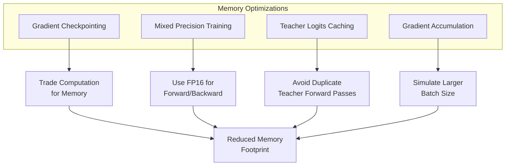
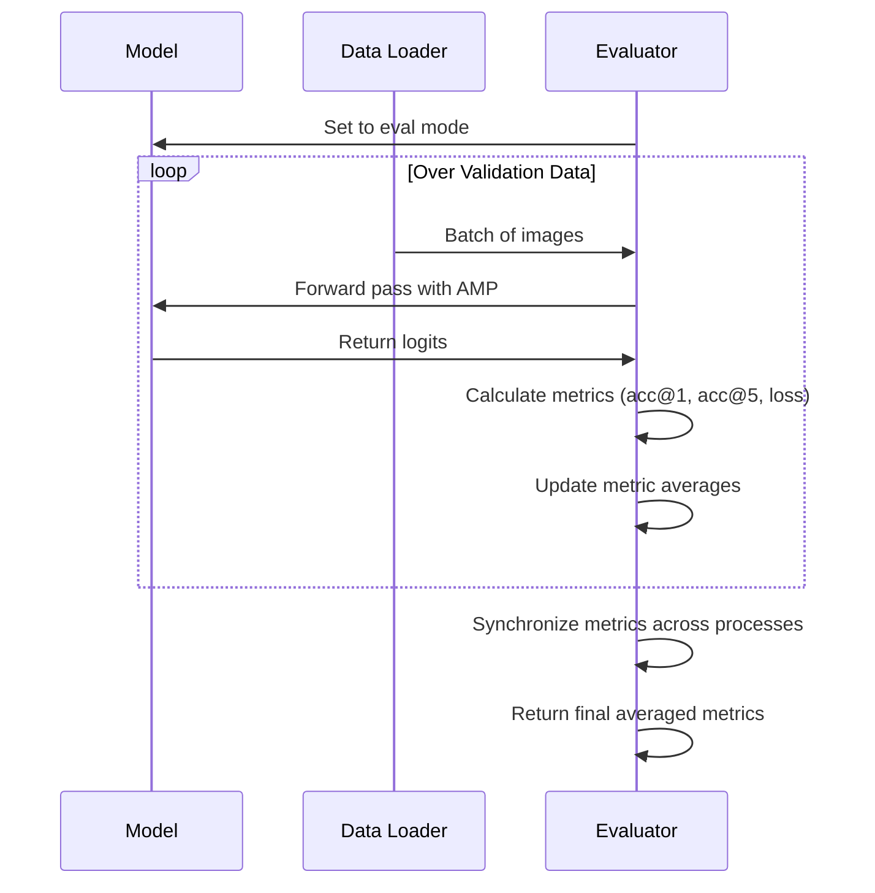
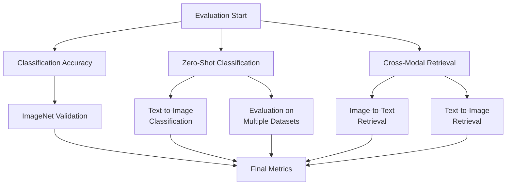
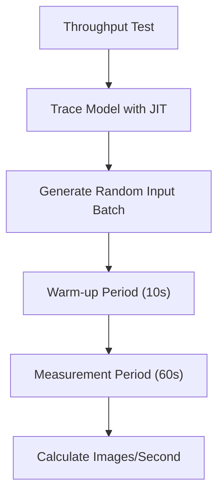
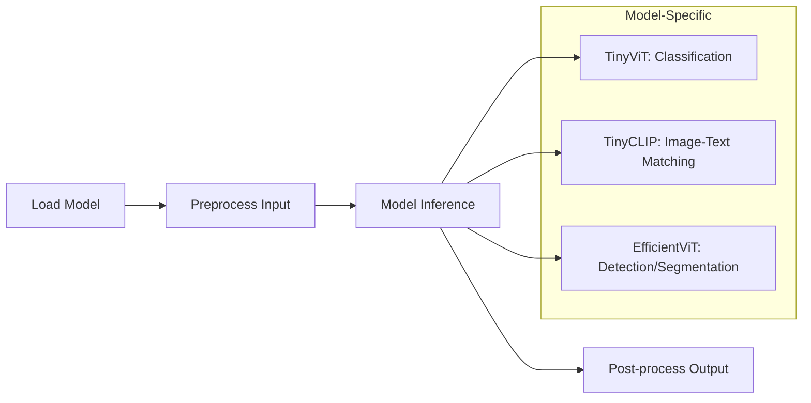

<!-- source: DeepWiki mcp.deepwiki.com · repo microsoft/Cream · page 5 Advanced Topics · fetched 2026-10-26 -->

# Advanced Topics

<details>
<summary>Relevant source files</summary>

The following files were used as context for generating this wiki page:

- [TinyCLIP/src/open_clip/model.py](TinyCLIP/src/open_clip/model.py)
- [TinyCLIP/src/open_clip/resnet.py](TinyCLIP/src/open_clip/resnet.py)
- [TinyCLIP/src/open_clip/weight_inherit.py](TinyCLIP/src/open_clip/weight_inherit.py)
- [TinyCLIP/src/training/data.py](TinyCLIP/src/training/data.py)
- [TinyCLIP/src/training/main.py](TinyCLIP/src/training/main.py)
- [TinyCLIP/src/training/main_for_test.py](TinyCLIP/src/training/main_for_test.py)
- [TinyCLIP/src/training/optimizer.py](TinyCLIP/src/training/optimizer.py)
- [TinyCLIP/src/training/train.py](TinyCLIP/src/training/train.py)
- [TinyViT/config.py](TinyViT/config.py)
- [TinyViT/data/augmentation/manager.py](TinyViT/data/augmentation/manager.py)
- [TinyViT/main.py](TinyViT/main.py)
- [TinyViT/my_meter.py](TinyViT/my_meter.py)
- [TinyViT/save_logits.py](TinyViT/save_logits.py)
- [TinyViT/utils.py](TinyViT/utils.py)

</details>


This page covers advanced implementation details across the Microsoft Cream repository projects, focusing on training infrastructure, optimization techniques, and evaluation methods. It provides technical information for researchers and developers who want to understand the inner workings of the repository's core systems.

For model architecture details, refer to the respective model pages for [TinyViT](#2.1), [TinyCLIP](#2.2), and other models. For basic training procedures, see the individual model training pipeline pages such as [TinyViT Training Pipeline](#2.1.2).

## 5.1 Distributed Training

The Microsoft Cream repository implements a comprehensive distributed training infrastructure that supports efficient multi-node, multi-GPU training across its projects. The infrastructure is built on PyTorch's Distributed Data Parallel (DDP) framework and includes additional optimizations for large-scale training.

### DDP Initialization

All projects in the repository follow a similar pattern for initializing distributed training:



The distributed training implementation handles device coordination, ensuring proper synchronization between processes:

```python
# Initialize process group
torch.distributed.init_process_group(
    backend='nccl',  # optimized for GPU training
    init_method='env://',  # use environment variables
    world_size=world_size,
    rank=rank
)
```

Important distributed training components include:

| Component | Function | Implementation |
|-----------|----------|----------------|
| Process Group | Manages communication between processes | Environment-based initialization with NCCL backend for GPUs |
| Device Assignment | Assigns GPUs to processes | Using `LOCAL_RANK` to assign each process to a specific GPU |
| Distributed Sampler | Ensures data partitioning between processes | Custom samplers that divide data without overlap |
| Gradient Synchronization | Averages gradients across processes | Automatic with DDP, controlled batch synchronization |
| Metric Reduction | Aggregates metrics across processes | Custom `AverageMeter` with `all_reduce` operations |

Sources: [TinyViT/main.py:511-513](), [TinyCLIP/src/training/main.py:473-476](), [TinyViT/utils.py:274-280]()

### Linear Scaling Rule and Gradient Accumulation

The repository implements the linear scaling rule for learning rates to maintain effective training with larger batch sizes across multiple GPUs:



Gradient accumulation is implemented to simulate larger batch sizes without requiring proportional GPU memory:

```python
# Scale the loss by accumulation steps
loss = loss / config.TRAIN.ACCUMULATION_STEPS
# Only update weights after accumulation_steps iterations
if (idx + 1) % config.TRAIN.ACCUMULATION_STEPS == 0:
    optimizer.zero_grad()
    lr_scheduler.step_update()
```

The learning rate scaling is proportional to both:
- The world size (number of processes)
- Gradient accumulation steps

This allows effective training with extremely large effective batch sizes.

Sources: [TinyViT/main.py:523-533](), [TinyViT/main.py:230-238](), [TinyCLIP/src/training/train.py:331-342]()

### Mixed Precision Training

All projects use Automatic Mixed Precision (AMP) to reduce memory usage and increase training speed:



The implementation uses custom gradient scalers that handle:
- Dynamic loss scaling to prevent underflow
- Gradient norm calculation for clipping
- Overflow detection and recovery

A key component is the `NativeScalerWithGradNormCount` which extends PyTorch's native AMP scaler with additional gradient norm monitoring and clipping capabilities.

Sources: [TinyViT/utils.py:300-327](), [TinyViT/main.py:223-238](), [TinyCLIP/src/training/main.py:283-285]()

### Memory Optimization Techniques

The repository implements several memory optimization techniques to enable training of large models on limited hardware:



#### Gradient Checkpointing
Implemented for transformer-based models to save activation memory by recomputing them during the backward pass rather than storing them.

```python
# Enable gradient checkpointing
model.set_grad_checkpointing()

# In transformer implementation
def set_grad_checkpointing(self, enable=True):
    self.grad_checkpointing = enable
```

#### Teacher Logits Caching
A particularly novel approach in TinyViT's distillation pipeline is caching of teacher model logits to avoid redundant computation:

1. Pre-computing and storing teacher logits with `save_logits_one_epoch()`
2. Reading the cached logits during student training with `train_one_epoch_distill_using_saved_logits()`
3. Using a custom disk-based cache manager (`TxtManager`) to efficiently handle the logits data

This approach significantly reduces memory requirements and speeds up training, as the teacher model doesn't need to be loaded during student training.

Sources: [TinyViT/main.py:409-410](), [TinyViT/save_logits.py:102-179](), [TinyViT/data/augmentation/manager.py:137-153]()

## 5.2 Evaluation Protocols

The repository implements rigorous evaluation protocols for benchmarking models, with specialized approaches for different model types.

### Classification Model Evaluation

For image classification models like TinyViT, the evaluation protocol includes:



Key metrics for classification models:
- Top-1 accuracy
- Top-5 accuracy
- Loss value

The validation function uses the same AMP settings as training and correctly handles synchronization across distributed processes using custom `AverageMeter` classes.

```python
# Metrics gathering with process synchronization
acc1_meter.sync()
acc5_meter.sync()
```

Sources: [TinyViT/main.py:403-454](), [TinyViT/my_meter.py:57-74]()

### Cross-Modal Model Evaluation

For cross-modal models like TinyCLIP, evaluation includes both classification accuracy and zero-shot evaluation:



Zero-shot evaluation involves using the model to predict on datasets without any fine-tuning, testing the generalization capabilities of the learned representations. For TinyCLIP, this includes:

1. Encoding a set of class names/descriptions 
2. Encoding validation images
3. Computing the similarity between image and text features
4. Evaluating accuracy based on highest similarity match

```python
# Zero-shot evaluation process
text_features = model.encode_text(texts)
image_features = model.encode_image(images)
similarity = image_features @ text_features.T
predictions = similarity.argmax(dim=-1)
```

Sources: [TinyCLIP/src/training/train.py:843-865](), [TinyCLIP/src/training/main_for_test.py:380-407]()

### Throughput Measurement

The repository includes dedicated throughput measurement to evaluate inference speed:



The implementation times individual forward passes and calculates the average throughput:

```python
# Throughput measurement
timing = []
with torch.cuda.amp.autocast():
    while sum(timing) < measurement_time:
        start = time.time()
        model(inputs)
        torch.cuda.synchronize()
        timing.append(time.time() - start)
throughput = batch_size / timing.mean().item()
```

This method provides consistent and reproducible speed measurements across different hardware.

Sources: [TinyViT/main.py:457-487]()

## 5.3 Inference Examples

This section provides practical examples of how to use the trained models for inference across different projects.

### Basic Inference Pipeline

The general inference pipeline follows these steps:



### TinyViT Inference

For TinyViT, inference involves:

1. Loading the model and weights
2. Applying image transformations
3. Running the model forward pass
4. Processing the classification results

```python
# Basic TinyViT inference
model = build_model(config)
if args.only_cpu:
    model_without_ddp = model
else:
    model = torch.nn.parallel.DistributedDataParallel(model)
    model_without_ddp = model.module

checkpoint = torch.load(config.MODEL.RESUME, map_location='cpu')
model_without_ddp.load_state_dict(checkpoint['model'])
model.eval()

# For ImageNet-22K -> ImageNet-1K mapping
if output_num_classes == 21841 and num_classes == 1000:
    output = remap_layer_22kto1k(output)
```

TinyViT provides a special remapping layer for handling models pre-trained on ImageNet-22K and evaluated on ImageNet-1K.

Sources: [TinyViT/main.py:420-425](), [TinyViT/main.py:63-76]()

### TinyCLIP Inference

TinyCLIP inference involves both image and text encoding:

1. Loading the model with appropriate precision settings
2. Encoding images and text inputs separately
3. Computing similarity between encoded features
4. Retrieving or classifying based on similarity scores

```python
# TinyCLIP inference
model, preprocess_val, _ = create_model_and_transforms(
    model_name, pretrained=pretrained, device=device,
    precision=precision
)
model.eval()

# Image encoding
image = preprocess_val(pil_image).unsqueeze(0).to(device)
with torch.no_grad(), torch.cuda.amp.autocast():
    image_features = model.encode_image(image)
    image_features = F.normalize(image_features, dim=-1)

# Text encoding
text = tokenizer(text_input)
with torch.no_grad(), torch.cuda.amp.autocast():
    text_features = model.encode_text(text)
    text_features = F.normalize(text_features, dim=-1)

# Compute similarity
similarity = (image_features @ text_features.T).squeeze(0)
```

TinyCLIP provides specialized inference methods that handle the cross-modal nature of the model.

Sources: [TinyCLIP/src/training/main_for_test.py:176-189](), [TinyCLIP/src/open_clip/model.py:493-535]()

### Memory-Efficient Inference

The repository provides several mechanisms for memory-efficient inference:

1. **Pruned Model Inference**: For models where pruning was applied during training, the system can automatically load and run the pruned version, which requires less memory.

```python
# Loading and using pruned models
if args.prune_image and args.prune_text:
    model.image_encoder_without_ddp = model.image_encoder_without_ddp.prune()
    model.text_encoder_without_ddp = model.text_encoder_without_ddp.prune()
```

2. **Weight Inheritance for Inference**: TinyCLIP models can use the weight inheritance technique to initialize smaller models from larger ones:

```python
# Weight inheritance for smaller models
num_inherit = encoder_weight_inherit(
    state_dict, image_checkpoint, '_image_encoder.visual', 
    head_dim=model.visual.head_dim
)
```

3. **Mixed Precision Inference**: All models support mixed precision inference for faster evaluation:

```python
# Mixed precision inference
with torch.cuda.amp.autocast():
    output = model(images)
```

Sources: [TinyCLIP/src/training/main.py:337-346](), [TinyCLIP/src/open_clip/weight_inherit.py:71-138](), [TinyViT/main.py:420-421]()

## Summary

The advanced implementation details discussed in this page are critical for efficiently training and evaluating the models in the repository. Key takeaways include:

1. A comprehensive distributed training framework that scales efficiently across multiple GPUs and nodes
2. Memory optimization techniques that enable training of large models on limited hardware
3. Rigorous evaluation protocols for different model types
4. Practical inference methods that balance efficiency and accuracy

These implementation details extend across all projects in the repository, providing a consistent foundation for model development and deployment.

---

