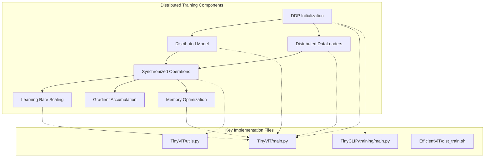
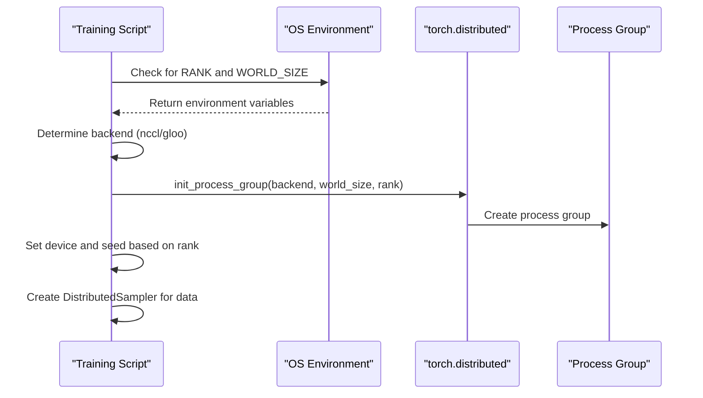
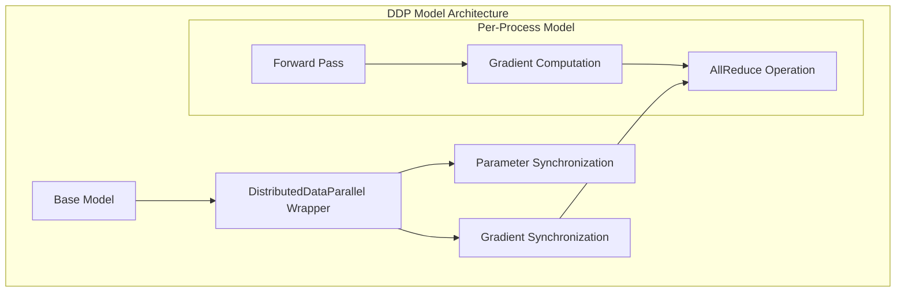
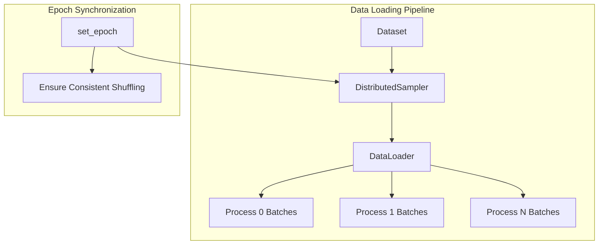
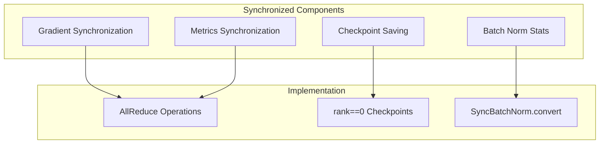
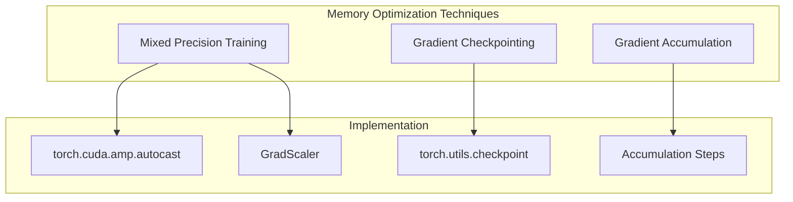
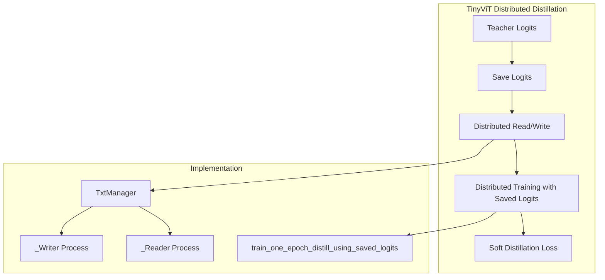
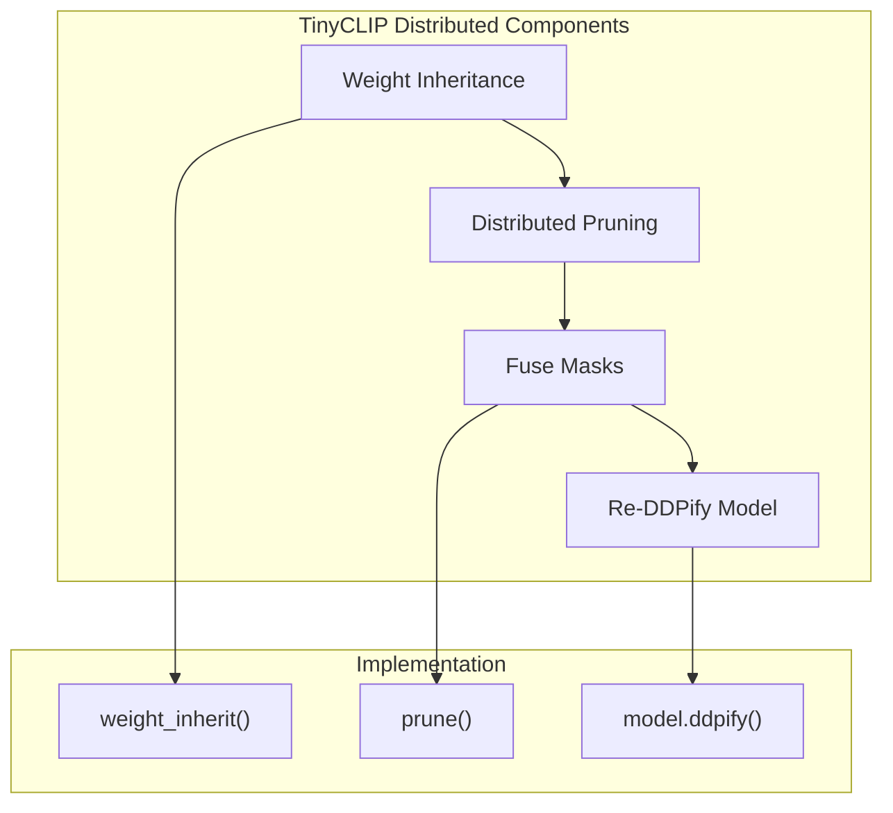
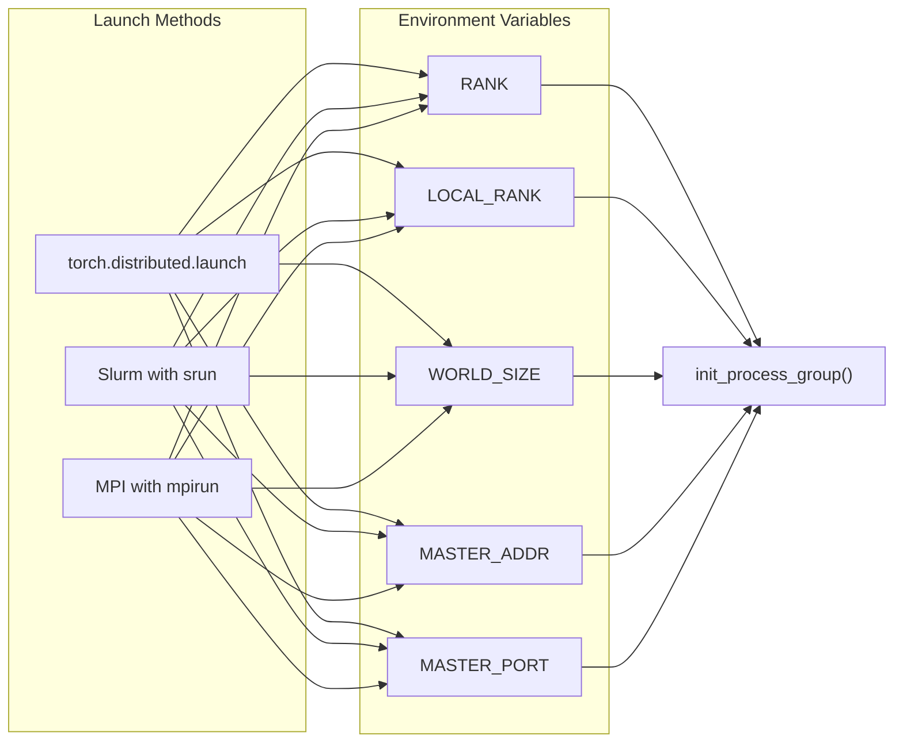

<!-- source: DeepWiki mcp.deepwiki.com · repo microsoft/Cream · page 5.1 Distributed Training · fetched 2026-10-26 -->

# Distributed Training

<details>
<summary>Relevant source files</summary>

The following files were used as context for generating this wiki page:

- [EfficientViT/downstream/dist_test.sh](EfficientViT/downstream/dist_test.sh)
- [EfficientViT/downstream/dist_train.sh](EfficientViT/downstream/dist_train.sh)
- [TinyCLIP/src/open_clip/model.py](TinyCLIP/src/open_clip/model.py)
- [TinyCLIP/src/open_clip/resnet.py](TinyCLIP/src/open_clip/resnet.py)
- [TinyCLIP/src/open_clip/weight_inherit.py](TinyCLIP/src/open_clip/weight_inherit.py)
- [TinyCLIP/src/training/data.py](TinyCLIP/src/training/data.py)
- [TinyCLIP/src/training/main.py](TinyCLIP/src/training/main.py)
- [TinyCLIP/src/training/main_for_test.py](TinyCLIP/src/training/main_for_test.py)
- [TinyCLIP/src/training/optimizer.py](TinyCLIP/src/training/optimizer.py)
- [TinyCLIP/src/training/train.py](TinyCLIP/src/training/train.py)
- [TinyViT/config.py](TinyViT/config.py)
- [TinyViT/data/augmentation/manager.py](TinyViT/data/augmentation/manager.py)
- [TinyViT/main.py](TinyViT/main.py)
- [TinyViT/my_meter.py](TinyViT/my_meter.py)
- [TinyViT/save_logits.py](TinyViT/save_logits.py)
- [TinyViT/utils.py](TinyViT/utils.py)

</details>


This document provides a technical overview of the distributed training implementation used across projects in the Microsoft Cream repository. It covers how models are trained on multiple GPUs and nodes to accelerate training of vision models like TinyViT, TinyCLIP, and others. For specific inference details, see [Inference Examples](#5.3).

## Overview of Distributed Training System

The Microsoft Cream repository implements a comprehensive distributed training system based on PyTorch's Distributed Data Parallel (DDP) framework. This enables efficient scaling from single-GPU to multi-GPU and multi-node training while maintaining training stability and accuracy.



Sources:
- [TinyViT/main.py:510-513]()
- [TinyViT/main.py:74-76]()
- [TinyCLIP/src/training/main.py:160-162]()
- [TinyViT/utils.py:274-280]()

## Distributed Environment Initialization

The distributed environment initialization is a critical first step in setting up distributed training. It establishes the communication backend, determines the world size (total number of processes), and assigns ranks to each process.



The initialization generally follows these steps:

1. **Environment Detection**: The script checks for environment variables set by the launcher.
2. **Backend Selection**: NCCL is used for GPU training, while Gloo can be used for CPU-only training.
3. **Process Group Initialization**: Establishes communication between processes.
4. **Device Assignment**: Each process is assigned to a specific GPU.
5. **Seed Setting**: Seeds are offset by rank to ensure different data samples.

### Code Example

```python
# Determine world size and rank
if 'RANK' in os.environ and 'WORLD_SIZE' in os.environ:
    rank = int(os.environ["RANK"])
    world_size = int(os.environ['WORLD_SIZE'])
else:
    rank = -1
    world_size = -1

# Set device and backend
if args.only_cpu:
    ddp_backend = 'gloo'
else:
    torch.cuda.set_device(config.LOCAL_RANK)
    ddp_backend = 'nccl'

# Initialize process group
torch.distributed.init_process_group(
    backend=ddp_backend, init_method='env://', 
    world_size=world_size, rank=rank)
torch.distributed.barrier()

# Set seed with rank offset
seed = config.SEED + dist.get_rank()
torch.manual_seed(seed)
torch.cuda.manual_seed(seed)
```

Sources:
- [TinyViT/main.py:497-520]()
- [TinyCLIP/src/training/main.py:141-162]()
- [TinyViT/save_logits.py:300-311]()

## Model Distribution with DDP

Once the distributed environment is initialized, models are wrapped with `DistributedDataParallel` (DDP) to enable efficient synchronization of gradients across processes.



The DDP implementation includes several key features:

1. **Model Wrapping**: The model is wrapped with `torch.nn.parallel.DistributedDataParallel`.
2. **Device Specification**: Each process's model is assigned to a specific GPU using the `device_ids` parameter.
3. **Broadcast Buffers**: Batch normalization statistics are synchronized across processes.
4. **Gradient Synchronization**: During backward pass, gradients are automatically synchronized using an AllReduce operation.

### Code Example

```python
# Wrap model with DDP
if not args.only_cpu:
    model = torch.nn.parallel.DistributedDataParallel(
        model, device_ids=[config.LOCAL_RANK], broadcast_buffers=False)
    model_without_ddp = model.module
else:
    model_without_ddp = model
```

For TinyCLIP, there's an additional `ddpify` method that applies DDP to specific components of the model:

```python
# Re-apply DDP to model components
ddp_args = {}
if args.ddp_static_graph:
    ddp_args['static_graph'] = True
ddp_fn = functools.partial(
    torch.nn.parallel.DistributedDataParallel, 
    device_ids=[device], **ddp_args)
model.ddpify(ddp_fn)
```

Sources:
- [TinyViT/main.py:74-79]()
- [TinyCLIP/src/training/main.py:469-477]()
- [TinyCLIP/src/training/train.py:366-375]()

## Distributed Data Loading

Efficient data loading is crucial for distributed training. The system uses `DistributedSampler` to ensure each process receives a different subset of the data.



Key components of the distributed data loading system:

1. **DistributedSampler**: Ensures each process gets a distinct subset of the data.
2. **Epoch Synchronization**: The `set_epoch` method ensures consistent data shuffling across epochs.
3. **Batch Size Scaling**: The effective batch size is the per-process batch size multiplied by the world size.
4. **Learning Rate Scaling**: Learning rates are linearly scaled based on the global batch size.

### Code Example

```python
# Setting up distributed sampler
dataset_train, dataset_val, data_loader_train, data_loader_val, mixup_fn = build_loader(config)

# Scaling learning rate based on global batch size
linear_scaled_lr = config.TRAIN.BASE_LR * \
    config.DATA.BATCH_SIZE * dist.get_world_size() / 512.0

# Setting epoch for consistent shuffling
data_loader_train.sampler.set_epoch(epoch)
```

Sources:
- [TinyViT/main.py:59-60]()
- [TinyViT/main.py:149]()
- [TinyViT/main.py:523-528]()
- [TinyCLIP/src/training/data.py:57-77]()

## Synchronized Operations

To maintain consistent training across processes, various operations need to be synchronized. This includes metrics, batch normalization statistics, and learning rate schedules.



Key synchronized operations include:

1. **Metrics**: Accuracy and loss metrics are synchronized across processes using AllReduce operations.
2. **Checkpoints**: Only the master process (rank 0) saves checkpoints.
3. **Batch Normalization**: In some cases, SyncBatchNorm is used to synchronize statistics.
4. **Gradient Accumulation**: Gradients can be accumulated over multiple steps before synchronization.

### Synchronized Metrics

The `AverageMeter` class includes a `sync()` method to synchronize metrics across processes:

```python
def sync(self):
    buf = torch.tensor([self._sum, self._count], dtype=torch.float32)
    if self._use_gpu:
        buf = buf.cuda()
    dist.all_reduce(buf, op=dist.ReduceOp.SUM)
    _sum, _count = buf.tolist()
    _avg = _sum / max(1, _count)
    # Update history
    self._history_avg = r * self._history_avg + (1.0 - r) * _avg
    self._history_count += _count
```

Sources:
- [TinyViT/my_meter.py:57-74]()
- [TinyViT/utils.py:274-280]()
- [TinyViT/main.py:449-452]()
- [TinyViT/main.py:157-159]()

## Memory Optimization Techniques

Distributed training often requires memory optimization techniques to handle larger models and batch sizes.



### Mixed Precision Training

Mixed precision training uses lower precision (FP16 or BF16) for most operations while maintaining FP32 for critical operations:

```python
# Setup for mixed precision training
loss_scaler = NativeScalerWithGradNormCount(grad_scaler_enabled=config.AMP_ENABLE)

# Using autocast for mixed precision
with torch.cuda.amp.autocast(enabled=config.AMP_ENABLE):
    outputs = model(samples)
```

### Gradient Checkpointing

Gradient checkpointing reduces memory usage by recomputing activations during the backward pass instead of storing them:

```python
# Enable gradient checkpointing in models
if args.grad_checkpointing:
    model.set_grad_checkpointing()

# Implementation in transformer models
@torch.jit.ignore
def set_grad_checkpointing(self, enable=True):
    self.grad_checkpointing = enable
```

### Gradient Accumulation

Gradient accumulation enables effective batch size scaling by accumulating gradients over multiple forward-backward passes:

```python
# Gradient accumulation implementation
loss = loss / config.TRAIN.ACCUMULATION_STEPS
grad_norm = loss_scaler(loss, optimizer, clip_grad=config.TRAIN.CLIP_GRAD,
                        parameters=model.parameters(), create_graph=is_second_order,
                        update_grad=(idx + 1) % config.TRAIN.ACCUMULATION_STEPS == 0)
if (idx + 1) % config.TRAIN.ACCUMULATION_STEPS == 0:
    optimizer.zero_grad()
    lr_scheduler.step_update(
        (epoch * num_steps + idx) // config.TRAIN.ACCUMULATION_STEPS)
```

Sources:
- [TinyViT/main.py:81-81]()
- [TinyViT/main.py:223-226]()
- [TinyViT/main.py:232-238]()
- [TinyCLIP/src/open_clip/model.py:428-430]()
- [TinyCLIP/src/training/main.py:285-285]()

## Project-Specific Distributed Training Components

Different projects in the repository have specialized components for distributed training. Here, we highlight the most important ones for TinyViT and TinyCLIP.

### TinyViT Distributed Training

TinyViT features specialized components for knowledge distillation using teacher logits in a distributed setting:



The TinyViT distillation process:

1. **Logit Saving**: The teacher model's logits are saved in a distributed manner.
2. **Rank-based Distribution**: Each rank writes to its own files and can read from all ranks.
3. **Efficient Storage**: Only the top-k logits are saved to reduce storage requirements.
4. **Synchronized Training**: The distillation process is synchronized across all processes.

### TinyCLIP Distributed Training

TinyCLIP uses specialized methods for distributed weight inheritance and pruning:



Key TinyCLIP distributed features:

1. **Weight Inheritance**: Efficiently inherits weights from a larger model to a smaller one.
2. **Distributed Pruning**: Performs model pruning across processes.
3. **Mask Fusion**: Fuses pruning masks in a distributed setting.
4. **Model Re-wrapping**: Re-applies DDP after structural changes to the model.

Sources:
- [TinyViT/save_logits.py:103-159]()
- [TinyViT/main.py:284-340]()
- [TinyViT/data/augmentation/manager.py:138-153]()
- [TinyCLIP/src/open_clip/weight_inherit.py:71-138]()
- [TinyCLIP/src/training/train.py:334-362]()

## Utility Functions for Distributed Training

The repository contains numerous utility functions for distributed training. Here are the most important ones:

| Function | Purpose | Location |
|----------|---------|----------|
| `reduce_tensor` | Reduces a tensor across processes | [TinyViT/utils.py:274-280]() |
| `is_main_process` | Checks if current process is rank 0 | [TinyViT/utils.py:330-331]() |
| `world_info_from_env` | Gets world size and rank from environment | [TinyCLIP/src/training/distributed.py]() |
| `sync` | Synchronizes metrics across processes | [TinyViT/my_meter.py:57-74]() |
| `save_checkpoint` | Saves model checkpoint (rank 0 only) | [TinyViT/utils.py:245-258]() |

### Linear Learning Rate Scaling

An important utility for distributed training is the linear scaling of learning rates based on the global batch size:

```python
# Linear LR scaling with world size
linear_scaled_lr = config.TRAIN.BASE_LR * \
    config.DATA.BATCH_SIZE * dist.get_world_size() / 512.0
linear_scaled_warmup_lr = config.TRAIN.WARMUP_LR * \
    config.DATA.BATCH_SIZE * dist.get_world_size() / 512.0
linear_scaled_min_lr = config.TRAIN.MIN_LR * \
    config.DATA.BATCH_SIZE * dist.get_world_size() / 512.0

# Additional scaling for gradient accumulation
if config.TRAIN.ACCUMULATION_STEPS > 1:
    linear_scaled_lr = linear_scaled_lr * config.TRAIN.ACCUMULATION_STEPS
    linear_scaled_warmup_lr = linear_scaled_warmup_lr * config.TRAIN.ACCUMULATION_STEPS
    linear_scaled_min_lr = linear_scaled_min_lr * config.TRAIN.ACCUMULATION_STEPS
```

Sources:
- [TinyViT/utils.py:274-280]()
- [TinyViT/utils.py:330-331]()
- [TinyViT/my_meter.py:57-74]()
- [TinyViT/main.py:523-538]()

## Launching Distributed Training

The repository provides various methods to launch distributed training depending on the project.

### EfficientViT Launch Script

```bash
# Launch EfficientViT training with specified number of GPUs
CONFIG=$1
GPUS=$2
PORT=${PORT:-29500}

PYTHONPATH="$(dirname $0)/..":$PYTHONPATH \
python -m torch.distributed.launch --nproc_per_node=$GPUS --master_port=$PORT \
    $(dirname "$0")/train.py $CONFIG --launcher pytorch ${@:3}
```

### TinyViT and TinyCLIP Environment-based Initialization

Both TinyViT and TinyCLIP use environment variables set by the launcher:

```python
# Check for environment variables set by torch.distributed.launch
if 'RANK' in os.environ and 'WORLD_SIZE' in os.environ:
    rank = int(os.environ["RANK"])
    world_size = int(os.environ['WORLD_SIZE'])
else:
    rank = -1
    world_size = -1
```

### Common Launch Patterns



Sources:
- [EfficientViT/downstream/dist_train.sh:1-10]()
- [TinyViT/main.py:497-504]()
- [TinyCLIP/src/training/main.py:141-143]()

## Best Practices

Based on the implementation in the repository, here are some best practices for distributed training:

1. **Initialization**: Always use environment variables for initialization to support different launchers.
2. **Linear LR Scaling**: Scale learning rates linearly with global batch size.
3. **Memory Optimization**: Use mixed precision, gradient checkpointing, and accumulation as needed.
4. **Synchronization**: Ensure metrics and checkpoints are properly synchronized.
5. **Reproducibility**: Set seeds with rank offsets for reproducibility while maintaining diversity.
6. **Check Main Process**: Use `is_main_process()` to ensure operations like logging, checkpointing, and evaluation happen only on one process.
7. **Batch Normalization**: Consider using `SyncBatchNorm` for small batch sizes per GPU.

## Conclusion

The distributed training system in the Microsoft Cream repository provides a robust framework for scaling model training across multiple GPUs and nodes. It includes optimizations for memory usage, data loading, gradient synchronization, and project-specific components for knowledge distillation and model pruning.

The system achieves efficient scaling through proper initialization, model distribution, data parallelism, and synchronized operations. This enables training larger models, using larger batch sizes, and reducing overall training time for vision transformer models like TinyViT, TinyCLIP, and EfficientViT.

Sources:
- [TinyViT/main.py]()
- [TinyViT/utils.py]()
- [TinyCLIP/src/training/main.py]()
- [TinyViT/save_logits.py]()
- [TinyCLIP/src/training/train.py]()

---

