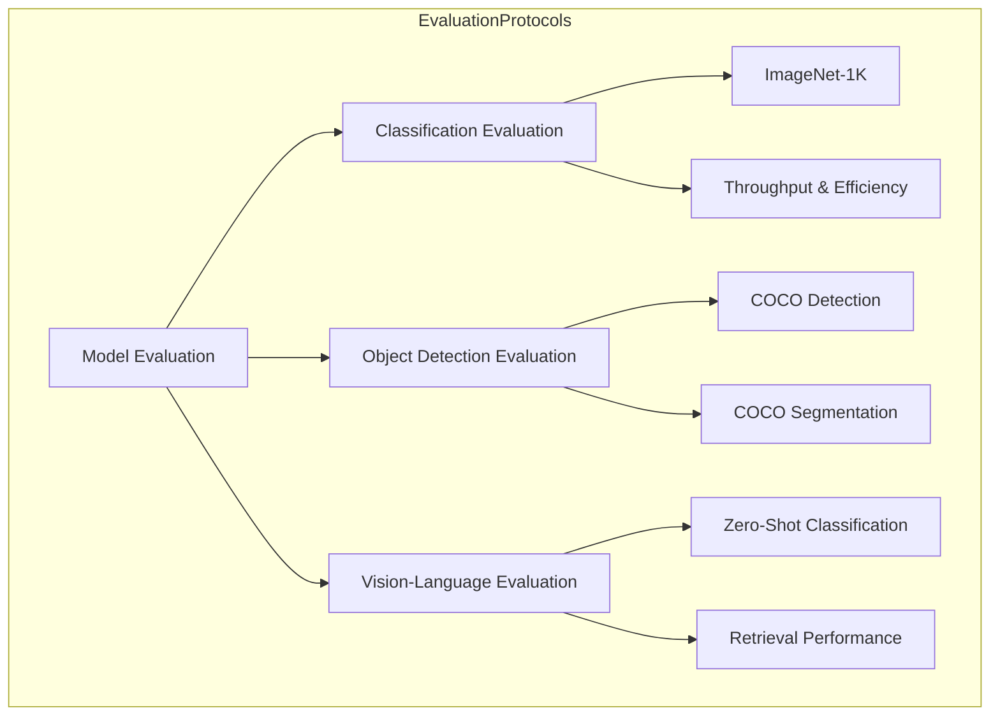
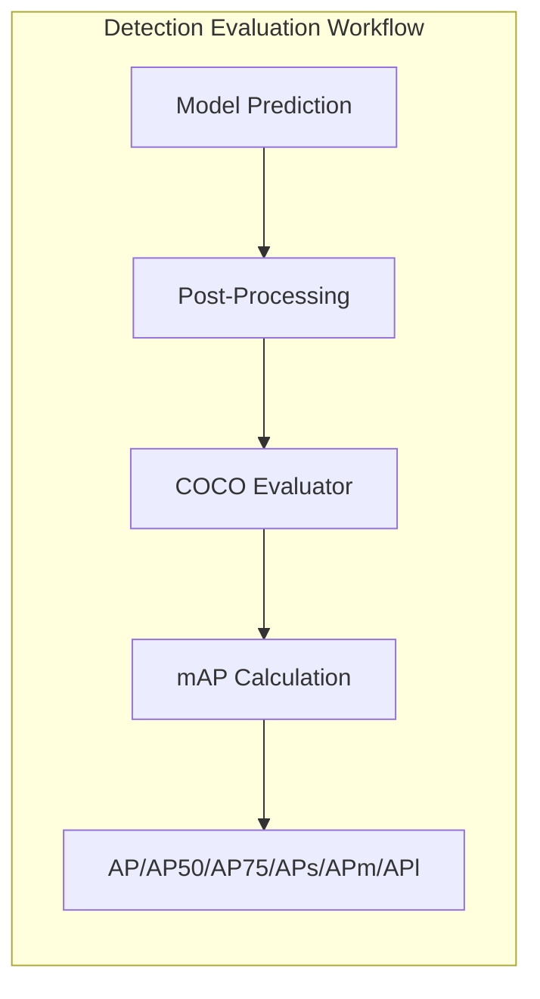
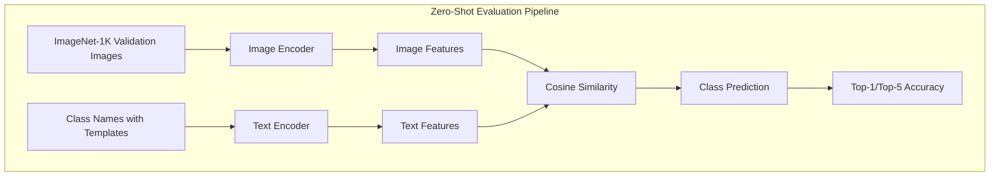
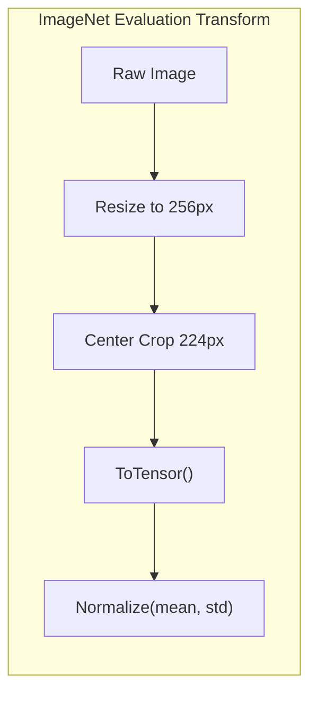
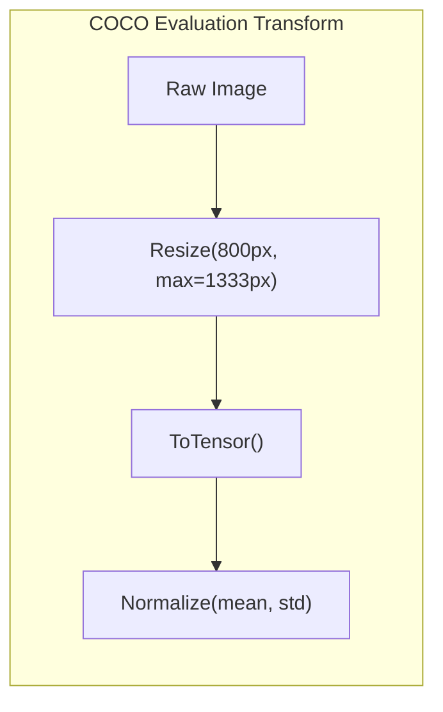
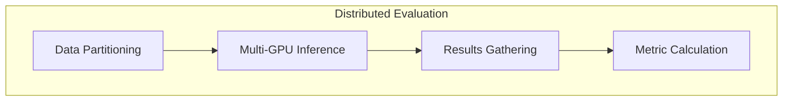

<!-- source: DeepWiki mcp.deepwiki.com · repo microsoft/Cream · page 5.2 Evaluation Protocols · fetched 2026-10-26 -->

# Evaluation Protocols

<details>
<summary>Relevant source files</summary>

The following files were used as context for generating this wiki page:

- [TinyCLIP/docs/EVALUATION.md](TinyCLIP/docs/EVALUATION.md)
- [TinyCLIP/src/open_clip/model_configs/TinyCLIP-ResNet-19M-Text-19M.json](TinyCLIP/src/open_clip/model_configs/TinyCLIP-ResNet-19M-Text-19M.json)
- [TinyCLIP/src/open_clip/model_configs/TinyCLIP-ResNet-30M-Text-29M.json](TinyCLIP/src/open_clip/model_configs/TinyCLIP-ResNet-30M-Text-29M.json)
- [TinyCLIP/src/open_clip/model_configs/TinyCLIP-ViT-39M-16-Text-19M.json](TinyCLIP/src/open_clip/model_configs/TinyCLIP-ViT-39M-16-Text-19M.json)
- [TinyCLIP/src/open_clip/model_configs/TinyCLIP-ViT-40M-32-Text-19M.json](TinyCLIP/src/open_clip/model_configs/TinyCLIP-ViT-40M-32-Text-19M.json)
- [TinyCLIP/src/open_clip/model_configs/TinyCLIP-ViT-61M-32-Text-29M.json](TinyCLIP/src/open_clip/model_configs/TinyCLIP-ViT-61M-32-Text-29M.json)
- [TinyCLIP/src/open_clip/model_configs/TinyCLIP-ViT-8M-16-Text-3M.json](TinyCLIP/src/open_clip/model_configs/TinyCLIP-ViT-8M-16-Text-3M.json)
- [iRPE/DETR-with-iRPE/.gitignore](iRPE/DETR-with-iRPE/.gitignore)
- [iRPE/DETR-with-iRPE/LICENSE](iRPE/DETR-with-iRPE/LICENSE)
- [iRPE/DETR-with-iRPE/datasets/__init__.py](iRPE/DETR-with-iRPE/datasets/__init__.py)
- [iRPE/DETR-with-iRPE/datasets/coco.py](iRPE/DETR-with-iRPE/datasets/coco.py)
- [iRPE/DETR-with-iRPE/datasets/coco_eval.py](iRPE/DETR-with-iRPE/datasets/coco_eval.py)
- [iRPE/DETR-with-iRPE/datasets/coco_panoptic.py](iRPE/DETR-with-iRPE/datasets/coco_panoptic.py)
- [iRPE/DETR-with-iRPE/datasets/panoptic_eval.py](iRPE/DETR-with-iRPE/datasets/panoptic_eval.py)
- [iRPE/DETR-with-iRPE/datasets/transforms.py](iRPE/DETR-with-iRPE/datasets/transforms.py)
- [iRPE/DETR-with-iRPE/engine.py](iRPE/DETR-with-iRPE/engine.py)

</details>


## Purpose and Scope

This document details the standardized evaluation protocols used across the Microsoft Cream repository for benchmarking model performance. It covers methods for evaluating various model types including vision transformers, neural architecture search models, compression frameworks, and multimodal models. For specific inference examples and usage patterns, see [Inference Examples](#5.3).

## Overview

The Microsoft Cream repository includes multiple projects with different evaluation requirements based on their specific tasks and architectures. This document outlines the consistent protocols used to evaluate and compare these models.



Sources: [TinyCLIP/docs/EVALUATION.md:7-24](), [iRPE/DETR-with-iRPE/engine.py:68-151]()

## Classification Evaluation

### ImageNet-1K

The primary benchmark for vision transformer models and compressed models is the ImageNet-1K dataset. The standard evaluation protocol includes:

- Center-cropped images at 224×224 resolution
- Single-crop validation
- Reporting Top-1 and Top-5 accuracy percentages
- Standard data normalization with mean=[0.485, 0.456, 0.406] and std=[0.229, 0.224, 0.225]

### Efficiency Metrics

Beyond accuracy, models are evaluated on efficiency metrics:

- FLOPs (floating point operations)
- Parameter count
- Throughput (images/second)
- Memory usage
- Latency

These metrics are particularly important for compressed models like TinyViT and MiniViT, where the balance between accuracy and efficiency is critical.

## Object Detection and Segmentation Evaluation

### COCO Detection Metrics

Object detection models are evaluated using the COCO evaluation protocol:



The COCOEvaluator class processes model predictions and computes standard metrics:

| Metric | Description |
|--------|-------------|
| AP     | Average Precision across IoU thresholds 0.5-0.95 |
| AP50   | Average Precision at IoU threshold 0.5 |
| AP75   | Average Precision at IoU threshold 0.75 |
| APs    | AP for small objects |
| APm    | AP for medium objects |
| APl    | AP for large objects |

Sources: [iRPE/DETR-with-iRPE/datasets/coco_eval.py:22-77](). [iRPE/DETR-with-iRPE/engine.py:68-151]()

### Segmentation Evaluation

For segmentation models:

- Mask AP for instance segmentation
- Panoptic Quality (PQ) for panoptic segmentation
- Segmentation Quality (SQ) and Recognition Quality (RQ)

The evaluation process follows the COCO protocol with the PanopticEvaluator for panoptic segmentation tasks.

Sources: [iRPE/DETR-with-iRPE/datasets/panoptic_eval.py:13-44](), [iRPE/DETR-with-iRPE/datasets/coco_eval.py:103-136]()

## Zero-Shot Evaluation for Vision-Language Models

TinyCLIP and other multimodal models use zero-shot image classification on standard benchmarks:



### Zero-Shot Classification Protocol

1. Encode each class name with a set of templates (e.g., "a photo of a {class}")
2. Process each validation image through the image encoder
3. Compute cosine similarity between image features and all class text features
4. Predict the class with highest similarity
5. Calculate accuracy metrics

Sources: [TinyCLIP/docs/EVALUATION.md:9-25]()

### Running TinyCLIP Evaluation

Example command for evaluating TinyCLIP models:

```bash
python -m torch.distributed.launch --use_env --nproc_per_node 8 src/training/main_for_test.py \
--imagenet-val ./ImageNet \
--model TinyCLIP-ViT-39M-16-Text-19M \
--eval \
--resume ./checkpoints/TinyCLIP-ViT-39M-16-Text-19M-YFCC15M.pt
```

Different model architectures (manual vs. auto weight inference) have different evaluation parameters as shown in the evaluation documentation.

Sources: [TinyCLIP/docs/EVALUATION.md:11-134]()

## Data Preprocessing for Evaluation

### Classification Preprocessing



### Detection Preprocessing



Sources: [iRPE/DETR-with-iRPE/datasets/transforms.py:196-258](), [iRPE/DETR-with-iRPE/datasets/coco.py:174-201]()

## Model Configuration for Evaluation

Each model family has specific configuration parameters for evaluation:

### TinyCLIP Models

The model configurations are defined in JSON files that specify the architecture parameters:

| Model | Vision Parameters | Text Parameters | Embedding Dim |
|-------|------------------|----------------|---------------|
| TinyCLIP-ViT-39M-16-Text-19M | layers: 12, width: 512, patch: 16 | layers: 6, width: 512, heads: 8 | 512 |
| TinyCLIP-ViT-8M-16-Text-3M | layers: 10, width: 256, patch: 16 | layers: 3, width: 256, heads: 4 | 512 |
| TinyCLIP-ResNet-30M-Text-29M | layers: [3,4,6,3], width: 56 | layers: 9, width: 512, heads: 8 | 1024 |

Sources: [TinyCLIP/src/open_clip/model_configs/TinyCLIP-ViT-39M-16-Text-19M.json:1-16](), [TinyCLIP/src/open_clip/model_configs/TinyCLIP-ViT-8M-16-Text-3M.json:1-16](), [TinyCLIP/src/open_clip/model_configs/TinyCLIP-ResNet-30M-Text-29M.json:1-21]()

## Distributed Evaluation

Most evaluation protocols in the repository support distributed evaluation for faster processing:



Key components of distributed evaluation:

1. **Data partitioning**: Dataset is divided among multiple GPUs
2. **Synchronization**: Results from all processes are synchronized
3. **Aggregation**: Metrics are computed on the complete evaluation set

Sources: [iRPE/DETR-with-iRPE/engine.py:127-131](), [iRPE/DETR-with-iRPE/datasets/coco_eval.py:55-58]()

## Evaluation Function Structure

The core evaluation function typically follows this structure:

1. Set model to evaluation mode
2. Initialize metric trackers and evaluators
3. Process all validation data in batches
4. Post-process model outputs
5. Update evaluators with results
6. Synchronize results across processes (for distributed evaluation)
7. Calculate and report final metrics

For detection models, the evaluation function structure is:

```python
@torch.no_grad()
def evaluate(model, criterion, postprocessors, data_loader, base_ds, device, output_dir):
    model.eval()
    # Initialize metrics and evaluators
    metric_logger = utils.MetricLogger(delimiter="  ")
    coco_evaluator = CocoEvaluator(base_ds, iou_types)
    
    # Process validation data
    for samples, targets in metric_logger.log_every(data_loader, 10, header):
        # Model inference
        outputs = model(samples)
        
        # Post-processing
        results = postprocessors['bbox'](outputs, orig_target_sizes)
        
        # Update evaluator
        coco_evaluator.update(res)
    
    # Synchronize and calculate metrics
    coco_evaluator.synchronize_between_processes()
    coco_evaluator.accumulate()
    coco_evaluator.summarize()
    return stats, coco_evaluator
```

Sources: [iRPE/DETR-with-iRPE/engine.py:68-151]()

## Conclusion

Standardized evaluation protocols ensure fair and consistent comparison between different models in the Microsoft Cream repository. Each model family follows established benchmarking practices for its domain while adapting to specific architectural considerations.

The evaluation results serve as the foundation for comparing efficiency improvements, architectural innovations, and compression techniques across the repository's projects.

---

