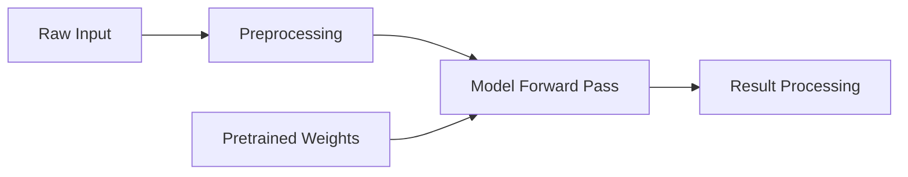
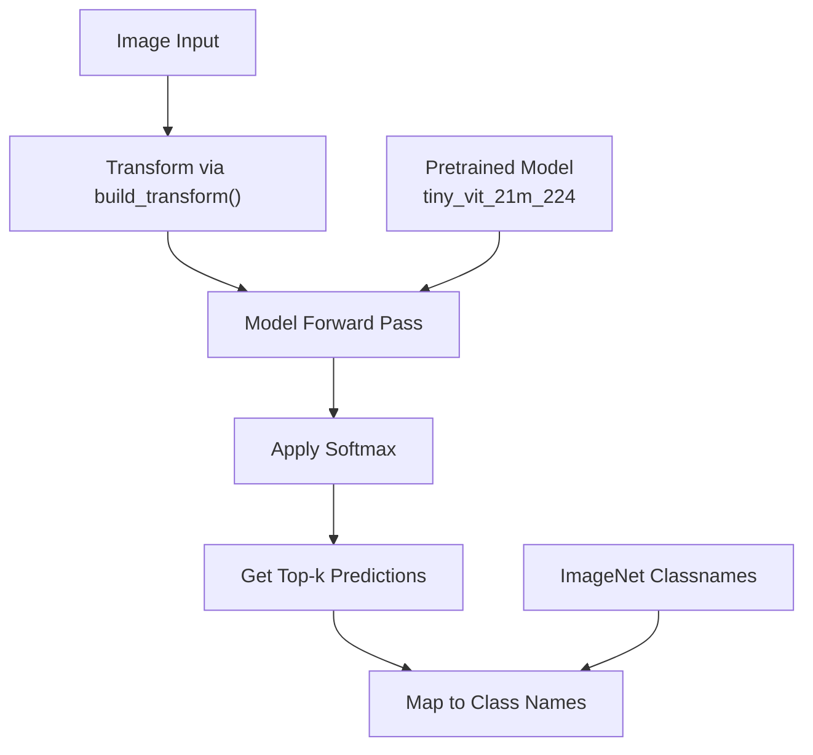
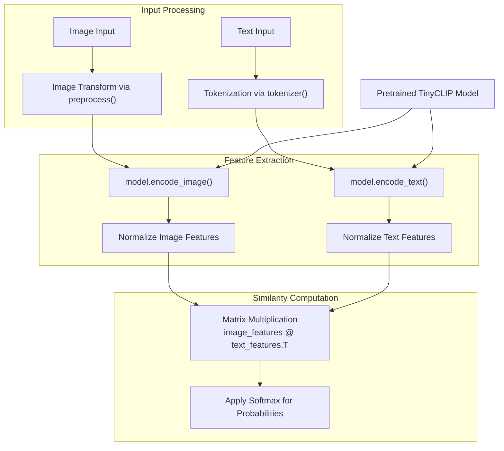
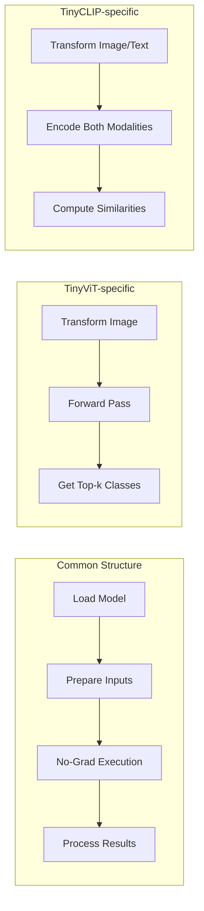

<!-- source: DeepWiki mcp.deepwiki.com · repo microsoft/Cream · page 5.3 Inference Examples · fetched 2026-10-26 -->

# Inference Examples

<details>
<summary>Relevant source files</summary>

The following files were used as context for generating this wiki page:

- [TinyCLIP/inference.py](TinyCLIP/inference.py)
- [TinyCLIP/src/open_clip/__init__.py](TinyCLIP/src/open_clip/__init__.py)
- [TinyCLIP/src/open_clip/pretrained.py](TinyCLIP/src/open_clip/pretrained.py)
- [TinyViT/.figure/cat.jpg](TinyViT/.figure/cat.jpg)
- [TinyViT/data/__init__.py](TinyViT/data/__init__.py)
- [TinyViT/data/imagenet_classnames.py](TinyViT/data/imagenet_classnames.py)
- [TinyViT/inference.py](TinyViT/inference.py)

</details>


This page provides practical examples of how to use models from the Microsoft Cream repository for inference tasks. It focuses on demonstrating the process of loading pretrained models, processing inputs, executing inference, and interpreting results for both TinyViT and TinyCLIP models.

For information about training protocols and evaluation metrics, see [Evaluation Protocols](#5.2).

## Inference Pipeline Overview

All models in this repository follow a similar inference pipeline pattern despite their different architectures and purposes:



Sources: [TinyViT/inference.py](), [TinyCLIP/inference.py]()

## TinyViT Inference

TinyViT is a family of compact vision transformers designed for efficient image classification. The following sections detail how to perform inference with TinyViT models.

### TinyViT Inference Pipeline



Sources: [TinyViT/inference.py](), [TinyViT/data/__init__.py]()

### TinyViT Example Code

Loading a TinyViT model requires importing the specific architecture and loading pretrained weights:

```python
from models.tiny_vit import tiny_vit_21m_224
model = tiny_vit_21m_224(pretrained=True)
model.eval()
```

For image preprocessing, use the built-in transformation pipeline:

```python
from data import build_transform
from config import get_config
transform = build_transform(is_train=False, config=get_config())
image = Image.open('path/to/image.jpg')
batch = transform(image)[None]  # Add batch dimension
```

Execute inference and process results:

```python
with torch.no_grad():
    logits = model(batch)

# Process output
probs = torch.softmax(logits, -1)
scores, inds = probs.topk(5, largest=True, sorted=True)

# Print top-5 predictions
for score, ind in zip(scores[0].numpy(), inds[0].numpy()):
    print(f'{imagenet_classnames[ind]}: {score:.2f}')
```

A complete working example can be found in [TinyViT/inference.py](). The example uses a cat image, which the model correctly identifies with high confidence.

Sources: [TinyViT/inference.py:13-34](), [TinyViT/data/imagenet_classnames.py]()

## TinyCLIP Inference

TinyCLIP is a compressed version of the CLIP (Contrastive Language-Image Pre-training) model that maintains cross-modal capabilities while reducing model size.

### TinyCLIP Inference Pipeline



Sources: [TinyCLIP/inference.py](), [TinyCLIP/src/open_clip/__init__.py]()

### Available TinyCLIP Models

TinyCLIP offers several model variants with different configurations:

| Model Name | Vision Encoder | Text Encoder | Dataset | Parameters |
|------------|---------------|-------------|---------|------------|
| TinyCLIP-ViT-39M-16-Text-19M | ViT-39M-16 | Text-19M | YFCC15M | ~58M |
| TinyCLIP-ViT-8M-16-Text-3M | ViT-8M-16 | Text-3M | YFCC15M | ~11M |
| TinyCLIP-ResNet-30M-Text-29M | ResNet-30M | Text-29M | LAION400M | ~59M |
| TinyCLIP-ResNet-19M-Text-19M | ResNet-19M | Text-19M | LAION400M | ~38M |
| TinyCLIP-ViT-61M-32-Text-29M | ViT-61M-32 | Text-29M | LAION400M | ~90M |
| TinyCLIP-ViT-40M-32-Text-19M | ViT-40M-32 | Text-19M | LAION400M | ~59M |

Sources: [TinyCLIP/src/open_clip/pretrained.py:149-183]()

### TinyCLIP Example Code

Loading a TinyCLIP model:

```python
import open_clip
arch = 'TinyCLIP-ViT-40M-32-Text-19M'
model, _, preprocess = open_clip.create_model_and_transforms(arch, pretrained='LAION400M')
tokenizer = open_clip.get_tokenizer(arch)
```

Preparing inputs and executing inference:

```python
# Prepare image
image = preprocess(Image.open('path/to/image.jpg')).unsqueeze(0)

# Prepare text prompts
text = tokenizer(["a diagram", "a dog", "a cat"])

# Execute inference
with torch.no_grad(), torch.cuda.amp.autocast():
    # Extract features
    image_features = model.encode_image(image)
    text_features = model.encode_text(text)
    
    # Normalize features
    image_features /= image_features.norm(dim=-1, keepdim=True)
    text_features /= text_features.norm(dim=-1, keepdim=True)
    
    # Compute similarity and convert to probabilities
    text_probs = (100.0 * image_features @ text_features.T).softmax(dim=-1)
```

The resulting `text_probs` tensor contains probabilities representing the likelihood that the image corresponds to each text prompt.

Sources: [TinyCLIP/inference.py:4-38]()

## Inference Best Practices

### Memory Optimization

For optimal inference performance:

1. Always use `torch.no_grad()` to disable gradient calculation during inference
2. Consider using mixed precision with `torch.cuda.amp.autocast()` for TinyCLIP inference
3. For TinyViT, ensure the model is in evaluation mode with `model.eval()`
4. Process inputs in appropriately sized batches for your hardware capabilities

### Model Comparison

| Aspect | TinyViT | TinyCLIP |
|--------|---------|----------|
| Input type | Images only | Images and text |
| Output | Image class probabilities | Image-text similarity scores |
| Use case | Image classification | Cross-modal retrieval, zero-shot classification |
| Available variants | Various parameter sizes | Combinations of vision and text encoders |
| Example application | Object recognition | Content searching, caption verification |

### Common Inference Patterns



Sources: [TinyViT/inference.py](), [TinyCLIP/inference.py]()

## Integration Examples

### Web Application Integration

For integrating these models into a web application:

1. Load the model once at application startup
2. Process incoming requests through a REST API or similar interface
3. Return processed results in a structured format (JSON)

### Batch Inference Processing

For processing large datasets:

1. Load data in batches to avoid memory issues
2. Use multiple workers for data loading (`num_workers` in DataLoader)
3. Consider distributing inference across multiple GPUs if available

Sources: [TinyViT/inference.py](), [TinyCLIP/inference.py]()