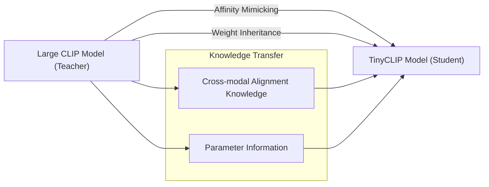
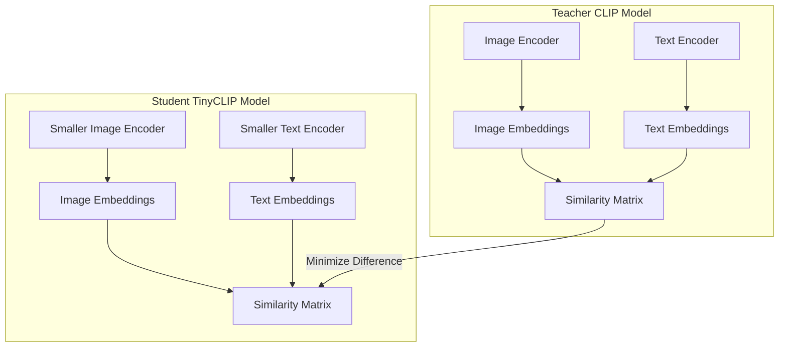
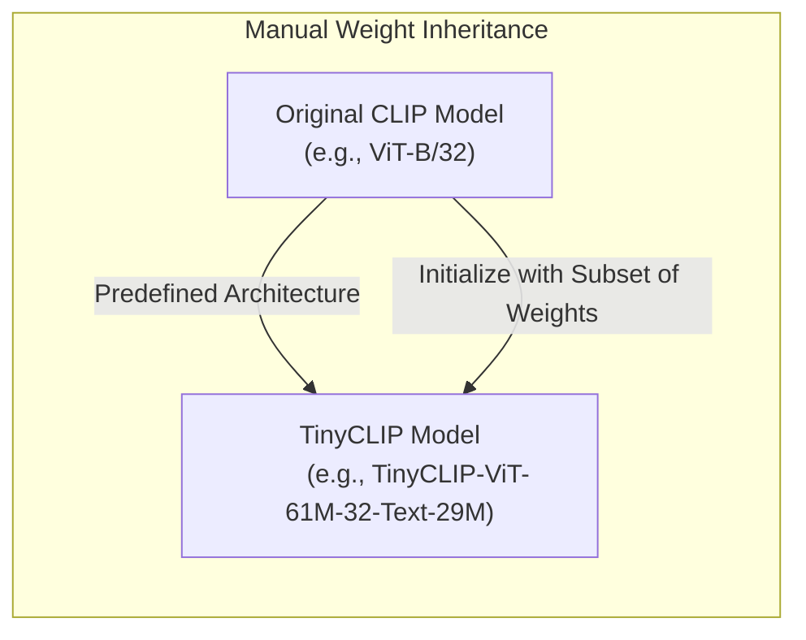
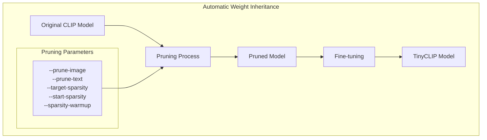
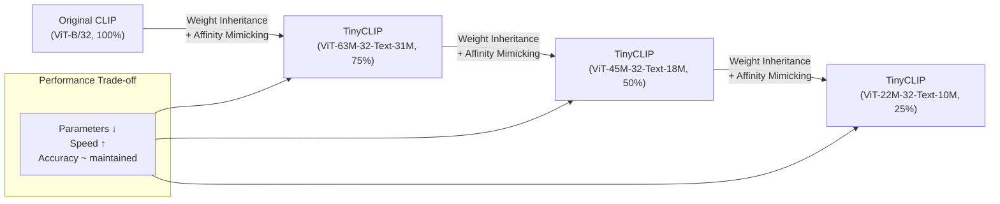

<!-- source: DeepWiki mcp.deepwiki.com · repo microsoft/Cream · extra page Affinity Mimicking & Weight Inheritance · fetched 2026-10-26 -->

# Affinity Mimicking & Weight Inheritance

<details>
<summary>Relevant source files</summary>

The following files were used as context for generating this wiki page:

- [TinyCLIP/README.md](TinyCLIP/README.md)
- [TinyCLIP/script/auto_weight_inherit_50to25.sh](TinyCLIP/script/auto_weight_inherit_50to25.sh)
- [TinyCLIP/script/auto_weight_inherit_75to50.sh](TinyCLIP/script/auto_weight_inherit_75to50.sh)
- [TinyCLIP/script/manual_weight_inherit_100to75.sh](TinyCLIP/script/manual_weight_inherit_100to75.sh)
- [TinyCLIP/script/manual_weight_inherit_75to50.sh](TinyCLIP/script/manual_weight_inherit_75to50.sh)

</details>


This document explains the two core techniques behind TinyCLIP: affinity mimicking and weight inheritance. These techniques enable efficient CLIP model compression while preserving cross-modal alignment capabilities. For information about the overall TinyCLIP architecture, see [TinyCLIP Architecture](#2.2.1), and for information about the training system, see [TinyCLIP Training System](#2.2.2).

## Overview

Affinity Mimicking and Weight Inheritance are complementary techniques designed to efficiently transfer knowledge from a large CLIP model to a much smaller student model:



Sources: [TinyCLIP/README.md:5-5]()

## Affinity Mimicking

Affinity mimicking is a distillation technique specifically designed for cross-modal models like CLIP. Unlike traditional knowledge distillation that focuses only on logit matching, affinity mimicking targets the preservation of alignment between image and text embeddings.

### How Affinity Mimicking Works

Affinity mimicking focuses on transferring the similarity relationships (affinities) between image and text features from the teacher model to the student model.



During distillation, the student model is trained to mimic the affinity patterns of the teacher model by:

1. Computing similarity matrices between image and text embeddings in both teacher and student models
2. Adding a distillation loss term that minimizes the difference between these similarity matrices
3. Preserving the cross-modal alignment capabilities while using fewer parameters

Sources: [TinyCLIP/README.md:3-5]()

## Weight Inheritance

Weight inheritance is a parameter transfer technique that initializes the smaller student model with weights derived from the larger teacher model. TinyCLIP implements two approaches to weight inheritance:

### Manual Weight Inheritance

Manual weight inheritance involves creating predefined architectures with carefully designed student models and a manual weight mapping strategy.



The manual approach involves:

1. Defining a smaller architecture with fewer layers/dimensions
2. Initializing the student with a subset of the teacher's weights
3. Fine-tuning the inherited weights with affinity mimicking

This approach allows for creation of models with specific parameter budgets like the TinyCLIP-ViT-61M-32-Text-29M (75% of original) or TinyCLIP-ViT-40M-32-Text-19M (50% of original).

Sources: [TinyCLIP/script/manual_weight_inherit_100to75.sh:15-24](), [TinyCLIP/script/manual_weight_inherit_75to50.sh:15-24]()

### Automatic Weight Inheritance

Automatic weight inheritance uses pruning techniques to systematically identify and remove less important weights from the teacher model.



Key aspects of automatic weight inheritance:

1. Progressive pruning from larger to smaller models (e.g., 100% → 75% → 50% → 25%)
2. Separate pruning for image and text encoders
3. Gradual sparsity increase from start-sparsity to target-sparsity
4. Fine-tuning after pruning to recover performance

Sources: [TinyCLIP/script/auto_weight_inherit_75to50.sh:29-36](), [TinyCLIP/script/auto_weight_inherit_50to25.sh:29-37]()

## Progressive Compression Pipeline

TinyCLIP employs a progressive compression pipeline that creates a series of increasingly smaller models:



This progressive approach allows for:

1. Better knowledge transfer between models with similar capacities
2. Creation of a family of models with different efficiency-accuracy trade-offs
3. Maximizing performance at each compression level

Sources: [TinyCLIP/README.md:26-38]()

## Implementation Details

### Manual Weight Inheritance Implementation

The manual weight inheritance is implemented through configuration files that define the student architecture and the initialization process:

1. Define the student architecture in a configuration file (e.g., `TinyCLIP-ViT-40M-32-Text-19M.json`)
2. Use the pretrained larger model weights as initialization
3. Train with the distillation teacher

Example script:
```
torchrun $DISTRIBUTED_ARGS src/training/main.py \
 --model TinyCLIP-ViT-40M-32-Text-19M \
 --pretrained-image-file checkpoints/TinyCLIP-ViT-61M-32-Text-29M-LAION400M.pt \
 --pretrained-text-file checkpoints/TinyCLIP-ViT-61M-32-Text-29M-LAION400M.pt \
 --distillation-teacher ViT-B-32@laion2b_e16
```

Sources: [TinyCLIP/script/manual_weight_inherit_75to50.sh:5-28]()

### Automatic Weight Inheritance Implementation

Automatic weight inheritance uses pruning parameters to gradually reduce model size:

1. Start with a larger model checkpoint
2. Apply pruning with controlled sparsity increase
3. Fine-tune the pruned model

Example script:
```
torchrun $DISTRIBUTED_ARGS src/training/main.py \
 --model ViT-B-32 \
 --prune-image \
 --prune-text \
 --total-loss-flag \
 --target-sparsity 0.5 \
 --start-sparsity 0.25 \
 --sparsity-warmup 1000 \
 --resume ./checkpoints/TinyCLIP-auto-ViT-63M-32-Text-31M-LAION400M.pt \
 --load-last-stage
```

Sources: [TinyCLIP/script/auto_weight_inherit_75to50.sh:5-37]()

## Performance Results

The combination of affinity mimicking and weight inheritance produces remarkably efficient models:

| Model | Parameters | ImageNet Accuracy | Throughput | Size Reduction |
|-------|------------|-------------------|------------|----------------|
| Original ViT-B/32 | ~88M | 63.2% | - | 0% |
| TinyCLIP ViT-45M/32 | 45M | 61.4% | 3,682 pairs/s | ~50% |
| TinyCLIP ViT-22M/32 | 22M | 53.7% | 5,504 pairs/s | ~75% |

Key observations:
- TinyCLIP ViT-45M/32 uses only half the parameters of ViT-B/32 with minimal accuracy loss
- TinyCLIP models provide significant throughput improvements
- Progressive compression maintains performance better than direct extreme compression

Sources: [TinyCLIP/README.md:26-38]()

## Usage Guidelines

### When to Use Manual vs. Automatic Weight Inheritance

- **Manual Weight Inheritance**: When you need:
  - Precise control over model architecture
  - Specific parameter budget targets
  - Higher stability during training

- **Automatic Weight Inheritance**: When you need:
  - Data-driven decisions about which weights to keep
  - More flexible compression ratios
  - Potentially better performance at higher compression rates

### Implementation Steps

To apply these techniques to a new model:

1. **For Manual Weight Inheritance**:
   - Define your target architecture (layers, dimensions)
   - Create a configuration file for the smaller model
   - Initialize with weights from a larger model
   - Train with affinity mimicking loss

2. **For Automatic Weight Inheritance**:
   - Start with a pre-trained model
   - Apply progressive pruning with appropriate sparsity settings
   - Fine-tune each pruned model with affinity mimicking

Sources: [TinyCLIP/script/manual_weight_inherit_100to75.sh:1-28](), [TinyCLIP/script/auto_weight_inherit_75to50.sh:1-37]()

## Conclusion

Affinity mimicking and weight inheritance are powerful, complementary techniques that enable efficient CLIP model compression without significant performance degradation. Together, they:

1. Preserve cross-modal alignment capabilities
2. Reduce parameter counts by up to 75%
3. Significantly improve inference throughput
4. Create a family of models with different efficiency-accuracy trade-offs

These techniques can be applied progressively to create extremely efficient models for resource-constrained environments.

Sources: [TinyCLIP/README.md:3-5](), [TinyCLIP/README.md:26-38]()

---

