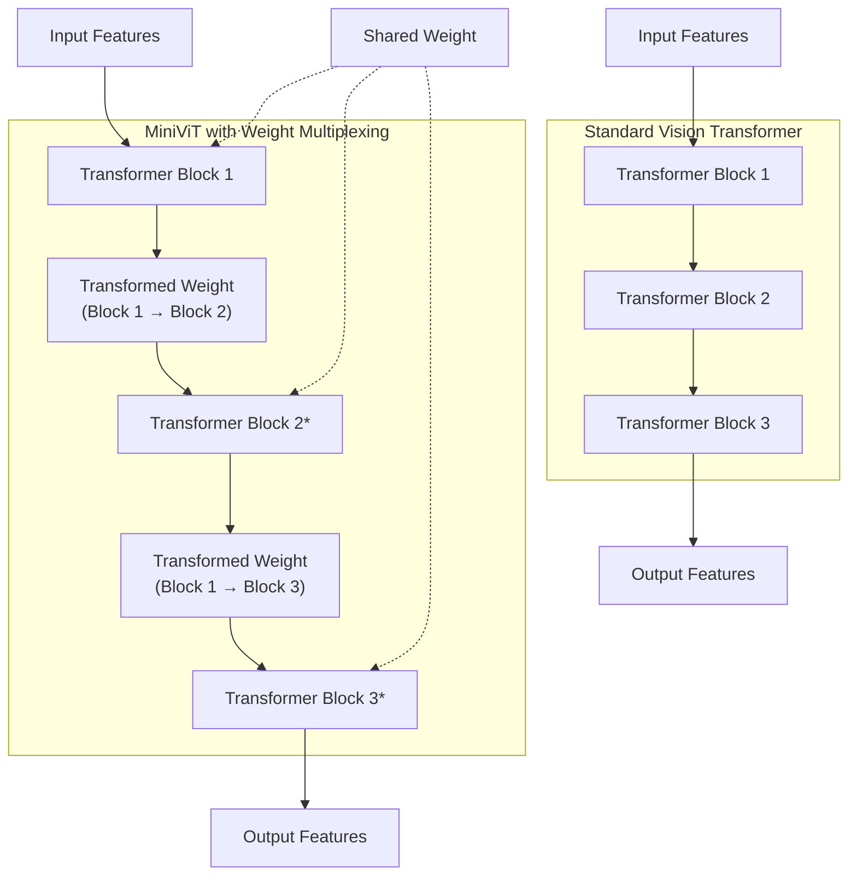
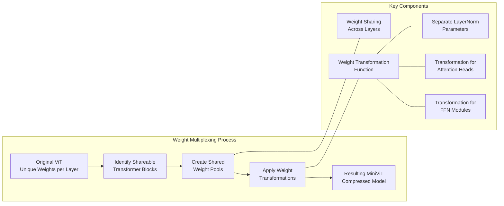

<!-- source: DeepWiki mcp.deepwiki.com · repo microsoft/Cream · extra page Weight Multiplexing · fetched 2026-10-26 -->

# Weight Multiplexing

<details>
<summary>Relevant source files</summary>

The following files were used as context for generating this wiki page:

- [AutoFormer/README.md](AutoFormer/README.md)
- [MiniViT/Mini-DeiT/README.md](MiniViT/Mini-DeiT/README.md)
- [MiniViT/Mini-Swin/README.md](MiniViT/Mini-Swin/README.md)
- [MiniViT/README.md](MiniViT/README.md)

</details>


Weight Multiplexing is a model compression technique that enables significant parameter reduction in Vision Transformers while maintaining or even improving performance. This page documents the core principles, implementation, and usage of Weight Multiplexing in the MiniViT framework. For information about other compression techniques like Knowledge Distillation, see [Fast Distillation Framework](#2.1.3).

## Overview of Weight Multiplexing

Weight Multiplexing is the central innovation behind MiniViT models that allows for substantial parameter reduction in Vision Transformers. It achieves compression by sharing weights across consecutive transformer blocks while applying transformations to preserve model capacity and expressiveness.

The key insight of Weight Multiplexing is that transformer blocks in vision models often learn redundant features. By intelligently sharing weights with appropriate transformations, models can maintain performance with significantly fewer parameters.



Sources: MiniViT/README.md

## Core Principles

Weight Multiplexing works by sharing transformer block weights while applying a transformation function to ensure the weights maintain their expressive power across different layers. This approach reduces the number of parameters while preserving the functional capacity of the network.



Sources: MiniViT/README.md, MiniViT/Mini-DeiT/README.md, MiniViT/Mini-Swin/README.md

## Implementation in MiniViT

MiniViT implements Weight Multiplexing in two main variants: Mini-DeiT (for DeiT transformers) and Mini-Swin (for Swin Transformers). In both cases, the core principle remains the same - weight sharing with transformations - but the specific implementation details differ to accommodate the architectural differences.

### Shared Parameters and Transformations

The Weight Multiplexing technique primarily focuses on sharing the following components across transformer blocks:

1. Self-attention query, key, and value projection matrices
2. Feed-forward network (FFN) weights
3. Output projection matrices

To maintain model expressivity, three key transformations are applied:

1. **Separate LayerNorm parameters** (`is_sep_layernorm` flag)
2. **Transformation for attention heads** (`is_transform_heads` flag)
3. **Transformation for feed-forward networks** (`is_transform_ffn` flag)

The command-line arguments for training make these transformations explicit:

```
--is_sep_layernorm --is_transform_heads --is_transform_ffn
```

Sources: MiniViT/Mini-Swin/README.md

### Architectural Components

```mermaid
flowchart TD
    A["Input"] --> B["Patch Embedding"]
    
    subgraph "Standard Transformer Blocks (Full Parameters)"
        C1["Block 1\n(Unique Parameters)"]
        C2["Block 2\n(Unique Parameters)"]
        C3["Block 3\n(Unique Parameters)"]
        C4["Block N\n(Unique Parameters)"]
    end
    
    subgraph "MiniViT with Weight Multiplexing"
        D1["Physical Block 1\n(Stored Parameters)"]
        D2["Virtual Block 2\n(Transformed from Block 1)"]
        D3["Virtual Block 3\n(Transformed from Block 1)"]
        D4["Physical Block 4\n(Stored Parameters)"]
        D5["Virtual Block 5\n(Transformed from Block 4)"]
        D6["Virtual Block 6\n(Transformed from Block 4)"]
        
        D1 -- "Transform" --> D2
        D2 -- "Transform" --> D3
        D4 -- "Transform" --> D5
        D5 -- "Transform" --> D6
    end
    
    B --> C1
    C1 --> C2
    C2 --> C3
    C3 --> "..."
    "..." --> C4
    
    B --> D1
    D1 --> D2
    D2 --> D3
    D3 --> "..."
    "..." --> D4
    D4 --> D5
    D5 --> D6
    
    C4 --> E["Classification Head"]
    D6 --> E
```

Sources: MiniViT/README.md

## Weight Sharing Configuration

The weight sharing configuration is specified in model configuration files. For example, in Mini-Swin, the number of shared blocks is specified through parameters like `sharenum6` for Tiny models and `sharenum2` for Small and Base models.

### Mini-DeiT Models

Mini-DeiT implements Weight Multiplexing across the DeiT architecture and comes in several variants:

| Model | Parameters | Input Size | Top-1 Accuracy | Compression Ratio |
|-------|------------|------------|----------------|-------------------|
| Mini-DeiT-Ti | 3M | 224×224 | 73.0% | ~71% from DeiT-Ti |
| Mini-DeiT-S | 11M | 224×224 | 80.9% | ~83% from DeiT-S |
| Mini-DeiT-B | 44M | 224×224 | 83.2% | ~49% from DeiT-B |
| Mini-DeiT-B | 44M | 384×384 | 84.9% | ~49% from DeiT-B |

Sources: MiniViT/Mini-DeiT/README.md

### Mini-Swin Models

Mini-Swin applies Weight Multiplexing to the Swin Transformer architecture:

| Model | Parameters | Input Size | Top-1 Accuracy | Compression Ratio |
|-------|------------|------------|----------------|-------------------|
| Mini-Swin-T | 12M | 224×224 | 81.3% | ~57% from Swin-T |
| Mini-Swin-S | 26M | 224×224 | 83.9% | ~53% from Swin-S |
| Mini-Swin-B | 46M | 224×224 | 84.5% | ~48% from Swin-B |
| Mini-Swin-B | 47M | 384×384 | 85.5% | ~48% from Swin-B |

Sources: MiniViT/Mini-Swin/README.md

## Weight Multiplexing with Distillation

Weight Multiplexing is often combined with knowledge distillation to further enhance performance. The distillation process transfers knowledge from a teacher model to the weight-multiplexed compact model.

```mermaid
flowchart LR
    subgraph "Teacher Model (Full-sized)"
        T1["Teacher\nTransformer Block 1"]
        T2["Teacher\nTransformer Block 2"]
        T3["Teacher\nTransformer Block 3"]
        TN["Teacher\nTransformer Block N"]
        
        T1 --> T2 --> T3 --> "..." --> TN
    end
    
    subgraph "Student Model (Weight Multiplexed)"
        S1["Shared Block 1\n(Physical)"]
        S2["Virtual Block 2\n(Transformed)"]
        S3["Virtual Block 3\n(Transformed)"]
        S4["Shared Block 4\n(Physical)"]
        S5["Virtual Block 5\n(Transformed)"]
        
        S1 --> S2 --> S3 --> "..." --> S4 --> S5
    end
    
    T1 -. "Attention Loss" .-> S1
    T2 -. "Attention Loss" .-> S2
    T3 -. "Attention Loss" .-> S3
    TN -. "Attention Loss" .-> S5
    
    T1 -. "Hidden Loss" .-> S1
    T3 -. "Hidden Loss" .-> S3
    TN -. "Hidden Loss" .-> S5
    
    subgraph "Distillation Components"
        D1["Attention\nDistillation"]
        D2["Hidden Feature\nDistillation"]
        D3["Layer Mapping\nStrategy"]
    end
    
    D1 -.-> T1
    D2 -.-> T3
    D3 -.-> TN
```

In Mini-Swin training, for example, distillation is configured with the following parameters:

```
--do_distill --alpha 0.0 --teacher <teacher-path> --attn_loss --hidden_loss --hidden_relation --student_layer_list 11_9_7_5_3_1 --teacher_layer_list 23_21_15_9_3_1 --hidden_weight 0.1
```

This specifies:
- Attention distillation loss (`--attn_loss`)
- Hidden feature distillation loss (`--hidden_loss`)
- Relational knowledge distillation (`--hidden_relation`)
- Layer-wise mapping between student and teacher (`--student_layer_list` and `--teacher_layer_list`)

Sources: MiniViT/Mini-Swin/README.md

## Training with Weight Multiplexing

Training a model with Weight Multiplexing requires careful initialization and optimization to ensure the shared weights work effectively across different layers. The process typically follows these steps:

1. Configure the sharing strategy (which layers share weights)
2. Set up the transformation functions for the shared weights
3. Initialize the model with appropriate weight sharing
4. Train with distillation from a teacher model (optional but recommended)

Training commands for Mini-DeiT and Mini-Swin models are available in their respective README files. For example, to train Mini-Swin-Tiny:

```bash
python -m torch.distributed.launch --nproc_per_node 8 main.py \
  --cfg configs/swin_tiny_patch4_window7_224_minivit_sharenum6.yaml \
  --data-path <data-path> \
  --is_sep_layernorm \
  --is_transform_heads \
  --is_transform_ffn \
  --do_distill \
  --teacher <teacher-path> \
  --attn_loss \
  --hidden_loss \
  --hidden_relation \
  --student_layer_list 11_9_7_5_3_1 \
  --teacher_layer_list 23_21_15_9_3_1
```

Sources: MiniViT/Mini-Swin/README.md

## Comparison with Other Approaches

Weight Multiplexing differs from traditional model compression methods in several ways:

| Method | Approach | Limitations | Weight Multiplexing Advantage |
|--------|----------|-------------|-------------------------------|
| Pruning | Removes unimportant weights | Can harm model capacity | Preserves capacity with transformation |
| Quantization | Reduces numerical precision | Limited compression ratio | Achieves higher compression ratios |
| Knowledge Distillation | Trains compact model to mimic larger model | Teacher-student gap | Can be combined with distillation |
| Parameter Sharing | Simple weight reuse | Reduces model expressivity | Adds transformations to maintain diversity |

Sources: MiniViT/README.md, AutoFormer/README.md

## Results and Performance

Weight Multiplexing achieves impressive compression results while maintaining or even improving accuracy:

1. Reduces Swin-B size by 48% while achieving 1.0% better Top-1 accuracy
2. Compresses DeiT-B (86M) to 9M (9.7x compression) with reasonable accuracy trade-off
3. Provides models at various efficiency points, from tiny (3M) to medium-sized (47M)

The technique demonstrates that with proper weight sharing and transformation, Vision Transformers can operate with significantly fewer parameters.

Sources: MiniViT/README.md

## Conclusion

Weight Multiplexing presents an effective approach to compressing Vision Transformers by sharing weights across transformer blocks while applying transformations to maintain model expressivity. It achieves substantial parameter reduction while preserving or even improving performance, making it valuable for deploying efficient Vision Transformer models.

For model-specific implementations and usage details, see [MiniViT Architecture](#2.3.1).

---

