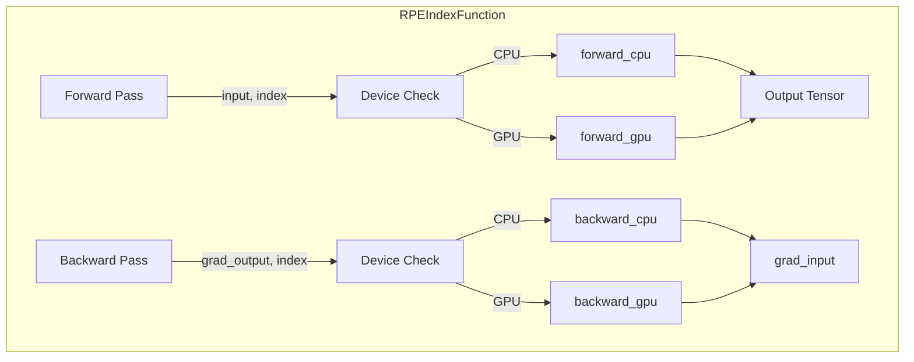
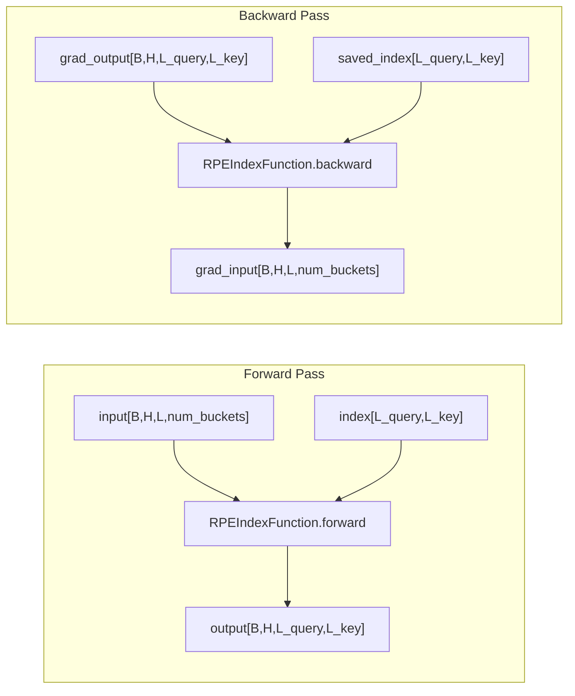

<!-- source: DeepWiki mcp.deepwiki.com · repo microsoft/Cream · extra page CUDA-optimized RPE Operations · fetched 2026-10-26 -->

# CUDA-optimized RPE Operations

<details>
<summary>Relevant source files</summary>

The following files were used as context for generating this wiki page:

- [iRPE/DETR-with-iRPE/rpe_ops/README.md](iRPE/DETR-with-iRPE/rpe_ops/README.md)
- [iRPE/DETR-with-iRPE/rpe_ops/rpe_index.py](iRPE/DETR-with-iRPE/rpe_ops/rpe_index.py)
- [iRPE/DeiT-with-iRPE/rpe_ops/README.md](iRPE/DeiT-with-iRPE/rpe_ops/README.md)
- [iRPE/DeiT-with-iRPE/rpe_ops/rpe_index.py](iRPE/DeiT-with-iRPE/rpe_ops/rpe_index.py)

</details>


## Purpose and Scope

This document details the CUDA-optimized implementation of Relative Position Encoding (RPE) operations used in the improved Relative Position Encoding (iRPE) system. The focus is on the efficient indexing operations that enable fast forward and backward computations during training of vision transformers with relative position encoding. For more information about iRPE in general, see [iRPE](#4.1).

## Overview

Relative Position Encoding (RPE) is a crucial component in modern vision transformers that captures spatial relationships between tokens. While RPE can be implemented using PyTorch's native functions, the backward pass of PyTorch's indexing operations is computationally expensive, causing training slowdowns. The CUDA-optimized RPE operations address this performance bottleneck by implementing custom CUDA kernels for both forward and backward passes.

Sources: [iRPE/DeiT-with-iRPE/rpe_ops/README.md:1-4](), [iRPE/DETR-with-iRPE/rpe_ops/README.md:1-4]()

## Core Operation: RPE Indexing

The fundamental operation in RPE is an indexing function that retrieves relative position encodings based on token positions. Mathematically, this is expressed as:

```
Y[b, h, i, j] = input[b, h, i, index[i, j]]
```

Where:
- `b` is the batch dimension
- `h` is the attention head dimension
- `i` is the query position
- `j` is the key position
- `index[i, j]` contains the relative position bucket index

This operation maps from a tensor of RPE parameters (with shape `[B, H, L_query, num_buckets]`) to a tensor of pairwise position encodings (with shape `[B, H, L_query, L_key]`).

Sources: [iRPE/DeiT-with-iRPE/rpe_ops/rpe_index.py:11-31](), [iRPE/DETR-with-iRPE/rpe_ops/rpe_index.py:11-31]()

## PyTorch Native Implementation

The equivalent implementation using native PyTorch functions is:

```python
def rpe_index(input, index):
    L_query, L_key = index.shape
    num_buckets = input.size(-1)
    B = len(input)
    offset = torch.arange(0, L_query * num_buckets, num_buckets).view(-1, 1)
    return input.flatten(2)[:, :, (index + offset).flatten()].view(B, -1, L_query, L_key)
```

While functional, this implementation suffers from significant performance issues during the backward pass, which motivated the development of the CUDA-optimized version.

Sources: [iRPE/DeiT-with-iRPE/rpe_ops/README.md:10-35](), [iRPE/DETR-with-iRPE/rpe_ops/README.md:10-35]()

## CUDA Implementation Architecture



The CUDA implementation is structured as a custom PyTorch autograd Function named `RPEIndexFunction` with specialized forward and backward methods. The implementation automatically detects whether to use CPU or GPU operations based on the input tensor's device.

Sources: [iRPE/DeiT-with-iRPE/rpe_ops/rpe_index.py:11-56](), [iRPE/DETR-with-iRPE/rpe_ops/rpe_index.py:11-56]()

## Data Flow in RPE Operations



In the forward pass, the operation takes a tensor of RPE parameters and an index tensor, producing a tensor of applied position encodings. In the backward pass, gradients are efficiently propagated back to the input parameters.

Sources: [iRPE/DeiT-with-iRPE/rpe_ops/rpe_index.py:13-56](), [iRPE/DETR-with-iRPE/rpe_ops/rpe_index.py:13-56]()

## Implementation Details

### Forward Pass
The forward function:
1. Extracts the number of buckets from the input tensor
2. Saves the index tensor and input shape for the backward pass
3. Dispatches to either the CPU or GPU implementation based on the input device
4. Returns the indexed output tensor

### Backward Pass
The backward function:
1. Retrieves the saved index tensor
2. Creates a zero-initialized gradient tensor with the same shape as the input
3. Dispatches to either the CPU or GPU implementation for gradient computation
4. Returns the gradient for the input (grad_input) and None for the index (as it doesn't require gradients)

Sources: [iRPE/DeiT-with-iRPE/rpe_ops/rpe_index.py:14-56](), [iRPE/DETR-with-iRPE/rpe_ops/rpe_index.py:14-56]()

## Building and Using the CUDA Operators

To build the CUDA-optimized RPE operators, you need to have `nvcc` (NVIDIA CUDA Compiler) installed. The build process is straightforward:

```bash
cd rpe_ops/
python setup.py install --user
```

After installation, the operators can be used by importing the module:

```python
import rpe_index_cpp
from rpe_index import RPEIndexFunction

# Usage example
output = RPEIndexFunction.apply(input_tensor, index_tensor)
```

The implementation includes a version check to ensure compatibility between the Python wrapper and the compiled C++/CUDA code.

Sources: [iRPE/DeiT-with-iRPE/rpe_ops/README.md:3-8](), [iRPE/DETR-with-iRPE/rpe_ops/README.md:3-8](), [iRPE/DeiT-with-iRPE/rpe_ops/rpe_index.py:4-8]()

## Performance Benefits

The CUDA-optimized implementation provides significant performance improvements, particularly for the backward pass during training. While the PyTorch native implementation and CUDA implementation produce mathematically equivalent results, the CUDA version is substantially faster.

The implementation includes test code that validates both the correctness (comparing outputs and gradients with the native PyTorch implementation) and performance.

Sources: [iRPE/DeiT-with-iRPE/rpe_ops/rpe_index.py:59-100](), [iRPE/DETR-with-iRPE/rpe_ops/rpe_index.py:59-100]()

## Tensor Shapes and Types

| Tensor | Shape | Type | Description |
|--------|-------|------|-------------|
| input | (B, H, L_query, num_buckets) | float32 | RPE parameters for each query position |
| index | (L_query, L_key) | int32 | Bucket indices for relative positions |
| output | (B, H, L_query, L_key) | float32 | Applied position encodings |
| grad_output | (B, H, L_query, L_key) | float32 | Gradient w.r.t. output tensor |
| grad_input | (B, H, L_query, num_buckets) | float32 | Gradient w.r.t. input tensor |

Where:
- B: batch size
- H: number of attention heads
- L_query: length of query sequence
- L_key: length of key sequence
- num_buckets: number of relative position buckets

Sources: [iRPE/DeiT-with-iRPE/rpe_ops/rpe_index.py:14-48](), [iRPE/DETR-with-iRPE/rpe_ops/rpe_index.py:14-48]()

## Integration with Vision Transformers

The CUDA-optimized RPE operations are designed to be seamlessly integrated into vision transformer architectures that use relative position encoding. They are particularly important in the forward and backward passes of the attention mechanism where relative position encoding is applied.

By optimizing these operations, the overall training speed of vision transformers with RPE is significantly improved without changing the mathematical behavior of the model.

Sources: [iRPE/DeiT-with-iRPE/rpe_ops/README.md:1-4](), [iRPE/DETR-with-iRPE/rpe_ops/README.md:1-4]()

---

