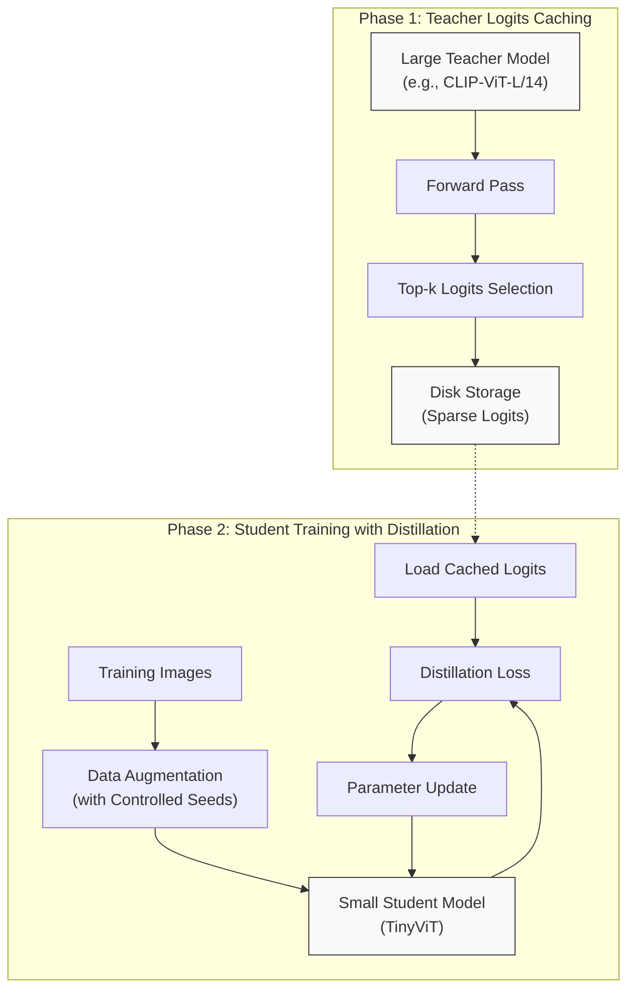
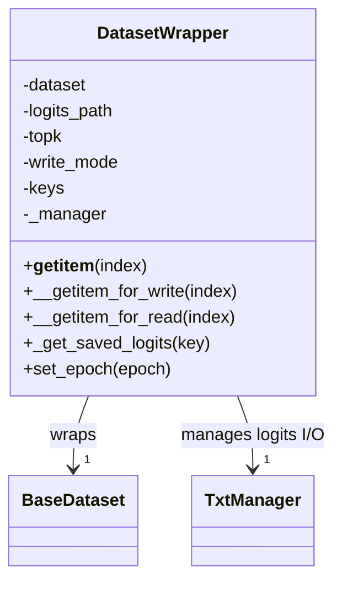
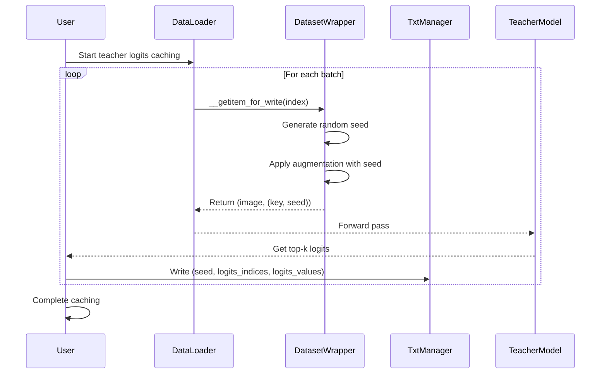
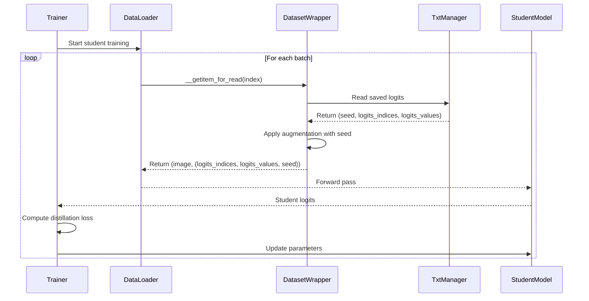
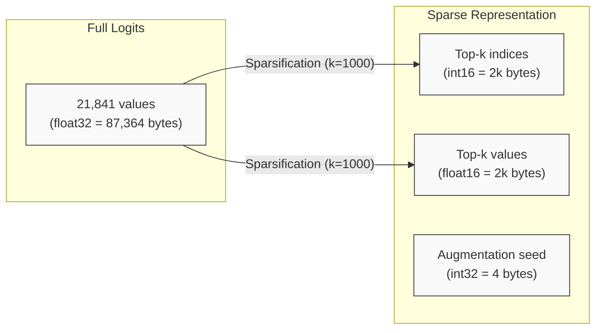

<!-- source: DeepWiki mcp.deepwiki.com · repo microsoft/Cream · extra page Fast Distillation Framework · fetched 2026-10-26 -->

# Fast Distillation Framework

<details>
<summary>Relevant source files</summary>

The following files were used as context for generating this wiki page:

- [TinyViT/LICENSE](TinyViT/LICENSE)
- [TinyViT/README.md](TinyViT/README.md)
- [TinyViT/configs/teacher/clip_vit_large_patch14_22k.yaml](TinyViT/configs/teacher/clip_vit_large_patch14_22k.yaml)
- [TinyViT/data/augmentation/dataset_wrapper.py](TinyViT/data/augmentation/dataset_wrapper.py)
- [TinyViT/data/augmentation/mixup.py](TinyViT/data/augmentation/mixup.py)
- [TinyViT/data/build.py](TinyViT/data/build.py)
- [TinyViT/data/imagenet22k_dataset.py](TinyViT/data/imagenet22k_dataset.py)
- [TinyViT/docs/TRAINING.md](TinyViT/docs/TRAINING.md)
- [TinyViT/models/tiny_vit.py](TinyViT/models/tiny_vit.py)
- [TinyViT/requirements.txt](TinyViT/requirements.txt)
- [TinyViT/tests/test_models.py](TinyViT/tests/test_models.py)

</details>


## Overview and Purpose

The Fast Distillation Framework is a key innovation within the TinyViT project that enables efficient knowledge transfer from large teacher models to small student models. The framework addresses a critical challenge in knowledge distillation: the computational and memory overhead of running large teacher models during student training. 

Instead of computing teacher model outputs on-the-fly during student training, the Fast Distillation Framework pre-computes and stores teacher logits in advance, significantly reducing resource requirements and accelerating the training process.

For details about the TinyViT architecture itself, see [TinyViT Architecture](#2.1.1). For information about the complete training pipeline, see [TinyViT Training Pipeline](#2.1.2).

## Key Concepts

The Fast Distillation Framework introduces several key concepts that differentiate it from traditional knowledge distillation approaches:

| Feature | Traditional Distillation | Fast Distillation Framework |
|---------|--------------------------|----------------------------|
| Teacher model during training | Loaded in memory and forward-passed for each batch | Not required during student training |
| Memory requirements | High (both teacher and student models) | Low (only student model) |
| Computational overhead | High (forward pass for both models) | Low (only student model forward pass) |
| Storage requirements | Low | Moderate (requires disk space for teacher logits) |
| Training speed | Slower | Faster (1.5-2x speedup) |

Sources: [TinyViT/README.md:5-9](), [TinyViT/README.md:24-25]()

## Framework Architecture



The architecture consists of two distinct phases:

1. **Teacher Logits Caching**: The large teacher model processes the dataset once, and the output logits are sparsified and cached to disk.
2. **Student Training with Distillation**: The student model is trained using these pre-computed logits, without needing the teacher model in memory.

Sources: [TinyViT/README.md:25-26](), [TinyViT/data/build.py:73-78]()

## Implementation Details

### Dataset Wrapper

The Fast Distillation Framework is implemented primarily through the `DatasetWrapper` class, which extends the standard PyTorch dataset to support saving and loading of teacher logits.



The `DatasetWrapper` has two operational modes:
- **Write mode**: Used during the teacher logits caching phase
- **Read mode**: Used during student training to load the cached logits

Sources: [TinyViT/data/build.py:73-78](), [TinyViT/data/augmentation/dataset_wrapper.py:16-90]()

### Logits Caching Process

When saving teacher logits, the framework follows a specific process to ensure consistency between saved logits and future augmented versions of the same images:

1. For each image, a random seed is generated to control data augmentation
2. The image is augmented using this seed
3. The teacher model processes the augmented image
4. The top-k logits (both indices and values) are saved along with the seed
5. During student training, the same seed ensures identical augmentation



Sources: [TinyViT/docs/SAVE_TEACHER_LOGITS.md](), [TinyViT/data/augmentation/dataset_wrapper.py:31-38]()

### Student Training with Cached Logits

During student training, the process is streamlined:

1. For each image, the corresponding key is retrieved
2. The cached logits and original augmentation seed are loaded
3. The image is augmented using the same seed for consistency
4. The student model processes the augmented image
5. Distillation loss is computed between student outputs and cached teacher logits



Sources: [TinyViT/data/augmentation/dataset_wrapper.py:40-45](), [TinyViT/docs/TRAINING.md:7-19]()

## Storage Efficiency with Sparse Logits

A key optimization in the Fast Distillation Framework is the use of sparse logits. Rather than storing all class probabilities (e.g., 21,841 values for ImageNet-22k), the framework only stores the top-k logits (typically k=100 or k=1000).



For ImageNet-1k (300 epochs) and ImageNet-22k (90 epochs), this approach requires approximately 16GB and 481GB of storage space, respectively, which is a reasonable trade-off for the computational benefits.

Sources: [TinyViT/README.md:25](), [TinyViT/data/augmentation/dataset_wrapper.py:63-65]()

## Consistent Data Augmentation

One technical challenge is ensuring that images are augmented consistently during both teacher logits caching and student training. The framework addresses this through controlled random seeds:

1. During teacher logits caching, random seeds control all augmentation operations
2. These seeds are saved alongside the logits
3. During student training, the same seeds ensure identical augmentations

This is implemented using the `AugRandomContext` class that manages the random number generator state.

Sources: [TinyViT/data/augmentation/dataset_wrapper.py:36](), [TinyViT/data/augmentation/dataset_wrapper.py:43]()

## Special Handling for Mixup/CutMix

The framework includes special handling for Mixup and CutMix augmentations, which combine multiple images:

1. Pairs of images are grouped together
2. A consistent seed is generated from the XOR of their individual seeds
3. This ensures that the same mixing operations are applied during both phases

The `Mixup_record` class implements this functionality with a special `pair2` mode designed for distillation.

Sources: [TinyViT/data/build.py:99-110](), [TinyViT/data/augmentation/mixup.py:213-249]()

## Performance Benefits

The Fast Distillation Framework provides substantial practical benefits:

- **Memory efficiency**: No need to load the large teacher model during student training
- **Computational efficiency**: No forward passes through the teacher model during training
- **Training speed**: 1.5-2x faster training compared to traditional distillation
- **Reusability**: Cached logits can be reused for training different student architectures

TinyViT models trained with this framework achieve state-of-the-art performance for their parameter count. For example, TinyViT-21M reaches 84.8% top-1 accuracy on ImageNet-1k with only 21 million parameters.

Sources: [TinyViT/README.md:8](), [TinyViT/README.md:21-23]()

## Integration with Training Pipeline

The Fast Distillation Framework is integrated into the TinyViT training pipeline through configuration parameters:

```
python -m torch.distributed.launch --master_addr=$MASTER_ADDR --nproc_per_node 8 --nnodes=4 --node_rank=$NODE_RANK main.py --cfg configs/22k_distill/tiny_vit_21m_22k_distill.yaml --data-path ./ImageNet-22k --batch-size 128 --output ./output --opts DISTILL.TEACHER_LOGITS_PATH ./teacher_logits/
```

Key configuration parameters include:
- `DISTILL.ENABLED`: Enables the distillation framework
- `DISTILL.TEACHER_LOGITS_PATH`: Path to stored teacher logits
- `DISTILL.LOGITS_TOPK`: Number of top logits to use
- `DISTILL.SAVE_TEACHER_LOGITS`: Enable teacher logits caching mode

Sources: [TinyViT/docs/TRAINING.md:15-17](), [TinyViT/data/build.py:73-78]()

## Usage Workflow

The complete workflow for using the Fast Distillation Framework consists of two steps:

1. **Save teacher logits**:
   - Configure the framework in write mode
   - Process the entire dataset with the teacher model
   - Save sparsified logits to disk

2. **Train student models**:
   - Configure the framework in read mode
   - Point to the saved logits directory
   - Train the student model with distillation loss

This two-step process provides a flexible and efficient way to transfer knowledge from large models to small ones.

Sources: [TinyViT/docs/SAVE_TEACHER_LOGITS.md](), [TinyViT/docs/TRAINING.md:7-19]()

---

