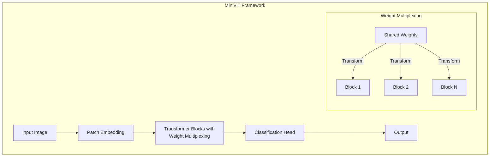
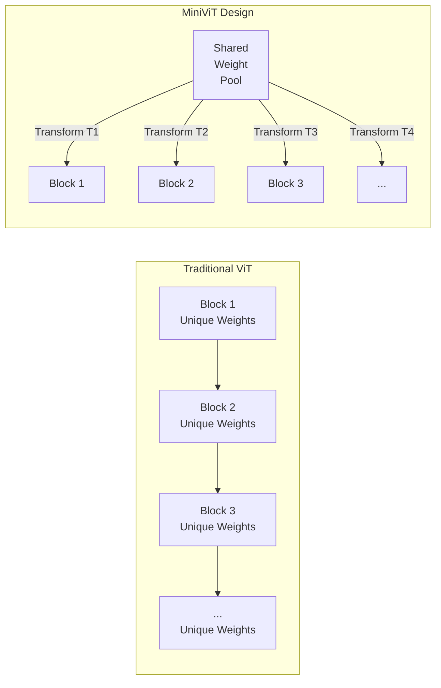
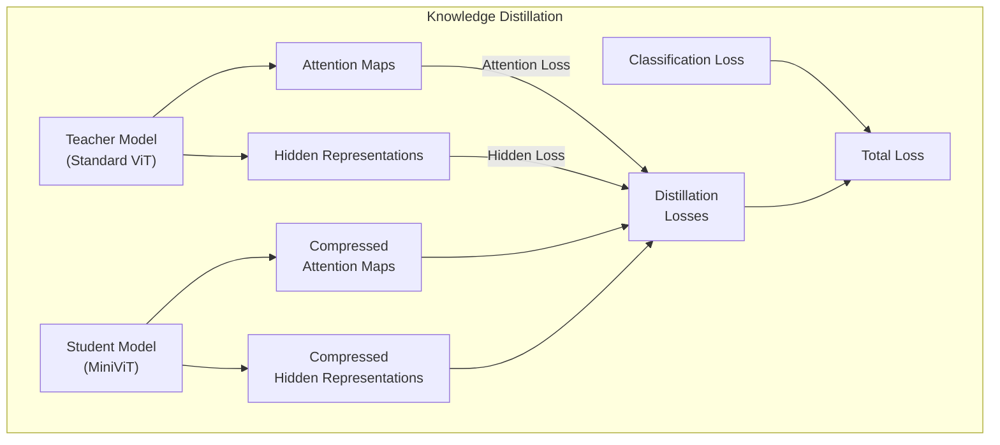
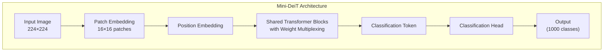
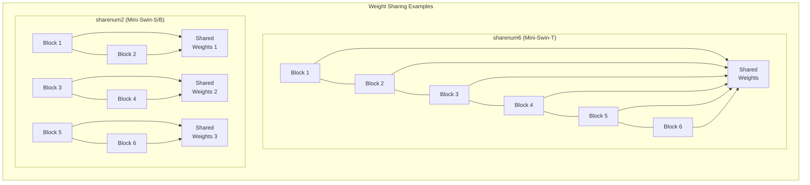

<!-- source: DeepWiki mcp.deepwiki.com · repo microsoft/Cream · extra page MiniViT Architecture · fetched 2026-10-26 -->

# MiniViT Architecture

Relevant source files

The following files were used as context for generating this wiki page:

- [AutoFormer/README.md](AutoFormer/README.md)
- [MiniViT/Mini-DeiT/README.md](MiniViT/Mini-DeiT/README.md)
- [MiniViT/Mini-Swin/README.md](MiniViT/Mini-Swin/README.md)
- [MiniViT/README.md](MiniViT/README.md)

## Purpose and Scope

This document describes the architecture of MiniViT, a compression framework designed to reduce the size of Vision Transformer (ViT) models while maintaining performance. MiniViT introduces the concept of weight multiplexing, which allows significant parameter reduction by sharing weights across transformer blocks. This page focuses on the architectural design of MiniViT, the weight multiplexing mechanism, and its implementations. For information about the weight multiplexing technique itself, see [Weight Multiplexing](#2.3.2).

Sources: [MiniViT/README.md:8-9]()

## Overview of MiniViT

MiniViT is a model compression approach that enables parameter reduction in vision transformers while preserving accuracy. The central innovation of MiniViT is the weight multiplexing technique, where weights are shared across consecutive transformer layers with transformations applied to maintain expressivity and diversity. This architecture is complemented by a specialized distillation process focused on self-attention to transfer knowledge from larger teacher models.

Sources: [MiniViT/README.md:9-13]()

MiniViT's architecture leverages the redundancy observed in vision transformer weights, allowing significant reductions in model size without the corresponding drop in performance typically associated with such compression. The framework has been successfully implemented for two popular vision transformer architectures: DeiT (Data-efficient Image Transformers) and Swin Transformers, resulting in Mini-DeiT and Mini-Swin variants.

Sources: [MiniViT/README.md:15-24]()

## Weight Multiplexing Architecture

The core architectural innovation in MiniViT is its weight multiplexing design. Instead of each transformer block having its own set of parameters, MiniViT uses a shared set of weights across multiple consecutive blocks. To maintain model expressivity despite this sharing, MiniViT applies transformations to the shared weights.

Sources: [MiniViT/README.md:9-13]()

### Weight Transformation Mechanism

The transformation mechanism is a critical component that allows MiniViT to maintain diversity across layers despite weight sharing. These transformations are applied to:

1. **Self-attention heads**: Using different transformations for attention mechanisms
2. **Feed-forward networks (FFN)**: Applying transformations to the feed-forward components
3. **Layer normalization**: Separate layer normalization parameters for each block

The transformations are lightweight functions that modify the shared weights to produce block-specific behavior, providing the model with sufficient expressivity while significantly reducing the parameter count.

Sources: [MiniViT/Mini-Swin/README.md:54-55](), [MiniViT/Mini-Swin/README.md:59-60](), [MiniViT/Mini-Swin/README.md:65-66]()

## Knowledge Distillation in MiniViT

MiniViT incorporates specialized knowledge distillation to ensure that the compressed models maintain performance. The distillation process primarily focuses on the self-attention mechanism, which is a key component of transformer architectures.

The distillation components include:
- **Attention map distillation**: Transfers knowledge about attention patterns
- **Hidden representation distillation**: Ensures intermediate representations maintain semantic richness
- **Hidden relation distillation**: Preserves the relationships between different layers

Sources: [MiniViT/Mini-Swin/README.md:54-55]()

## MiniViT Implementations

MiniViT has been implemented for two popular vision transformer architectures, resulting in two variants:

### Mini-DeiT Architecture

Mini-DeiT applies the weight multiplexing technique to the Data-efficient Image Transformer (DeiT) architecture. It maintains the patch-based input processing and standard transformer blocks of DeiT but with shared weights across layers.

Mini-DeiT comes in three primary variants:

| Model | Parameters | Input Size | Top-1 Accuracy | Parameter Reduction |
|-------|------------|------------|----------------|---------------------|
| Mini-DeiT-Ti | 3M | 224×224 | 73.0% | ~66% |
| Mini-DeiT-S | 11M | 224×224 | 80.9% | ~59% |
| Mini-DeiT-B | 44M | 224×224 | 83.2% | ~49% |
| Mini-DeiT-B | 44M | 384×384 | 84.9% | ~49% |

Sources: [MiniViT/Mini-DeiT/README.md:6-11]()

### Mini-Swin Architecture

Mini-Swin applies weight multiplexing to the Swin Transformer architecture, which features a hierarchical design with shifted windows for self-attention computation. In Mini-Swin, the weights are shared within each stage of the hierarchy.

```mermaid
flowchart TD
    subgraph "Mini-Swin Architecture"
        A["Input Image\n224×224"] --> B["Patch Embedding\n4×4 patches"]
        B --> C["Stage 1:\nShared Swin Blocks"]
        C --> D["Patch Merging"]
        D --> E["Stage 2:\nShared Swin Blocks"]
        E --> F["Patch Merging"]
        F --> G["Stage 3:\nShared Swin Blocks"]
        G --> H["Patch Merging"]
        H --> I["Stage 4:\nShared Swin Blocks"]
        I --> J["Global Average Pooling"]
        J --> K["Classification Head"]
        K --> L["Output\n(1000 classes)"]
    end
```

Mini-Swin variants include:

| Model | Parameters | Input Size | Top-1 Accuracy | Parameter Reduction |
|-------|------------|------------|----------------|---------------------|
| Mini-Swin-T | 12M | 224×224 | 81.3% | ~57% |
| Mini-Swin-S | 26M | 224×224 | 83.9% | ~53% |
| Mini-Swin-B | 46M | 224×224 | 84.5% | ~48% |
| Mini-Swin-B | 47M | 384×384 | 85.5% | ~48% |

Sources: [MiniViT/Mini-Swin/README.md:6-11]()

## Weight Sharing Configuration

The degree of weight sharing in MiniViT can be configured based on the desired trade-off between model size and performance. This is controlled by the `sharenum` parameter which determines how many consecutive blocks share weights.

For Mini-Swin, different configurations are used:
- Mini-Swin-T uses `sharenum6`, indicating substantial weight sharing
- Mini-Swin-S and Mini-Swin-B use `sharenum2`, with more moderate sharing

Sources: [MiniViT/Mini-Swin/README.md:54](), [MiniViT/Mini-Swin/README.md:59](), [MiniViT/Mini-Swin/README.md:65]()

## Distillation Structure

The distillation mechanism in MiniViT uses a specialized layer mapping strategy to transfer knowledge from teacher to student models. The configuration parameters `student_layer_list` and `teacher_layer_list` define which layers in the student model (MiniViT) should learn from which layers in the teacher model.

For example, in Mini-Swin-Tiny:
- Student layers 11, 9, 7, 5, 3, 1 learn from
- Teacher layers 23, 21, 15, 9, 3, 1 respectively

This selective distillation strategy focuses on transferring knowledge to critical layers in the compressed model.

Sources: [MiniViT/Mini-Swin/README.md:54]()

## Performance Characteristics

MiniViT achieves significant parameter reduction while maintaining or even improving performance compared to the original models:

1. **Mini-DeiT-B (44M)** achieves 83.2% top-1 accuracy, compared to the original DeiT-B (86M) with similar accuracy, representing a ~49% parameter reduction.

2. **Mini-Swin-B (46M)** achieves 84.5% top-1 accuracy, outperforming the original Swin-B (88M) by approximately 1.0% while using 48% fewer parameters.

3. When fine-tuned at higher resolution (384×384), **Mini-Swin-B** reaches 85.5% top-1 accuracy, demonstrating the scalability of the architecture.

The effectiveness of MiniViT demonstrates that vision transformers contain significant parameter redundancy that can be addressed through weight multiplexing without sacrificing model performance.

Sources: [MiniViT/README.md:17-24](), [MiniViT/Mini-DeiT/README.md:6-11](), [MiniViT/Mini-Swin/README.md:6-11]()

---

