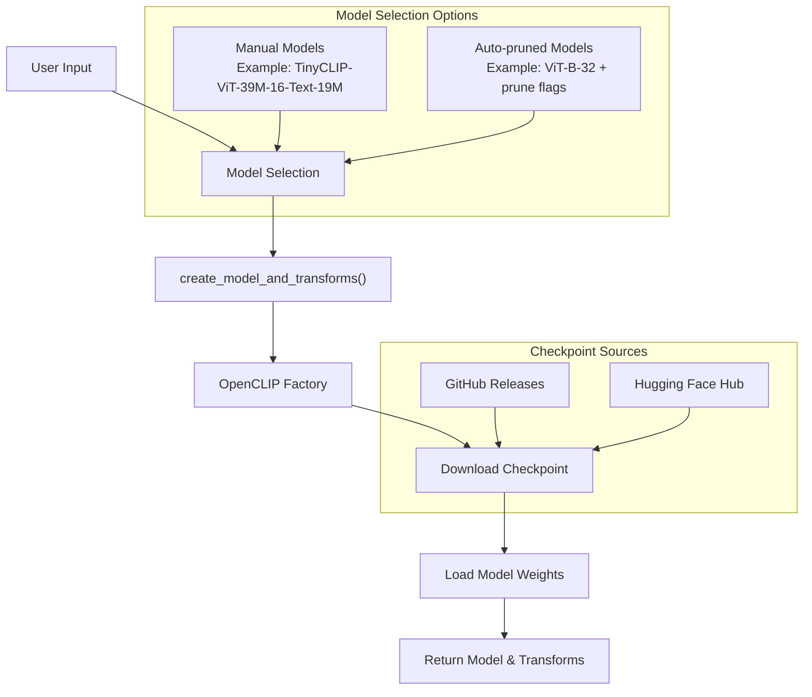
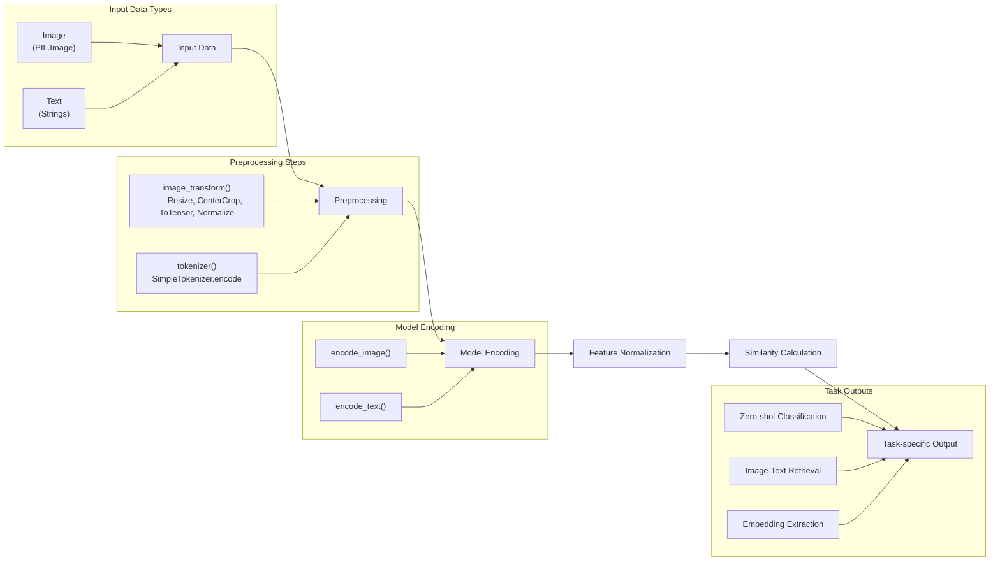

<!-- source: DeepWiki mcp.deepwiki.com · repo microsoft/Cream · extra page Model Loading & Inference · fetched 2026-10-26 -->

# Model Loading & Inference

<details>
<summary>Relevant source files</summary>

The following files were used as context for generating this wiki page:

- [TinyCLIP/docs/EVALUATION.md](TinyCLIP/docs/EVALUATION.md)
- [TinyCLIP/inference.py](TinyCLIP/inference.py)
- [TinyCLIP/src/open_clip/__init__.py](TinyCLIP/src/open_clip/__init__.py)
- [TinyCLIP/src/open_clip/model_configs/TinyCLIP-ResNet-19M-Text-19M.json](TinyCLIP/src/open_clip/model_configs/TinyCLIP-ResNet-19M-Text-19M.json)
- [TinyCLIP/src/open_clip/model_configs/TinyCLIP-ResNet-30M-Text-29M.json](TinyCLIP/src/open_clip/model_configs/TinyCLIP-ResNet-30M-Text-29M.json)
- [TinyCLIP/src/open_clip/model_configs/TinyCLIP-ViT-39M-16-Text-19M.json](TinyCLIP/src/open_clip/model_configs/TinyCLIP-ViT-39M-16-Text-19M.json)
- [TinyCLIP/src/open_clip/model_configs/TinyCLIP-ViT-40M-32-Text-19M.json](TinyCLIP/src/open_clip/model_configs/TinyCLIP-ViT-40M-32-Text-19M.json)
- [TinyCLIP/src/open_clip/model_configs/TinyCLIP-ViT-61M-32-Text-29M.json](TinyCLIP/src/open_clip/model_configs/TinyCLIP-ViT-61M-32-Text-29M.json)
- [TinyCLIP/src/open_clip/model_configs/TinyCLIP-ViT-8M-16-Text-3M.json](TinyCLIP/src/open_clip/model_configs/TinyCLIP-ViT-8M-16-Text-3M.json)
- [TinyCLIP/src/open_clip/pretrained.py](TinyCLIP/src/open_clip/pretrained.py)

</details>


This document provides a comprehensive guide to loading and performing inference with pre-trained TinyCLIP models. It covers available model variants, loading procedures, and inference techniques. For information about the TinyCLIP architecture, see [TinyCLIP Architecture](#2.2.1), and for training details, see [TinyCLIP Training System](#2.2.2).

## Available Pre-trained Models

TinyCLIP offers multiple model variants with different parameter sizes and architectures, optimized for various compute requirements.

### Model Variants

TinyCLIP provides several pre-trained models that vary in size, architecture type, and training dataset:

| Model Name | Vision Model | Text Model | Training Dataset | Size | Description |
|------------|--------------|------------|------------------|------|-------------|
| TinyCLIP-ViT-39M-16-Text-19M | ViT (39M params) | Text Encoder (19M params) | YFCC15M | 58M | ViT-based with 16px patches |
| TinyCLIP-ViT-8M-16-Text-3M | ViT (8M params) | Text Encoder (3M params) | YFCC15M | 11M | Extremely lightweight ViT |
| TinyCLIP-ResNet-30M-Text-29M | ResNet (30M params) | Text Encoder (29M params) | LAION400M | 59M | ResNet-based backbone |
| TinyCLIP-ResNet-19M-Text-19M | ResNet (19M params) | Text Encoder (19M params) | LAION400M | 38M | Smaller ResNet variant |
| TinyCLIP-ViT-61M-32-Text-29M | ViT (61M params) | Text Encoder (29M params) | LAION400M | 90M | ViT-based with 32px patches |
| TinyCLIP-ViT-40M-32-Text-19M | ViT (40M params) | Text Encoder (19M params) | LAION400M | 59M | Medium-sized ViT with 32px patches |

Sources: [TinyCLIP/src/open_clip/pretrained.py:149-183](), [TinyCLIP/src/open_clip/model_configs/TinyCLIP-ViT-39M-16-Text-19M.json](), [TinyCLIP/src/open_clip/model_configs/TinyCLIP-ViT-8M-16-Text-3M.json](), [TinyCLIP/src/open_clip/model_configs/TinyCLIP-ResNet-30M-Text-29M.json](), [TinyCLIP/src/open_clip/model_configs/TinyCLIP-ResNet-19M-Text-19M.json](), [TinyCLIP/src/open_clip/model_configs/TinyCLIP-ViT-61M-32-Text-29M.json](), [TinyCLIP/src/open_clip/model_configs/TinyCLIP-ViT-40M-32-Text-19M.json]()

### Model Architecture Configurations

Each TinyCLIP model has a specific configuration defined in JSON format. These configurations specify architecture parameters such as embedding dimensions, layer counts, and model widths.

For example, the TinyCLIP-ViT-39M-16-Text-19M configuration:

```
{
    "embed_dim": 512,
    "vision_cfg": {
        "image_size": 224,
        "layers": 12,
        "width": 512,
        "patch_size": 16
    },
    "text_cfg": {
        "context_length": 77,
        "vocab_size": 49408,
        "width": 512,
        "heads": 8,
        "layers": 6
    }
}
```

Sources: [TinyCLIP/src/open_clip/model_configs/TinyCLIP-ViT-39M-16-Text-19M.json]()

## TinyCLIP Model Loading

TinyCLIP models can be loaded using the OpenCLIP API provided in the repository. There are two main categories of checkpoints: manually designed models and automatically pruned models.

### TinyCLIP Model Loading Flow



Sources: [TinyCLIP/src/open_clip/pretrained.py:211-378](), [TinyCLIP/src/open_clip/__init__.py:1-12]()

### Loading Manually Designed Models

To load a manually designed TinyCLIP model, use the `create_model_and_transforms` function with the appropriate model name and pretrained tag:

```python
import open_clip

# Load TinyCLIP ViT model
model, _, preprocess = open_clip.create_model_and_transforms('TinyCLIP-ViT-39M-16-Text-19M', pretrained='YFCC15M')

# Load TinyCLIP ResNet model
model, _, preprocess = open_clip.create_model_and_transforms('TinyCLIP-ResNet-30M-Text-29M', pretrained='LAION400M')
```

The first parameter specifies the model architecture, and the second parameter indicates which pre-trained weights to load.

Sources: [TinyCLIP/inference.py:5-22]()

### Loading Auto-pruned Models

For automatically pruned models, you need to load the base model and set pruning flags:

```python
import open_clip
import torch

# Load via command line approach
# python main_for_test.py --model ViT-B-32 --prune-image --prune-text --eval --resume path/to/checkpoint.pt
```

Sources: [TinyCLIP/docs/EVALUATION.md:73-134]()

## Inference Pipeline

The TinyCLIP inference pipeline consists of several key steps: image preprocessing, text tokenization, feature encoding, and similarity calculation.

### TinyCLIP Inference Flow



Sources: [TinyCLIP/inference.py:22-38]()

### Image Preprocessing

Images must be preprocessed before being fed into the model:

1. Load the image using PIL
2. Apply transforms (resize, crop, normalize) using the preprocess function
3. Add batch dimension if necessary

```python
from PIL import Image

image = preprocess(Image.open('path/to/image.jpg')).unsqueeze(0)
```

Sources: [TinyCLIP/inference.py:26-27]()

### Text Tokenization

Text inputs must be tokenized:

```python
tokenizer = open_clip.get_tokenizer(model_name)
text = tokenizer(["a diagram", "a dog", "a cat"])
```

The tokenizer handles converting text into token IDs that can be processed by the model.

Sources: [TinyCLIP/inference.py:24-28]()

### Feature Encoding and Similarity Calculation

Once inputs are preprocessed, you can encode them into feature vectors and calculate similarity:

```python
with torch.no_grad(), torch.cuda.amp.autocast():
    # Encode inputs to embedding space
    image_features = model.encode_image(image)
    text_features = model.encode_text(text)
    
    # Normalize features
    image_features /= image_features.norm(dim=-1, keepdim=True)
    text_features /= text_features.norm(dim=-1, keepdim=True)
    
    # Calculate similarity
    similarity = image_features @ text_features.T
    
    # For classification, convert to probabilities
    text_probs = (100.0 * similarity).softmax(dim=-1)
```

The normalized dot product between image and text features represents their cosine similarity, which can be converted to probabilities using softmax for classification tasks.

Sources: [TinyCLIP/inference.py:30-38]()

## Zero-shot Evaluation

TinyCLIP models can be evaluated on datasets like ImageNet-1k for zero-shot classification performance.

### Command-line Evaluation

The repository provides a script for evaluating models on ImageNet:

```bash
python -m torch.distributed.launch --use_env --nproc_per_node 8 src/training/main_for_test.py \
--imagenet-val /path/to/ImageNet \
--model TinyCLIP-ViT-39M-16-Text-19M \
--eval \
--resume /path/to/checkpoints/TinyCLIP-ViT-39M-16-Text-19M-YFCC15M.pt
```

For auto-pruned models, add the pruning flags:

```bash
python -m torch.distributed.launch --use_env --nproc_per_node 8 src/training/main_for_test.py \
--imagenet-val /path/to/ImageNet \
--model ViT-B-32 \
--prune-image \
--prune-text \
--eval \
--resume /path/to/checkpoints/TinyCLIP-auto-ViT-45M-32-Text-18M-LAION400M.pt
```

Sources: [TinyCLIP/docs/EVALUATION.md:7-134]()

## Complete Inference Example

Here's a complete example of performing inference with a TinyCLIP model:

```python
import torch
from PIL import Image
import open_clip

# Load model, transforms, and tokenizer
model_name = 'TinyCLIP-ViT-40M-32-Text-19M'
model, _, preprocess = open_clip.create_model_and_transforms(model_name, pretrained='LAION400M')
tokenizer = open_clip.get_tokenizer(model_name)

# Prepare inputs
image = preprocess(Image.open('image.jpg')).unsqueeze(0)
text = tokenizer(["a diagram", "a dog", "a cat"])

# Perform inference
with torch.no_grad(), torch.cuda.amp.autocast():
    # Encode inputs
    image_features = model.encode_image(image)
    text_features = model.encode_text(text)
    
    # Normalize features
    image_features /= image_features.norm(dim=-1, keepdim=True)
    text_features /= text_features.norm(dim=-1, keepdim=True)
    
    # Calculate similarity and convert to probabilities
    text_probs = (100.0 * image_features @ text_features.T).softmax(dim=-1)

print("Label probabilities:", text_probs)
```

Sources: [TinyCLIP/inference.py:1-38]()

## Summary

This page covered the loading and inference process for TinyCLIP models, including:

1. Available pre-trained model variants
2. Methods for loading both manually designed and auto-pruned models
3. The complete inference pipeline from input preprocessing to similarity calculation
4. Techniques for evaluating models on standard benchmarks

TinyCLIP offers a range of model sizes and architectures to accommodate different computational constraints while maintaining reasonable performance compared to larger CLIP models.

---

