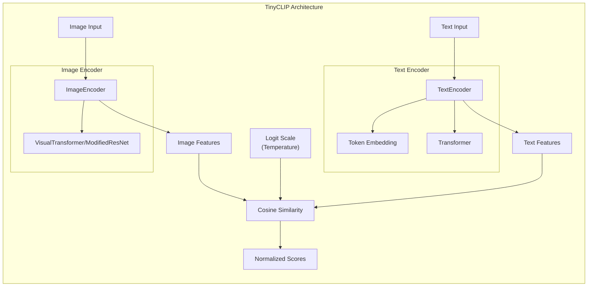
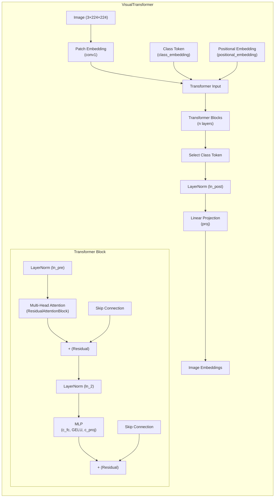
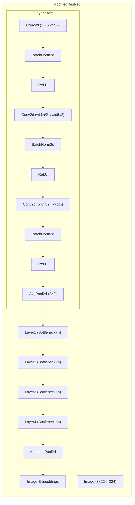
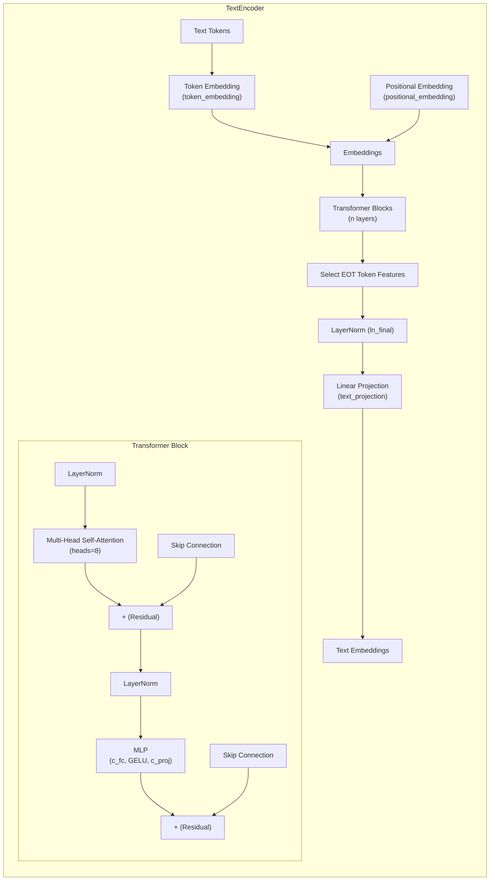
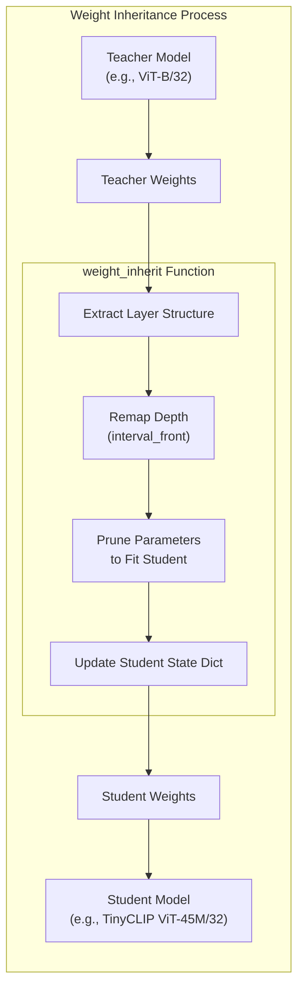
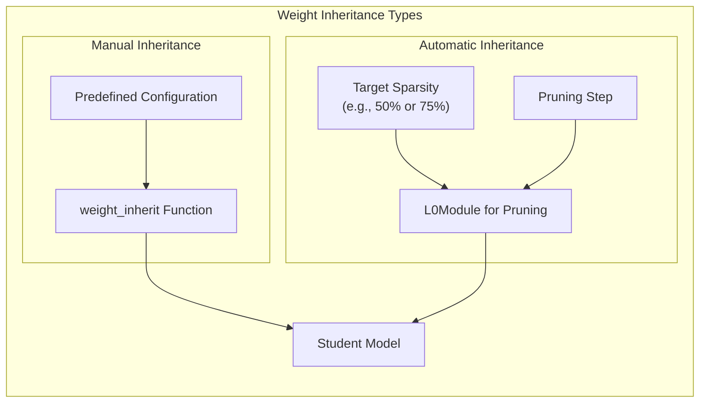
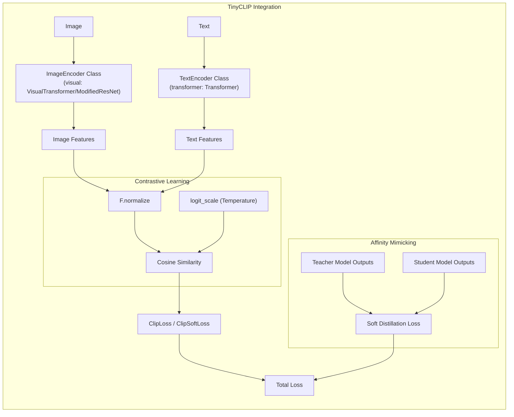
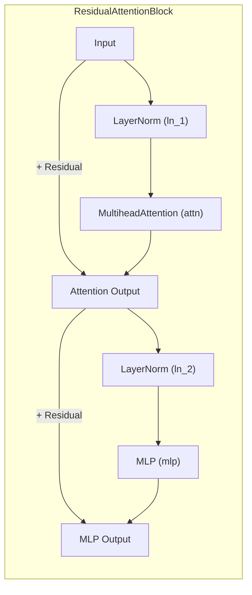
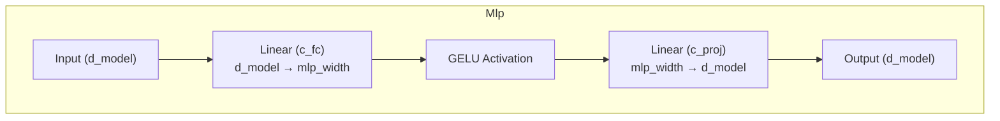
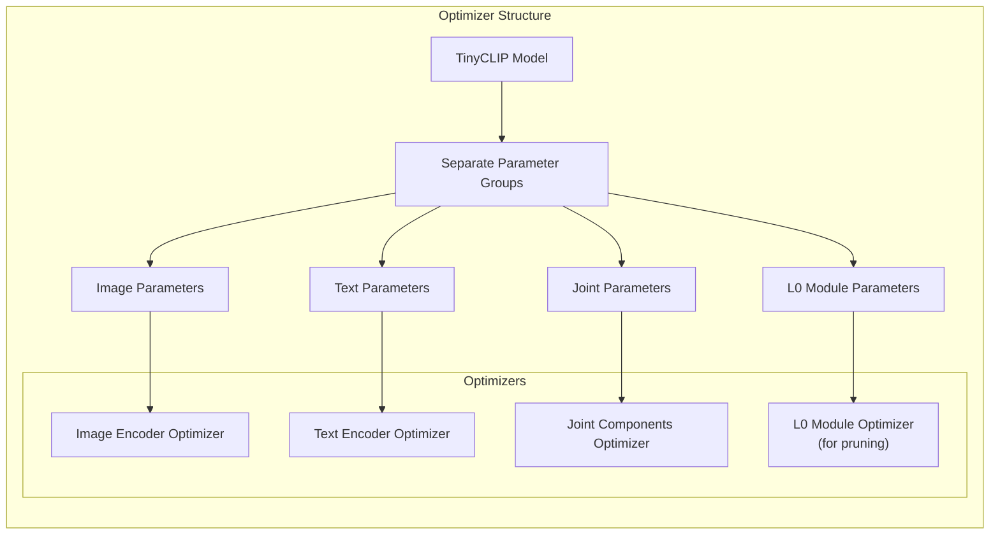

<!-- source: DeepWiki mcp.deepwiki.com · repo microsoft/Cream · extra page TinyCLIP Architecture · fetched 2026-10-26 -->

# TinyCLIP Architecture

Relevant source files

The following files were used as context for generating this wiki page:

- [TinyCLIP/README.md](TinyCLIP/README.md)
- [TinyCLIP/script/auto_weight_inherit_50to25.sh](TinyCLIP/script/auto_weight_inherit_50to25.sh)
- [TinyCLIP/script/auto_weight_inherit_75to50.sh](TinyCLIP/script/auto_weight_inherit_75to50.sh)
- [TinyCLIP/src/open_clip/model.py](TinyCLIP/src/open_clip/model.py)
- [TinyCLIP/src/open_clip/resnet.py](TinyCLIP/src/open_clip/resnet.py)
- [TinyCLIP/src/open_clip/weight_inherit.py](TinyCLIP/src/open_clip/weight_inherit.py)
- [TinyCLIP/src/training/data.py](TinyCLIP/src/training/data.py)
- [TinyCLIP/src/training/main.py](TinyCLIP/src/training/main.py)
- [TinyCLIP/src/training/main_for_test.py](TinyCLIP/src/training/main_for_test.py)
- [TinyCLIP/src/training/optimizer.py](TinyCLIP/src/training/optimizer.py)
- [TinyCLIP/src/training/train.py](TinyCLIP/src/training/train.py)

This document provides a detailed technical explanation of the TinyCLIP architecture, focusing on the model structure, components, and their relationships. TinyCLIP is a distilled version of CLIP (Contrastive Language-Image Pre-training) that achieves comparable performance with significantly reduced model size and increased inference speed through two key techniques: affinity mimicking and weight inheritance. For information about the training process, see [TinyCLIP Training System](#2.2.2). For details on affinity mimicking and weight inheritance techniques, see [Affinity Mimicking & Weight Inheritance](#2.2.3).

## 1. Overview

TinyCLIP follows the dual-encoder architecture of CLIP, consisting of an image encoder and a text encoder that project images and text into a shared embedding space. The architecture is designed for efficiency while maintaining strong cross-modal understanding.

Sources: [TinyCLIP/README.md:1-39](). [TinyCLIP/src/open_clip/model.py:592-680](), [TinyCLIP/src/open_clip/model.py:682-819]()

## 2. Image Encoder Architecture

TinyCLIP supports two types of image encoders: Vision Transformer (ViT) and Modified ResNet. The image encoder transforms input images into fixed-dimensional feature vectors.

### 2.1 Vision Transformer (ViT) Architecture

The ViT architecture in TinyCLIP follows the standard Vision Transformer design with modifications for efficiency:

Sources: [TinyCLIP/src/open_clip/model.py:442-566]()

### 2.2 Modified ResNet Architecture

An alternative to ViT is the Modified ResNet, which is more efficient for smaller model sizes:

Sources: [TinyCLIP/src/open_clip/resnet.py:96-187]()

### 2.3 Image Encoder Variants

TinyCLIP offers several image encoder variants with different parameter counts:

| Model | Type | Parameters | Image Size | Patch Size | Width | Heads |
|-------|------|------------|------------|------------|-------|-------|
| ViT-39M/16 | ViT | 39M | 224 | 16 | 512 | 8 |
| ViT-8M/16 | ViT | 8M | 224 | 16 | 256 | 4 |
| ResNet-30M | ResNet | 30M | 224 | - | 64 | - |
| ResNet-19M | ResNet | 19M | 224 | - | 64 | - |
| ViT-61M/32 | ViT | 61M | 224 | 32 | 768 | 12 |
| ViT-40M/32 | ViT | 40M | 224 | 32 | 512 | 8 |

Sources: [TinyCLIP/README.md:25-38]()

## 3. Text Encoder Architecture

The text encoder in TinyCLIP is a transformer-based model that processes tokenized text:

Sources: [TinyCLIP/src/open_clip/model.py:342-433](), [TinyCLIP/src/open_clip/model.py:682-819]()

### 3.1 Text Encoder Variants

TinyCLIP offers several text encoder variants with different parameter counts:

| Model | Parameters | Context Length | Width | Heads | Layers |
|-------|------------|----------------|-------|-------|--------|
| Text-29M | 29M | 77 | 512 | 8 | 12 |
| Text-19M | 19M | 77 | 384 | 6 | 12 |
| Text-3M | 3M | 77 | 256 | 4 | 6 |

Sources: [TinyCLIP/README.md:25-38]()

## 4. Weight Inheritance Mechanism

Weight inheritance is a key innovation in TinyCLIP that enables the smaller model to leverage knowledge from larger pre-trained models. This process requires careful handling of architectural differences.

Sources: [TinyCLIP/src/open_clip/weight_inherit.py:71-138](), [TinyCLIP/src/training/main.py:422-467]()

### 4.1 Manual vs Automatic Weight Inheritance

TinyCLIP supports both manual and automatic weight inheritance:

- **Manual Inheritance**: Predefined configurations for inheriting weights from a larger model
- **Automatic Inheritance**: Automated process that determines optimal inheritance patterns

Sources: [TinyCLIP/script/auto_weight_inherit_50to25.sh:1-37](), [TinyCLIP/script/auto_weight_inherit_75to50.sh:1-37]()

## 5. Model Integration and Component Interaction

The complete TinyCLIP architecture integrates the image encoder, text encoder, and contrastive learning components through a unified training framework:

Sources: [TinyCLIP/src/training/train.py:160-205](), [TinyCLIP/src/open_clip/model.py:595-675](), [TinyCLIP/src/open_clip/model.py:682-819]()

## 6. Architecture Configuration and Hyperparameters

TinyCLIP models are configured with a set of hyperparameters that define their architecture:

| Parameter | Description | Example Values |
|-----------|-------------|---------------|
| width | Base dimension of the model | 256, 384, 512, 768 |
| layers | Number of transformer layers | 6, 12 |
| heads | Number of attention heads | 4, 6, 8, 12 |
| mlp_ratio | Multiplier for MLP hidden dimension | 4.0 |
| patch_size | Size of image patches (ViT only) | 16, 32 |
| image_size | Input image resolution | 224 |
| context_length | Maximum text sequence length | 77 |
| vocab_size | Size of the text vocabulary | 49408 |

Sources: [TinyCLIP/src/open_clip/model.py:569-594]()

## 7. Model Variants and Performance

TinyCLIP offers various model configurations that balance efficiency and performance:

| Model | Image Encoder | Text Encoder | ImageNet-1K | MACs(G) | Throughput (pairs/s) |
|-------|---------------|--------------|-------------|---------|---------------------|
| TinyCLIP ViT-39M/16 Text-19M | ViT-39M/16 | Text-19M | 63.5% | 9.5 | 1,469 |
| TinyCLIP ViT-8M/16 Text-3M | ViT-8M/16 | Text-3M | 41.1% | 2.0 | 4,150 |
| TinyCLIP ResNet-30M Text-29M | ResNet-30M | Text-29M | 59.1% | 6.9 | 1,811 |
| TinyCLIP ResNet-19M Text-19M | ResNet-19M | Text-19M | 56.4% | 4.4 | 3,024 |
| TinyCLIP ViT-61M/32 Text-29M | ViT-61M/32 | Text-29M | 62.4% | 5.3 | 3,191 |
| TinyCLIP ViT-40M/32 Text-19M | ViT-40M/32 | Text-19M | 59.8% | 3.5 | 4,641 |
| TinyCLIP ViT-63M/32 Text-31M (auto) | ViT-63M/32 | Text-31M | 63.9% | 5.6 | 2,905 |
| TinyCLIP ViT-45M/32 Text-18M (auto) | ViT-45M/32 | Text-18M | 61.4% | 3.7 | 3,682 |

Sources: [TinyCLIP/README.md:25-38]()

## 8. Key Architectural Components

The TinyCLIP architecture builds on several core components, each with specific architectural details:

### 8.1 Transformer Block

The transformer block is the fundamental building block for both vision and text transformers:

Sources: [TinyCLIP/src/open_clip/model.py:208-339]()

### 8.2 MLP Block

The MLP module consists of two linear layers with a non-linearity:

Sources: [TinyCLIP/src/open_clip/model.py:108-137]()

### 8.3 Optimizer Configuration

TinyCLIP uses specialized optimizer configurations for different model components:

Sources: [TinyCLIP/src/training/optimizer.py:22-101]()

---

