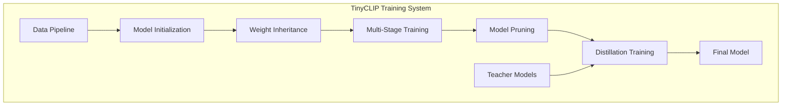
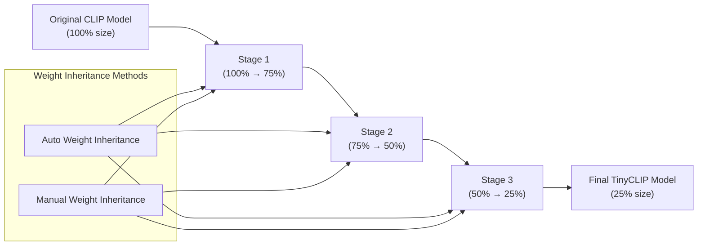
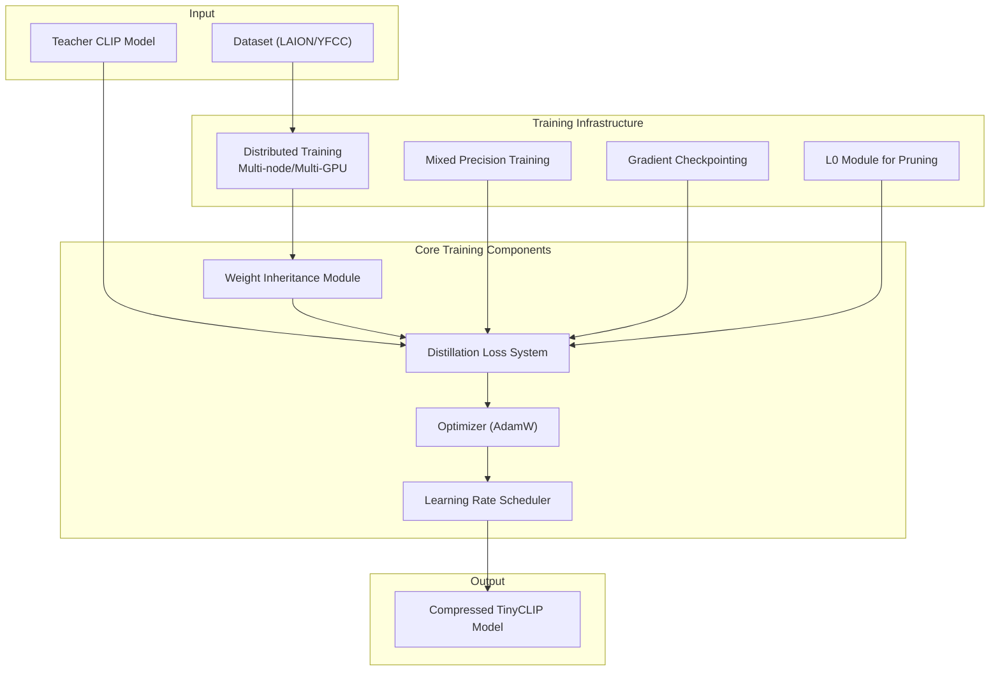
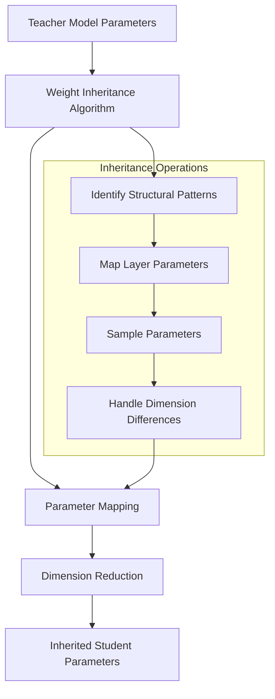
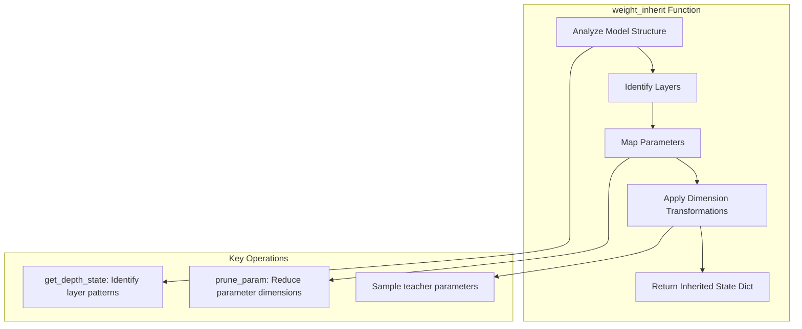
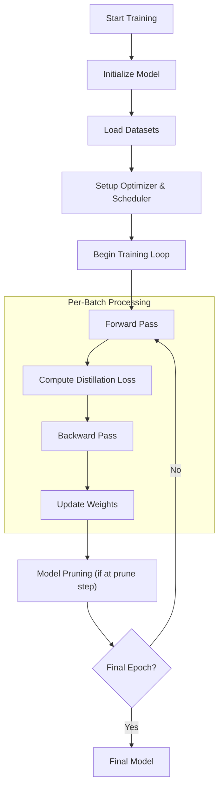
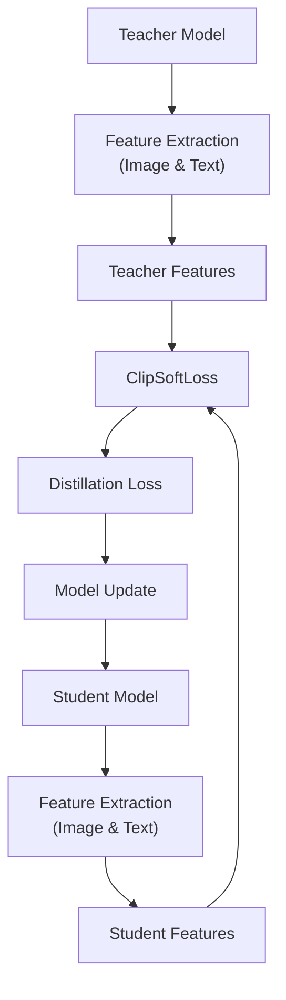
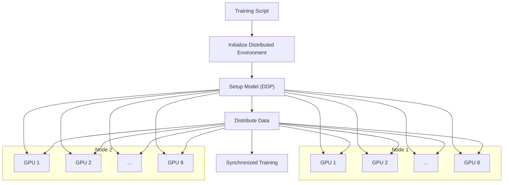
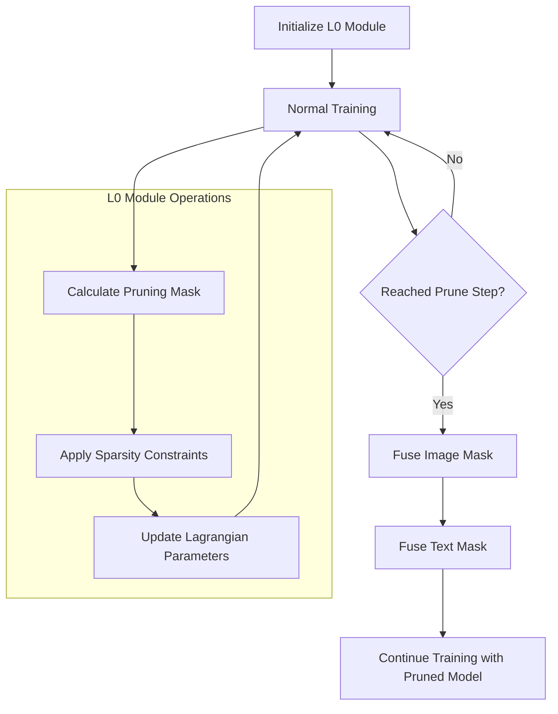
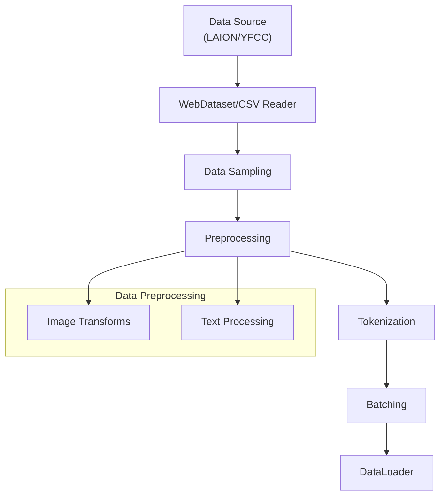

<!-- source: DeepWiki mcp.deepwiki.com · repo microsoft/Cream · extra page TinyCLIP Training System · fetched 2026-10-26 -->

# TinyCLIP Training System

<details>
<summary>Relevant source files</summary>

The following files were used as context for generating this wiki page:

- [TinyCLIP/.gitignore](TinyCLIP/.gitignore)
- [TinyCLIP/docs/PRETRAINING.md](TinyCLIP/docs/PRETRAINING.md)
- [TinyCLIP/script/auto_weight_inherit_100to75.sh](TinyCLIP/script/auto_weight_inherit_100to75.sh)
- [TinyCLIP/src/open_clip/clip_soft_loss.py](TinyCLIP/src/open_clip/clip_soft_loss.py)
- [TinyCLIP/src/open_clip/model.py](TinyCLIP/src/open_clip/model.py)
- [TinyCLIP/src/open_clip/resnet.py](TinyCLIP/src/open_clip/resnet.py)
- [TinyCLIP/src/open_clip/weight_inherit.py](TinyCLIP/src/open_clip/weight_inherit.py)
- [TinyCLIP/src/training/data.py](TinyCLIP/src/training/data.py)
- [TinyCLIP/src/training/logger.py](TinyCLIP/src/training/logger.py)
- [TinyCLIP/src/training/main.py](TinyCLIP/src/training/main.py)
- [TinyCLIP/src/training/main_for_test.py](TinyCLIP/src/training/main_for_test.py)
- [TinyCLIP/src/training/optimizer.py](TinyCLIP/src/training/optimizer.py)
- [TinyCLIP/src/training/params.py](TinyCLIP/src/training/params.py)
- [TinyCLIP/src/training/train.py](TinyCLIP/src/training/train.py)

</details>


This document describes the TinyCLIP training system architecture and workflows. It covers the end-to-end training process for TinyCLIP models, including data preparation, model setup, distillation training, and weight inheritance mechanisms. For specific details about the TinyCLIP architecture, see [TinyCLIP Architecture](#2.2.1), and for information about the affinity mimicking and weight inheritance techniques, see [Affinity Mimicking & Weight Inheritance](#2.2.3).

## Overview

The TinyCLIP training system is designed to efficiently compress CLIP models while maintaining high performance through a multi-stage training process utilizing cross-modality distillation and weight inheritance. The training combines knowledge distillation from teacher models with a unique weight inheritance approach to reduce model size while preserving accuracy.



Sources:
- [TinyCLIP/src/training/main.py:106-564]()
- [TinyCLIP/docs/PRETRAINING.md:1-28]()

## Training Stages

TinyCLIP training follows a progressive compression approach, reducing the model size in multiple stages. Each stage builds upon the previous one, using the already compressed model as the starting point for further compression.



Sources:
- [TinyCLIP/docs/PRETRAINING.md:9-28]()
- [TinyCLIP/script/auto_weight_inherit_100to75.sh:1-35]()

## Training System Architecture

The TinyCLIP training system integrates several key components that work together to enable efficient model compression with knowledge distillation.



Sources:
- [TinyCLIP/src/training/main.py:106-564]()
- [TinyCLIP/src/training/train.py:81-862]()

## Weight Inheritance Mechanism

The weight inheritance mechanism is a core part of TinyCLIP that enables efficient knowledge transfer from larger models to smaller ones. It intelligently maps parameters from a teacher model to a student model with different dimensions.

### Auto Weight Inheritance

Auto weight inheritance automatically handles parameter mapping between models of different sizes, focusing on structural similarities:



Sources:
- [TinyCLIP/src/open_clip/weight_inherit.py:1-204]()
- [TinyCLIP/src/training/main.py:422-467]()

### Weight Inheritance Implementation

The weight inheritance process handles different model components in specialized ways:

1. **Transformer blocks**: Maps attention heads and feed-forward layers while preserving architectural patterns
2. **Visual encoder**: Maps convolutional layers and positional embeddings
3. **Text encoder**: Maps token embeddings and transformer blocks



Sources:
- [TinyCLIP/src/open_clip/weight_inherit.py:70-138]()
- [TinyCLIP/src/training/main.py:408-467]()

## Training Process

### Model Initialization

The training process begins with model initialization, where the TinyCLIP model components are created and optionally initialized with pretrained weights.

```python
# Model creation and initialization
model, preprocess_train, preprocess_val = create_model_and_transforms(
    args.model,
    args.pretrained,
    precision=args.precision,
    device=device,
    jit=args.torchscript,
    force_quick_gelu=args.force_quick_gelu,
    pretrained_image=args.pretrained_image,
    image_mean=args.image_mean,
    image_std=args.image_std,
    args=args,
)
```

If weight inheritance is used, the model will load pretrained image and text encoder weights:

```python
if args.pretrained_image_file:
    # Load and inherit image encoder weights
    state_dict = remove_prefix_module(model.state_dict())
    image_checkpoint = remove_prefix_module(_load_checkpoint(args.pretrained_image_file))
    num_inherit = encoder_weight_inherit(
        state_dict, image_checkpoint, '_image_encoder.visual', head_dim=model.visual.head_dim)
    model_load_checkpoint(model, state_dict)

if args.pretrained_text_file:
    # Load and inherit text encoder weights
    state_dict = remove_prefix_module(model.state_dict())
    text_checkpoint = remove_prefix_module(_load_checkpoint(args.pretrained_text_file))
    num_inherit = encoder_weight_inherit(
        state_dict, text_checkpoint, '_text_encoder', head_dim=model.transformer.head_dim)
    model_load_checkpoint(model, state_dict)
```

Sources:
- [TinyCLIP/src/training/main.py:196-467]()

### Training Workflow

The TinyCLIP training workflow involves the following key steps:

1. **Model and data preparation**: Initialize model components and prepare datasets
2. **Optimizer setup**: Create optimizers for different model components
3. **Training loop**: Run training epochs with distillation from teacher model
4. **Pruning**: Apply model pruning at specific steps to reduce model size
5. **Evaluation**: Periodically evaluate model performance



Sources:
- [TinyCLIP/src/training/main.py:530-542]()
- [TinyCLIP/src/training/train.py:84-543]()

### Distillation Process

TinyCLIP uses cross-modality distillation where a student model learns from a teacher model through knowledge distillation:



The key loss function component is the `ClipSoftLoss` which computes the soft distillation loss between student and teacher models:

```python
if args.distillation_alpha > 0.0 and args.distillation_weight > 0.0:
    soft_loss_weight = args.distillation_alpha * args.distillation_weight
    img2text_loss, text2img_loss = soft_loss_fn(
        image_features, text_features, logit_scale,
        teacher_image_features, teacher_text_features, teacher_logit_scale,
        labels=labels,
        average_two_losses=False,
    )
    
    img2text_loss *= 0.5 * soft_loss_weight
    text2img_loss *= 0.5 * soft_loss_weight
    soft_loss = img2text_loss + text2img_loss
    
    losses['soft_loss'] = soft_loss
```

Sources:
- [TinyCLIP/src/training/train.py:173-196]()
- [TinyCLIP/src/open_clip/clip_soft_loss.py:1-89]()

## Distributed Training Setup

TinyCLIP supports efficient distributed training across multiple nodes and GPUs, which is essential for training with large datasets like LAION-400M.



Key distributed training features:
- Multi-node training with 8 GPUs per node
- Distributed Data Parallel (DDP) implementation
- Synchronized batch normalization
- Gradient synchronization across nodes

Sources:
- [TinyCLIP/src/training/main.py:141-191]()
- [TinyCLIP/src/training/main.py:469-477]()

## Optimization and Mixed Precision

TinyCLIP employs several optimization techniques to improve training efficiency:

### Mixed Precision Training

The system supports different precision modes for different parts of the model:

```python
autocast = get_autocast(args.precision)
image_autocast = get_autocast(args.image_precision)
text_autocast = get_autocast(args.text_precision)
logit_autocast = get_autocast(args.logit_precision)

model.set_autocast(
    image_autocast=image_autocast,
    text_autocast=text_autocast,
    logit_autocast=logit_autocast)
```

### Optimizer Configuration

TinyCLIP uses separate optimizers for different components of the model:

| Component | Optimizer | Parameters |
|-----------|-----------|------------|
| Image Encoder | AdamW | Image encoder parameters |
| Text Encoder | AdamW | Text encoder parameters |
| Joint Components | AdamW | Shared parameters |
| L0 Module (if pruning) | AdamW | Pruning parameters |

Each optimizer has specific learning rates and weight decay settings:

```python
# Example optimizer setup for model components
optimizer = []
part_names = ['image', 'text', 'joint']
for name, named_parameters in zip(part_names, model_parts):
    gain_or_bias_params = [p for n, p in named_parameters if exclude(n, p) and p.requires_grad]
    rest_params = [p for n, p in named_parameters if include(n, p) and p.requires_grad]
    params_groups = [
        {"params": gain_or_bias_params, "weight_decay": 0.},
        {"params": rest_params, "weight_decay": args.wd},
    ]
    optimizer_i = optim.AdamW(
        params_groups,
        lr=args.lr,
        betas=(args.beta1, args.beta2),
        eps=args.eps,
    )
    optimizer.append(optimizer_i)
```

Sources:
- [TinyCLIP/src/training/train.py:89-98]()
- [TinyCLIP/src/training/optimizer.py:22-101]()

## Model Pruning

TinyCLIP employs model pruning to further reduce model size during training:



The pruning process uses an L0 regularization approach implemented with the `L0Module`:

```python
if step == args.prune_step and model.image_encoder_without_ddp.l0_module is not None:
    logging.info('=== FUSE MASK IMAGE ===')
    num_params_before_fuse = sum(
        p.numel() for p in model.image_encoder_without_ddp.parameters() if p.requires_grad)
    with torch.no_grad():
        model.image_encoder_without_ddp.eval()
        image = torch.randn((1, 3, 224, 224), device='cuda')
        model.image_encoder_without_ddp(image)
        model.image_encoder_without_ddp = model.image_encoder_without_ddp.prune()
    model.image_encoder_without_ddp.l0_module = None
    num_params_after_fuse = sum(
        p.numel() for p in model.image_encoder_without_ddp.parameters() if p.requires_grad)
    logging.info(f'=> fuse MASK image: {num_params_before_fuse} -> {num_params_after_fuse}')
```

Sources:
- [TinyCLIP/src/training/train.py:333-362]()
- [TinyCLIP/src/open_clip/model.py:636-651]()

## Training Configuration Options

The TinyCLIP training system provides numerous configuration options to fine-tune the training process:

| Option Category | Description | Key Parameters |
|-----------------|-------------|---------------|
| **Data Configuration** | Dataset options | `--train-data`, `--val-data`, `--train-num-samples` |
| **Model Setup** | Model architecture | `--model`, `--pretrained`, `--pretrained-image-file`, `--pretrained-text-file` |
| **Distillation** | Distillation settings | `--distillation`, `--distillation-weight`, `--distillation-alpha`, `--distillation-teacher` |
| **Pruning** | Model pruning | `--prune-image`, `--prune-text`, `--prune-step`, `--target-sparsity`, `--start-sparsity` |
| **Optimization** | Training hyperparameters | `--lr`, `--batch-size`, `--epochs`, `--warmup`, `--wd` |
| **Hardware** | Hardware utilization | `--workers`, `--precision`, `--grad-checkpointing` |

Example command for stage 1 training (100% to 75% compression):

```bash
torchrun --nproc_per_node 8 --nnodes 1 src/training/main.py \
  --train-data synthetic \
  --batch-size 1024 \
  --epochs 6 \
  --model ViT-B-32 \
  --lr 0.0001 \
  --distillation-teacher ViT-B-32@laion2b_e16 \
  --prune-image \
  --prune-text \
  --target-sparsity 0.25 \
  --start-sparsity 0.0
```

Sources:
- [TinyCLIP/script/auto_weight_inherit_100to75.sh:1-35]()
- [TinyCLIP/src/training/params.py:13-437]()

## Training Data Pipeline

TinyCLIP's data pipeline supports various data formats and sources, with specialized handling for large-scale webdatasets:



Key features of the data pipeline:
- Support for WebDataset format for efficient loading of large datasets
- Distributed data sampling for multi-node training
- On-the-fly data preprocessing and augmentation
- Efficient tokenization for text inputs

Sources:
- [TinyCLIP/src/training/data.py:479-600]()
- [TinyCLIP/src/training/main.py:479-483]()

## Conclusion

The TinyCLIP training system provides a comprehensive framework for efficiently compressing CLIP models while maintaining high performance. By utilizing weight inheritance, cross-modality distillation, and pruning techniques, it enables the creation of lightweight models that are suitable for resource-constrained environments. The multi-stage training approach allows for progressive compression with controlled quality degradation.

For deploying and using the trained TinyCLIP models, refer to [Model Loading & Inference](#2.2.4).

Sources:
- [TinyCLIP/src/training/main.py:106-564]()
- [TinyCLIP/docs/PRETRAINING.md:1-28]()

---

