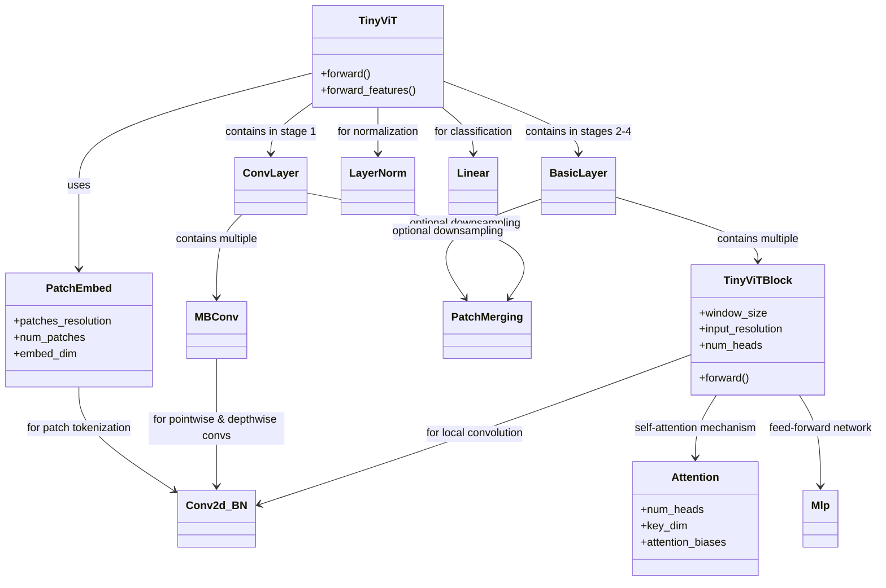
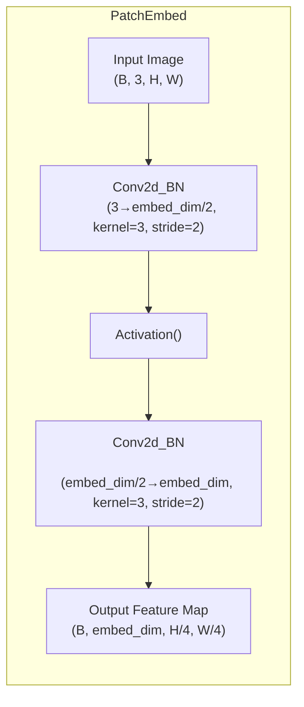
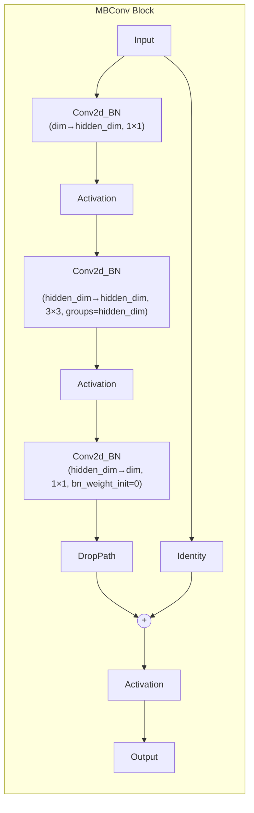
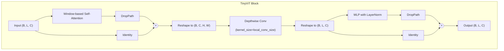
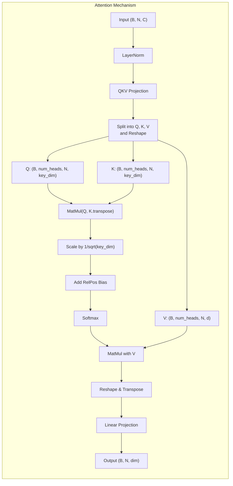
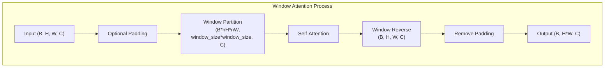
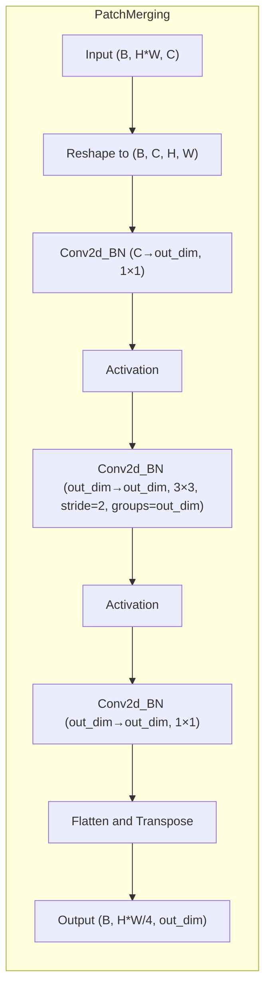
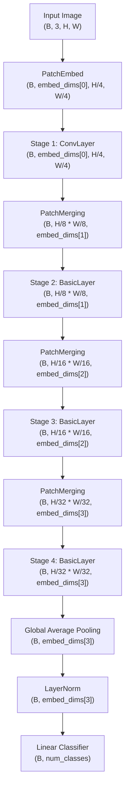
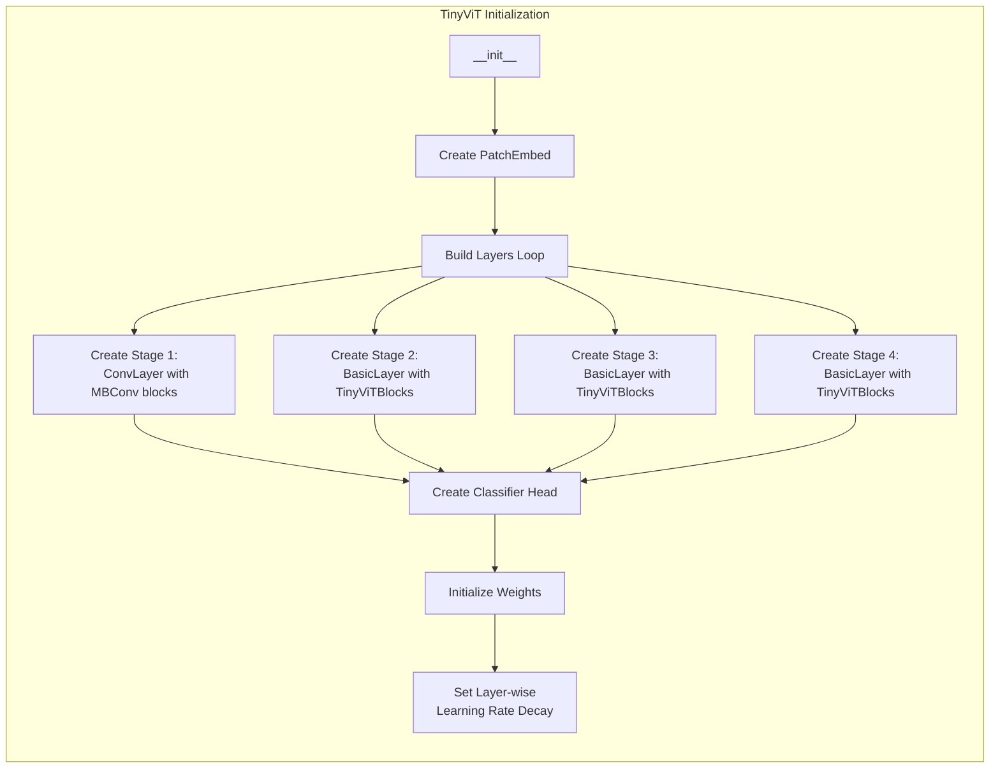

<!-- source: DeepWiki mcp.deepwiki.com · repo microsoft/Cream · extra page TinyViT Architecture · fetched 2026-10-26 -->

# TinyViT Architecture

<details>
<summary>Relevant source files</summary>

The following files were used as context for generating this wiki page:

- [TinyViT/.figure/cat.jpg](TinyViT/.figure/cat.jpg)
- [TinyViT/README.md](TinyViT/README.md)
- [TinyViT/data/__init__.py](TinyViT/data/__init__.py)
- [TinyViT/data/imagenet_classnames.py](TinyViT/data/imagenet_classnames.py)
- [TinyViT/inference.py](TinyViT/inference.py)
- [TinyViT/models/tiny_vit.py](TinyViT/models/tiny_vit.py)
- [TinyViT/tests/test_models.py](TinyViT/tests/test_models.py)

</details>


This document provides a detailed explanation of the TinyViT model architecture. TinyViT is a family of small and efficient Vision Transformers designed for high performance with low parameter counts. For information on the TinyViT training pipeline and distillation process, see [TinyViT Training Pipeline](#2.1.2) and [Fast Distillation Framework](#2.1.3).

## Overview

TinyViT is a hierarchical vision transformer architecture optimized for efficiency while maintaining strong performance. The model family ranges from 5M to 21M parameters while achieving competitive accuracy compared to larger models. TinyViT incorporates several architectural innovations:

1. **Hierarchical Design**: Multi-stage architecture with progressively increased channel dimensions and reduced spatial resolution
2. **Hybrid Architecture**: Combines MBConv blocks (Mobile inverted Bottleneck Convolution) in early stages with transformer blocks in later stages
3. **Window-based Attention**: Efficient local attention computation within windows
4. **Relative Position Encoding**: Integrated directly into the attention mechanism

Sources: [TinyViT/models/tiny_vit.py](TinyViT/models/tiny_vit.py), [TinyViT/README.md](TinyViT/README.md)

## Architectural Overview

TinyViT follows a hierarchical design with 4 stages, where each stage has a specific resolution, channel dimension, and block type.

### High-Level Architecture

```mermaid
flowchart TD
    subgraph "TinyViT Architecture"
        Input["Input Image"] --> PatchEmbed["Patch Embedding
        (H/4 × W/4 resolution)"]
        
        PatchEmbed --> Stage1["Stage 1: ConvLayer
        MBConv Blocks"]
        Stage1 --> Downsample1["Patch Merging
        (H/8 × W/8)"]
        
        Downsample1 --> Stage2["Stage 2: BasicLayer
        Transformer Blocks"]
        Stage2 --> Downsample2["Patch Merging
        (H/16 × W/16)"]
        
        Downsample2 --> Stage3["Stage 3: BasicLayer
        Transformer Blocks"]
        Stage3 --> Downsample3["Patch Merging
        (H/32 × W/32)"]
        
        Downsample3 --> Stage4["Stage 4: BasicLayer
        Transformer Blocks"]
        
        Stage4 --> GlobalPool["Global Average
        Pooling"]
        
        GlobalPool --> NormHead["LayerNorm"]
        NormHead --> ClassifierHead["Linear Classifier"]
    end
```



Sources: [TinyViT/models/tiny_vit.py:453-591](TinyViT/models/tiny_vit.py)

### Model Components Relationship



Sources: [TinyViT/models/tiny_vit.py](TinyViT/models/tiny_vit.py)

## Main Components

### Patch Embedding

The patch embedding layer is the first component of TinyViT, responsible for converting the input image into tokens. Unlike standard Vision Transformers that use a single convolution operation, TinyViT uses a sequence of two strided convolutions to reduce the spatial dimensions by a factor of 4 (2×2) while increasing the channel dimension.



Sources: [TinyViT/models/tiny_vit.py:64-81](TinyViT/models/tiny_vit.py)

### Model Stages

TinyViT consists of 4 stages, each with different channel dimensions and block types:

1. **Stage 1**: Uses MBConv blocks wrapped in a ConvLayer
2. **Stages 2-4**: Use Transformer blocks (TinyViTBlock) wrapped in BasicLayers

The stages are connected by PatchMerging layers that reduce spatial dimensions and increase channel dimensions.

#### Stage 1: ConvLayer with MBConv Blocks

The first stage uses MBConv blocks, which are efficient mobile inverted bottleneck convolution blocks similar to those in MobileNet and EfficientNet architectures.



Sources: [TinyViT/models/tiny_vit.py:84-122](TinyViT/models/tiny_vit.py)

#### Stages 2-4: BasicLayer with TinyViT Blocks

Stages 2-4 use TinyViT Blocks, which are specialized transformer blocks with window-based attention and a local convolution between attention and MLP.



Sources: [TinyViT/models/tiny_vit.py:289-379](TinyViT/models/tiny_vit.py)

### Attention Mechanism

TinyViT uses a specialized attention mechanism with a learned relative position bias. This is more efficient than absolute position embeddings and provides better generalization.



Sources: [TinyViT/models/tiny_vit.py:216-286](TinyViT/models/tiny_vit.py)

### Window-based Attention

TinyViT uses window-based attention to reduce computational complexity. For image regions larger than the window size, the feature map is divided into non-overlapping windows before applying self-attention.



Sources: [TinyViT/models/tiny_vit.py:337-370](TinyViT/models/tiny_vit.py)

### Patch Merging for Downsampling

Between stages, TinyViT uses PatchMerging to reduce spatial resolution and increase channel dimensions:



Sources: [TinyViT/models/tiny_vit.py:125-151](TinyViT/models/tiny_vit.py)

## Model Variants

TinyViT comes in several variants with different parameter counts and configurations:

| Model | Parameters | Embed Dims | Depths | Num Heads | Window Sizes |
|-------|------------|------------|--------|-----------|--------------|
| TinyViT-5M | 5.4M | [64, 128, 160, 320] | [2, 2, 6, 2] | [2, 4, 5, 10] | [7, 7, 14, 7] |
| TinyViT-11M | 11M | [64, 128, 256, 448] | [2, 2, 6, 2] | [2, 4, 8, 14] | [7, 7, 14, 7] |
| TinyViT-21M | 21M | [96, 192, 384, 576] | [2, 2, 6, 2] | [3, 6, 12, 18] | [7, 7, 14, 7] |
| TinyViT-21M-384 | 21M | [96, 192, 384, 576] | [2, 2, 6, 2] | [3, 6, 12, 18] | [12, 12, 24, 12] |
| TinyViT-21M-512 | 21M | [96, 192, 384, 576] | [2, 2, 6, 2] | [3, 6, 12, 18] | [16, 16, 32, 16] |

Sources: [TinyViT/models/tiny_vit.py:641-704](TinyViT/models/tiny_vit.py), [TinyViT/README.md:50-60](TinyViT/README.md)

## Implementation and Usage

The TinyViT model is implemented in the `TinyViT` class found in [TinyViT/models/tiny_vit.py](TinyViT/models/tiny_vit.py). To use a pre-trained TinyViT model for inference:

```python
from models.tiny_vit import tiny_vit_21m_224
model = tiny_vit_21m_224(pretrained=True)

# For inference
model.eval()
output = model(image)  # image shape: [B, 3, 224, 224]
```

The main forward pass of the model consists of the following steps:

1. Patch embedding to convert image into tokens
2. Processing through the 4 stages with different block types
3. Global average pooling of features
4. Normalization and classification

Sources: [TinyViT/models/tiny_vit.py:572-591](TinyViT/models/tiny_vit.py), [TinyViT/inference.py:1-34](TinyViT/inference.py)

## Layer-by-Layer Forward Pass

The following diagram illustrates the detailed forward pass through a TinyViT model, showing the transformation of input data dimensions at each stage:



Sources: [TinyViT/models/tiny_vit.py:572-591](TinyViT/models/tiny_vit.py)

## Layer Construction

TinyViT dynamically constructs its layers based on the model variant specifications. The initialization process builds each stage with the appropriate number of blocks and configurations:



Sources: [TinyViT/models/tiny_vit.py:454-558](TinyViT/models/tiny_vit.py)

## Conclusion

TinyViT is a highly efficient vision transformer architecture that achieves strong performance with a small parameter count. Its hierarchical design, with specialized blocks at different stages, enables it to process visual information efficiently while maintaining high accuracy. The model incorporates several innovations like window-based attention, a hybrid architecture with MBConv blocks, and an efficient downsampling strategy.

The architecture has been demonstrated to achieve up to 84.8% top-1 accuracy on ImageNet-1k with just 21M parameters, and even higher accuracy (86.5%) at higher resolutions.

Sources: [TinyViT/README.md:1-27](TinyViT/README.md), [TinyViT/models/tiny_vit.py](TinyViT/models/tiny_vit.py)

---

