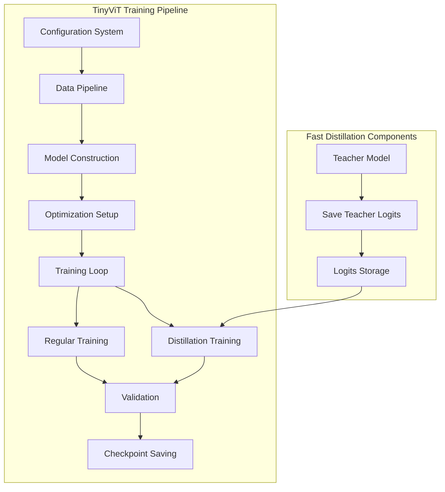
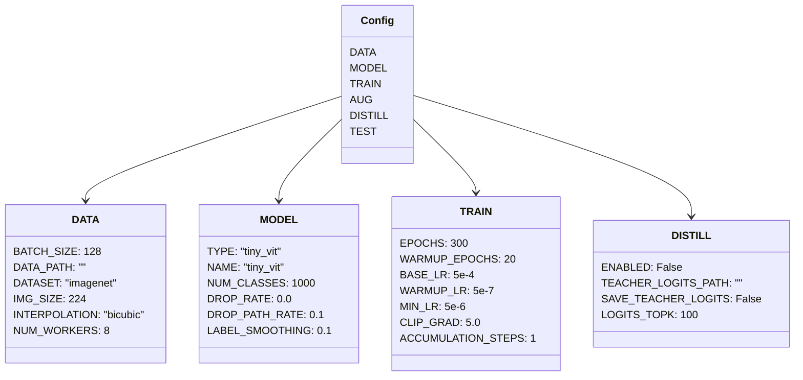
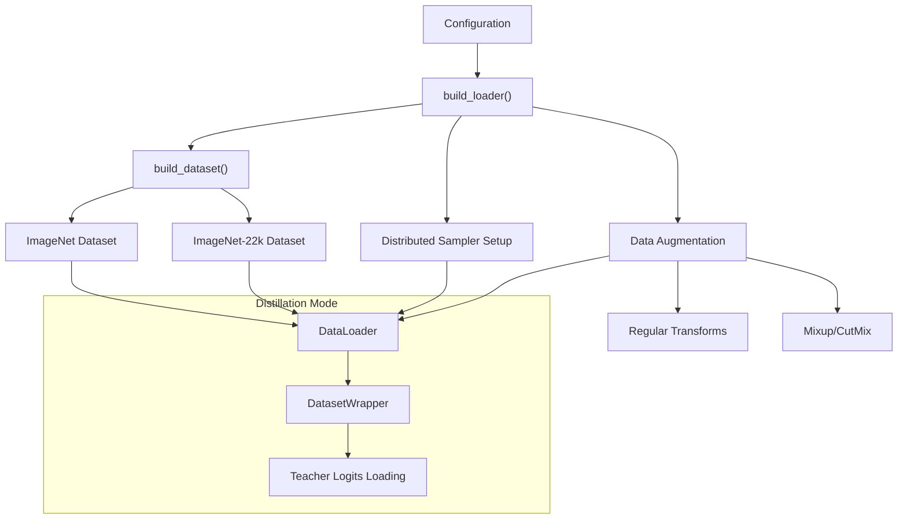
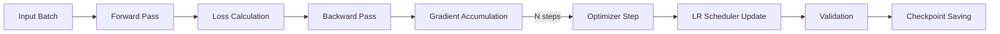
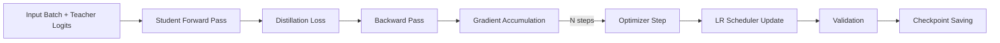
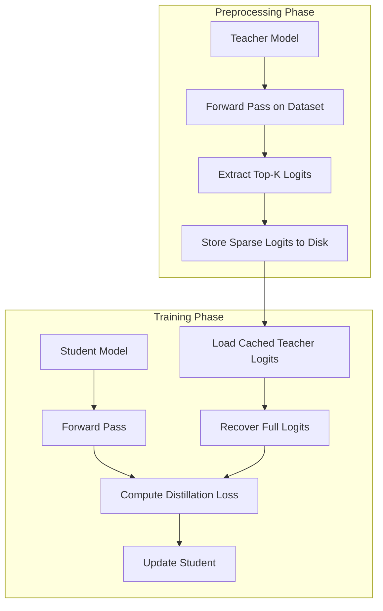
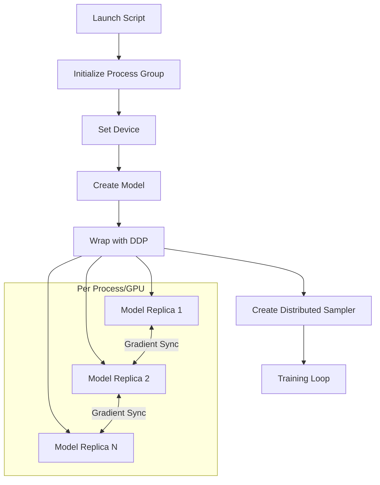

<!-- source: DeepWiki mcp.deepwiki.com · repo microsoft/Cream · extra page TinyViT Training Pipeline · fetched 2026-10-26 -->

# TinyViT Training Pipeline

<details>
<summary>Relevant source files</summary>

The following files were used as context for generating this wiki page:

- [TinyViT/config.py](TinyViT/config.py)
- [TinyViT/data/augmentation/manager.py](TinyViT/data/augmentation/manager.py)
- [TinyViT/data/build.py](TinyViT/data/build.py)
- [TinyViT/data/imagenet22k_dataset.py](TinyViT/data/imagenet22k_dataset.py)
- [TinyViT/docs/TRAINING.md](TinyViT/docs/TRAINING.md)
- [TinyViT/logger.py](TinyViT/logger.py)
- [TinyViT/main.py](TinyViT/main.py)
- [TinyViT/my_meter.py](TinyViT/my_meter.py)
- [TinyViT/requirements.txt](TinyViT/requirements.txt)
- [TinyViT/save_logits.py](TinyViT/save_logits.py)
- [TinyViT/tinyvit_utils.py](TinyViT/tinyvit_utils.py)
- [TinyViT/utils.py](TinyViT/utils.py)

</details>


This document describes the training pipeline for TinyViT models, including regular training and the specialized fast distillation framework. For details about the TinyViT architecture itself, see [TinyViT Architecture](#2.1.1). For an in-depth look at the fast distillation approach, see [Fast Distillation Framework](#2.1.3).

## Overview

The TinyViT training pipeline provides a framework for training efficient vision transformer models. It supports both regular training from scratch and knowledge distillation using stored teacher logits for faster and more efficient training. The pipeline includes distributed training capabilities, mixed precision, gradient accumulation, and other optimization techniques.



Sources: [TinyViT/main.py:57-179](), [TinyViT/docs/TRAINING.md:1-55]()

## Configuration System

The TinyViT training pipeline uses a YACS-based configuration system to manage all training parameters. The configuration is loaded from YAML files and can be overridden by command-line arguments.

### Key Configuration Categories



Sources: [TinyViT/config.py:13-252]()

## Data Pipeline

The data pipeline handles loading and preprocessing of datasets, implementing distributed sampling and augmentations.

### Data Loading Process



The build_loader function sets up the datasets and dataloaders with appropriate transformations, samplers, and workers:

- For regular training, it loads the dataset and applies standard augmentations
- For distillation training, it wraps the dataset in a `DatasetWrapper` which handles loading the saved teacher logits

When `DISTILL.ENABLED` is set to `True`, the data pipeline also loads the cached teacher logits from the specified path.

Sources: [TinyViT/data/build.py:48-112](), [TinyViT/data/imagenet22k_dataset.py:14-69]()

## Training Workflow

TinyViT supports two training workflows: regular training and distillation-based training.

### Regular Training



The regular training pipeline processes batches through the model, calculates the cross-entropy loss, and updates the model weights using the optimizer. Training metrics like accuracy, loss, and gradient norms are tracked during training.

### Distillation Training



In distillation training, the pipeline loads the cached teacher logits alongside the input data. The loss is computed between the student model's predictions and the teacher's logits. This approach speeds up training by eliminating the need to run the teacher model during training.

Sources: [TinyViT/main.py:195-281](), [TinyViT/main.py:284-400]()

## Fast Distillation Framework

The fast distillation framework is a key innovation in TinyViT that speeds up the distillation process by pre-computing and storing teacher model outputs.

### Distillation Process



The fast distillation process consists of two phases:

1. **Preprocessing Phase**: Run the teacher model on the training dataset once, extract the top-K logits (where K is typically 100), and store them efficiently to disk.

2. **Training Phase**: During student model training, load the cached teacher logits for each batch, reconstruct the full probability distribution, and use them to compute the distillation loss.

This approach significantly reduces the computational overhead of traditional distillation by avoiding the need to run both teacher and student models during training.

Sources: [TinyViT/save_logits.py:102-180](), [TinyViT/main.py:284-400]()

## Implementation Details

### Teacher Logits Caching

The logits caching system stores only the top-K values and their indices for each image, significantly reducing storage requirements:

1. For each image, the system extracts:
   - Seeds for consistent augmentation (int32)
   - Indices of top-K logits (int16)
   - Values of top-K logits (float16)

2. During training, the full teacher output distribution is reconstructed:
   ```python
   # Recover full logits from sparse representation
   minor_value = (1.0 - logits_value.sum(-1, keepdim=True)) / (num_classes - topk)
   minor_value = minor_value.repeat_interleave(num_classes, dim=-1)
   outputs_teacher = minor_value.scatter_(-1, logits_index, logits_value)
   ```

This approach distributes the remaining probability mass evenly across non-top-K classes.

Sources: [TinyViT/main.py:325-328](), [TinyViT/save_logits.py:135-145]()

### Distributed Training Integration

The training pipeline seamlessly integrates with PyTorch's Distributed Data Parallel (DDP) framework:



Key distributed training components:
- Initialization with `torch.distributed.init_process_group()`
- Device assignment with `torch.cuda.set_device()`
- Model wrapping with `torch.nn.parallel.DistributedDataParallel`
- Data sharding with `MyDistributedSampler`
- Gradient synchronization handled automatically by DDP

Sources: [TinyViT/main.py:505-513](), [TinyViT/main.py:74-76]()

## Performance Optimization Techniques

The TinyViT training pipeline incorporates several techniques to optimize training performance:

1. **Mixed Precision Training**: Uses PyTorch's automatic mixed precision (AMP) to speed up computation while maintaining training stability.

2. **Gradient Accumulation**: Allows training with effectively larger batch sizes by accumulating gradients over multiple forward-backward passes.

3. **Learning Rate Scaling**: Automatically adjusts learning rates based on batch size and number of GPUs:
   ```python
   linear_scaled_lr = config.TRAIN.BASE_LR * config.DATA.BATCH_SIZE * dist.get_world_size() / 512.0
   ```

4. **Gradient Clipping**: Prevents exploding gradients with a customizable threshold.

Sources: [TinyViT/main.py:81-81](), [TinyViT/main.py:523-537](), [TinyViT/utils.py:282-327]()

## Training Workflows

### Training with Fast Distillation

The recommended approach for training TinyViT models is to use the fast distillation framework:

1. **Save teacher logits**:
   ```bash
   python -m torch.distributed.launch --nproc_per_node 8 save_logits.py --cfg configs/22k_teacher.yaml --data-path ./ImageNet-22k --batch-size 128 --output ./output
   ```

2. **Train with distillation**:
   ```bash
   python -m torch.distributed.launch --nproc_per_node 8 --nnodes=4 --node_rank=$NODE_RANK main.py --cfg configs/22k_distill/tiny_vit_21m_22k_distill.yaml --data-path ./ImageNet-22k --batch-size 128 --output ./output --opts DISTILL.TEACHER_LOGITS_PATH ./teacher_logits/
   ```

3. **Finetune on ImageNet-1k**:
   ```bash
   python -m torch.distributed.launch --nproc_per_node 8 main.py --cfg configs/22kto1k/tiny_vit_21m_22kto1k.yaml --data-path ./ImageNet --batch-size 128 --pretrained ./checkpoints/tiny_vit_21m_22k_distill.pth --output ./output
   ```

Sources: [TinyViT/docs/TRAINING.md:3-55]()

## Debugging and Monitoring

The TinyViT training pipeline includes several features for debugging and monitoring:

1. **Logging System**: Detailed logging with support for console and file output.

2. **Metrics Tracking**: Tracks and reports key metrics including:
   - Training/validation accuracy
   - Loss values
   - Gradient norms
   - Learning rates
   - Memory usage

3. **Wandb Integration**: Optional integration with Weights & Biases for experiment tracking.

4. **Checkpoint Management**: Regular saving of model checkpoints with auto-resume capability.

Sources: [TinyViT/main.py:257-280](), [TinyViT/logger.py:15-44](), [TinyViT/my_meter.py:18-74]()

## Command-line Options

The training pipeline supports numerous command-line options to customize training behavior:

| Option | Description | Default |
|--------|-------------|---------|
| `--cfg` | Path to configuration file | Required |
| `--batch-size` | Batch size per GPU | From config |
| `--data-path` | Path to dataset | From config |
| `--pretrained` | Path to pretrained model | From config |
| `--resume` | Resume from checkpoint | From config |
| `--accumulation-steps` | Gradient accumulation steps | 1 |
| `--use-checkpoint` | Enable gradient checkpointing | False |
| `--output` | Output directory | "output" |
| `--eval` | Run evaluation only | False |
| `--throughput` | Test throughput only | False |
| `--use-wandb` | Use Weights & Biases | False |

Sources: [TinyViT/utils.py:15-54]()

---

