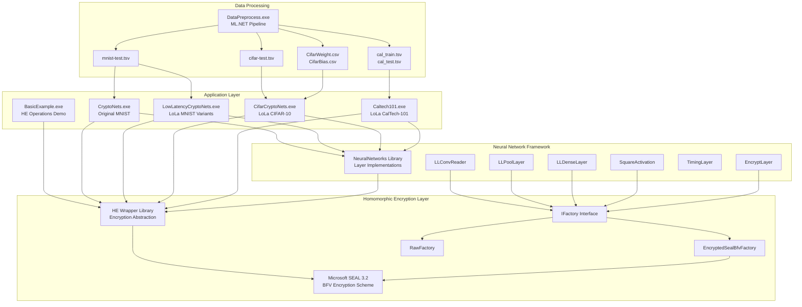
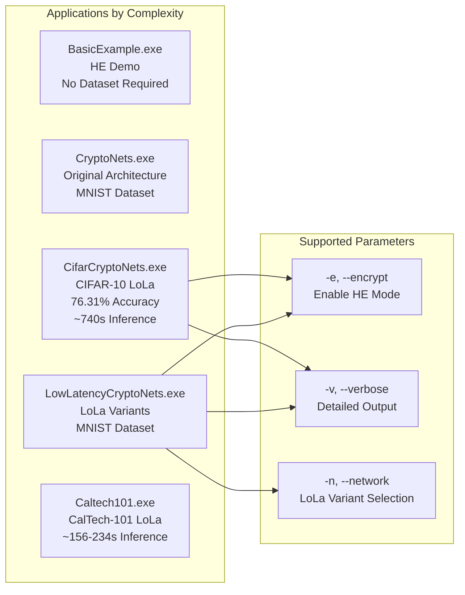
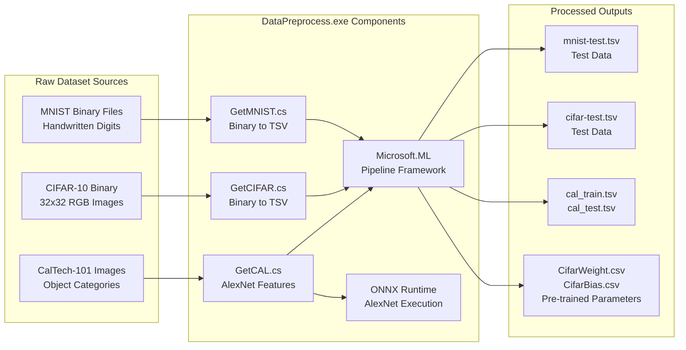

<!-- source: DeepWiki mcp.deepwiki.com · repo microsoft/CryptoNets · page 1 Overview · fetched 2026-10-26 -->

# Overview

Relevant source files

The following files were used as context for generating this wiki page:

- [CifarCryptoNet/LolaCifarCryptoNet.cs](CifarCryptoNet/LolaCifarCryptoNet.cs)
- [README.md](README.md)

This document provides a comprehensive overview of the CryptoNets repository, which demonstrates privacy-preserving neural network inference using homomorphic encryption. CryptoNets enables neural network predictions on encrypted data without ever decrypting it, making it suitable for scenarios where data privacy is critical, such as healthcare or finance applications.

The repository implements the [CryptoNets](http://proceedings.mlr.press/v48/gilad-bachrach16.pdf) and [Low-Latency CryptoNets (LoLa)](https://arxiv.org/abs/1812.10659) architectures across multiple datasets including MNIST, CIFAR-10, and CalTech-101. For detailed information about specific neural network implementations, see [Neural Network Implementations](#3). For data preprocessing workflows, see [Data Preprocessing Pipeline](#2.3).

## System Purpose and Capabilities

CryptoNets addresses the Prediction as a Service (PaaS) use case where users need neural network predictions but cannot share their raw data due to privacy constraints. The system uses Microsoft SEAL 3.2 homomorphic encryption to perform mathematical operations directly on encrypted data, ensuring that sensitive information never exists in plaintext during computation.

The framework supports both encrypted and plaintext modes for development and testing, with the encrypted mode providing full privacy preservation while the plaintext mode enables faster development cycles and debugging.

## High-Level Architecture

The CryptoNets system consists of three primary architectural layers that work together to enable privacy-preserving neural network inference:

**Sources:** [README.md:14-17](), [CifarCryptoNet/LolaCifarCryptoNet.cs:1-170]()

## Core System Components

### Homomorphic Encryption Wrapper

The HE Wrapper provides a high-level abstraction over Microsoft SEAL's homomorphic encryption operations, enabling matrix and vector computations on encrypted data through the `IFactory` interface pattern. The wrapper supports two operational modes:

| Factory Type | Purpose | Use Case |
|--------------|---------|----------|
| `EncryptedSealBfvFactory` | Encrypted operations using SEAL BFV scheme | Production privacy-preserving inference |
| `RawFactory` | Plaintext operations | Development, testing, and debugging |

### Neural Network Framework

The neural network framework implements specialized layers optimized for homomorphic encryption constraints. Key layer types include:

- `LLConvReader`: Input data loading and initial convolution operations
- `LLPoolLayer`: Combined convolution and pooling operations
- `LLDenseLayer`: Fully connected layers with configurable input formats
- `SquareActivation`: Polynomial activation function (f(x) = x²) compatible with HE
- `EncryptLayer`: Data encryption interface between plaintext and encrypted domains
- `TimingLayer`: Performance measurement and benchmarking

### Application Implementations

The system includes five main executable applications, each targeting different use cases and datasets:

**Sources:** [README.md:54-200](), [CifarCryptoNet/LolaCifarCryptoNet.cs:12-18]()

## Data Processing Pipeline

The system uses a Microsoft.ML-based preprocessing pipeline to convert raw datasets into formats suitable for encrypted neural network inference:

**Sources:** [README.md:50-52]()

## Performance Characteristics

The system demonstrates varying performance profiles across different implementations and datasets:

| Implementation | Dataset | Accuracy | Inference Time | Key Features |
|----------------|---------|----------|----------------|--------------|
| CryptoNets | MNIST | ~98.8% | ~27s | Original architecture, SEAL 3.2 |
| LoLa | MNIST | High | ~2014ms | Low-latency optimization |
| LoLa CIFAR-10 | CIFAR-10 | 76.31% | ~740-750s | Complex color image processing |
| LoLa CalTech-101 | CalTech-101 | Variable | ~156-234s | Object recognition categories |

The performance metrics are measured on Azure B8ms reference hardware and include full encryption/decryption cycles when operating in encrypted mode.

**Sources:** [README.md:108-200](), [CifarCryptoNet/LolaCifarCryptoNet.cs:28-30]()

---

