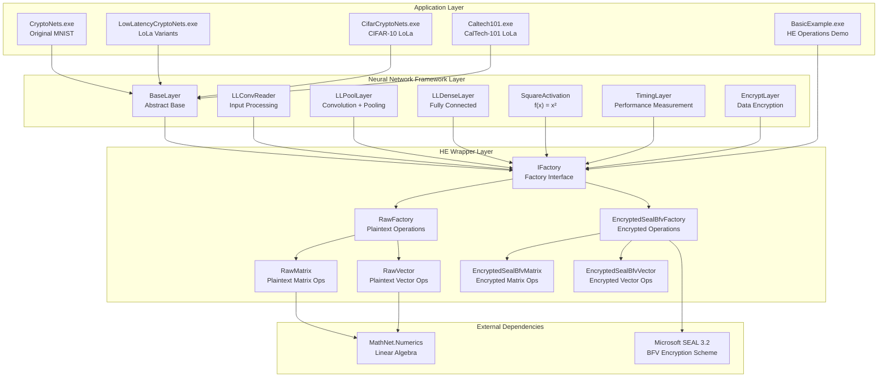
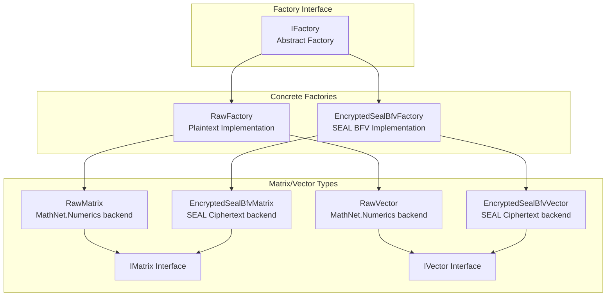
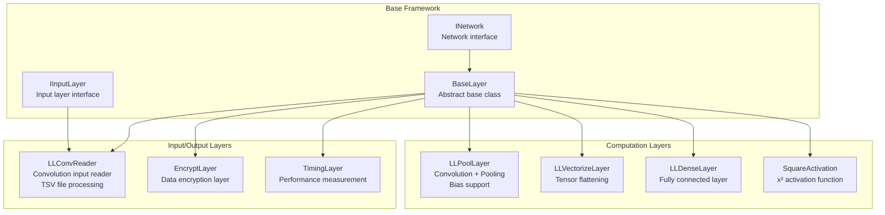
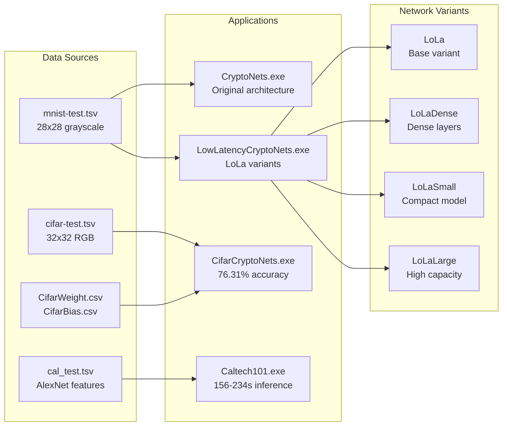
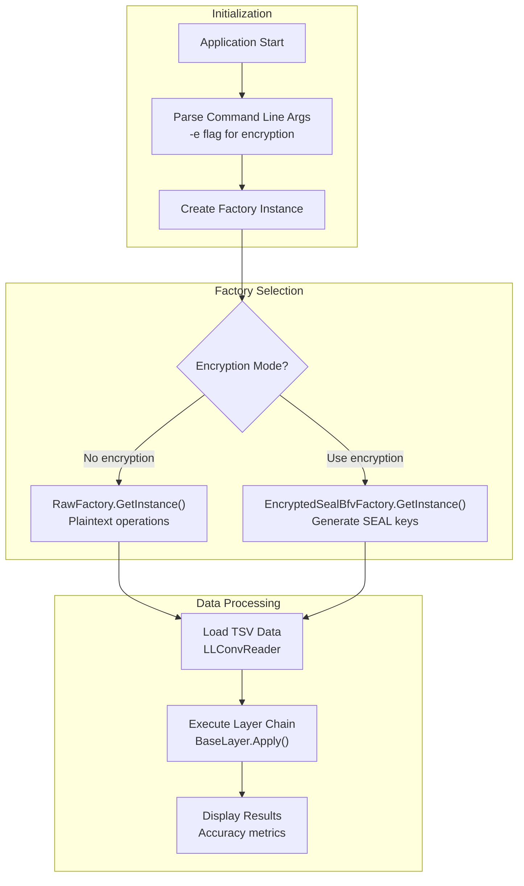
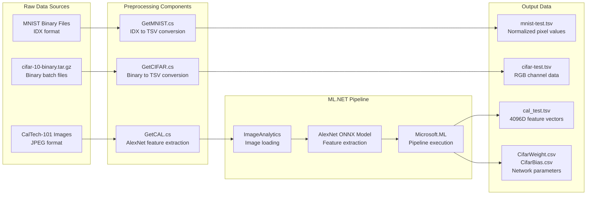

<!-- source: DeepWiki mcp.deepwiki.com · repo microsoft/CryptoNets · page 2 System Architecture · fetched 2026-10-26 -->

# System Architecture

Relevant source files

The following files were used as context for generating this wiki page:

- [DataPreprocess/GetCIFAR.cs](DataPreprocess/GetCIFAR.cs)
- [HE Wrapper/RawMatrix.cs](HE Wrapper/RawMatrix.cs)
- [NeuralNetworks/LLConvReader.cs](NeuralNetworks/LLConvReader.cs)
- [README.md](README.md)

This document provides a comprehensive overview of the CryptoNets system architecture, covering the three core architectural components and their interactions. CryptoNets enables privacy-preserving neural network inference using homomorphic encryption through a layered architecture that abstracts cryptographic operations while maintaining computational efficiency.

For information about specific neural network implementations and their performance characteristics, see [Neural Network Implementations](#3). For usage instructions and command-line parameters, see [Usage and Examples](#4).

## Core Architectural Components

The CryptoNets system is built around three fundamental architectural layers that work together to enable homomorphic encryption-based neural network inference:

### Three-Layer Architecture Overview

Sources: [README.md:14-17](), [HE Wrapper/RawMatrix.cs:12-13](), [NeuralNetworks/LLConvReader.cs:12]()

## Component 1: Homomorphic Encryption Wrapper

The HE Wrapper provides a unified interface for matrix and vector operations that can operate on both plaintext and encrypted data. This abstraction allows the neural network layers to be encryption-agnostic.

### Factory Pattern Implementation

The `RawMatrix` class implements core matrix operations using `MathNet.Numerics.LinearAlgebra` as the computational backend. Key operations include:

| Operation | Method | Purpose |
|-----------|--------|---------|
| Matrix-Vector Multiplication | `Mul(IVector v, IComputationEnvironment env)` | Core neural network computation |
| Element-wise Multiplication | `ElementWiseMultiply(IMatrix m, IComputationEnvironment env)` | Activation functions |
| Matrix Addition | `Add(IMatrix m, IComputationEnvironment env)` | Bias addition |
| Matrix Interleaving | `Interleave(int shift, IComputationEnvironment env)` | Convolution operations |

Sources: [HE Wrapper/RawMatrix.cs:12-174](), [README.md:15]()

## Component 2: Neural Network Framework

The neural network framework provides layer implementations that operate transparently on both encrypted and plaintext data through the HE Wrapper interface.

### Layer Hierarchy and Specialization

The `LLConvReader` class demonstrates the framework's approach to input processing, supporting both sparse and dense data formats while handling convolution-specific data layout:

- **Sparse Format**: `label:dimension:index:value` pairs from TSV files
- **Dense Format**: Tab-separated values with configurable label column
- **Convolution Mapping**: Transforms input vectors into convolution matrices using `ConvolutionEngine`

Sources: [NeuralNetworks/LLConvReader.cs:12-164](), [README.md:16]()

## Component 3: Application Implementations

The application layer contains specific neural network implementations that combine the HE Wrapper and Neural Network Framework to solve different classification problems.

### Application Architecture and Data Flow

### Performance Characteristics

| Application | Dataset | Inference Time | Accuracy | Key Features |
|-------------|---------|----------------|----------|--------------|
| `CryptoNets.exe` | MNIST | ~27 seconds | 98.7% | Original architecture, SEAL 3.2 |
| `LowLatencyCryptoNets.exe` | MNIST | ~2000ms | High | Multiple LoLa variants |
| `CifarCryptoNets.exe` | CIFAR-10 | ~740 seconds | 76.31% | Color image classification |
| `Caltech101.exe` | CalTech-101 | 156-234 seconds | Varies | Object recognition |

Sources: [README.md:19-21](), [README.md:136-139](), [README.md:148-171]()

## System Execution Flow

The system follows a consistent execution pattern across all applications, with mode selection determining whether operations occur on plaintext or encrypted data.

### Execution Mode Selection

### Layer Execution Chain

The neural network layers execute in a pipeline, with each layer's output becoming the next layer's input:

1. **`LLConvReader`**: Reads TSV data and converts to convolution format
2. **`EncryptLayer`** (encrypted mode only): Encrypts input data
3. **`LLPoolLayer`**: Applies convolution and pooling operations  
4. **`SquareActivation`**: Applies polynomial activation function
5. **`LLDenseLayer`**: Performs fully connected layer computation
6. **`TimingLayer`**: Records performance metrics

Sources: [README.md:82-104](), [README.md:117-132](), [DataPreprocess/GetCIFAR.cs:32-53]()

## Data Preprocessing Integration

The system includes a comprehensive data preprocessing pipeline implemented in `DataPreprocess.exe` that prepares datasets for the neural network applications.

### Preprocessing Pipeline Architecture

The `GetCIFAR` class exemplifies the preprocessing approach, reading binary data and converting it to the TSV format expected by the neural network layers. The conversion process handles the CIFAR-10 data layout where each record contains a label byte followed by 3072 bytes (32×32×3 RGB values).

Sources: [DataPreprocess/GetCIFAR.cs:14-54](), [README.md:50-52]()

---

