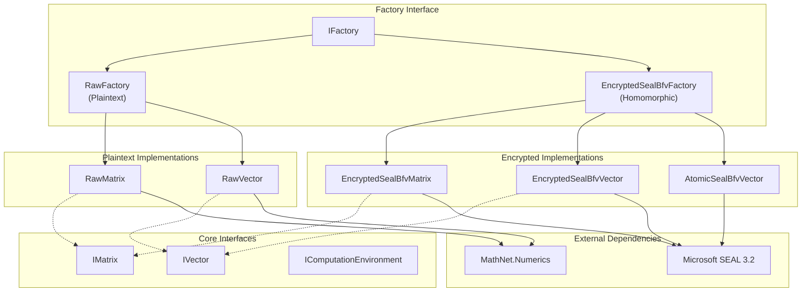
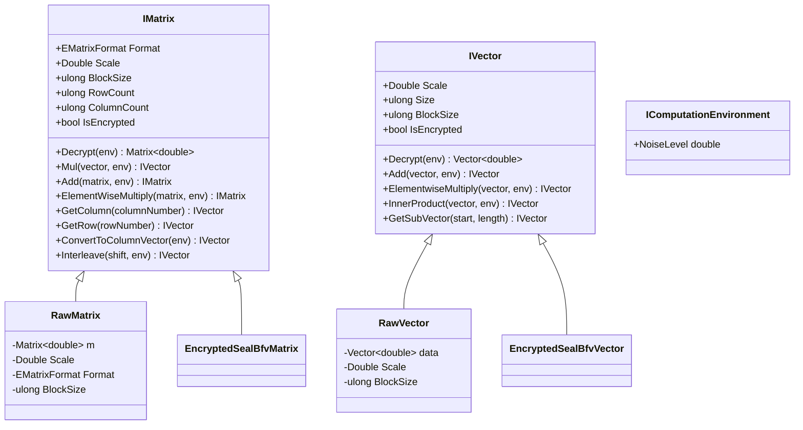
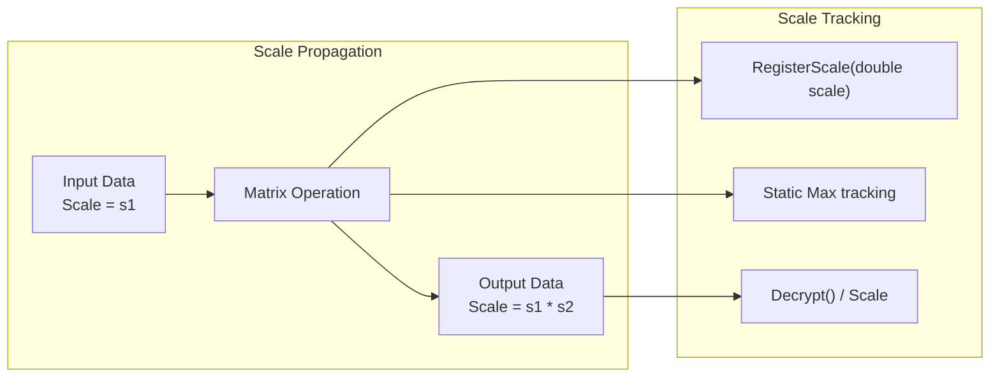
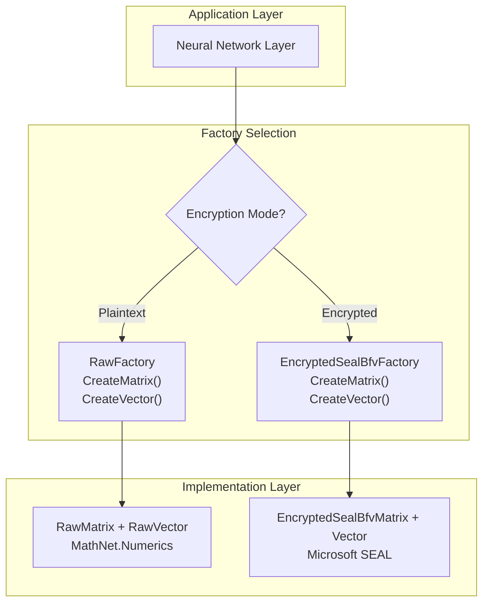

<!-- source: DeepWiki mcp.deepwiki.com · repo microsoft/CryptoNets · page 2.1 Homomorphic Encryption Wrapper · fetched 2026-10-26 -->

# Homomorphic Encryption Wrapper

Relevant source files

The following files were used as context for generating this wiki page:

- [HE Wrapper Tests/HE Wrapper Tests.csproj](HE Wrapper Tests/HE Wrapper Tests.csproj)
- [HE Wrapper/HE Wrapper.csproj](HE Wrapper/HE Wrapper.csproj)
- [HE Wrapper/RawMatrix.cs](HE Wrapper/RawMatrix.cs)

The Homomorphic Encryption Wrapper provides a unified interface for matrix and vector operations that can be performed on both plaintext and homomorphically encrypted data. This component serves as the foundational cryptographic layer for the CryptoNets neural network implementations, abstracting Microsoft SEAL's BFV encryption scheme behind standard linear algebra operations.

The wrapper enables seamless switching between plaintext and encrypted computation modes through a factory pattern, allowing neural network layers to operate identically regardless of whether data is encrypted or not. For information about the neural network layers that use this wrapper, see [Neural Network Framework](#2.2). For details about specific neural network implementations, see [Neural Network Implementations](#3).

## Architecture Overview

The HE Wrapper implements a factory-based architecture that provides identical interfaces for both encrypted and plaintext operations:

**Sources:** [HE Wrapper/HE Wrapper.csproj:80-94](), [HE Wrapper/RawMatrix.cs:1-175]()

## Core Interfaces and Data Structures

The wrapper defines three primary interfaces that establish the contract for all matrix and vector operations:

### Interface Hierarchy

**Sources:** [HE Wrapper/RawMatrix.cs:12-175](), [HE Wrapper/HE Wrapper.csproj:88-90]()

## Matrix Operations and Scaling

The `RawMatrix` class implements plaintext matrix operations using MathNet.Numerics as the underlying mathematical library. Key features include:

| Operation | Method | Description |
|-----------|--------|-------------|
| Matrix-Vector Multiplication | `Mul(IVector v, IComputationEnvironment env)` | Multiplies matrix by vector, handling scale propagation |
| Element-wise Multiplication | `ElementWiseMultiply(IMatrix m, IComputationEnvironment env)` | Point-wise multiplication with format validation |
| Matrix Addition | `Add(IMatrix m, IComputationEnvironment env)` | Addition with scale and dimension validation |
| Column/Row Extraction | `GetColumn(int columnNumber)` / `GetRow(int rowNumber)` | Extract vectors respecting matrix format |
| Vectorization | `ConvertToColumnVector(IComputationEnvironment env)` | Flatten matrix to column vector |
| Interleaving | `Interleave(int shift, IComputationEnvironment env)` | Shift-and-add operation for convolution |

### Scaling and Precision Management

The wrapper implements a scaling system to maintain precision when working with integer-based homomorphic encryption:

**Sources:** [HE Wrapper/RawMatrix.cs:23-30](), [HE Wrapper/RawMatrix.cs:128-131](), [HE Wrapper/RawMatrix.cs:34-39]()

## Factory Pattern Implementation

The wrapper uses the factory pattern to enable runtime selection between plaintext and encrypted computation modes:

This pattern allows identical neural network code to operate on both plaintext and encrypted data by simply changing the factory instance used for matrix and vector creation.

**Sources:** [HE Wrapper/HE Wrapper.csproj:85]()

## Serialization and Persistence

The wrapper provides serialization capabilities for both matrices and vectors through `Read` and `Write` methods:

| Component | Read Method | Write Method | Format |
|-----------|-------------|--------------|--------|
| RawMatrix | `Read(StreamReader str)` | `Write(StreamWriter str)` | Scale + Delimited Matrix + BlockSize |
| RawVector | Similar pattern | Similar pattern | Scale + Delimited Vector + BlockSize |

The serialization format preserves scaling information and block size parameters necessary for homomorphic operations.

**Sources:** [HE Wrapper/RawMatrix.cs:42-53](), [HE Wrapper/RawMatrix.cs:59-64]()

## Dependencies and Build Configuration

The HE Wrapper project has the following key dependencies:

| Dependency | Version | Purpose |
|------------|---------|---------|
| Microsoft.Research.SEALNet | 3.2.0 | Homomorphic encryption operations |
| MathNet.Numerics | 4.8.1 | Linear algebra for plaintext operations |
| MathNet.Numerics.Data.Text | 4.0.0 | Matrix/vector file I/O |
| MathNet.Numerics.MKL.Win-x64 | 2.3.0 | Optimized mathematical operations |

The project supports both Debug and Release configurations with x64 platform targeting for optimal performance with the mathematical libraries.

**Sources:** [HE Wrapper/HE Wrapper.csproj:54-78](), [HE Wrapper/HE Wrapper.csproj:100-108]()

## Testing Infrastructure

The HE Wrapper includes comprehensive testing through the HE Wrapper Tests project:

| Test Category | Purpose |
|---------------|---------|
| BasicOperations | Test encrypted homomorphic operations |
| BasicRawOperations | Test plaintext mathematical operations |
| BudgetAnalysis | Analyze encryption noise budget consumption |

**Sources:** [HE Wrapper Tests/HE Wrapper Tests.csproj:81-84]()

---

